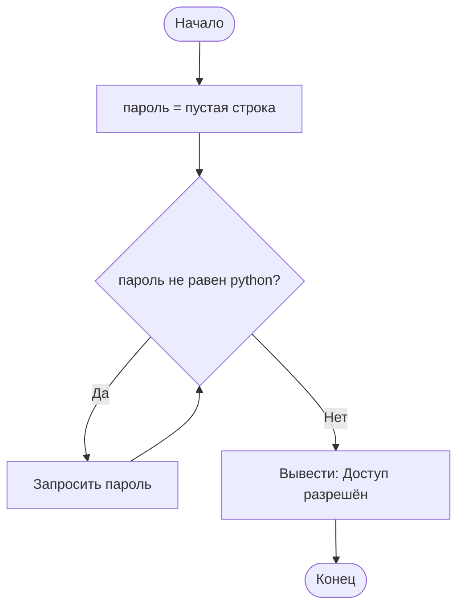
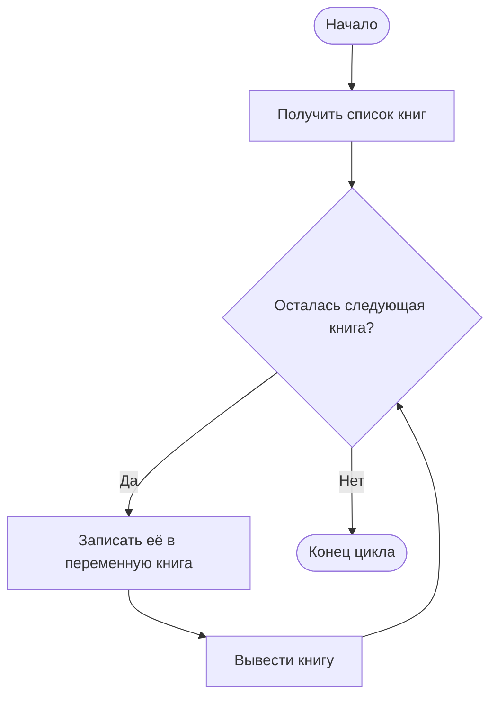
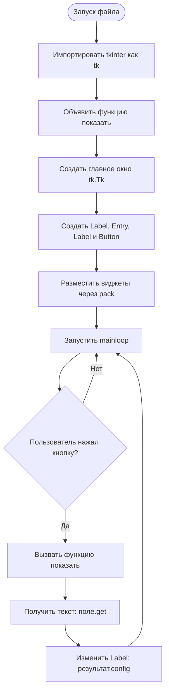
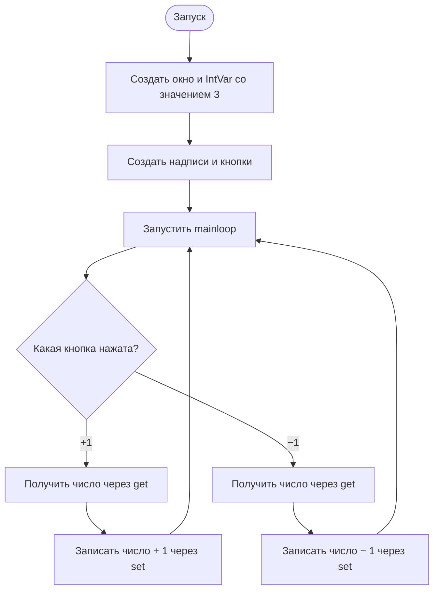
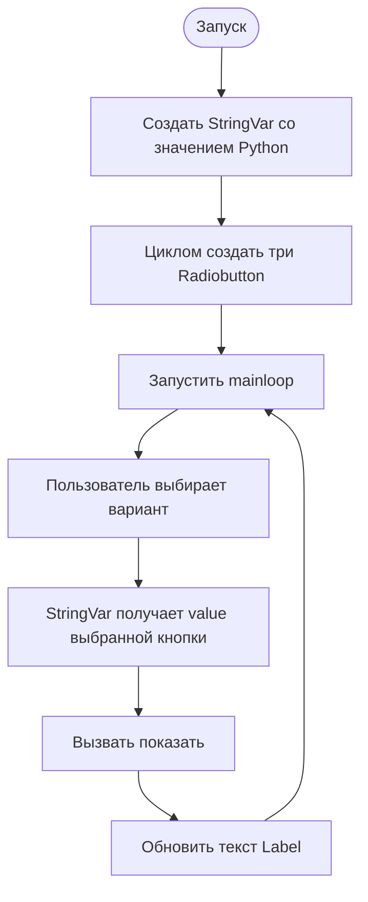
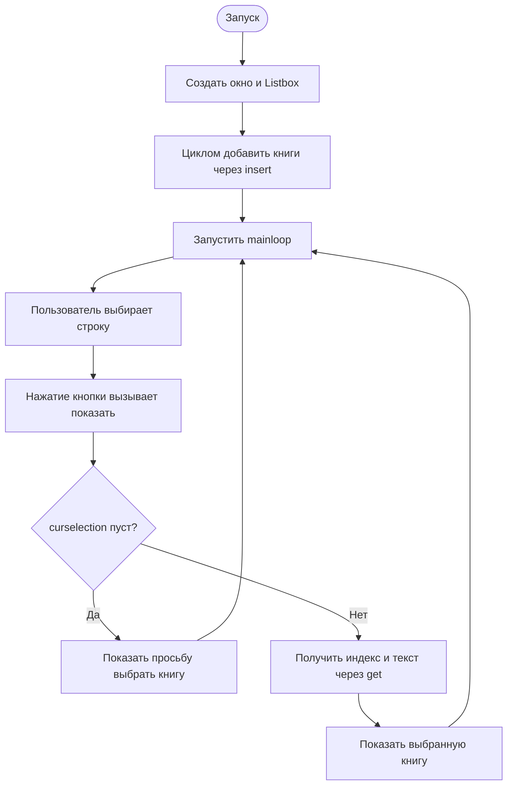
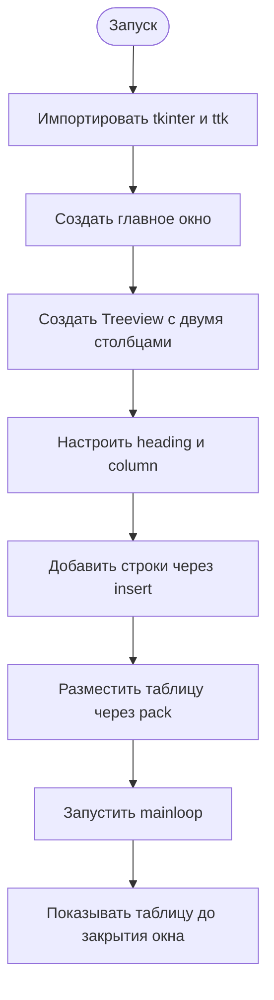
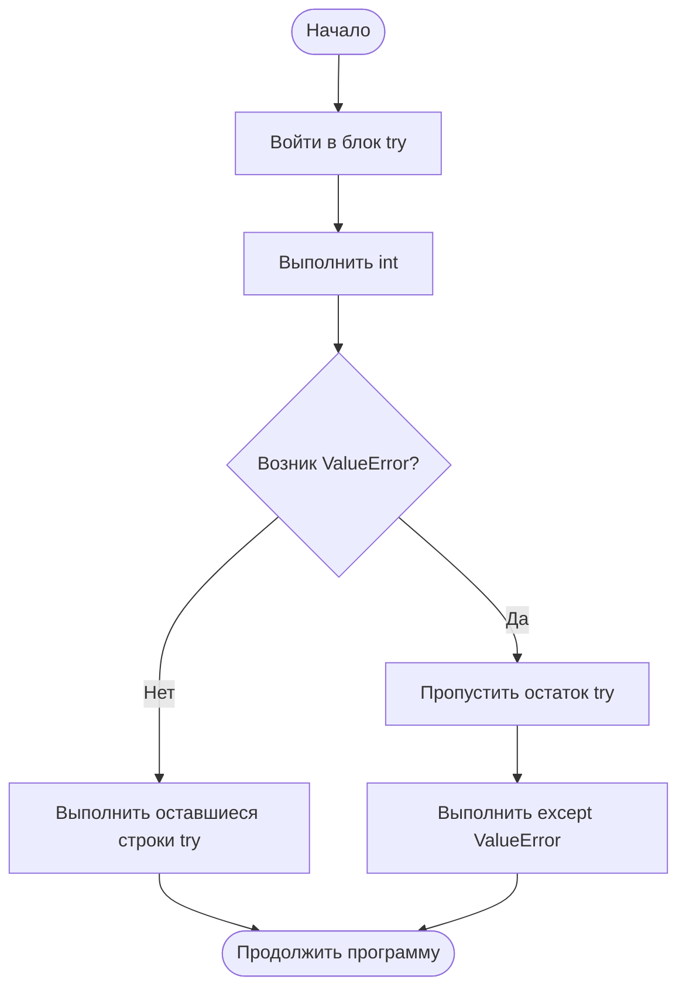
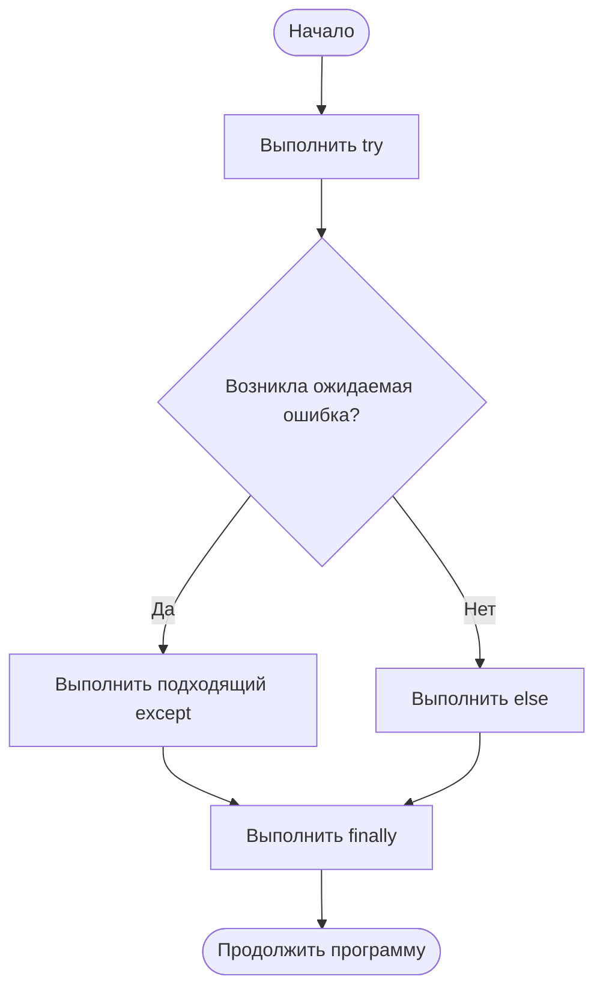

# УП 12 Основы Python, pgAdmin, Tkinter

# Основы Python: пошаговый самоучитель на 420 минут

Это семичасовое занятие: **7 блоков × 60 минут**. В каждом блоке сначала запускается готовый код, затем разбираются компоненты и выполняются задания от простого к сложному. Не переходите дальше, пока не можете объяснить текущий код построчно.

## Логический порядок тем

Материал изучается только сверху вниз:

```text
print и порядок строк
        ↓
значения, типы и переменные
        ↓
input и преобразование типов
        ↓
строки и их методы
        ↓
if / elif / else
        ↓
while → for → различие циклов
        ↓
списки и обработка нескольких значений
        ↓
функции
        ↓
try / except / else / finally
        ↓
объекты Tkinter без изучения ООП
        ↓
первое графическое приложение
```

ООП, создание собственных классов и наследование не входят в обязательный маршрут этого дня. Слово «объект» используется только практически: Python создал окно или поле, переменная указывает на него, а через точку вызывается его действие.

## Режим одного 60-минутного блока

- 0–10 минут — перепечатать и запустить пример;
- 10–20 минут — разобрать строки и провести эксперименты;
- 20–40 минут — задания 1–6;
- 40–55 минут — задания 7–9;
- 55–60 минут — мини-проект №10 и краткое объяснение результата.

## Блок 1. Вывод, значения и первые эксперименты — 60 минут

### Код, который можно скопировать

```python
print("Привет, Python!")
print(2 + 3)
print("Книга:", "Мастер и Маргарита")
print("*" * 20)
```

### Что за что отвечает

- print() выводит значения в консоль.
- Через запятую можно передать несколько значений.
- Python вычисляет 2 + 3 до вывода.
- Умножение строки повторяет её.

### Пошаговый запуск

- [ ] Создайте отдельный файл для блока.
- [ ] Перепечатайте код и предскажите результат.
- [ ] Запустите пример минимум три раза с разными данными.
- [ ] Меняйте по одной строке и наблюдайте изменение.
- [ ] Намеренно создайте ошибку и прочитайте последнюю строку traceback.

### Задания: от простого к сложному

1. **Простое.** Смените приветствие.
   - **Input:** `текст: Добро пожаловать!`
   - **Output — точный ожидаемый результат:**

     ```text
     Добро пожаловать!
     ```
2. **Простое.** Выведите имя, город и профессию отдельными строками.
   - **Input:** `Анна; Москва; программист`
   - **Output — точный ожидаемый результат:**

     ```text
     Анна
     Москва
     программист
     ```
3. **Простое.** Получите результаты +, -, *, / для двух чисел.
   - **Input:** `числа: 12 и 4`
   - **Output — точный ожидаемый результат:**

     ```text
     Сумма: 16
     Разность: 8
     Произведение: 48
     Частное: 3.0
     ```
4. **Усложнённое.** Создайте разделитель из 30 знаков =.
   - **Input:** `символ =, количество 30`
   - **Output — точный ожидаемый результат:**

     ```text
     ==============================
     ```
5. **Усложнённое.** Нарисуйте прямоугольник 10×4 из символов.
   - **Input:** `символ #, ширина 10, высота 4`
   - **Output — точный ожидаемый результат:**

     ```text
     ##########
     ##########
     ##########
     ##########
     ```
6. **Усложнённое.** Выведите меню из пяти пунктов.
   - **Input:** `пункты: Каталог, Поиск, Добавить, Удалить, Выход`
   - **Output — точный ожидаемый результат:**

     ```text
     1. Каталог
     2. Поиск
     3. Добавить
     4. Удалить
     5. Выход
     ```
7. **Усложнённое.** Предскажите вывод print('5' + '5') и print(5 + 5).
   - **Input:** `выражения: '5' + '5' и 5 + 5`
   - **Output — точный ожидаемый результат:**

     ```text
     55
     10
     ```
8. **Сложное.** Исправьте три ошибки: пропущенную кавычку, скобку и запятую.
   - **Input:** `код с незакрытой строкой print("Привет)`
   - **Output — точный ожидаемый результат:**

     ```text
     Привет
     ```
9. **Сложное.** Создайте ASCII-визитку.
   - **Input:** `Анна, Python-разработчик, anna@example.ru`
   - **Output — точный ожидаемый результат:**

     ```text
     ========================
     Анна
     Python-разработчик
     anna@example.ru
     ========================
     ```
10. **Мини-проект.** Мини-проект: оформите консольную обложку курса.
   - **Input:** `название курса и три раздела`
   - **Output — точный ожидаемый результат:**

     ```text
     ================================
     УП 12
     Python → Tkinter → PostgreSQL
     ================================
     ```
### Самопроверка

- [ ] Я могу написать минимальный пример без копирования.
- [ ] Я знаю, откуда взялось каждое имя.
- [ ] Я могу предсказать порядок выполнения.
- [ ] Я выполнил мини-проект и объяснил его.

---

## Блок 2. Переменные и типы — 60 минут

### Код, который можно скопировать

```python
название = "Капитанская дочка"
год = 1836
цена = 450.50
в_наличии = True
print(название, год, цена, в_наличии)
print(type(название), type(год), type(цена), type(в_наличии))
```

### Что за что отвечает

- Переменная связывает имя со значением.
- str, int, float и bool — разные типы.
- type() показывает тип.
- Значение переменной можно заменить.

### Пошаговый запуск

- [ ] Создайте отдельный файл для блока.
- [ ] Перепечатайте код и предскажите результат.
- [ ] Запустите пример минимум три раза с разными данными.
- [ ] Меняйте по одной строке и наблюдайте изменение.
- [ ] Намеренно создайте ошибку и прочитайте последнюю строку traceback.

### Задания: от простого к сложному

1. **Простое.** Создайте четыре переменные о себе и выведите их значения.

   В этом задании `input()` пока использовать не нужно. Слово **Input** означает исходные значения, которые необходимо самостоятельно записать в переменные.

   - **Input — исходные значения:** имя — `Анна`, возраст — `18`, город — `Москва`, изучает Python — `True`.
   - **Имена переменных:** `имя`, `возраст`, `город`, `изучает_python`.

   **Заготовка:**

   ```python
   имя = "Анна"
   возраст = 18
   город = "Москва"
   изучает_python = True

   print(имя)
   print(возраст)
   print(город)
   print(изучает_python)
   ```

   - **Output — точный ожидаемый результат:**

     ```text
     Анна
     18
     Москва
     True
     ```

   После успешного запуска замените значения своими данными. Например, вместо `Анна` укажите собственное имя.
2. **Простое.** Создайте карточку книги.
   - **Input:** `Идиот; Достоевский; 1869; 450.0`
   - **Output — точный ожидаемый результат:**

     ```text
     Название: Идиот
     Автор: Достоевский
     Год: 1869
     Цена: 450.0
     ```
3. **Простое.** Перезапишите цену и покажите старое и новое значение.
   - **Input:** `старая цена 450, новая 499`
   - **Output — точный ожидаемый результат:**

     ```text
     Старая цена: 450
     Новая цена: 499
     ```
4. **Усложнённое.** Поменяйте значения двух переменных.
   - **Input:** `a = 5, b = 9`
   - **Output — точный ожидаемый результат:**

     ```text
     a = 9
     b = 5
     ```
5. **Усложнённое.** Проверьте тип десяти разных значений.
   - **Input:** `10, 10.0, '10', True, None и ещё пять значений`
   - **Output — точный ожидаемый результат:**

     ```text
     int
     float
     str
     bool
     NoneType
     list
     dict
     tuple
     set
     complex
     ```
6. **Усложнённое.** Найдите допустимые и недопустимые имена.
   - **Input:** `имена: reader_name, 2book, class`
   - **Output — точный ожидаемый результат:**

     ```text
     reader_name — допустимое
     2book — недопустимое: начинается с цифры
     class — недопустимое: служебное слово
     ```
7. **Усложнённое.** Замените x, a, b понятными именами.
   - **Input:** `x='Идиот', a=1869, b=450`
   - **Output — точный ожидаемый результат:**

     ```text
     название = Идиот
     год = 1869
     цена = 450
     ```
8. **Сложное.** Объясните отличие 10, 10.0 и '10'.
   - **Input:** `10; 10.0; '10'`
   - **Output — точный ожидаемый результат:**

     ```text
     10 → int
     10.0 → float
     '10' → str
     ```
9. **Сложное.** Создайте карточки трёх товаров.
   - **Input:** `три товара с названием и ценой`
   - **Output — точный ожидаемый результат:**

     ```text
     Товар: Книга, цена: 450
     Товар: Журнал, цена: 200
     Товар: Альбом, цена: 350
     ```
10. **Мини-проект.** Мини-проект: паспорт библиотечной книги из восьми полей.
   - **Input:** `8 полей книги`
   - **Output — точный ожидаемый результат:**

     ```text
     Название: Идиот
     Автор: Достоевский
     Год: 1869
     Жанр: роман
     Цена: 450.0
     В наличии: True
     ISBN: 9780000000001
     Полка: A-12
     ```
### Самопроверка

- [ ] Я могу написать минимальный пример без копирования.
- [ ] Я знаю, откуда взялось каждое имя.
- [ ] Я могу предсказать порядок выполнения.
- [ ] Я выполнил мини-проект и объяснил его.

---

## Блок 3. Ввод, числа и вычисления — 60 минут

### Код, который можно скопировать

```python
цена = float(input("Цена книги: "))
количество = int(input("Количество: "))
стоимость = цена * количество
print(f"К оплате: {стоимость:.2f} руб.")
```

### Что за что отвечает

- input() всегда возвращает строку.
- int() и float() преобразуют текст в число.
- Результат вычисления сохраняется отдельно.
- :.2f показывает два знака после запятой.

### Пошаговый запуск

- [ ] Создайте отдельный файл для блока.
- [ ] Перепечатайте код и предскажите результат.
- [ ] Запустите пример минимум три раза с разными данными.
- [ ] Меняйте по одной строке и наблюдайте изменение.
- [ ] Намеренно создайте ошибку и прочитайте последнюю строку traceback.

### Задания: от простого к сложному

1. **Простое.** Спросите имя и поприветствуйте пользователя.
   - **Input:** `Анна`
   - **Output — точный ожидаемый результат:**

     ```text
     Привет, Анна!
     ```
2. **Простое.** Посчитайте возраст через 5 лет.
   - **Input:** `18`
   - **Output — точный ожидаемый результат:**

     ```text
     Через 5 лет вам будет 23
     ```
3. **Простое.** Сложите два введённых числа.
   - **Input:** `12 и 8`
   - **Output — точный ожидаемый результат:**

     ```text
     Сумма: 20
     ```
4. **Усложнённое.** Рассчитайте площадь прямоугольника.
   - **Input:** `ширина 5, высота 3`
   - **Output — точный ожидаемый результат:**

     ```text
     Площадь: 15
     ```
5. **Усложнённое.** Переведите минуты в часы и минуты.
   - **Input:** `135 минут`
   - **Output — точный ожидаемый результат:**

     ```text
     2 часа 15 минут
     ```
6. **Усложнённое.** Создайте конвертер рублей в условную валюту.
   - **Input:** `1000 рублей, курс 100`
   - **Output — точный ожидаемый результат:**

     ```text
     10.0 единиц валюты
     ```
7. **Усложнённое.** Рассчитайте среднее трёх оценок.
   - **Input:** `5, 4, 3`
   - **Output — точный ожидаемый результат:**

     ```text
     Среднее: 4.0
     ```
8. **Сложное.** Добавьте процент скидки.
   - **Input:** `цена 1000, скидка 15%`
   - **Output — точный ожидаемый результат:**

     ```text
     Цена без скидки: 1000
     Скидка: 150.0
     К оплате: 850.0
     ```
9. **Сложное.** Сравните ошибку без int() и правильный вариант.
   - **Input:** `строки '2' и '3'`
   - **Output — точный ожидаемый результат:**

     ```text
     Без int(): 23
     С int(): 5
     ```
10. **Мини-проект.** Мини-проект: чек покупки из названия, цены, количества и скидки.
   - **Input:** `Книга; 500; 3; 10%`
   - **Output — точный ожидаемый результат:**

     ```text
     Товар: Книга
     Цена: 500
     Количество: 3
     Скидка: 10%
     Итого: 1350.0
     ```
### Самопроверка

- [ ] Я могу написать минимальный пример без копирования.
- [ ] Я знаю, откуда взялось каждое имя.
- [ ] Я могу предсказать порядок выполнения.
- [ ] Я выполнил мини-проект и объяснил его.

---

## Блок 4. Строки и методы — 60 минут

### Код, который можно скопировать

```python
текст = "  Python и Tkinter  "
чистый = текст.strip()
print(чистый)
print(чистый.lower())
print(чистый.upper())
print(чистый.replace("Tkinter", "PostgreSQL"))
print(len(чистый))
```

### Что за что отвечает

- strip() убирает внешние пробелы.
- lower() и upper() меняют регистр в новом результате.
- replace() заменяет фрагмент.
- len() возвращает длину.
- Методы вызываются через точку — как get() и config() в Tkinter.

### Пошаговый запуск

- [ ] Создайте отдельный файл для блока.
- [ ] Перепечатайте код и предскажите результат.
- [ ] Запустите пример минимум три раза с разными данными.
- [ ] Меняйте по одной строке и наблюдайте изменение.
- [ ] Намеренно создайте ошибку и прочитайте последнюю строку traceback.

### Задания: от простого к сложному

1. **Простое.** Удалите пробелы у введённого имени.
   - **Input:** `'  Анна  '`
   - **Output — точный ожидаемый результат:**

     ```text
     Анна
     ```
2. **Простое.** Приведите логин к нижнему регистру.
   - **Input:** `'User_Name'`
   - **Output — точный ожидаемый результат:**

     ```text
     user_name
     ```
3. **Простое.** Замените слово в предложении.
   - **Input:** `'Я изучаю Java'; Java → Python`
   - **Output — точный ожидаемый результат:**

     ```text
     Я изучаю Python
     ```
4. **Усложнённое.** Посчитайте длину названия книги.
   - **Input:** `'Капитанская дочка'`
   - **Output — точный ожидаемый результат:**

     ```text
     Длина названия: 19
     ```
5. **Усложнённое.** Получите первый и последний символ.
   - **Input:** `'Python'`
   - **Output — точный ожидаемый результат:**

     ```text
     Первый символ: P
     Последний символ: n
     ```
6. **Усложнённое.** Сделайте срез первых пяти символов.
   - **Input:** `'PostgreSQL'`
   - **Output — точный ожидаемый результат:**

     ```text
     Postg
     ```
7. **Усложнённое.** Разверните строку срезом.
   - **Input:** `'Python'`
   - **Output — точный ожидаемый результат:**

     ```text
     nohtyP
     ```
8. **Сложное.** Посчитайте слова через split().
   - **Input:** `'Python легко изучать'`
   - **Output — точный ожидаемый результат:**

     ```text
     Количество слов: 3
     ```
9. **Сложное.** Проверьте палиндром после нормализации.
   - **Input:** `' А роза упала на лапу Азора '`
   - **Output — точный ожидаемый результат:**

     ```text
     Палиндром: True
     ```
10. **Мини-проект.** Мини-проект: очистка пользовательской карточки — имя, email и название книги.
   - **Input:** `' Анна '; ' USER@MAIL.RU '; ' идиот '`
   - **Output — точный ожидаемый результат:**

     ```text
     Имя: Анна
     Email: user@mail.ru
     Книга: Идиот
     ```
### Самопроверка

- [ ] Я могу написать минимальный пример без копирования.
- [ ] Я знаю, откуда взялось каждое имя.
- [ ] Я могу предсказать порядок выполнения.
- [ ] Я выполнил мини-проект и объяснил его.

---

## Блок 5. Условия и логика — 60 минут

### Код, который можно скопировать

```python
год = int(input("Год издания: "))
if год < 1900:
    категория = "старая книга"
elif год < 2000:
    категория = "книга XX века"
else:
    категория = "современная книга"
print(категория)
```

### Что за что отвечает

- if проверяет первое условие.
- elif проверяется, если предыдущая ветка не подошла.
- else покрывает остальные случаи.
- Отступы определяют принадлежность команд веткам.
- Последняя строка выводит выбранную категорию после завершения проверки.

### Пошаговый запуск

- [ ] Создайте отдельный файл для блока.
- [ ] Перепечатайте код и предскажите результат.
- [ ] Запустите пример минимум три раза с разными данными.
- [ ] Меняйте по одной строке и наблюдайте изменение.
- [ ] Намеренно создайте ошибку и прочитайте последнюю строку traceback.

### Задания: от простого к сложному

1. **Простое.** Проверьте положительное ли число.
   - **Input:** `число 7`
   - **Output — точный ожидаемый результат:**

     ```text
     Положительное число
     ```
2. **Простое.** Определите чётность через %.
   - **Input:** `число 12`
   - **Output — точный ожидаемый результат:**

     ```text
     Чётное число
     ```
3. **Простое.** Сравните два числа.
   - **Input:** `8 и 15`
   - **Output — точный ожидаемый результат:**

     ```text
     15 больше 8
     ```
4. **Усложнённое.** Проверьте длину пароля.
   - **Input:** `пароль 'python12'`
   - **Output — точный ожидаемый результат:**

     ```text
     Пароль подходит по длине
     ```
5. **Усложнённое.** Добавьте три возрастные категории.
   - **Input:** `возраст 10, 25 и 70`
   - **Output — точный ожидаемый результат:**

     ```text
     10 → ребёнок
     25 → взрослый
     70 → пожилой
     ```
6. **Усложнённое.** Используйте and для диапазона.
   - **Input:** `значение 15, диапазон 10–20`
   - **Output — точный ожидаемый результат:**

     ```text
     15 находится в диапазоне от 10 до 20
     ```
7. **Усложнённое.** Используйте or для двух допустимых команд.
   - **Input:** `команда 'да', допустимы 'да' или 'yes'`
   - **Output — точный ожидаемый результат:**

     ```text
     Команда принята
     ```
8. **Сложное.** Нормализуйте ответ lower() перед сравнением.
   - **Input:** `ответ ' ДА '`
   - **Output — точный ожидаемый результат:**

     ```text
     Нормализованный ответ: да
     Команда принята
     ```
9. **Сложное.** Исправьте неверный порядок elif.
   - **Input:** `оценка 5`
   - **Output — точный ожидаемый результат:**

     ```text
     Отлично
     ```
10. **Мини-проект.** Мини-проект: проверка данных книги — непустое название, разумный год и положительная цена.
   - **Input:** `название 'Идиот', год 1869, цена 450`
   - **Output — точный ожидаемый результат:**

     ```text
     Название: корректно
     Год: корректно
     Цена: корректно
     Книгу можно сохранить
     ```
### Самопроверка

- [ ] Я могу написать минимальный пример без копирования.
- [ ] Я знаю, откуда взялось каждое имя.
- [ ] Я могу предсказать порядок выполнения.
- [ ] Я выполнил мини-проект и объяснил его.

---

## Обязательный урок перед блоком 6: `while`, `for` и их отличие

### Цикл `while`: повторять, пока условие истинно

`while` выбирают, когда заранее неизвестно точное количество повторений.

```python
пароль = ""                         # Пока правильного пароля нет.
while пароль != "python":          # Повторять, пока условие истинно.
    пароль = input("Введите пароль: ")  # Получить новую попытку.
print("Доступ разрешён")            # Выполнить после завершения цикла.
```



**Input:** сначала `123`, затем `python`.

**Output:**

```text
Введите пароль: 123
Введите пароль: python
Доступ разрешён
```

### Почему `while` может стать бесконечным

```python
число = 1
while число <= 5:
    print(число)
```

Переменная `число` не изменяется, поэтому условие всегда остаётся истинным. Исправление:

```python
число = 1                # Начать с единицы.
while число <= 5:        # Повторять, пока число не больше пяти.
    print(число)         # Показать текущее значение.
    число += 1           # Обязательно приблизить цикл к завершению.
```

### Цикл `for`: перебрать готовую последовательность

`for` выбирают, когда есть готовый список, строка, диапазон или другая последовательность.

```python
книги = ["Идиот", "Ревизор", "Гроза"]  # Создать список.
for книга in книги:                         # Брать по одной книге.
    print(книга)                            # Выполнить действие для неё.
```



**Output:**

```text
Идиот
Ревизор
Гроза
```

### `range()` — последовательность чисел для `for`

```python
for число in range(1, 6):  # Создать числа 1, 2, 3, 4, 5.
    print(число)            # Вывести текущее число.
```

Правая граница `6` не входит в диапазон.

### Главное отличие

```text
for                           while
──────────────────────────    ─────────────────────────────
перебирает последовательность повторяет по условию
часто известно число шагов    число шагов может быть неизвестно
сам берёт следующий элемент   переменную часто меняем вручную
удобен для списка и range     удобен для повторного ввода
```

### Как выбрать цикл

- «Для каждой книги выполнить действие» → `for`.
- «Повторять, пока пользователь не введёт корректное значение» → `while`.
- «Вывести числа от 1 до 10» → обычно `for` с `range()`.
- «Спрашивать команду до слова `выход`» → `while`.

### Задания на выбор цикла

1. Выведите все книги из готового списка.
   - **Нужный цикл:** `for`.
2. Запрашивайте возраст, пока пользователь не введёт число.
   - **Нужный цикл:** `while`.
3. Выведите числа от 10 до 1.
   - **Нужный цикл:** `for` и `range(10, 0, -1)`.
4. Исправьте бесконечный цикл, добавив изменение счётчика.
5. Перепишите вывод чисел 1–5 сначала через `while`, затем через `for` и сравните длину решений.

---

## Блок 6. Списки и циклы — 60 минут

### Код, который можно скопировать

```python
книги = ["Идиот", "Капитанская дочка"]
книги.append("Мастер и Маргарита")
for номер, книга in enumerate(книги, start=1):
    print(f"{номер}. {книга}")
```

### Что за что отвечает

- Список хранит несколько значений.
- append() добавляет элемент.
- for перебирает элементы.
- enumerate() даёт номер и значение.
- Этот материал понадобится для Listbox и Combobox.

### Пошаговый запуск

- [ ] Создайте отдельный файл для блока.
- [ ] Перепечатайте код и предскажите результат.
- [ ] Запустите пример минимум три раза с разными данными.
- [ ] Меняйте по одной строке и наблюдайте изменение.
- [ ] Намеренно создайте ошибку и прочитайте последнюю строку traceback.

### Задания: от простого к сложному

1. **Простое.** Создайте список из пяти книг.
   - **Input:** `Идиот; Ревизор; Дубровский; Гроза; Отцы и дети`
   - **Output — точный ожидаемый результат:**

     ```text
     ['Идиот', 'Ревизор', 'Дубровский', 'Гроза', 'Отцы и дети']
     ```
2. **Простое.** Выведите первый и последний элементы.
   - **Input:** `['Идиот','Ревизор','Гроза']`
   - **Output — точный ожидаемый результат:**

     ```text
     Первый: Идиот
     Последний: Гроза
     ```
3. **Простое.** Добавьте две книги.
   - **Input:** `исходный список и две новые книги`
   - **Output — точный ожидаемый результат:**

     ```text
     ['Идиот', 'Ревизор', 'Дубровский']
     ```
4. **Усложнённое.** Измените второй элемент.
   - **Input:** `второй элемент 'Ревизор' → 'Шинель'`
   - **Output — точный ожидаемый результат:**

     ```text
     ['Идиот', 'Шинель', 'Гроза']
     ```
5. **Усложнённое.** Удалите книгу.
   - **Input:** `удалить 'Гроза'`
   - **Output — точный ожидаемый результат:**

     ```text
     ['Идиот', 'Ревизор']
     ```
6. **Усложнённое.** Выведите все элементы циклом.
   - **Input:** `три книги`
   - **Output — точный ожидаемый результат:**

     ```text
     Идиот
     Ревизор
     Гроза
     ```
7. **Усложнённое.** Пронумеруйте элементы.
   - **Input:** `Идиот; Ревизор`
   - **Output — точный ожидаемый результат:**

     ```text
     1. Идиот
     2. Ревизор
     ```
8. **Сложное.** Покажите только длинные названия.
   - **Input:** `минимальная длина 8`
   - **Output — точный ожидаемый результат:**

     ```text
     Капитанская дочка
     Мастер и Маргарита
     ```
9. **Сложное.** Найдите книгу по введённому названию.
   - **Input:** `поиск: 'Ревизор'`
   - **Output — точный ожидаемый результат:**

     ```text
     Книга найдена: Ревизор
     ```
10. **Мини-проект.** Мини-проект: консольный каталог с добавлением, поиском и выводом.
   - **Input:** `добавить 'Идиот', затем найти и вывести`
   - **Output — точный ожидаемый результат:**

     ```text
     Каталог:
     1. Идиот
     Команда поиска: Идиот
     Найдена книга: Идиот
     ```
### Самопроверка

- [ ] Я могу написать минимальный пример без копирования.
- [ ] Я знаю, откуда взялось каждое имя.
- [ ] Я могу предсказать порядок выполнения.
- [ ] Я выполнил мини-проект и объяснил его.

---

## Блок 7. Функции и переход к Tkinter — 60 минут

### Код, который можно скопировать

```python
import tkinter as tk  # Подключить средства создания графического интерфейса.

def показать():
    текст = поле.get()
    результат.config(text=f"Привет, {текст}!")

окно = tk.Tk()
поле = tk.Entry(окно)
поле.pack()
кнопка = tk.Button(окно, text="Показать", command=показать)
кнопка.pack()
результат = tk.Label(окно, text="")
результат.pack()
окно.mainloop()
```

### Что за что отвечает

- def создаёт обработчик показать.
- поле.get() получает текст из Entry.
- config() изменяет Label.
- command=показать передаёт функцию без запуска.
- mainloop() ждёт действия пользователя.

### Пошаговый запуск

- [ ] Создайте отдельный файл для блока.
- [ ] Перепечатайте код и предскажите результат.
- [ ] Запустите пример минимум три раза с разными данными.
- [ ] Меняйте по одной строке и наблюдайте изменение.
- [ ] Намеренно создайте ошибку и прочитайте последнюю строку traceback.

### Задания: от простого к сложному

1. **Простое.** Запустите пример без изменений.
   - **Input:** `запуск исходного файла`
   - **Output — точный ожидаемый результат:**

     ```text
     Открыто окно «Поле ввода»
     Поле: пустое
     Кнопка: Показать
     Надпись результата: пустая
     ```
2. **Простое.** Смените все видимые надписи.
   - **Input:** `заголовок 'Библиотека', кнопка 'Добавить'`
   - **Output — точный ожидаемый результат:**

     ```text
     Заголовок окна: Библиотека
     Кнопка: Добавить
     Надпись: Введите название книги
     ```
3. **Простое.** Добавьте второй Label.
   - **Input:** `текст второго Label: 'Введите книгу'`
   - **Output — точный ожидаемый результат:**

     ```text
     Введите книгу
     [поле ввода]
     [кнопка Показать]
     Результат:
     ```
4. **Усложнённое.** Покажите длину введённого текста.
   - **Input:** `ввод 'Python'`
   - **Output — точный ожидаемый результат:**

     ```text
     Введено: Python
     Длина: 6
     ```
5. **Усложнённое.** Запретите пустой ввод через if.
   - **Input:** `пустая строка`
   - **Output — точный ожидаемый результат:**

     ```text
     Ошибка: введите значение
     ```
6. **Усложнённое.** Очищайте поле методом delete(0, tk.END).
   - **Input:** `ввод 'Идиот', затем нажатие кнопки`
   - **Output — точный ожидаемый результат:**

     ```text
     До нажатия: Идиот
     После нажатия: [пустое поле]
     ```
7. **Усложнённое.** Добавьте кнопку очистки с отдельной функцией.
   - **Input:** `текст в поле и нажатие 'Очистить'`
   - **Output — точный ожидаемый результат:**

     ```text
     До нажатия «Очистить»: Python
     После нажатия: [пустое поле]
     ```
8. **Сложное.** Покажите введённый текст в верхнем регистре.
   - **Input:** `ввод 'Python tkinter'`
   - **Output — точный ожидаемый результат:**

     ```text
     PYTHON TKINTER
     ```
9. **Сложное.** Создайте форму названия и автора книги.
   - **Input:** `название 'Идиот', автор 'Достоевский'`
   - **Output — точный ожидаемый результат:**

     ```text
     Название: Идиот
     Автор: Достоевский
     Результат: Идиот — Достоевский
     ```
10. **Мини-проект.** Мини-проект: форма добавления книги с проверкой и итоговой надписью.
   - **Input:** `корректные название и автор`
   - **Output — точный ожидаемый результат:**

     ```text
     Название: Идиот
     Автор: Достоевский
     Книга добавлена: Идиот — Достоевский
     ```
### Самопроверка

- [ ] Я могу написать минимальный пример без копирования.
- [ ] Я знаю, откуда взялось каждое имя.
- [ ] Я могу предсказать порядок выполнения.
- [ ] Я выполнил мини-проект и объяснил его.

---


## Расширение блока 7: Tkinter без непонятных строк

### 7.1. Что означает `import tkinter as tk`

```python
import tkinter as tk
```

- `tkinter` — модуль стандартной библиотеки Python для графических интерфейсов.
- `import` подключает имена из модуля к программе.
- `as tk` создаёт короткое имя `tk`.
- После импорта классы модуля доступны через точку: `tk.Tk`, `tk.Label`, `tk.Entry`, `tk.Button`.

```text
модуль tkinter
│
└── короткое имя tk
    ├── Tk       — класс главного окна
    ├── Label    — класс надписи
    ├── Entry    — класс однострочного поля
    └── Button   — класс кнопки
```

Если удалить импорт, строка `tk.Tk()` завершится ошибкой:

```text
NameError: name 'tk' is not defined
```

### 7.2. Почему написано `окно = tk.Tk()`

Разберём выражение справа налево:

```text
tk.Tk()          создаёт объект главного окна
   │
   └── круглые скобки вызывают класс и создают объект

окно = tk.Tk()
│      └──────── объект создаётся здесь
└─────────────── имя переменной сохраняет ссылку на объект
```

`tk.Tk()` создаёт окно и возвращает объект. Переменная `окно` нужна, чтобы позже обращаться именно к этому объекту:

```python
окно = tk.Tk()
окно.title("Моя программа")
окно.geometry("400x200")
окно.mainloop()
```

Без переменной пришлось бы создать разные окна:

```python
tk.Tk().title("Заголовок одного окна")
tk.Tk().geometry("400x200")
```

Это неверный подход: каждый вызов `tk.Tk()` создаёт новый объект главного окна.

### 7.3. Что означает `поле = tk.Entry(окно)`

```python
поле = tk.Entry(окно)
```

```text
окно ─────────────────────────────► главное окно Tk
                                      │
поле ─────► объект Entry ─────────────┘
            родитель: окно
```

- `tk.Entry` — класс поля ввода.
- `tk.Entry(окно)` создаёт объект поля.
- Значение в скобках сообщает, внутри какого родителя должен находиться виджет.
- `поле` сохраняет ссылку на созданный объект.
- Благодаря переменной позже можно вызвать `поле.get()` и `поле.delete(...)`.

Сравнение:

```python
поле_имени = tk.Entry(окно)
поле_автора = tk.Entry(окно)
```

Созданы два независимых объекта. Оба находятся в `окно`, но у каждого своё имя и своё содержимое.

### 7.4. Что находится в скобках виджета

Первый позиционный аргумент большинства виджетов — родитель:

```python
надпись = tk.Label(окно, text="Введите имя")
поле = tk.Entry(окно)
кнопка = tk.Button(окно, text="Показать")
```

Параметр `text` задаёт видимый текст. `окно` не является текстом: это ссылка на родительский объект.

```text
окно
├── надпись Label
├── поле Entry
└── кнопка Button
```

Позже родителем может стать контейнер `Frame`:

```python
панель = tk.Frame(окно)
панель.pack()

кнопка_1 = tk.Button(панель, text="Сохранить")
кнопка_2 = tk.Button(панель, text="Отмена")
```

```text
окно
└── панель Frame
    ├── кнопка_1
    └── кнопка_2
```

### 7.5. Что делает `.pack()`

Создание виджета и его размещение — два разных действия:

```python
надпись = tk.Label(окно, text="Привет")  # объект создан
надпись.pack()                            # объект размещён
```

`pack()` — метод менеджера геометрии. Он сообщает Tkinter: «рассчитай размер и покажи этот виджет внутри родителя».

```text
После tk.Label(...), но до pack():

память программы                 видимое окно
┌───────────────────┐           ┌──────────────────┐
│ объект Label есть │           │                  │
└───────────────────┘           │      пусто       │
                                └──────────────────┘

После надпись.pack():

память программы                 видимое окно
┌───────────────────┐           ┌──────────────────┐
│ объект Label есть │──────────►│      Привет      │
└───────────────────┘           └──────────────────┘
```

### Обязательный эксперимент: удалить `pack()`

Сначала запустите:

```python
import tkinter as tk

окно = tk.Tk()
окно.geometry("300x150")

надпись = tk.Label(окно, text="Я видима")
надпись.pack()

окно.mainloop()
```

**Output:**

```text
┌────────────────────────────┐
│          Я видима          │
│                            │
└────────────────────────────┘
```

Затем закомментируйте `надпись.pack()`:

```python
# надпись.pack()
```

**Output:**

```text
┌────────────────────────────┐
│                            │
│        пустое окно         │
└────────────────────────────┘
```

Объект `Label` всё ещё создан, но менеджер геометрии не получил команду показать его.

### 7.6. Что делает `mainloop()`

```python
окно.mainloop()
```

Обычная консольная программа завершается после последней команды. Графическая программа должна продолжать ждать события:

```text
mainloop()
   │
   ├── ждёт движение мыши
   ├── ждёт щелчок
   ├── ждёт ввод с клавиатуры
   ├── вызывает нужную функцию
   └── перерисовывает окно
          │
          └── снова ждёт событие
```

Если не вызвать `mainloop()`, программа дойдёт до конца, и окно закроется или не успеет нормально отобразиться.

### 7.7. Полный пример с обработчиком

```python
import tkinter as tk  # Подключить модуль tkinter и дать ему короткое имя tk.


# Создать функцию-обработчик. Она выполнится не сейчас, а после нажатия кнопки.
def показать():
    # Обратиться к объекту Entry и получить введённую пользователем строку.
    имя = поле.get()

    # Собрать строку приветствия и изменить свойство text у объекта Label.
    результат.config(text=f"Привет, {имя}!")


# Создать главный объект окна и сохранить ссылку на него в переменной окно.
окно = tk.Tk()

# Вызвать метод title() объекта окно и установить текст в строке заголовка.
окно.title("Первое приложение Tkinter")

# Установить начальную ширину 420 пикселей и высоту 220 пикселей.
окно.geometry("420x220")

# Создать объект Label внутри окна. Пока объект существует только в памяти.
подсказка = tk.Label(окно, text="Введите имя:")

# Разместить подсказку в окне и добавить вертикальные внешние отступы.
подсказка.pack(pady=(24, 8))

# Создать однострочное поле Entry внутри окна шириной 30 текстовых единиц.
поле = tk.Entry(окно, width=30)

# Передать поле менеджеру геометрии pack(), чтобы оно стало видимым.
поле.pack()

# Создать пустую надпись. Позже функция показать() изменит её текст.
результат = tk.Label(окно, text="")

# Разместить надпись результата с вертикальным отступом 14 пикселей.
результат.pack(pady=14)

# Создать кнопку. В command передать функцию без круглых скобок.
кнопка = tk.Button(окно, text="Показать", command=показать)

# Разместить кнопку в окне.
кнопка.pack()

# Запустить цикл обработки событий: ожидать ввод, щелчки и закрытие окна.
окно.mainloop()
```

### Поток данных после щелчка

```text
пользователь вводит «Анна»
          │
          ▼
      объект Entry
          │ поле.get()
          ▼
    переменная имя
          │ f-строка
          ▼
   «Привет, Анна!»
          │ результат.config(...)
          ▼
      объект Label
```

### Настоящий Output программы


### Блок-схема выполнения



### Почему `command=показать`, а не `command=показать()`

```python
кнопка = tk.Button(окно, text="Показать", command=показать)
```

- `command=показать` передаёт Tkinter саму функцию; она будет вызвана после щелчка.
- `command=показать()` вызывает функцию сразу во время создания кнопки и передаёт её результат.

Обязательная проверка:

1. Запустите вариант `command=показать` и нажмите кнопку.
2. Замените его на `command=показать()`.
3. Запишите, когда изменяется надпись в каждом варианте.

### Задания блока 7 с Input и Output

#### Задание 1 — изменить окно

Измените заголовок на «Библиотека» и размер на `500x300`.

- **Input:** `title = "Библиотека"`, `geometry = "500x300"`.
- **Output:**

```text
Окно размером 500×300
Заголовок окна: Библиотека
```

#### Задание 2 — два независимых поля

Создайте поля `название` и `автор`, оба с родителем `окно`.

- **Input:** название — `Идиот`, автор — `Ф. М. Достоевский`.
- **Output:**

```text
Название: Идиот
Автор: Ф. М. Достоевский
```

#### Задание 3 — исследовать `pack()`

Создайте три надписи. У второй надписи временно не вызывайте `pack()`.

- **Input:** `Первая`, `Вторая`, `Третья`.
- **Output до исправления:**

```text
Первая
Третья
```

- **Output после вызова `вторая.pack()`:**

```text
Первая
Вторая
Третья
```

#### Задание 4 — очистить поле

После показа результата вызовите:

```python
поле.delete(0, tk.END)
```

- **Input:** `Анна`, затем щелчок по кнопке.
- **Output:** надпись показывает `Привет, Анна!`, поле становится пустым.

#### Задание 5 — проверить пустой ввод

```python
def показать():
    имя = поле.get().strip()

    if имя == "":
        результат.config(text="Введите имя")
    else:
        результат.config(text=f"Привет, {имя}!")
```

- **Input:** пустое поле.
- **Output:**

```text
Введите имя
```

### Задание на отладку: исправьте испорченный код

Ниже программа немного больше исходного примера. В ней семь ошибок. Не смотрите решение заранее.

```python-broken
import tkinter as tk

def показать()
    название = поле_названия.get
    автор = поле_автора.get()
    результат.config(text=f"{название} — {автор}")

окно = tk.Tk
окно.title("Добавление книги")

поле_названия = tk.Entry()
поле_названия.pack

поле_автора = tk.Entry(окно)
поле_автора.pack()

кнопка = tk.Button(окно, text="Добавить", command=показать())
кнопка.pack()

результат = tk.Label(окно, text="")
результат.pack()

окно.mainloop()
```

Найдите ошибки последовательно:

1. запустите код;
2. прочитайте последнюю строку traceback;
3. исправьте только одну ошибку;
4. снова запустите;
5. повторяйте, пока окно не заработает.

### Исправленный вариант для проверки

```python
import tkinter as tk


def показать():
    название = поле_названия.get()
    автор = поле_автора.get()
    результат.config(text=f"{название} — {автор}")


окно = tk.Tk()
окно.title("Добавление книги")

поле_названия = tk.Entry(окно)
поле_названия.pack()

поле_автора = tk.Entry(окно)
поле_автора.pack()

кнопка = tk.Button(окно, text="Добавить", command=показать)
кнопка.pack()

результат = tk.Label(окно, text="")
результат.pack()

окно.mainloop()
```

- **Input:** название — `Идиот`, автор — `Ф. М. Достоевский`, затем щелчок «Добавить».
- **Output:**

```text
Идиот — Ф. М. Достоевский
```

### Увеличенный пример: форма книги


```python
import tkinter as tk


окно = tk.Tk()
окно.title("Каталог книг — учебный пример")
окно.geometry("520x300")

заголовок = tk.Label(окно, text="Добавление книги")
заголовок.pack(pady=15)

форма = tk.Frame(окно)
форма.pack(padx=30)

tk.Label(форма, text="Название:").grid(row=0, column=0)
поле_названия = tk.Entry(форма, width=38)
поле_названия.grid(row=0, column=1)

tk.Label(форма, text="Автор:").grid(row=1, column=0)
поле_автора = tk.Entry(форма, width=38)
поле_автора.grid(row=1, column=1)

результат = tk.Label(окно, text="Книга готова к добавлению")
результат.pack(pady=14)

tk.Button(окно, text="Добавить").pack()

окно.mainloop()
```

Обратите внимание: `grid()` используется внутри `форма`, а `pack()` — внутри `окно`. Нельзя смешивать `pack()` и `grid()` для дочерних элементов одного и того же родителя.

---

## Дополнительные приложения Tkinter со снимками

### Мини-пример перед формой: `Frame` — контейнер внутри окна

`Frame` — невидимая панель-контейнер. Она помогает объединить несколько виджетов в одну группу.

```python
import tkinter as tk                  # Подключить Tkinter.
окно = tk.Tk()                        # Создать главное окно.
панель = tk.Frame(окно)               # Создать панель внутри окна.
панель.pack()                          # Разместить панель.
tk.Label(панель, text="Имя").pack()  # Создать Label внутри панели.
tk.Entry(панель).pack()               # Создать Entry внутри панели.
окно.mainloop()                        # Показать окно и ждать события.
```

```text
окно
└── панель Frame
    ├── Label «Имя»
    └── Entry
```

### Мини-пример перед формой: `grid()`

`grid()` размещает элементы как ячейки таблицы: `row` — номер строки, `column` — номер столбца. Нумерация начинается с нуля.

```python
import tkinter as tk                       # Подключить Tkinter.
окно = tk.Tk()                             # Создать окно.
tk.Label(окно, text="Имя:").grid(row=0, column=0)  # Левая ячейка.
поле = tk.Entry(окно)                      # Создать поле.
поле.grid(row=0, column=1)                 # Правая ячейка.
tk.Button(окно, text="OK").grid(row=1, column=1)   # Вторая строка.
окно.mainloop()                             # Показать интерфейс.
```

```text
row=0:  [ Имя: ] [ поле Entry ]
row=1:  [       ] [ кнопка OK  ]
```

Не применяйте `pack()` и `grid()` к дочерним элементам одного родителя. Но допустимо использовать `pack()` для `Frame` внутри окна и `grid()` для элементов внутри этого `Frame`.

### Мини-пример перед счётчиком: что такое `IntVar`

`IntVar` — объект Tkinter, который хранит целое число и умеет сообщать интерфейсу, что число изменилось.

```python
import tkinter as tk                    # Подключить Tkinter.
окно = tk.Tk()                          # Создать окно.
число = tk.IntVar(value=3)              # Создать хранилище числа 3.
print(число.get())                       # Получить 3 и вывести в консоль.
число.set(10)                            # Заменить 3 на 10.
tk.Label(окно, textvariable=число).pack()  # Связать Label с IntVar.
окно.mainloop()                          # В окне автоматически видно 10.
```

```text
число ──get()──► 3
число ──set(10)► 10 ──textvariable──► Label показывает 10
```

- Обычный `int` хранит число только для Python.
- `IntVar` дополнительно может быть связан с виджетом.
- `get()` читает значение.
- `set(...)` меняет значение и обновляет связанный виджет.

### Пример A. Счётчик нажатий

```python
import tkinter as tk


def увеличить():
    текущее = число.get()          # Получить текущее значение из IntVar.
    число.set(текущее + 1)         # Записать увеличенное значение обратно.


def уменьшить():
    текущее = число.get()          # Получить число, которое сейчас показано.
    число.set(текущее - 1)         # Уменьшить число и обновить интерфейс.


окно = tk.Tk()                     # Создать главное окно приложения.
окно.title("Счётчик нажатий")     # Установить заголовок окна.
окно.geometry("500x320")          # Установить начальный размер.

число = tk.IntVar(value=3)         # Создать связанную с GUI целочисленную переменную.

tk.Label(окно, text="Счётчик").pack(pady=20)  # Создать и разместить заголовок.
tk.Label(окно, textvariable=число).pack(pady=10)  # Показывать значение IntVar.
tk.Button(окно, text="−1", command=уменьшить).pack()  # Передать обработчик уменьшения.
tk.Button(окно, text="+1", command=увеличить).pack()  # Передать обработчик увеличения.

окно.mainloop()                    # Начать ожидание действий пользователя.
```

`IntVar` хранит целое значение, связанное с интерфейсом. `get()` получает число, а `set()` записывает новое. Надпись с `textvariable=число` обновляется автоматически.




#### Задания

1. **Простое:** измените начальное значение с `3` на `10`.
   - **Input:** запуск программы.
   - **Output:** в центре окна показано `10`.
2. **Усложнённое:** добавьте кнопку `+5`.
   - **Input:** начальное значение `10`, одно нажатие `+5`.
   - **Output:** `15`.
3. **Сложное:** не позволяйте счётчику становиться меньше нуля.
   - **Input:** значение `0`, нажатие `−1`.
   - **Output:** значение остаётся `0`.
4. **Отладка:** исправьте `число.set(число.get + 1)`.
   - **Output после исправления:** нажатие увеличивает число на единицу.

### Пример B. Radiobutton и общая переменная

#### Мини-пример 1: что такое `StringVar`

`StringVar` — объект-хранилище строки, созданный специально для связи Python и виджетов Tkinter.

```python
import tkinter as tk                     # Подключить Tkinter.
окно = tk.Tk()                           # Создать окно.
текст = tk.StringVar(value="Python")    # Сохранить строку Python.
print(текст.get())                        # Прочитать строку методом get().
текст.set("Tkinter")                     # Изменить строку методом set().
tk.Label(окно, textvariable=текст).pack() # Label автоматически покажет Tkinter.
окно.mainloop()                           # Показать окно.
```

```text
StringVar
│
├── текущее значение: "Python"
├── get()       → вернуть "Python"
├── set(...)    → записать новую строку
└── textvariable → связать значение с виджетом
```

После `текст.set("Tkinter")` надпись меняется автоматически, потому что её параметр `textvariable` связан с тем же объектом `StringVar`.

#### Обязательные эксперименты со `StringVar`

1. Замените начальное значение на `"Java"`.
   - **Output:** Label показывает `Java`.
2. Удалите `текст.set("Tkinter")`.
   - **Output:** Label показывает исходное значение `Python`.
3. Замените `textvariable=текст` на `text=текст.get()`.
   - **Наблюдение:** Label получит обычную строку и перестанет автоматически следить за последующими изменениями.

#### Мини-пример 2: как `Radiobutton` записывает значение в `StringVar`

```python
import tkinter as tk                              # Подключить Tkinter.
окно = tk.Tk()                                    # Создать окно.
выбор = tk.StringVar(value="Python")             # Создать общее хранилище.
tk.Radiobutton(окно, text="Python", variable=выбор, value="Python").pack()
tk.Radiobutton(окно, text="Java", variable=выбор, value="Java").pack()
tk.Button(окно, text="Печать", command=lambda: print(выбор.get())).pack()
окно.mainloop()                                    # Ждать выбора и нажатия.
```

```text
Radiobutton Python ── value="Python" ──┐
                                       ├──► одна StringVar выбор
Radiobutton Java   ── value="Java" ────┘
```

Когда выбран переключатель `Java`, Tkinter выполняет действие, похожее на `выбор.set("Java")`. Затем `выбор.get()` возвращает строку `Java`.

```python
import tkinter as tk  # Подключить Tkinter.


def показать():
    значение = выбор.get()  # Получить value активного Radiobutton.
    результат.config(text=f"Выбрано: {значение}")  # Обновить Label.


окно = tk.Tk()  # Создать главное окно.
окно.title("Выбор языка")  # Установить заголовок.

выбор = tk.StringVar(value="Python")  # Общая переменная всех переключателей.

for язык in ["Python", "Java", "C#"]:
    # На каждой итерации создать переключатель со своим value.
    tk.Radiobutton(
        окно,
        text=язык,
        variable=выбор,
        value=язык,
        command=показать,
    ).pack()  # Сразу разместить созданный переключатель.

результат = tk.Label(окно, text="Выбрано: Python")  # Создать надпись результата.
результат.pack(pady=15)  # Показать надпись.

окно.mainloop()  # Ожидать выбора пользователя.
```

Все переключатели используют одну `StringVar`. У каждого своё значение `value`. Выбор одного варианта записывает соответствующую строку в переменную.




#### Задания

1. Добавьте вариант `JavaScript`.
   - **Input:** щелчок по `JavaScript`.
   - **Output:** `Выбрано: JavaScript`.
2. Сделайте `C#` начальным вариантом.
   - **Input:** запуск программы.
   - **Output:** выбран `C#`.
3. Удалите `variable=выбор` у одного переключателя и исследуйте поведение.
4. Исправьте ошибку `value=выбор` — параметр должен хранить значение конкретного варианта.

### Пример C. Listbox — список книг

#### Мини-пример: первый `Listbox`

```python
import tkinter as tk                    # Подключить Tkinter.
окно = tk.Tk()                          # Создать окно.
список = tk.Listbox(окно)               # Создать пустой список внутри окна.
список.insert(tk.END, "Идиот")         # Добавить строку в конец.
список.insert(tk.END, "Ревизор")       # Добавить ещё одну строку.
список.pack()                            # Показать Listbox.
окно.mainloop()                          # Ждать действий пользователя.
```

`tk.END` означает позицию после последнего элемента. Если удалить `список.pack()`, объект будет создан и заполнен, но пользователь его не увидит.

```text
Listbox
├── индекс 0: Идиот
└── индекс 1: Ревизор
```

```python
import tkinter as tk


def показать():
    индексы = список.curselection()  # Получить кортеж индексов выбранных строк.

    if индексы:  # Проверить, что пользователь действительно сделал выбор.
        номер = индексы[0]  # Взять индекс первой выбранной строки.
        книга = список.get(номер)  # Получить текст книги по индексу.
        результат.config(text=f"Выбрана: {книга}")  # Обновить Label.
    else:
        результат.config(text="Сначала выберите книгу")  # Показать подсказку.


окно = tk.Tk()  # Создать главное окно.
окно.title("Список книг")  # Установить заголовок окна.

список = tk.Listbox(окно, width=45, height=6)  # Создать список внутри окна.
список.pack(pady=10)  # Разместить список.

for книга in ["Мастер и Маргарита", "Преступление и наказание", "Капитанская дочка"]:
    список.insert(tk.END, книга)  # Добавлять каждую книгу в конец Listbox.

tk.Button(окно, text="Выбрать", command=показать).pack()  # Создать кнопку выбора.
результат = tk.Label(окно, text="")  # Создать пустую надпись результата.
результат.pack(pady=10)  # Сделать надпись видимой.

окно.mainloop()  # Запустить цикл событий.
```

`curselection()` возвращает индексы выбранных строк. `get(индекс)` получает значение строки. Проверка `if индексы` защищает программу от обращения к отсутствующему выбору.




#### Задания

1. Добавьте четвёртую книгу методом `insert()`.
2. Добавьте кнопку удаления выбранной строки.
   - **Input:** выбрана `Капитанская дочка`, нажатие `Удалить`.
   - **Output:** в списке остаются две первые книги.
3. Добавьте поле `Entry`, чтобы пользователь вводил новую книгу.
4. Исправьте программу без проверки `if индексы`, чтобы нажатие без выбора не завершалось ошибкой.

### Пример D. ttk.Treeview — таблица книг

#### Мини-пример: одна колонка `Treeview`

```python
import tkinter as tk                         # Подключить Tkinter.
from tkinter import ttk                      # Подключить виджеты ttk.
окно = tk.Tk()                               # Создать окно.
таблица = ttk.Treeview(окно, columns=("имя",), show="headings")
таблица.heading("имя", text="Название")    # Настроить заголовок.
таблица.insert("", tk.END, values=("Идиот",))  # Добавить строку.
таблица.pack()                               # Показать таблицу.
окно.mainloop()                              # Ждать события.
```

Обратите внимание на запятую в `("имя",)` и `("Идиот",)`: она создаёт кортеж из одного элемента. Без неё Python воспримет значение как обычную строку.

```text
columns=("имя",)
        │
        └── внутреннее имя колонки

heading("имя", text="Название")
        │             └── видимый текст
        └── к какой колонке обратиться
```

```python
import tkinter as tk       # Подключить базовые элементы Tkinter.
from tkinter import ttk    # Подключить современные тематические виджеты.


окно = tk.Tk()  # Создать главное окно.
окно.title("Таблица книг")  # Установить заголовок.

таблица = ttk.Treeview(
    окно,                         # Родителем таблицы является главное окно.
    columns=("автор", "год"),   # Создать два столбца с внутренними именами.
    show="headings",             # Показывать только заголовки и строки.
    height=6,                     # Показывать примерно шесть строк по высоте.
)

таблица.heading("автор", text="Автор")  # Задать видимый заголовок первого столбца.
таблица.heading("год", text="Год")      # Задать видимый заголовок второго столбца.
таблица.column("автор", width=260)       # Настроить ширину столбца автора.
таблица.column("год", width=90, anchor="center")  # Центрировать год.
таблица.pack(pady=15)  # Разместить таблицу в окне.

таблица.insert("", tk.END, values=("Пушкин", 1836))       # Добавить первую строку.
таблица.insert("", tk.END, values=("Достоевский", 1866)) # Добавить вторую строку.
таблица.insert("", tk.END, values=("Булгаков", 1967))    # Добавить третью строку.

окно.mainloop()  # Запустить цикл событий приложения.
```

- `columns` задаёт внутренние имена столбцов.
- `show="headings"` показывает заголовки без древовидного столбца.
- `heading()` устанавливает видимый заголовок.
- `column()` настраивает ширину и выравнивание.
- `insert()` добавляет строку таблицы.




#### Задания

1. Добавьте столбец `название`.
2. Добавьте строку `("Гоголь", 1842)`.
   - **Output:** в таблице появляется четвёртая строка.
3. Сделайте столбец года шириной `120`.
4. Добавьте получение выбранной строки через `таблица.selection()`.
5. Исправьте ошибку, когда в `columns` три столбца, а в `values` только два значения.

---

## Наглядный урок: что такое объект в Python

### Простое определение

**Объект** — это конкретное значение, созданное в памяти программы. У объекта есть:

1. тип — что это за значение;
2. данные — что внутри него хранится;
3. методы — какие действия объект умеет выполнять.

В Python строка, число, список и виджет Tkinter являются объектами.

### Визуальная схема строки

```text
переменная                         объект в памяти

название ───────────────────────► "  Учебник  "
                                   │
                                   ├── тип: str
                                   ├── данные: символы и пробелы
                                   └── методы:
                                       ├── strip()
                                       ├── upper()
                                       └── replace()
```

Переменная `название` — не сам объект. Это понятное имя, которое указывает на объект в памяти.

### Код для копирования

```python
название = "  Учебник  "

print(type(название))
print(название.strip())
print(название.upper())
print(название.replace("Учебник", "Словарь"))
```

### Точный результат

```text
<class 'str'>
Учебник
  УЧЕБНИК  
  Словарь  
```

Точка в выражении `название.strip()` читается так: «у объекта, на который указывает `название`, вызвать метод `strip()`».

### Объект списка

```python
книги = ["Учебник", "Словарь"]
книги.append("Справочник")
print(книги)
```

```text
книги ─────────► объект типа list
                 ["Учебник", "Словарь"]
                         │
                         └── append("Справочник")
                              добавляет новый элемент
```

**Output:**

```text
['Учебник', 'Словарь', 'Справочник']
```

### Объект Tkinter

```python
import tkinter as tk

окно = tk.Tk()
поле = tk.Entry(окно)
поле.pack()
окно.mainloop()
```

```text
поле ──────────► объект Entry
                 │
                 ├── состояние: введённый текст
                 ├── get()    → получить текст
                 ├── delete() → удалить текст
                 └── pack()   → разместить поле в окне
```

- `tk.Entry(окно)` создаёт объект поля ввода.
- `поле` указывает на созданный объект.
- `поле.pack()` вызывает метод размещения.
- `поле.get()` позже позволит получить введённый текст.

### Что пока не нужно изучать

Для выполнения заданий не требуется создавать собственные классы, разбирать `self`, `__init__` или наследование. Достаточно практического правила:

```text
окно = tk.Tk()          → создать окно и сохранить его в переменной
поле = tk.Entry(окно)   → создать поле внутри окна
поле.get()              → попросить поле вернуть введённый текст
поле.pack()             → попросить Tkinter показать поле
```

Внутреннее устройство классов Tkinter будет скрыто. Ученик использует готовые компоненты по образцу и понимает назначение каждой команды.

### Важно не путать

- `"Учебник"` — объект типа `str`;
- `["Учебник"]` — объект типа `list`;
- `поле = tk.Entry(окно)` — объект класса `Entry` из Tkinter;
- три слова `Учебник`, `Словарь`, `Справочник` в обычном задании лучше называть **тремя значениями**, а не тремя объектами класса.

### Задания после объяснения

1. Создайте строковый объект `"Python"` и вызовите методы `upper()` и `lower()`.
2. Создайте объект списка и добавьте элемент методом `append()`.
3. Нарисуйте стрелку от имени переменной к объекту, как на схемах выше.
4. Объясните своими словами разницу между переменной, объектом и методом.
5. Найдите объекты и методы в выражениях `поле.get()`, `окно.mainloop()` и `книги.append("Идиот")`.

---

# Расширенная практическая часть

Ниже находятся дополнительные самостоятельные карточки. Каждая карточка содержит новый запускаемый пример и задания, использующие только уже введённые конструкции.

## Практическая карточка 1. print и оформление вывода: контекст «цена»

### Цель

Закрепить конструкцию «print и оформление вывода» на новых данных и научиться объяснять движение значений по программе.

### Готовый пример

```python
print("Учебник: 3")
```

### Разбор компонентов

- Имена слева от `=` создаются автором программы.
- Строки в кавычках являются данными и могут быть заменены.
- Круглые скобки передают значения функции или методу.
- Двоеточие начинает блок команд; входящие в него строки имеют отступ.
- `print()` используется для наблюдения за текущим результатом.

### Эксперимент по шагам

- [ ] Перепечатайте пример вручную.
- [ ] Подчеркните имена, созданные программистом.
- [ ] Обведите встроенные функции Python.
- [ ] Запишите ожидаемый вывод.
- [ ] Запустите и сравните прогноз.
- [ ] Измените первое значение и повторите прогноз.
- [ ] Добавьте диагностический `print()`.
- [ ] Удалите диагностический вывод после проверки.

### Простые задания

1. Замените `Учебник` собственным значением.
   - **Пример Input:** новое значение: "Моя книга"
   - **Пример Output:**

     ```text
     Моя книга: 10
     ```
2. Используйте значение `Словарь` и сравните вывод.
   - **Пример Input:** значение: "Словарь"
   - **Пример Output:**

     ```text
     Словарь: 12
     ```
3. Переименуйте переменные так, чтобы смысл сохранился.
   - **Пример Input:** переименование: `цена` → `данные_цена`
   - **Пример Output:**

     ```text
     Моя книга: 10
     ```
4. Добавьте поясняющий комментарий к каждой строке.
   - **Пример Input:** комментарий: # сохраняем исходные данные
   - **Пример Output:**

     ```text
     Моя книга: 10
     ```

### Усложнённые задания

5. Выполните пример три раза с разными данными.
   - **Пример Input:** три запуска: "Учебник"; "Словарь"; "Справочник"
   - **Пример Output:**

     ```text
     Учебник: 8
     Словарь: 12
     Справочник: 16
     ```
6. Сохраните промежуточный результат в отдельной переменной.
   - **Пример Input:** промежуточная переменная: `промежуточный_результат`
   - **Пример Output:**

     ```text
     Промежуточный результат: Моя книга: 10
     ```
7. Добавьте второе действие с полученным значением.
   - **Пример Input:** второе действие: вывести результат ещё раз в верхнем регистре
   - **Пример Output:**

     ```text
     МОЯ КНИГА: 10
     ```
8. Сделайте вывод более понятным с помощью f-строки.
   - **Пример Input:** шаблон: `f"Результат: {результат}"`
   - **Пример Output:**

     ```text
     Результат: Моя книга: 10
     ```

### Сложные задания

9. Примените конструкцию по очереди к трём значениям: Учебник, Словарь, Справочник.
   - **Пример Input:** значения: Учебник; Словарь; Справочник
   - **Пример Output:**

     ```text
     Учебник: 8
     Словарь: 12
     Справочник: 16
     ```
10. Добавьте проверку граничного случая уже известными средствами.
   - **Пример Input:** граничное значение: пустая строка `""`
   - **Пример Output:**

     ```text
     Ошибка: значение не должно быть пустым
     ```
11. Создайте ошибочную версию с двумя ошибками и обменяйтесь ей с учеником.
   - **Пример Input:** ошибки: неверное имя переменной и пропущенная закрывающая скобка
   - **Пример Output:**

     ```text
     После исправления:
     Моя книга: 10
     ```
12. Перепишите решение другим способом, не используя новых конструкций.
   - **Пример Input:** тот же результат, но данные сначала сохраняются в отдельной переменной
   - **Пример Output:**

     ```text
     Моя книга: 10
     ```

### Контрольные вопросы

- Что создаётся первым?
- Где хранится исходное значение?
- Какая операция изменяет или проверяет данные?
- Какая строка показывает результат?
- Что произойдёт при пустом или необычном значении?

### Самопроверка

- [ ] Пример запускается без ошибок.
- [ ] Выполнены все простые задания.
- [ ] Выполнены минимум два усложнённых задания.
- [ ] Выполнено минимум одно сложное задание.
- [ ] Код объяснён построчно.

---

## Практическая карточка 2. переменные: контекст «оценка»

### Цель

Закрепить конструкцию «переменные» на новых данных и научиться объяснять движение значений по программе.

### Готовый пример

```python
оценка = 4
print(оценка)
```

### Разбор компонентов

- Имена слева от `=` создаются автором программы.
- Строки в кавычках являются данными и могут быть заменены.
- Круглые скобки передают значения функции или методу.
- Двоеточие начинает блок команд; входящие в него строки имеют отступ.
- `print()` используется для наблюдения за текущим результатом.

### Эксперимент по шагам

- [ ] Перепечатайте пример вручную.
- [ ] Подчеркните имена, созданные программистом.
- [ ] Обведите встроенные функции Python.
- [ ] Запишите ожидаемый вывод.
- [ ] Запустите и сравните прогноз.
- [ ] Измените первое значение и повторите прогноз.
- [ ] Добавьте диагностический `print()`.
- [ ] Удалите диагностический вывод после проверки.

### Простые задания

1. Замените `Практика` собственным значением.
   - **Пример Input:** новое значение: "Моя книга"
   - **Пример Output:**

     ```text
     10
     ```
2. Используйте значение `Тест` и сравните вывод.
   - **Пример Input:** значение: "Словарь"
   - **Пример Output:**

     ```text
     12
     ```
3. Переименуйте переменные так, чтобы смысл сохранился.
   - **Пример Input:** переименование: `оценка` → `данные_оценка`
   - **Пример Output:**

     ```text
     10
     ```
4. Добавьте поясняющий комментарий к каждой строке.
   - **Пример Input:** комментарий: # сохраняем исходные данные
   - **Пример Output:**

     ```text
     10
     ```

### Усложнённые задания

5. Выполните пример три раза с разными данными.
   - **Пример Input:** три запуска: "Учебник"; "Словарь"; "Справочник"
   - **Пример Output:**

     ```text
     8
     12
     16
     ```
6. Сохраните промежуточный результат в отдельной переменной.
   - **Пример Input:** промежуточная переменная: `промежуточный_результат`
   - **Пример Output:**

     ```text
     Промежуточный результат: 10
     ```
7. Добавьте второе действие с полученным значением.
   - **Пример Input:** второе действие: вывести результат ещё раз в верхнем регистре
   - **Пример Output:**

     ```text
     10
     ```
8. Сделайте вывод более понятным с помощью f-строки.
   - **Пример Input:** шаблон: `f"Результат: {результат}"`
   - **Пример Output:**

     ```text
     Результат: 10
     ```

### Сложные задания

9. Примените конструкцию по очереди к трём значениям: Практика, Тест, Проект.
   - **Пример Input:** значения: Учебник; Словарь; Справочник
   - **Пример Output:**

     ```text
     8
     12
     16
     ```
10. Добавьте проверку граничного случая уже известными средствами.
   - **Пример Input:** граничное значение: пустая строка `""`
   - **Пример Output:**

     ```text
     Ошибка: значение не должно быть пустым
     ```
11. Создайте ошибочную версию с двумя ошибками и обменяйтесь ей с учеником.
   - **Пример Input:** ошибки: неверное имя переменной и пропущенная закрывающая скобка
   - **Пример Output:**

     ```text
     После исправления:
     10
     ```
12. Перепишите решение другим способом, не используя новых конструкций.
   - **Пример Input:** тот же результат, но данные сначала сохраняются в отдельной переменной
   - **Пример Output:**

     ```text
     10
     ```

### Контрольные вопросы

- Что создаётся первым?
- Где хранится исходное значение?
- Какая операция изменяет или проверяет данные?
- Какая строка показывает результат?
- Что произойдёт при пустом или необычном значении?

### Самопроверка

- [ ] Пример запускается без ошибок.
- [ ] Выполнены все простые задания.
- [ ] Выполнены минимум два усложнённых задания.
- [ ] Выполнено минимум одно сложное задание.
- [ ] Код объяснён построчно.

---

## Практическая карточка 3. арифметика: контекст «выдача»

### Цель

Закрепить конструкцию «арифметика» на новых данных и научиться объяснять движение значений по программе.

### Готовый пример

```python
результат = 5 + 4
print(результат)
```

### Разбор компонентов

- Имена слева от `=` создаются автором программы.
- Строки в кавычках являются данными и могут быть заменены.
- Круглые скобки передают значения функции или методу.
- Двоеточие начинает блок команд; входящие в него строки имеют отступ.
- `print()` используется для наблюдения за текущим результатом.

### Эксперимент по шагам

- [ ] Перепечатайте пример вручную.
- [ ] Подчеркните имена, созданные программистом.
- [ ] Обведите встроенные функции Python.
- [ ] Запишите ожидаемый вывод.
- [ ] Запустите и сравните прогноз.
- [ ] Измените первое значение и повторите прогноз.
- [ ] Добавьте диагностический `print()`.
- [ ] Удалите диагностический вывод после проверки.

### Простые задания

1. Замените `Сегодня` собственным значением.
   - **Пример Input:** новое значение: "Моя книга"
   - **Пример Output:**

     ```text
     15
     ```
2. Используйте значение `Завтра` и сравните вывод.
   - **Пример Input:** значение: "Словарь"
   - **Пример Output:**

     ```text
     17
     ```
3. Переименуйте переменные так, чтобы смысл сохранился.
   - **Пример Input:** переименование: `выдача` → `данные_выдача`
   - **Пример Output:**

     ```text
     15
     ```
4. Добавьте поясняющий комментарий к каждой строке.
   - **Пример Input:** комментарий: # сохраняем исходные данные
   - **Пример Output:**

     ```text
     15
     ```

### Усложнённые задания

5. Выполните пример три раза с разными данными.
   - **Пример Input:** три запуска: "Учебник"; "Словарь"; "Справочник"
   - **Пример Output:**

     ```text
     13
     17
     21
     ```
6. Сохраните промежуточный результат в отдельной переменной.
   - **Пример Input:** промежуточная переменная: `промежуточный_результат`
   - **Пример Output:**

     ```text
     Промежуточный результат: 15
     ```
7. Добавьте второе действие с полученным значением.
   - **Пример Input:** второе действие: вывести результат ещё раз в верхнем регистре
   - **Пример Output:**

     ```text
     15
     ```
8. Сделайте вывод более понятным с помощью f-строки.
   - **Пример Input:** шаблон: `f"Результат: {результат}"`
   - **Пример Output:**

     ```text
     Результат: 15
     ```

### Сложные задания

9. Примените конструкцию по очереди к трём значениям: Сегодня, Завтра, Через неделю.
   - **Пример Input:** значения: Учебник; Словарь; Справочник
   - **Пример Output:**

     ```text
     13
     17
     21
     ```
10. Добавьте проверку граничного случая уже известными средствами.
   - **Пример Input:** граничное значение: пустая строка `""`
   - **Пример Output:**

     ```text
     Ошибка: значение не должно быть пустым
     ```
11. Создайте ошибочную версию с двумя ошибками и обменяйтесь ей с учеником.
   - **Пример Input:** ошибки: неверное имя переменной и пропущенная закрывающая скобка
   - **Пример Output:**

     ```text
     После исправления:
     15
     ```
12. Перепишите решение другим способом, не используя новых конструкций.
   - **Пример Input:** тот же результат, но данные сначала сохраняются в отдельной переменной
   - **Пример Output:**

     ```text
     15
     ```

### Контрольные вопросы

- Что создаётся первым?
- Где хранится исходное значение?
- Какая операция изменяет или проверяет данные?
- Какая строка показывает результат?
- Что произойдёт при пустом или необычном значении?

### Самопроверка

- [ ] Пример запускается без ошибок.
- [ ] Выполнены все простые задания.
- [ ] Выполнены минимум два усложнённых задания.
- [ ] Выполнено минимум одно сложное задание.
- [ ] Код объяснён построчно.

---

## Практическая карточка 4. f-строки: контекст «автор»

### Цель

Закрепить конструкцию «f-строки» на новых данных и научиться объяснять движение значений по программе.

### Готовый пример

```python
автор = "Пушкин"
print(f"Выбрано: {автор}")
```

### Разбор компонентов

- Имена слева от `=` создаются автором программы.
- Строки в кавычках являются данными и могут быть заменены.
- Круглые скобки передают значения функции или методу.
- Двоеточие начинает блок команд; входящие в него строки имеют отступ.
- `print()` используется для наблюдения за текущим результатом.

### Эксперимент по шагам

- [ ] Перепечатайте пример вручную.
- [ ] Подчеркните имена, созданные программистом.
- [ ] Обведите встроенные функции Python.
- [ ] Запишите ожидаемый вывод.
- [ ] Запустите и сравните прогноз.
- [ ] Измените первое значение и повторите прогноз.
- [ ] Добавьте диагностический `print()`.
- [ ] Удалите диагностический вывод после проверки.

### Простые задания

1. Замените `Пушкин` собственным значением.
   - **Пример Input:** новое значение: "Моя книга"
   - **Пример Output:**

     ```text
     Выбрано: Моя книга
     ```
2. Используйте значение `Гоголь` и сравните вывод.
   - **Пример Input:** значение: "Словарь"
   - **Пример Output:**

     ```text
     Выбрано: Словарь
     ```
3. Переименуйте переменные так, чтобы смысл сохранился.
   - **Пример Input:** переименование: `автор` → `данные_автор`
   - **Пример Output:**

     ```text
     Выбрано: Моя книга
     ```
4. Добавьте поясняющий комментарий к каждой строке.
   - **Пример Input:** комментарий: # сохраняем исходные данные
   - **Пример Output:**

     ```text
     Выбрано: Моя книга
     ```

### Усложнённые задания

5. Выполните пример три раза с разными данными.
   - **Пример Input:** три запуска: "Учебник"; "Словарь"; "Справочник"
   - **Пример Output:**

     ```text
     Выбрано: Учебник
     Выбрано: Словарь
     Выбрано: Справочник
     ```
6. Сохраните промежуточный результат в отдельной переменной.
   - **Пример Input:** промежуточная переменная: `промежуточный_результат`
   - **Пример Output:**

     ```text
     Промежуточный результат: Выбрано: Моя книга
     ```
7. Добавьте второе действие с полученным значением.
   - **Пример Input:** второе действие: вывести результат ещё раз в верхнем регистре
   - **Пример Output:**

     ```text
     ВЫБРАНО: МОЯ КНИГА
     ```
8. Сделайте вывод более понятным с помощью f-строки.
   - **Пример Input:** шаблон: `f"Результат: {результат}"`
   - **Пример Output:**

     ```text
     Результат: Выбрано: Моя книга
     ```

### Сложные задания

9. Примените конструкцию по очереди к трём значениям: Пушкин, Гоголь, Булгаков.
   - **Пример Input:** значения: Учебник; Словарь; Справочник
   - **Пример Output:**

     ```text
     Выбрано: Учебник
     Выбрано: Словарь
     Выбрано: Справочник
     ```
10. Добавьте проверку граничного случая уже известными средствами.
   - **Пример Input:** граничное значение: пустая строка `""`
   - **Пример Output:**

     ```text
     Ошибка: значение не должно быть пустым
     ```
11. Создайте ошибочную версию с двумя ошибками и обменяйтесь ей с учеником.
   - **Пример Input:** ошибки: неверное имя переменной и пропущенная закрывающая скобка
   - **Пример Output:**

     ```text
     После исправления:
     Выбрано: Моя книга
     ```
12. Перепишите решение другим способом, не используя новых конструкций.
   - **Пример Input:** тот же результат, но данные сначала сохраняются в отдельной переменной
   - **Пример Output:**

     ```text
     Выбрано: Моя книга
     ```

### Контрольные вопросы

- Что создаётся первым?
- Где хранится исходное значение?
- Какая операция изменяет или проверяет данные?
- Какая строка показывает результат?
- Что произойдёт при пустом или необычном значении?

### Самопроверка

- [ ] Пример запускается без ошибок.
- [ ] Выполнены все простые задания.
- [ ] Выполнены минимум два усложнённых задания.
- [ ] Выполнено минимум одно сложное задание.
- [ ] Код объяснён построчно.

---

## Практическая карточка 5. input: контекст «группа»

### Цель

Закрепить конструкцию «input» на новых данных и научиться объяснять движение значений по программе.

### Готовый пример

```python
группа = input("Введите значение: ")
print(f"Получено: {группа}")
```

### Разбор компонентов

- Имена слева от `=` создаются автором программы.
- Строки в кавычках являются данными и могут быть заменены.
- Круглые скобки передают значения функции или методу.
- Двоеточие начинает блок команд; входящие в него строки имеют отступ.
- `print()` используется для наблюдения за текущим результатом.

### Эксперимент по шагам

- [ ] Перепечатайте пример вручную.
- [ ] Подчеркните имена, созданные программистом.
- [ ] Обведите встроенные функции Python.
- [ ] Запишите ожидаемый вывод.
- [ ] Запустите и сравните прогноз.
- [ ] Измените первое значение и повторите прогноз.
- [ ] Добавьте диагностический `print()`.
- [ ] Удалите диагностический вывод после проверки.

### Простые задания

1. Замените `ИС-21` собственным значением.
   - **Пример Input:** новое значение: "Моя книга"
   - **Пример Output:**

     ```text
     Получено: Моя книга
     ```
2. Используйте значение `ИС-22` и сравните вывод.
   - **Пример Input:** значение: "Словарь"
   - **Пример Output:**

     ```text
     Получено: Словарь
     ```
3. Переименуйте переменные так, чтобы смысл сохранился.
   - **Пример Input:** переименование: `группа` → `данные_группа`
   - **Пример Output:**

     ```text
     Получено: Моя книга
     ```
4. Добавьте поясняющий комментарий к каждой строке.
   - **Пример Input:** комментарий: # сохраняем исходные данные
   - **Пример Output:**

     ```text
     Получено: Моя книга
     ```

### Усложнённые задания

5. Выполните пример три раза с разными данными.
   - **Пример Input:** три запуска: "Учебник"; "Словарь"; "Справочник"
   - **Пример Output:**

     ```text
     Получено: Учебник
     Получено: Словарь
     Получено: Справочник
     ```
6. Сохраните промежуточный результат в отдельной переменной.
   - **Пример Input:** промежуточная переменная: `промежуточный_результат`
   - **Пример Output:**

     ```text
     Промежуточный результат: Получено: Моя книга
     ```
7. Добавьте второе действие с полученным значением.
   - **Пример Input:** второе действие: вывести результат ещё раз в верхнем регистре
   - **Пример Output:**

     ```text
     ПОЛУЧЕНО: МОЯ КНИГА
     ```
8. Сделайте вывод более понятным с помощью f-строки.
   - **Пример Input:** шаблон: `f"Результат: {результат}"`
   - **Пример Output:**

     ```text
     Результат: Получено: Моя книга
     ```

### Сложные задания

9. Примените конструкцию по очереди к трём значениям: ИС-21, ИС-22, ИС-23.
   - **Пример Input:** значения: Учебник; Словарь; Справочник
   - **Пример Output:**

     ```text
     Получено: Учебник
     Получено: Словарь
     Получено: Справочник
     ```
10. Добавьте проверку граничного случая уже известными средствами.
   - **Пример Input:** граничное значение: пустая строка `""`
   - **Пример Output:**

     ```text
     Ошибка: значение не должно быть пустым
     ```
11. Создайте ошибочную версию с двумя ошибками и обменяйтесь ей с учеником.
   - **Пример Input:** ошибки: неверное имя переменной и пропущенная закрывающая скобка
   - **Пример Output:**

     ```text
     После исправления:
     Получено: Моя книга
     ```
12. Перепишите решение другим способом, не используя новых конструкций.
   - **Пример Input:** тот же результат, но данные сначала сохраняются в отдельной переменной
   - **Пример Output:**

     ```text
     Получено: Моя книга
     ```

### Контрольные вопросы

- Что создаётся первым?
- Где хранится исходное значение?
- Какая операция изменяет или проверяет данные?
- Какая строка показывает результат?
- Что произойдёт при пустом или необычном значении?

### Самопроверка

- [ ] Пример запускается без ошибок.
- [ ] Выполнены все простые задания.
- [ ] Выполнены минимум два усложнённых задания.
- [ ] Выполнено минимум одно сложное задание.
- [ ] Код объяснён построчно.

---

## Практическая карточка 6. условие if: контекст «жанр»

### Цель

Закрепить конструкцию «условие if» на новых данных и научиться объяснять движение значений по программе.

### Готовый пример

```python
жанр = 8
if жанр >= 7:
    print("Условие выполнено")
```

### Разбор компонентов

- Имена слева от `=` создаются автором программы.
- Строки в кавычках являются данными и могут быть заменены.
- Круглые скобки передают значения функции или методу.
- Двоеточие начинает блок команд; входящие в него строки имеют отступ.
- `print()` используется для наблюдения за текущим результатом.

### Эксперимент по шагам

- [ ] Перепечатайте пример вручную.
- [ ] Подчеркните имена, созданные программистом.
- [ ] Обведите встроенные функции Python.
- [ ] Запишите ожидаемый вывод.
- [ ] Запустите и сравните прогноз.
- [ ] Измените первое значение и повторите прогноз.
- [ ] Добавьте диагностический `print()`.
- [ ] Удалите диагностический вывод после проверки.

### Простые задания

1. Замените `Роман` собственным значением.
   - **Пример Input:** новое значение: "Моя книга"
   - **Пример Output:**

     ```text
     Условие выполнено
     ```
2. Используйте значение `Повесть` и сравните вывод.
   - **Пример Input:** значение: "Словарь"
   - **Пример Output:**

     ```text
     Условие выполнено
     ```
3. Переименуйте переменные так, чтобы смысл сохранился.
   - **Пример Input:** переименование: `жанр` → `данные_жанр`
   - **Пример Output:**

     ```text
     Условие выполнено
     ```
4. Добавьте поясняющий комментарий к каждой строке.
   - **Пример Input:** комментарий: # сохраняем исходные данные
   - **Пример Output:**

     ```text
     Условие выполнено
     ```

### Усложнённые задания

5. Выполните пример три раза с разными данными.
   - **Пример Input:** три запуска: "Учебник"; "Словарь"; "Справочник"
   - **Пример Output:**

     ```text
     Условие выполнено
     Условие выполнено
     Условие выполнено
     ```
6. Сохраните промежуточный результат в отдельной переменной.
   - **Пример Input:** промежуточная переменная: `промежуточный_результат`
   - **Пример Output:**

     ```text
     Промежуточный результат: Условие выполнено
     ```
7. Добавьте второе действие с полученным значением.
   - **Пример Input:** второе действие: вывести результат ещё раз в верхнем регистре
   - **Пример Output:**

     ```text
     УСЛОВИЕ ВЫПОЛНЕНО
     ```
8. Сделайте вывод более понятным с помощью f-строки.
   - **Пример Input:** шаблон: `f"Результат: {результат}"`
   - **Пример Output:**

     ```text
     Результат: Условие выполнено
     ```

### Сложные задания

9. Примените конструкцию по очереди к трём значениям: Роман, Повесть, Рассказ.
   - **Пример Input:** значения: Учебник; Словарь; Справочник
   - **Пример Output:**

     ```text
     Условие выполнено
     Условие выполнено
     Условие выполнено
     ```
10. Добавьте проверку граничного случая уже известными средствами.
   - **Пример Input:** граничное значение: пустая строка `""`
   - **Пример Output:**

     ```text
     Ошибка: значение не должно быть пустым
     ```
11. Создайте ошибочную версию с двумя ошибками и обменяйтесь ей с учеником.
   - **Пример Input:** ошибки: неверное имя переменной и пропущенная закрывающая скобка
   - **Пример Output:**

     ```text
     После исправления:
     Условие выполнено
     ```
12. Перепишите решение другим способом, не используя новых конструкций.
   - **Пример Input:** тот же результат, но данные сначала сохраняются в отдельной переменной
   - **Пример Output:**

     ```text
     Условие выполнено
     ```

### Контрольные вопросы

- Что создаётся первым?
- Где хранится исходное значение?
- Какая операция изменяет или проверяет данные?
- Какая строка показывает результат?
- Что произойдёт при пустом или необычном значении?

### Самопроверка

- [ ] Пример запускается без ошибок.
- [ ] Выполнены все простые задания.
- [ ] Выполнены минимум два усложнённых задания.
- [ ] Выполнено минимум одно сложное задание.
- [ ] Код объяснён построчно.

---

## Практическая карточка 7. if и else: контекст «читатель»

### Цель

Закрепить конструкцию «if и else» на новых данных и научиться объяснять движение значений по программе.

### Готовый пример

```python
читатель = 9
if читатель % 2 == 0:
    print("Чётное")
else:
    print("Нечётное")
```

### Разбор компонентов

- Имена слева от `=` создаются автором программы.
- Строки в кавычках являются данными и могут быть заменены.
- Круглые скобки передают значения функции или методу.
- Двоеточие начинает блок команд; входящие в него строки имеют отступ.
- `print()` используется для наблюдения за текущим результатом.

### Эксперимент по шагам

- [ ] Перепечатайте пример вручную.
- [ ] Подчеркните имена, созданные программистом.
- [ ] Обведите встроенные функции Python.
- [ ] Запишите ожидаемый вывод.
- [ ] Запустите и сравните прогноз.
- [ ] Измените первое значение и повторите прогноз.
- [ ] Добавьте диагностический `print()`.
- [ ] Удалите диагностический вывод после проверки.

### Простые задания

1. Замените `Анна` собственным значением.
   - **Пример Input:** новое значение: "Моя книга"
   - **Пример Output:**

     ```text
     Чётное
     ```
2. Используйте значение `Борис` и сравните вывод.
   - **Пример Input:** значение: "Словарь"
   - **Пример Output:**

     ```text
     Чётное
     ```
3. Переименуйте переменные так, чтобы смысл сохранился.
   - **Пример Input:** переименование: `читатель` → `данные_читатель`
   - **Пример Output:**

     ```text
     Чётное
     ```
4. Добавьте поясняющий комментарий к каждой строке.
   - **Пример Input:** комментарий: # сохраняем исходные данные
   - **Пример Output:**

     ```text
     Чётное
     ```

### Усложнённые задания

5. Выполните пример три раза с разными данными.
   - **Пример Input:** три запуска: "Учебник"; "Словарь"; "Справочник"
   - **Пример Output:**

     ```text
     Чётное
     Чётное
     Чётное
     ```
6. Сохраните промежуточный результат в отдельной переменной.
   - **Пример Input:** промежуточная переменная: `промежуточный_результат`
   - **Пример Output:**

     ```text
     Промежуточный результат: Чётное
     ```
7. Добавьте второе действие с полученным значением.
   - **Пример Input:** второе действие: вывести результат ещё раз в верхнем регистре
   - **Пример Output:**

     ```text
     ЧЁТНОЕ
     ```
8. Сделайте вывод более понятным с помощью f-строки.
   - **Пример Input:** шаблон: `f"Результат: {результат}"`
   - **Пример Output:**

     ```text
     Результат: Чётное
     ```

### Сложные задания

9. Примените конструкцию по очереди к трём значениям: Анна, Борис, Вера.
   - **Пример Input:** значения: Учебник; Словарь; Справочник
   - **Пример Output:**

     ```text
     Чётное
     Чётное
     Чётное
     ```
10. Добавьте проверку граничного случая уже известными средствами.
   - **Пример Input:** граничное значение: пустая строка `""`
   - **Пример Output:**

     ```text
     Ошибка: значение не должно быть пустым
     ```
11. Создайте ошибочную версию с двумя ошибками и обменяйтесь ей с учеником.
   - **Пример Input:** ошибки: неверное имя переменной и пропущенная закрывающая скобка
   - **Пример Output:**

     ```text
     После исправления:
     Чётное
     ```
12. Перепишите решение другим способом, не используя новых конструкций.
   - **Пример Input:** тот же результат, но данные сначала сохраняются в отдельной переменной
   - **Пример Output:**

     ```text
     Чётное
     ```

### Контрольные вопросы

- Что создаётся первым?
- Где хранится исходное значение?
- Какая операция изменяет или проверяет данные?
- Какая строка показывает результат?
- Что произойдёт при пустом или необычном значении?

### Самопроверка

- [ ] Пример запускается без ошибок.
- [ ] Выполнены все простые задания.
- [ ] Выполнены минимум два усложнённых задания.
- [ ] Выполнено минимум одно сложное задание.
- [ ] Код объяснён построчно.

---

## Практическая карточка 8. цикл for: контекст «урок»

### Цель

Закрепить конструкцию «цикл for» на новых данных и научиться объяснять движение значений по программе.

### Готовый пример

```python
for номер in range(1, 3):
    print(номер, "Python")
```

### Разбор компонентов

- Имена слева от `=` создаются автором программы.
- Строки в кавычках являются данными и могут быть заменены.
- Круглые скобки передают значения функции или методу.
- Двоеточие начинает блок команд; входящие в него строки имеют отступ.
- `print()` используется для наблюдения за текущим результатом.

### Эксперимент по шагам

- [ ] Перепечатайте пример вручную.
- [ ] Подчеркните имена, созданные программистом.
- [ ] Обведите встроенные функции Python.
- [ ] Запишите ожидаемый вывод.
- [ ] Запустите и сравните прогноз.
- [ ] Измените первое значение и повторите прогноз.
- [ ] Добавьте диагностический `print()`.
- [ ] Удалите диагностический вывод после проверки.

### Простые задания

1. Замените `Python` собственным значением.
   - **Пример Input:** новое значение: "Моя книга"
   - **Пример Output:**

     ```text
     1 Моя книга
     2 Моя книга
     3 Моя книга
     ```
2. Используйте значение `Tkinter` и сравните вывод.
   - **Пример Input:** значение: "Словарь"
   - **Пример Output:**

     ```text
     1 Словарь
     2 Словарь
     3 Словарь
     ```
3. Переименуйте переменные так, чтобы смысл сохранился.
   - **Пример Input:** переименование: `урок` → `данные_урок`
   - **Пример Output:**

     ```text
     1 Моя книга
     2 Моя книга
     3 Моя книга
     ```
4. Добавьте поясняющий комментарий к каждой строке.
   - **Пример Input:** комментарий: # сохраняем исходные данные
   - **Пример Output:**

     ```text
     1 Моя книга
     2 Моя книга
     3 Моя книга
     ```

### Усложнённые задания

5. Выполните пример три раза с разными данными.
   - **Пример Input:** три запуска: "Учебник"; "Словарь"; "Справочник"
   - **Пример Output:**

     ```text
     1 Учебник
     2 Учебник
     3 Учебник
     1 Словарь
     2 Словарь
     3 Словарь
     1 Справочник
     2 Справочник
     3 Справочник
     ```
6. Сохраните промежуточный результат в отдельной переменной.
   - **Пример Input:** промежуточная переменная: `промежуточный_результат`
   - **Пример Output:**

     ```text
     Промежуточный результат: 1 Моя книга
     ```
7. Добавьте второе действие с полученным значением.
   - **Пример Input:** второе действие: вывести результат ещё раз в верхнем регистре
   - **Пример Output:**

     ```text
     1 МОЯ КНИГА
     2 МОЯ КНИГА
     3 МОЯ КНИГА
     ```
8. Сделайте вывод более понятным с помощью f-строки.
   - **Пример Input:** шаблон: `f"Результат: {результат}"`
   - **Пример Output:**

     ```text
     Результат: 1 Моя книга
     ```

### Сложные задания

9. Примените конструкцию по очереди к трём значениям: Python, Tkinter, PostgreSQL.
   - **Пример Input:** значения: Учебник; Словарь; Справочник
   - **Пример Output:**

     ```text
     1 Учебник
     2 Учебник
     3 Учебник
     1 Словарь
     2 Словарь
     3 Словарь
     1 Справочник
     2 Справочник
     3 Справочник
     ```
10. Добавьте проверку граничного случая уже известными средствами.
   - **Пример Input:** граничное значение: пустая строка `""`
   - **Пример Output:**

     ```text
     Ошибка: значение не должно быть пустым
     ```
11. Создайте ошибочную версию с двумя ошибками и обменяйтесь ей с учеником.
   - **Пример Input:** ошибки: неверное имя переменной и пропущенная закрывающая скобка
   - **Пример Output:**

     ```text
     После исправления:
     1 Моя книга
     2 Моя книга
     3 Моя книга
     ```
12. Перепишите решение другим способом, не используя новых конструкций.
   - **Пример Input:** тот же результат, но данные сначала сохраняются в отдельной переменной
   - **Пример Output:**

     ```text
     1 Моя книга
     2 Моя книга
     3 Моя книга
     ```

### Контрольные вопросы

- Что создаётся первым?
- Где хранится исходное значение?
- Какая операция изменяет или проверяет данные?
- Какая строка показывает результат?
- Что произойдёт при пустом или необычном значении?

### Самопроверка

- [ ] Пример запускается без ошибок.
- [ ] Выполнены все простые задания.
- [ ] Выполнены минимум два усложнённых задания.
- [ ] Выполнено минимум одно сложное задание.
- [ ] Код объяснён построчно.

---

## Практическая карточка 9. цикл while: контекст «заказ»

### Цель

Закрепить конструкцию «цикл while» на новых данных и научиться объяснять движение значений по программе.

### Готовый пример

```python
заказ = 1
while заказ < 4:
    print(заказ)
    заказ += 1
```

### Разбор компонентов

- Имена слева от `=` создаются автором программы.
- Строки в кавычках являются данными и могут быть заменены.
- Круглые скобки передают значения функции или методу.
- Двоеточие начинает блок команд; входящие в него строки имеют отступ.
- `print()` используется для наблюдения за текущим результатом.

### Эксперимент по шагам

- [ ] Перепечатайте пример вручную.
- [ ] Подчеркните имена, созданные программистом.
- [ ] Обведите встроенные функции Python.
- [ ] Запишите ожидаемый вывод.
- [ ] Запустите и сравните прогноз.
- [ ] Измените первое значение и повторите прогноз.
- [ ] Добавьте диагностический `print()`.
- [ ] Удалите диагностический вывод после проверки.

### Простые задания

1. Замените `Книга` собственным значением.
   - **Пример Input:** новое значение: "Моя книга"
   - **Пример Output:**

     ```text
     1
     2
     3
     ```
2. Используйте значение `Журнал` и сравните вывод.
   - **Пример Input:** значение: "Словарь"
   - **Пример Output:**

     ```text
     1
     2
     3
     ```
3. Переименуйте переменные так, чтобы смысл сохранился.
   - **Пример Input:** переименование: `заказ` → `данные_заказ`
   - **Пример Output:**

     ```text
     1
     2
     3
     ```
4. Добавьте поясняющий комментарий к каждой строке.
   - **Пример Input:** комментарий: # сохраняем исходные данные
   - **Пример Output:**

     ```text
     1
     2
     3
     ```

### Усложнённые задания

5. Выполните пример три раза с разными данными.
   - **Пример Input:** три запуска: "Учебник"; "Словарь"; "Справочник"
   - **Пример Output:**

     ```text
     1
     2
     3
     1
     2
     3
     1
     2
     3
     ```
6. Сохраните промежуточный результат в отдельной переменной.
   - **Пример Input:** промежуточная переменная: `промежуточный_результат`
   - **Пример Output:**

     ```text
     Промежуточный результат: 1
     ```
7. Добавьте второе действие с полученным значением.
   - **Пример Input:** второе действие: вывести результат ещё раз в верхнем регистре
   - **Пример Output:**

     ```text
     1
     2
     3
     ```
8. Сделайте вывод более понятным с помощью f-строки.
   - **Пример Input:** шаблон: `f"Результат: {результат}"`
   - **Пример Output:**

     ```text
     Результат: 1
     ```

### Сложные задания

9. Примените конструкцию по очереди к трём значениям: Книга, Журнал, Альбом.
   - **Пример Input:** значения: Учебник; Словарь; Справочник
   - **Пример Output:**

     ```text
     1
     2
     3
     1
     2
     3
     1
     2
     3
     ```
10. Добавьте проверку граничного случая уже известными средствами.
   - **Пример Input:** граничное значение: пустая строка `""`
   - **Пример Output:**

     ```text
     Ошибка: значение не должно быть пустым
     ```
11. Создайте ошибочную версию с двумя ошибками и обменяйтесь ей с учеником.
   - **Пример Input:** ошибки: неверное имя переменной и пропущенная закрывающая скобка
   - **Пример Output:**

     ```text
     После исправления:
     1
     2
     3
     ```
12. Перепишите решение другим способом, не используя новых конструкций.
   - **Пример Input:** тот же результат, но данные сначала сохраняются в отдельной переменной
   - **Пример Output:**

     ```text
     1
     2
     3
     ```

### Контрольные вопросы

- Что создаётся первым?
- Где хранится исходное значение?
- Какая операция изменяет или проверяет данные?
- Какая строка показывает результат?
- Что произойдёт при пустом или необычном значении?

### Самопроверка

- [ ] Пример запускается без ошибок.
- [ ] Выполнены все простые задания.
- [ ] Выполнены минимум два усложнённых задания.
- [ ] Выполнено минимум одно сложное задание.
- [ ] Код объяснён построчно.

---

## Практическая карточка 10. список: контекст «книга»

### Цель

Закрепить конструкцию «список» на новых данных и научиться объяснять движение значений по программе.

### Готовый пример

```python
книга = ["Идиот", "Ревизор", "Дубровский"]
print(книга[0])
```

### Разбор компонентов

- Имена слева от `=` создаются автором программы.
- Строки в кавычках являются данными и могут быть заменены.
- Круглые скобки передают значения функции или методу.
- Двоеточие начинает блок команд; входящие в него строки имеют отступ.
- `print()` используется для наблюдения за текущим результатом.

### Эксперимент по шагам

- [ ] Перепечатайте пример вручную.
- [ ] Подчеркните имена, созданные программистом.
- [ ] Обведите встроенные функции Python.
- [ ] Запишите ожидаемый вывод.
- [ ] Запустите и сравните прогноз.
- [ ] Измените первое значение и повторите прогноз.
- [ ] Добавьте диагностический `print()`.
- [ ] Удалите диагностический вывод после проверки.

### Простые задания

1. Замените `Идиот` собственным значением.
   - **Пример Input:** новое значение: "Моя книга"
   - **Пример Output:**

     ```text
     Моя книга
     ```
2. Используйте значение `Ревизор` и сравните вывод.
   - **Пример Input:** значение: "Словарь"
   - **Пример Output:**

     ```text
     Словарь
     ```
3. Переименуйте переменные так, чтобы смысл сохранился.
   - **Пример Input:** переименование: `книга` → `данные_книга`
   - **Пример Output:**

     ```text
     Моя книга
     ```
4. Добавьте поясняющий комментарий к каждой строке.
   - **Пример Input:** комментарий: # сохраняем исходные данные
   - **Пример Output:**

     ```text
     Моя книга
     ```

### Усложнённые задания

5. Выполните пример три раза с разными данными.
   - **Пример Input:** три запуска: "Учебник"; "Словарь"; "Справочник"
   - **Пример Output:**

     ```text
     Учебник
     Словарь
     Справочник
     ```
6. Сохраните промежуточный результат в отдельной переменной.
   - **Пример Input:** промежуточная переменная: `промежуточный_результат`
   - **Пример Output:**

     ```text
     Промежуточный результат: Моя книга
     ```
7. Добавьте второе действие с полученным значением.
   - **Пример Input:** второе действие: вывести результат ещё раз в верхнем регистре
   - **Пример Output:**

     ```text
     МОЯ КНИГА
     ```
8. Сделайте вывод более понятным с помощью f-строки.
   - **Пример Input:** шаблон: `f"Результат: {результат}"`
   - **Пример Output:**

     ```text
     Результат: Моя книга
     ```

### Сложные задания

9. Примените конструкцию по очереди к трём значениям: Идиот, Ревизор, Дубровский.
   - **Пример Input:** значения: Учебник; Словарь; Справочник
   - **Пример Output:**

     ```text
     Учебник
     Словарь
     Справочник
     ```
10. Добавьте проверку граничного случая уже известными средствами.
   - **Пример Input:** граничное значение: пустая строка `""`
   - **Пример Output:**

     ```text
     Ошибка: значение не должно быть пустым
     ```
11. Создайте ошибочную версию с двумя ошибками и обменяйтесь ей с учеником.
   - **Пример Input:** ошибки: неверное имя переменной и пропущенная закрывающая скобка
   - **Пример Output:**

     ```text
     После исправления:
     Моя книга
     ```
12. Перепишите решение другим способом, не используя новых конструкций.
   - **Пример Input:** тот же результат, но данные сначала сохраняются в отдельной переменной
   - **Пример Output:**

     ```text
     Моя книга
     ```

### Контрольные вопросы

- Что создаётся первым?
- Где хранится исходное значение?
- Какая операция изменяет или проверяет данные?
- Какая строка показывает результат?
- Что произойдёт при пустом или необычном значении?

### Самопроверка

- [ ] Пример запускается без ошибок.
- [ ] Выполнены все простые задания.
- [ ] Выполнены минимум два усложнённых задания.
- [ ] Выполнено минимум одно сложное задание.
- [ ] Код объяснён построчно.

---

## Практическая карточка 11. методы списка: контекст «цена»

### Цель

Закрепить конструкцию «методы списка» на новых данных и научиться объяснять движение значений по программе.

### Готовый пример

```python
цена = ["Учебник"]
цена.append("Словарь")
print(цена)
```

### Разбор компонентов

- Имена слева от `=` создаются автором программы.
- Строки в кавычках являются данными и могут быть заменены.
- Круглые скобки передают значения функции или методу.
- Двоеточие начинает блок команд; входящие в него строки имеют отступ.
- `print()` используется для наблюдения за текущим результатом.

### Эксперимент по шагам

- [ ] Перепечатайте пример вручную.
- [ ] Подчеркните имена, созданные программистом.
- [ ] Обведите встроенные функции Python.
- [ ] Запишите ожидаемый вывод.
- [ ] Запустите и сравните прогноз.
- [ ] Измените первое значение и повторите прогноз.
- [ ] Добавьте диагностический `print()`.
- [ ] Удалите диагностический вывод после проверки.

### Простые задания

1. Замените `Учебник` собственным значением.
   - **Пример Input:** новое значение: "Моя книга"
   - **Пример Output:**

     ```text
     ['Моя книга', 'Словарь']
     ```
2. Используйте значение `Словарь` и сравните вывод.
   - **Пример Input:** значение: "Словарь"
   - **Пример Output:**

     ```text
     ['Словарь', 'Словарь']
     ```
3. Переименуйте переменные так, чтобы смысл сохранился.
   - **Пример Input:** переименование: `цена` → `данные_цена`
   - **Пример Output:**

     ```text
     ['Моя книга', 'Словарь']
     ```
4. Добавьте поясняющий комментарий к каждой строке.
   - **Пример Input:** комментарий: # сохраняем исходные данные
   - **Пример Output:**

     ```text
     ['Моя книга', 'Словарь']
     ```

### Усложнённые задания

5. Выполните пример три раза с разными данными.
   - **Пример Input:** три запуска: "Учебник"; "Словарь"; "Справочник"
   - **Пример Output:**

     ```text
     ['Учебник', 'Словарь']
     ['Словарь', 'Словарь']
     ['Справочник', 'Словарь']
     ```
6. Сохраните промежуточный результат в отдельной переменной.
   - **Пример Input:** промежуточная переменная: `промежуточный_результат`
   - **Пример Output:**

     ```text
     Промежуточный результат: ['Моя книга', 'Словарь']
     ```
7. Добавьте второе действие с полученным значением.
   - **Пример Input:** второе действие: вывести результат ещё раз в верхнем регистре
   - **Пример Output:**

     ```text
     ['МОЯ КНИГА', 'СЛОВАРЬ']
     ```
8. Сделайте вывод более понятным с помощью f-строки.
   - **Пример Input:** шаблон: `f"Результат: {результат}"`
   - **Пример Output:**

     ```text
     Результат: ['Моя книга', 'Словарь']
     ```

### Сложные задания

9. Примените конструкцию по очереди к трём значениям: Учебник, Словарь, Справочник.
   - **Пример Input:** значения: Учебник; Словарь; Справочник
   - **Пример Output:**

     ```text
     ['Учебник', 'Словарь']
     ['Словарь', 'Словарь']
     ['Справочник', 'Словарь']
     ```
10. Добавьте проверку граничного случая уже известными средствами.
   - **Пример Input:** граничное значение: пустая строка `""`
   - **Пример Output:**

     ```text
     Ошибка: значение не должно быть пустым
     ```
11. Создайте ошибочную версию с двумя ошибками и обменяйтесь ей с учеником.
   - **Пример Input:** ошибки: неверное имя переменной и пропущенная закрывающая скобка
   - **Пример Output:**

     ```text
     После исправления:
     ['Моя книга', 'Словарь']
     ```
12. Перепишите решение другим способом, не используя новых конструкций.
   - **Пример Input:** тот же результат, но данные сначала сохраняются в отдельной переменной
   - **Пример Output:**

     ```text
     ['Моя книга', 'Словарь']
     ```

### Контрольные вопросы

- Что создаётся первым?
- Где хранится исходное значение?
- Какая операция изменяет или проверяет данные?
- Какая строка показывает результат?
- Что произойдёт при пустом или необычном значении?

### Самопроверка

- [ ] Пример запускается без ошибок.
- [ ] Выполнены все простые задания.
- [ ] Выполнены минимум два усложнённых задания.
- [ ] Выполнено минимум одно сложное задание.
- [ ] Код объяснён построчно.

---

## Практическая карточка 12. словарь: контекст «оценка»

### Цель

Закрепить конструкцию «словарь» на новых данных и научиться объяснять движение значений по программе.

### Готовый пример

```python
оценка = {"название": "Практика", "значение": 14}
print(оценка["название"])
```

### Разбор компонентов

- Имена слева от `=` создаются автором программы.
- Строки в кавычках являются данными и могут быть заменены.
- Круглые скобки передают значения функции или методу.
- Двоеточие начинает блок команд; входящие в него строки имеют отступ.
- `print()` используется для наблюдения за текущим результатом.

### Эксперимент по шагам

- [ ] Перепечатайте пример вручную.
- [ ] Подчеркните имена, созданные программистом.
- [ ] Обведите встроенные функции Python.
- [ ] Запишите ожидаемый вывод.
- [ ] Запустите и сравните прогноз.
- [ ] Измените первое значение и повторите прогноз.
- [ ] Добавьте диагностический `print()`.
- [ ] Удалите диагностический вывод после проверки.

### Простые задания

1. Замените `Практика` собственным значением.
   - **Пример Input:** новое значение: "Моя книга"
   - **Пример Output:**

     ```text
     Моя книга
     ```
2. Используйте значение `Тест` и сравните вывод.
   - **Пример Input:** значение: "Словарь"
   - **Пример Output:**

     ```text
     Словарь
     ```
3. Переименуйте переменные так, чтобы смысл сохранился.
   - **Пример Input:** переименование: `оценка` → `данные_оценка`
   - **Пример Output:**

     ```text
     Моя книга
     ```
4. Добавьте поясняющий комментарий к каждой строке.
   - **Пример Input:** комментарий: # сохраняем исходные данные
   - **Пример Output:**

     ```text
     Моя книга
     ```

### Усложнённые задания

5. Выполните пример три раза с разными данными.
   - **Пример Input:** три запуска: "Учебник"; "Словарь"; "Справочник"
   - **Пример Output:**

     ```text
     Учебник
     Словарь
     Справочник
     ```
6. Сохраните промежуточный результат в отдельной переменной.
   - **Пример Input:** промежуточная переменная: `промежуточный_результат`
   - **Пример Output:**

     ```text
     Промежуточный результат: Моя книга
     ```
7. Добавьте второе действие с полученным значением.
   - **Пример Input:** второе действие: вывести результат ещё раз в верхнем регистре
   - **Пример Output:**

     ```text
     МОЯ КНИГА
     ```
8. Сделайте вывод более понятным с помощью f-строки.
   - **Пример Input:** шаблон: `f"Результат: {результат}"`
   - **Пример Output:**

     ```text
     Результат: Моя книга
     ```

### Сложные задания

9. Примените конструкцию по очереди к трём значениям: Практика, Тест, Проект.
   - **Пример Input:** значения: Учебник; Словарь; Справочник
   - **Пример Output:**

     ```text
     Учебник
     Словарь
     Справочник
     ```
10. Добавьте проверку граничного случая уже известными средствами.
   - **Пример Input:** граничное значение: пустая строка `""`
   - **Пример Output:**

     ```text
     Ошибка: значение не должно быть пустым
     ```
11. Создайте ошибочную версию с двумя ошибками и обменяйтесь ей с учеником.
   - **Пример Input:** ошибки: неверное имя переменной и пропущенная закрывающая скобка
   - **Пример Output:**

     ```text
     После исправления:
     Моя книга
     ```
12. Перепишите решение другим способом, не используя новых конструкций.
   - **Пример Input:** тот же результат, но данные сначала сохраняются в отдельной переменной
   - **Пример Output:**

     ```text
     Моя книга
     ```

### Контрольные вопросы

- Что создаётся первым?
- Где хранится исходное значение?
- Какая операция изменяет или проверяет данные?
- Какая строка показывает результат?
- Что произойдёт при пустом или необычном значении?

### Самопроверка

- [ ] Пример запускается без ошибок.
- [ ] Выполнены все простые задания.
- [ ] Выполнены минимум два усложнённых задания.
- [ ] Выполнено минимум одно сложное задание.
- [ ] Код объяснён построчно.

---

## Практическая карточка 13. функция: контекст «выдача»

### Цель

Закрепить конструкцию «функция» на новых данных и научиться объяснять движение значений по программе.

### Готовый пример

```python
def показать_выдача(значение):
    print(f"Результат: {значение}")

показать_выдача("Сегодня")
```

### Разбор компонентов

- Имена слева от `=` создаются автором программы.
- Строки в кавычках являются данными и могут быть заменены.
- Круглые скобки передают значения функции или методу.
- Двоеточие начинает блок команд; входящие в него строки имеют отступ.
- `print()` используется для наблюдения за текущим результатом.

### Эксперимент по шагам

- [ ] Перепечатайте пример вручную.
- [ ] Подчеркните имена, созданные программистом.
- [ ] Обведите встроенные функции Python.
- [ ] Запишите ожидаемый вывод.
- [ ] Запустите и сравните прогноз.
- [ ] Измените первое значение и повторите прогноз.
- [ ] Добавьте диагностический `print()`.
- [ ] Удалите диагностический вывод после проверки.

### Простые задания

1. Замените `Сегодня` собственным значением.
   - **Пример Input:** новое значение: "Моя книга"
   - **Пример Output:**

     ```text
     Результат: Моя книга
     ```
2. Используйте значение `Завтра` и сравните вывод.
   - **Пример Input:** значение: "Словарь"
   - **Пример Output:**

     ```text
     Результат: Словарь
     ```
3. Переименуйте переменные так, чтобы смысл сохранился.
   - **Пример Input:** переименование: `выдача` → `данные_выдача`
   - **Пример Output:**

     ```text
     Результат: Моя книга
     ```
4. Добавьте поясняющий комментарий к каждой строке.
   - **Пример Input:** комментарий: # сохраняем исходные данные
   - **Пример Output:**

     ```text
     Результат: Моя книга
     ```

### Усложнённые задания

5. Выполните пример три раза с разными данными.
   - **Пример Input:** три запуска: "Учебник"; "Словарь"; "Справочник"
   - **Пример Output:**

     ```text
     Результат: Учебник
     Результат: Словарь
     Результат: Справочник
     ```
6. Сохраните промежуточный результат в отдельной переменной.
   - **Пример Input:** промежуточная переменная: `промежуточный_результат`
   - **Пример Output:**

     ```text
     Промежуточный результат: Результат: Моя книга
     ```
7. Добавьте второе действие с полученным значением.
   - **Пример Input:** второе действие: вывести результат ещё раз в верхнем регистре
   - **Пример Output:**

     ```text
     РЕЗУЛЬТАТ: МОЯ КНИГА
     ```
8. Сделайте вывод более понятным с помощью f-строки.
   - **Пример Input:** шаблон: `f"Результат: {результат}"`
   - **Пример Output:**

     ```text
     Результат: Результат: Моя книга
     ```

### Сложные задания

9. Примените конструкцию по очереди к трём значениям: Сегодня, Завтра, Через неделю.
   - **Пример Input:** значения: Учебник; Словарь; Справочник
   - **Пример Output:**

     ```text
     Результат: Учебник
     Результат: Словарь
     Результат: Справочник
     ```
10. Добавьте проверку граничного случая уже известными средствами.
   - **Пример Input:** граничное значение: пустая строка `""`
   - **Пример Output:**

     ```text
     Ошибка: значение не должно быть пустым
     ```
11. Создайте ошибочную версию с двумя ошибками и обменяйтесь ей с учеником.
   - **Пример Input:** ошибки: неверное имя переменной и пропущенная закрывающая скобка
   - **Пример Output:**

     ```text
     После исправления:
     Результат: Моя книга
     ```
12. Перепишите решение другим способом, не используя новых конструкций.
   - **Пример Input:** тот же результат, но данные сначала сохраняются в отдельной переменной
   - **Пример Output:**

     ```text
     Результат: Моя книга
     ```

### Контрольные вопросы

- Что создаётся первым?
- Где хранится исходное значение?
- Какая операция изменяет или проверяет данные?
- Какая строка показывает результат?
- Что произойдёт при пустом или необычном значении?

### Самопроверка

- [ ] Пример запускается без ошибок.
- [ ] Выполнены все простые задания.
- [ ] Выполнены минимум два усложнённых задания.
- [ ] Выполнено минимум одно сложное задание.
- [ ] Код объяснён построчно.

---

## Практическая карточка 14. return: контекст «автор»

### Цель

Закрепить конструкцию «return» на новых данных и научиться объяснять движение значений по программе.

### Готовый пример

```python
def вычислить(a, b):
    return a + b

print(вычислить(16, 1))
```

### Разбор компонентов

- Имена слева от `=` создаются автором программы.
- Строки в кавычках являются данными и могут быть заменены.
- Круглые скобки передают значения функции или методу.
- Двоеточие начинает блок команд; входящие в него строки имеют отступ.
- `print()` используется для наблюдения за текущим результатом.

### Эксперимент по шагам

- [ ] Перепечатайте пример вручную.
- [ ] Подчеркните имена, созданные программистом.
- [ ] Обведите встроенные функции Python.
- [ ] Запишите ожидаемый вывод.
- [ ] Запустите и сравните прогноз.
- [ ] Измените первое значение и повторите прогноз.
- [ ] Добавьте диагностический `print()`.
- [ ] Удалите диагностический вывод после проверки.

### Простые задания

1. Замените `Пушкин` собственным значением.
   - **Пример Input:** новое значение: "Моя книга"
   - **Пример Output:**

     ```text
     15
     ```
2. Используйте значение `Гоголь` и сравните вывод.
   - **Пример Input:** значение: "Словарь"
   - **Пример Output:**

     ```text
     17
     ```
3. Переименуйте переменные так, чтобы смысл сохранился.
   - **Пример Input:** переименование: `автор` → `данные_автор`
   - **Пример Output:**

     ```text
     15
     ```
4. Добавьте поясняющий комментарий к каждой строке.
   - **Пример Input:** комментарий: # сохраняем исходные данные
   - **Пример Output:**

     ```text
     15
     ```

### Усложнённые задания

5. Выполните пример три раза с разными данными.
   - **Пример Input:** три запуска: "Учебник"; "Словарь"; "Справочник"
   - **Пример Output:**

     ```text
     13
     17
     21
     ```
6. Сохраните промежуточный результат в отдельной переменной.
   - **Пример Input:** промежуточная переменная: `промежуточный_результат`
   - **Пример Output:**

     ```text
     Промежуточный результат: 15
     ```
7. Добавьте второе действие с полученным значением.
   - **Пример Input:** второе действие: вывести результат ещё раз в верхнем регистре
   - **Пример Output:**

     ```text
     15
     ```
8. Сделайте вывод более понятным с помощью f-строки.
   - **Пример Input:** шаблон: `f"Результат: {результат}"`
   - **Пример Output:**

     ```text
     Результат: 15
     ```

### Сложные задания

9. Примените конструкцию по очереди к трём значениям: Пушкин, Гоголь, Булгаков.
   - **Пример Input:** значения: Учебник; Словарь; Справочник
   - **Пример Output:**

     ```text
     13
     17
     21
     ```
10. Добавьте проверку граничного случая уже известными средствами.
   - **Пример Input:** граничное значение: пустая строка `""`
   - **Пример Output:**

     ```text
     Ошибка: значение не должно быть пустым
     ```
11. Создайте ошибочную версию с двумя ошибками и обменяйтесь ей с учеником.
   - **Пример Input:** ошибки: неверное имя переменной и пропущенная закрывающая скобка
   - **Пример Output:**

     ```text
     После исправления:
     15
     ```
12. Перепишите решение другим способом, не используя новых конструкций.
   - **Пример Input:** тот же результат, но данные сначала сохраняются в отдельной переменной
   - **Пример Output:**

     ```text
     15
     ```

### Контрольные вопросы

- Что создаётся первым?
- Где хранится исходное значение?
- Какая операция изменяет или проверяет данные?
- Какая строка показывает результат?
- Что произойдёт при пустом или необычном значении?

### Самопроверка

- [ ] Пример запускается без ошибок.
- [ ] Выполнены все простые задания.
- [ ] Выполнены минимум два усложнённых задания.
- [ ] Выполнено минимум одно сложное задание.
- [ ] Код объяснён построчно.

---

## Обязательный урок перед `try/except`: откуда берутся названия ошибок

### Сначала получить ошибку, потом её обрабатывать

Не нужно угадывать название исключения. Сначала запустите опасную команду без `try`, затем прочитайте последнюю строку сообщения Python.

```python
число = int("семнадцать")  # Попросить int превратить слово в целое число.
print(число)                # Эта строка уже не выполнится.
```

Python показывает traceback:

```text
Traceback (most recent call last):
  ...
ValueError: invalid literal for int() with base 10: 'семнадцать'
```

```text
ValueError: invalid literal ...
│           └── пояснение, что именно не получилось
└── точное имя класса ошибки, которое можно написать после except
```

`ValueError` придумано не автором программы. Это встроенный класс исключения Python. Он означает: функция получила значение подходящего типа, но неподходящего содержания. `int()` умеет работать со строкой `"17"`, но не может преобразовать слово `"семнадцать"`.

### Второй эксперимент: получить `ZeroDivisionError`

```python
число = 0               # Создать делитель со значением ноль.
результат = 100 / число # Попытаться разделить на ноль.
print(результат)         # Эта строка не выполнится.
```

```text
Traceback (most recent call last):
  ...
ZeroDivisionError: division by zero
```

Последняя строка сообщает имя `ZeroDivisionError`. Это встроенный класс ошибки деления на ноль.

### Где искать имя исключения

1. Запустите минимальный пример без `try`.
2. Найдите последнюю строку traceback.
3. Прочитайте слово перед двоеточием: `ValueError`, `ZeroDivisionError`, `IndexError` и т. д.
4. Перехватывайте именно это имя после `except`.
5. Повторите запуск с корректными и некорректными данными.

Частые встроенные исключения:

```text
ValueError         — значение невозможно преобразовать или использовать
ZeroDivisionError  — деление на ноль
TypeError          — операция не подходит для данного типа
NameError          — имя переменной или функции не найдено
IndexError         — индекс отсутствует в списке
KeyError           — ключ отсутствует в словаре
FileNotFoundError  — указанный файл не найден
```

### Мини-пример `try/except` только для `ValueError`

```python
try:                             # Начать участок, где возможна ошибка.
    число = int("семнадцать")   # Здесь возникнет ValueError.
    print(число)                 # При ошибке эта строка пропускается.
except ValueError:               # Перехватить именно ValueError.
    print("Введите цифры")      # Выполнить запасной безопасный код.
```

**Output:**

```text
Введите цифры
```

### Как Python выбирает путь



### Почему можно написать два имени в скобках

В следующем примере опасны две разные операции:

```python
try:
    число = int("17")       # Может вызвать ValueError.
    print(100 / число)      # Может вызвать ZeroDivisionError.
except (ValueError, ZeroDivisionError):
    print("Ошибка данных")
```

Кортеж `(ValueError, ZeroDivisionError)` означает: выполнить один обработчик, если возникла любая из перечисленных ошибок.

Три обязательных запуска:

```text
Исходная строка: "17"
Output: 5.882352941176471

Исходная строка: "ноль"
Output: Ошибка данных

Исходная строка: "0"
Output: Ошибка данных
```

### Более понятный вариант с отдельными обработчиками

```python
try:
    число = int(input("Введите число: "))
    print(100 / число)
except ValueError:
    print("Ошибка: введите целое число цифрами")
except ZeroDivisionError:
    print("Ошибка: число не должно быть нулём")
```

Отдельные `except` полезны, когда пользователю нужны разные сообщения.

### Как временно увидеть объект ошибки

```python
try:
    число = int("abc")
except ValueError as ошибка:
    print(type(ошибка).__name__)
    print(ошибка)
```

```text
ValueError
invalid literal for int() with base 10: 'abc'
```

- `as ошибка` сохраняет созданный объект исключения в переменную.
- `type(ошибка).__name__` показывает имя класса.
- `print(ошибка)` показывает пояснение Python.
- Такое техническое сообщение полезно при обучении и отладке; пользователю приложения обычно показывают более простое сообщение.

### `else` после `except`

Блок `else` выполняется только тогда, когда внутри `try` не возникло ошибки.

```python
try:
    число = int("20")       # Попробовать получить целое число.
except ValueError:
    print("Нужны цифры")    # Выполнить только при ValueError.
else:
    print(число * 2)         # Выполнить только при успешном try.
```

**Output:**

```text
40
```

### `finally`: выполнить в любом случае

`finally` выполняется и после успешного `try`, и после обработанной ошибки. Он нужен для обязательного завершающего действия: закрыть файл, соединение или показать, что попытка закончена.

```python
try:
    число = int("abc")      # Здесь возникнет ValueError.
except ValueError:
    print("Нужны цифры")    # Обработать ошибку.
finally:
    print("Проверка завершена")  # Выполнить в любом случае.
```

**Output:**

```text
Нужны цифры
Проверка завершена
```

С корректным значением:

```python
try:
    число = int("20")       # Ошибки нет.
except ValueError:
    print("Нужны цифры")    # Эта строка пропускается.
finally:
    print("Проверка завершена")  # Эта строка всё равно выполняется.
```

```text
Проверка завершена
```

### Полный порядок `try / except / else / finally`



```text
try      — код, где может возникнуть ошибка
except   — что делать при указанной ошибке
else     — что делать, если ошибки не было
finally  — что сделать в любом случае
```

### Задания с Input и Output

1. Обработайте преобразование возраста.
   - **Input:** `восемнадцать`.
   - **Output:** `Ошибка: возраст нужно вводить цифрами`.
2. Обработайте деление на ноль.
   - **Input:** `0`.
   - **Output:** `Ошибка: на ноль делить нельзя`.
3. Проверьте корректное значение.
   - **Input:** `20`.
   - **Output:** `5.0`.
4. Удалите `try/except`, снова передайте `abc` и выпишите имя исключения из последней строки traceback.
5. Создайте отдельные обработчики для `ValueError` и `ZeroDivisionError`.

### Отладка: исправьте программу

```python-broken
try
    число = int(input("Число: "))
    print(100 / число)
except ValueErrors:
    print("Неверное значение")
except ZeroDivision:
    print("На ноль делить нельзя")
```

Ошибки:

- после `try` пропущено двоеточие;
- встроенный класс называется `ValueError`, а не `ValueErrors`;
- встроенный класс называется `ZeroDivisionError`, а не `ZeroDivision`.

---

## Практическая карточка 15. обработка ошибок: `ValueError` и `ZeroDivisionError`

### Цель

Закрепить конструкцию `try/except`, предварительно получив исключения без обработчика и прочитав их имена в traceback.

### Готовый пример

```python
try:
    число = int("17")
    print(100 / число)
except (ValueError, ZeroDivisionError):
    print("Ошибка данных")
```

### Разбор компонентов

- `try` начинает блок кода, в котором ожидается возможная ошибка.
- `int("17")` успешно возвращает число `17`; `int("abc")` вызывает `ValueError`.
- `100 / число` вызывает `ZeroDivisionError`, если число равно нулю.
- `except` перехватывает только указанные классы исключений.
- Кортеж после `except` позволяет одному обработчику принять несколько типов ошибок.
- Если ошибки нет, блок `except` полностью пропускается.

### Эксперимент по шагам

- [ ] Перепечатайте пример вручную.
- [ ] Подчеркните имена, созданные программистом.
- [ ] Обведите встроенные функции Python.
- [ ] Запишите ожидаемый вывод.
- [ ] Запустите и сравните прогноз.
- [ ] Измените первое значение и повторите прогноз.
- [ ] Добавьте диагностический `print()`.
- [ ] Удалите диагностический вывод после проверки.

### Простые задания

1. Замените строку `"17"` на `"20"`.
   - **Input:** `"20"`.
   - **Output:** `5.0`.
2. Замените строку на `"abc"` и объясните, какой обработчик выполнится.
   - **Input:** `"abc"`.
   - **Output:** `Ошибка данных`.
3. Замените строку на `"0"` и назовите возникшее исключение.
   - **Input:** `"0"`.
   - **Output:** `Ошибка данных`; внутри `try` возникает `ZeroDivisionError`.
4. Разделите общий обработчик на два `except` с разными сообщениями.
   - **Input:** `"abc"`.
   - **Output:** `Ошибка: нужны цифры`.

### Усложнённые задания

5. Получайте строку через `input()` вместо готового значения.
   - **Input:** пользователь вводит `25`.
   - **Output:** `4.0`.
6. Добавьте отдельное сообщение для нуля.
   - **Input:** пользователь вводит `0`.
   - **Output:** `Ошибка: ноль использовать нельзя`.
7. Сохраните результат деления в переменную и выведите его только после успешного вычисления.
   - **Input:** `4`.
   - **Output:** `Результат: 25.0`.
8. Используйте `except ValueError as ошибка` и покажите имя класса через `type(ошибка).__name__`.
   - **Input:** `abc`.
   - **Output:** `ValueError`.

### Сложные задания

9. Создайте цикл, который повторяет запрос после `ValueError` и завершается после корректного числа.
   - **Input:** сначала `abc`, затем `20`.
   - **Output:** `Нужны цифры`, затем `Результат: 5.0`.
10. Добавьте проверку диапазона от 1 до 100 без создания искусственного исключения.
   - **Input:** `150`.
   - **Output:** `Ошибка: число должно быть от 1 до 100`.
11. Исправьте код `except ValueErrors:` и объясните, откуда узнали правильное имя.
   - **Input:** `abc`.
   - **Output:** `Ошибка данных`; правильное имя `ValueError` видно в traceback.
12. Создайте функцию `безопасно_разделить(делимое, делитель)`, которая обрабатывает неправильный тип и нулевой делитель.
   - **Input:** `100` и `4`.
   - **Output:** `25.0`.

### Контрольные вопросы

- Что создаётся первым?
- Где хранится исходное значение?
- Какая операция изменяет или проверяет данные?
- Какая строка показывает результат?
- Что произойдёт при пустом или необычном значении?

### Самопроверка

- [ ] Пример запускается без ошибок.
- [ ] Выполнены все простые задания.
- [ ] Выполнены минимум два усложнённых задания.
- [ ] Выполнено минимум одно сложное задание.
- [ ] Код объяснён построчно.

---

## Практическая карточка 16. print и оформление вывода: контекст «жанр»

### Цель

Закрепить конструкцию «print и оформление вывода» на новых данных и научиться объяснять движение значений по программе.

### Готовый пример

```python
print("Роман: 18")
```

### Разбор компонентов

- Имена слева от `=` создаются автором программы.
- Строки в кавычках являются данными и могут быть заменены.
- Круглые скобки передают значения функции или методу.
- Двоеточие начинает блок команд; входящие в него строки имеют отступ.
- `print()` используется для наблюдения за текущим результатом.

### Эксперимент по шагам

- [ ] Перепечатайте пример вручную.
- [ ] Подчеркните имена, созданные программистом.
- [ ] Обведите встроенные функции Python.
- [ ] Запишите ожидаемый вывод.
- [ ] Запустите и сравните прогноз.
- [ ] Измените первое значение и повторите прогноз.
- [ ] Добавьте диагностический `print()`.
- [ ] Удалите диагностический вывод после проверки.

### Простые задания

1. Замените `Роман` собственным значением.
   - **Пример Input:** новое значение: "Моя книга"
   - **Пример Output:**

     ```text
     Моя книга: 10
     ```
2. Используйте значение `Повесть` и сравните вывод.
   - **Пример Input:** значение: "Словарь"
   - **Пример Output:**

     ```text
     Словарь: 12
     ```
3. Переименуйте переменные так, чтобы смысл сохранился.
   - **Пример Input:** переименование: `жанр` → `данные_жанр`
   - **Пример Output:**

     ```text
     Моя книга: 10
     ```
4. Добавьте поясняющий комментарий к каждой строке.
   - **Пример Input:** комментарий: # сохраняем исходные данные
   - **Пример Output:**

     ```text
     Моя книга: 10
     ```

### Усложнённые задания

5. Выполните пример три раза с разными данными.
   - **Пример Input:** три запуска: "Учебник"; "Словарь"; "Справочник"
   - **Пример Output:**

     ```text
     Учебник: 8
     Словарь: 12
     Справочник: 16
     ```
6. Сохраните промежуточный результат в отдельной переменной.
   - **Пример Input:** промежуточная переменная: `промежуточный_результат`
   - **Пример Output:**

     ```text
     Промежуточный результат: Моя книга: 10
     ```
7. Добавьте второе действие с полученным значением.
   - **Пример Input:** второе действие: вывести результат ещё раз в верхнем регистре
   - **Пример Output:**

     ```text
     МОЯ КНИГА: 10
     ```
8. Сделайте вывод более понятным с помощью f-строки.
   - **Пример Input:** шаблон: `f"Результат: {результат}"`
   - **Пример Output:**

     ```text
     Результат: Моя книга: 10
     ```

### Сложные задания

9. Примените конструкцию по очереди к трём значениям: Роман, Повесть, Рассказ.
   - **Пример Input:** значения: Учебник; Словарь; Справочник
   - **Пример Output:**

     ```text
     Учебник: 8
     Словарь: 12
     Справочник: 16
     ```
10. Добавьте проверку граничного случая уже известными средствами.
   - **Пример Input:** граничное значение: пустая строка `""`
   - **Пример Output:**

     ```text
     Ошибка: значение не должно быть пустым
     ```
11. Создайте ошибочную версию с двумя ошибками и обменяйтесь ей с учеником.
   - **Пример Input:** ошибки: неверное имя переменной и пропущенная закрывающая скобка
   - **Пример Output:**

     ```text
     После исправления:
     Моя книга: 10
     ```
12. Перепишите решение другим способом, не используя новых конструкций.
   - **Пример Input:** тот же результат, но данные сначала сохраняются в отдельной переменной
   - **Пример Output:**

     ```text
     Моя книга: 10
     ```

### Контрольные вопросы

- Что создаётся первым?
- Где хранится исходное значение?
- Какая операция изменяет или проверяет данные?
- Какая строка показывает результат?
- Что произойдёт при пустом или необычном значении?

### Самопроверка

- [ ] Пример запускается без ошибок.
- [ ] Выполнены все простые задания.
- [ ] Выполнены минимум два усложнённых задания.
- [ ] Выполнено минимум одно сложное задание.
- [ ] Код объяснён построчно.

---

## Практическая карточка 17. переменные: контекст «читатель»

### Цель

Закрепить конструкцию «переменные» на новых данных и научиться объяснять движение значений по программе.

### Готовый пример

```python
читатель = 19
print(читатель)
```

### Разбор компонентов

- Имена слева от `=` создаются автором программы.
- Строки в кавычках являются данными и могут быть заменены.
- Круглые скобки передают значения функции или методу.
- Двоеточие начинает блок команд; входящие в него строки имеют отступ.
- `print()` используется для наблюдения за текущим результатом.

### Эксперимент по шагам

- [ ] Перепечатайте пример вручную.
- [ ] Подчеркните имена, созданные программистом.
- [ ] Обведите встроенные функции Python.
- [ ] Запишите ожидаемый вывод.
- [ ] Запустите и сравните прогноз.
- [ ] Измените первое значение и повторите прогноз.
- [ ] Добавьте диагностический `print()`.
- [ ] Удалите диагностический вывод после проверки.

### Простые задания

1. Замените `Анна` собственным значением.
   - **Пример Input:** новое значение: "Моя книга"
   - **Пример Output:**

     ```text
     10
     ```
2. Используйте значение `Борис` и сравните вывод.
   - **Пример Input:** значение: "Словарь"
   - **Пример Output:**

     ```text
     12
     ```
3. Переименуйте переменные так, чтобы смысл сохранился.
   - **Пример Input:** переименование: `читатель` → `данные_читатель`
   - **Пример Output:**

     ```text
     10
     ```
4. Добавьте поясняющий комментарий к каждой строке.
   - **Пример Input:** комментарий: # сохраняем исходные данные
   - **Пример Output:**

     ```text
     10
     ```

### Усложнённые задания

5. Выполните пример три раза с разными данными.
   - **Пример Input:** три запуска: "Учебник"; "Словарь"; "Справочник"
   - **Пример Output:**

     ```text
     8
     12
     16
     ```
6. Сохраните промежуточный результат в отдельной переменной.
   - **Пример Input:** промежуточная переменная: `промежуточный_результат`
   - **Пример Output:**

     ```text
     Промежуточный результат: 10
     ```
7. Добавьте второе действие с полученным значением.
   - **Пример Input:** второе действие: вывести результат ещё раз в верхнем регистре
   - **Пример Output:**

     ```text
     10
     ```
8. Сделайте вывод более понятным с помощью f-строки.
   - **Пример Input:** шаблон: `f"Результат: {результат}"`
   - **Пример Output:**

     ```text
     Результат: 10
     ```

### Сложные задания

9. Примените конструкцию по очереди к трём значениям: Анна, Борис, Вера.
   - **Пример Input:** значения: Учебник; Словарь; Справочник
   - **Пример Output:**

     ```text
     8
     12
     16
     ```
10. Добавьте проверку граничного случая уже известными средствами.
   - **Пример Input:** граничное значение: пустая строка `""`
   - **Пример Output:**

     ```text
     Ошибка: значение не должно быть пустым
     ```
11. Создайте ошибочную версию с двумя ошибками и обменяйтесь ей с учеником.
   - **Пример Input:** ошибки: неверное имя переменной и пропущенная закрывающая скобка
   - **Пример Output:**

     ```text
     После исправления:
     10
     ```
12. Перепишите решение другим способом, не используя новых конструкций.
   - **Пример Input:** тот же результат, но данные сначала сохраняются в отдельной переменной
   - **Пример Output:**

     ```text
     10
     ```

### Контрольные вопросы

- Что создаётся первым?
- Где хранится исходное значение?
- Какая операция изменяет или проверяет данные?
- Какая строка показывает результат?
- Что произойдёт при пустом или необычном значении?

### Самопроверка

- [ ] Пример запускается без ошибок.
- [ ] Выполнены все простые задания.
- [ ] Выполнены минимум два усложнённых задания.
- [ ] Выполнено минимум одно сложное задание.
- [ ] Код объяснён построчно.

---

## Практическая карточка 18. арифметика: контекст «урок»

### Цель

Закрепить конструкцию «арифметика» на новых данных и научиться объяснять движение значений по программе.

### Готовый пример

```python
результат = 20 + 5
print(результат)
```

### Разбор компонентов

- Имена слева от `=` создаются автором программы.
- Строки в кавычках являются данными и могут быть заменены.
- Круглые скобки передают значения функции или методу.
- Двоеточие начинает блок команд; входящие в него строки имеют отступ.
- `print()` используется для наблюдения за текущим результатом.

### Эксперимент по шагам

- [ ] Перепечатайте пример вручную.
- [ ] Подчеркните имена, созданные программистом.
- [ ] Обведите встроенные функции Python.
- [ ] Запишите ожидаемый вывод.
- [ ] Запустите и сравните прогноз.
- [ ] Измените первое значение и повторите прогноз.
- [ ] Добавьте диагностический `print()`.
- [ ] Удалите диагностический вывод после проверки.

### Простые задания

1. Замените `Python` собственным значением.
   - **Пример Input:** новое значение: "Моя книга"
   - **Пример Output:**

     ```text
     15
     ```
2. Используйте значение `Tkinter` и сравните вывод.
   - **Пример Input:** значение: "Словарь"
   - **Пример Output:**

     ```text
     17
     ```
3. Переименуйте переменные так, чтобы смысл сохранился.
   - **Пример Input:** переименование: `урок` → `данные_урок`
   - **Пример Output:**

     ```text
     15
     ```
4. Добавьте поясняющий комментарий к каждой строке.
   - **Пример Input:** комментарий: # сохраняем исходные данные
   - **Пример Output:**

     ```text
     15
     ```

### Усложнённые задания

5. Выполните пример три раза с разными данными.
   - **Пример Input:** три запуска: "Учебник"; "Словарь"; "Справочник"
   - **Пример Output:**

     ```text
     13
     17
     21
     ```
6. Сохраните промежуточный результат в отдельной переменной.
   - **Пример Input:** промежуточная переменная: `промежуточный_результат`
   - **Пример Output:**

     ```text
     Промежуточный результат: 15
     ```
7. Добавьте второе действие с полученным значением.
   - **Пример Input:** второе действие: вывести результат ещё раз в верхнем регистре
   - **Пример Output:**

     ```text
     15
     ```
8. Сделайте вывод более понятным с помощью f-строки.
   - **Пример Input:** шаблон: `f"Результат: {результат}"`
   - **Пример Output:**

     ```text
     Результат: 15
     ```

### Сложные задания

9. Примените конструкцию по очереди к трём значениям: Python, Tkinter, PostgreSQL.
   - **Пример Input:** значения: Учебник; Словарь; Справочник
   - **Пример Output:**

     ```text
     13
     17
     21
     ```
10. Добавьте проверку граничного случая уже известными средствами.
   - **Пример Input:** граничное значение: пустая строка `""`
   - **Пример Output:**

     ```text
     Ошибка: значение не должно быть пустым
     ```
11. Создайте ошибочную версию с двумя ошибками и обменяйтесь ей с учеником.
   - **Пример Input:** ошибки: неверное имя переменной и пропущенная закрывающая скобка
   - **Пример Output:**

     ```text
     После исправления:
     15
     ```
12. Перепишите решение другим способом, не используя новых конструкций.
   - **Пример Input:** тот же результат, но данные сначала сохраняются в отдельной переменной
   - **Пример Output:**

     ```text
     15
     ```

### Контрольные вопросы

- Что создаётся первым?
- Где хранится исходное значение?
- Какая операция изменяет или проверяет данные?
- Какая строка показывает результат?
- Что произойдёт при пустом или необычном значении?

### Самопроверка

- [ ] Пример запускается без ошибок.
- [ ] Выполнены все простые задания.
- [ ] Выполнены минимум два усложнённых задания.
- [ ] Выполнено минимум одно сложное задание.
- [ ] Код объяснён построчно.

---

## Практическая карточка 19. f-строки: контекст «заказ»

### Цель

Закрепить конструкцию «f-строки» на новых данных и научиться объяснять движение значений по программе.

### Готовый пример

```python
заказ = "Книга"
print(f"Выбрано: {заказ}")
```

### Разбор компонентов

- Имена слева от `=` создаются автором программы.
- Строки в кавычках являются данными и могут быть заменены.
- Круглые скобки передают значения функции или методу.
- Двоеточие начинает блок команд; входящие в него строки имеют отступ.
- `print()` используется для наблюдения за текущим результатом.

### Эксперимент по шагам

- [ ] Перепечатайте пример вручную.
- [ ] Подчеркните имена, созданные программистом.
- [ ] Обведите встроенные функции Python.
- [ ] Запишите ожидаемый вывод.
- [ ] Запустите и сравните прогноз.
- [ ] Измените первое значение и повторите прогноз.
- [ ] Добавьте диагностический `print()`.
- [ ] Удалите диагностический вывод после проверки.

### Простые задания

1. Замените `Книга` собственным значением.
   - **Пример Input:** новое значение: "Моя книга"
   - **Пример Output:**

     ```text
     Выбрано: Моя книга
     ```
2. Используйте значение `Журнал` и сравните вывод.
   - **Пример Input:** значение: "Словарь"
   - **Пример Output:**

     ```text
     Выбрано: Словарь
     ```
3. Переименуйте переменные так, чтобы смысл сохранился.
   - **Пример Input:** переименование: `заказ` → `данные_заказ`
   - **Пример Output:**

     ```text
     Выбрано: Моя книга
     ```
4. Добавьте поясняющий комментарий к каждой строке.
   - **Пример Input:** комментарий: # сохраняем исходные данные
   - **Пример Output:**

     ```text
     Выбрано: Моя книга
     ```

### Усложнённые задания

5. Выполните пример три раза с разными данными.
   - **Пример Input:** три запуска: "Учебник"; "Словарь"; "Справочник"
   - **Пример Output:**

     ```text
     Выбрано: Учебник
     Выбрано: Словарь
     Выбрано: Справочник
     ```
6. Сохраните промежуточный результат в отдельной переменной.
   - **Пример Input:** промежуточная переменная: `промежуточный_результат`
   - **Пример Output:**

     ```text
     Промежуточный результат: Выбрано: Моя книга
     ```
7. Добавьте второе действие с полученным значением.
   - **Пример Input:** второе действие: вывести результат ещё раз в верхнем регистре
   - **Пример Output:**

     ```text
     ВЫБРАНО: МОЯ КНИГА
     ```
8. Сделайте вывод более понятным с помощью f-строки.
   - **Пример Input:** шаблон: `f"Результат: {результат}"`
   - **Пример Output:**

     ```text
     Результат: Выбрано: Моя книга
     ```

### Сложные задания

9. Примените конструкцию по очереди к трём значениям: Книга, Журнал, Альбом.
   - **Пример Input:** значения: Учебник; Словарь; Справочник
   - **Пример Output:**

     ```text
     Выбрано: Учебник
     Выбрано: Словарь
     Выбрано: Справочник
     ```
10. Добавьте проверку граничного случая уже известными средствами.
   - **Пример Input:** граничное значение: пустая строка `""`
   - **Пример Output:**

     ```text
     Ошибка: значение не должно быть пустым
     ```
11. Создайте ошибочную версию с двумя ошибками и обменяйтесь ей с учеником.
   - **Пример Input:** ошибки: неверное имя переменной и пропущенная закрывающая скобка
   - **Пример Output:**

     ```text
     После исправления:
     Выбрано: Моя книга
     ```
12. Перепишите решение другим способом, не используя новых конструкций.
   - **Пример Input:** тот же результат, но данные сначала сохраняются в отдельной переменной
   - **Пример Output:**

     ```text
     Выбрано: Моя книга
     ```

### Контрольные вопросы

- Что создаётся первым?
- Где хранится исходное значение?
- Какая операция изменяет или проверяет данные?
- Какая строка показывает результат?
- Что произойдёт при пустом или необычном значении?

### Самопроверка

- [ ] Пример запускается без ошибок.
- [ ] Выполнены все простые задания.
- [ ] Выполнены минимум два усложнённых задания.
- [ ] Выполнено минимум одно сложное задание.
- [ ] Код объяснён построчно.

---

## Практическая карточка 20. input: контекст «книга»

### Цель

Закрепить конструкцию «input» на новых данных и научиться объяснять движение значений по программе.

### Готовый пример

```python
книга = input("Введите значение: ")
print(f"Получено: {книга}")
```

### Разбор компонентов

- Имена слева от `=` создаются автором программы.
- Строки в кавычках являются данными и могут быть заменены.
- Круглые скобки передают значения функции или методу.
- Двоеточие начинает блок команд; входящие в него строки имеют отступ.
- `print()` используется для наблюдения за текущим результатом.

### Эксперимент по шагам

- [ ] Перепечатайте пример вручную.
- [ ] Подчеркните имена, созданные программистом.
- [ ] Обведите встроенные функции Python.
- [ ] Запишите ожидаемый вывод.
- [ ] Запустите и сравните прогноз.
- [ ] Измените первое значение и повторите прогноз.
- [ ] Добавьте диагностический `print()`.
- [ ] Удалите диагностический вывод после проверки.

### Простые задания

1. Замените `Идиот` собственным значением.
   - **Пример Input:** новое значение: "Моя книга"
   - **Пример Output:**

     ```text
     Получено: Моя книга
     ```
2. Используйте значение `Ревизор` и сравните вывод.
   - **Пример Input:** значение: "Словарь"
   - **Пример Output:**

     ```text
     Получено: Словарь
     ```
3. Переименуйте переменные так, чтобы смысл сохранился.
   - **Пример Input:** переименование: `книга` → `данные_книга`
   - **Пример Output:**

     ```text
     Получено: Моя книга
     ```
4. Добавьте поясняющий комментарий к каждой строке.
   - **Пример Input:** комментарий: # сохраняем исходные данные
   - **Пример Output:**

     ```text
     Получено: Моя книга
     ```

### Усложнённые задания

5. Выполните пример три раза с разными данными.
   - **Пример Input:** три запуска: "Учебник"; "Словарь"; "Справочник"
   - **Пример Output:**

     ```text
     Получено: Учебник
     Получено: Словарь
     Получено: Справочник
     ```
6. Сохраните промежуточный результат в отдельной переменной.
   - **Пример Input:** промежуточная переменная: `промежуточный_результат`
   - **Пример Output:**

     ```text
     Промежуточный результат: Получено: Моя книга
     ```
7. Добавьте второе действие с полученным значением.
   - **Пример Input:** второе действие: вывести результат ещё раз в верхнем регистре
   - **Пример Output:**

     ```text
     ПОЛУЧЕНО: МОЯ КНИГА
     ```
8. Сделайте вывод более понятным с помощью f-строки.
   - **Пример Input:** шаблон: `f"Результат: {результат}"`
   - **Пример Output:**

     ```text
     Результат: Получено: Моя книга
     ```

### Сложные задания

9. Примените конструкцию по очереди к трём значениям: Идиот, Ревизор, Дубровский.
   - **Пример Input:** значения: Учебник; Словарь; Справочник
   - **Пример Output:**

     ```text
     Получено: Учебник
     Получено: Словарь
     Получено: Справочник
     ```
10. Добавьте проверку граничного случая уже известными средствами.
   - **Пример Input:** граничное значение: пустая строка `""`
   - **Пример Output:**

     ```text
     Ошибка: значение не должно быть пустым
     ```
11. Создайте ошибочную версию с двумя ошибками и обменяйтесь ей с учеником.
   - **Пример Input:** ошибки: неверное имя переменной и пропущенная закрывающая скобка
   - **Пример Output:**

     ```text
     После исправления:
     Получено: Моя книга
     ```
12. Перепишите решение другим способом, не используя новых конструкций.
   - **Пример Input:** тот же результат, но данные сначала сохраняются в отдельной переменной
   - **Пример Output:**

     ```text
     Получено: Моя книга
     ```

### Контрольные вопросы

- Что создаётся первым?
- Где хранится исходное значение?
- Какая операция изменяет или проверяет данные?
- Какая строка показывает результат?
- Что произойдёт при пустом или необычном значении?

### Самопроверка

- [ ] Пример запускается без ошибок.
- [ ] Выполнены все простые задания.
- [ ] Выполнены минимум два усложнённых задания.
- [ ] Выполнено минимум одно сложное задание.
- [ ] Код объяснён построчно.

---

## Практическая карточка 21. условие if: контекст «цена»

### Цель

Закрепить конструкцию «условие if» на новых данных и научиться объяснять движение значений по программе.

### Готовый пример

```python
цена = 4
if цена >= 1:
    print("Условие выполнено")
```

### Разбор компонентов

- Имена слева от `=` создаются автором программы.
- Строки в кавычках являются данными и могут быть заменены.
- Круглые скобки передают значения функции или методу.
- Двоеточие начинает блок команд; входящие в него строки имеют отступ.
- `print()` используется для наблюдения за текущим результатом.

### Эксперимент по шагам

- [ ] Перепечатайте пример вручную.
- [ ] Подчеркните имена, созданные программистом.
- [ ] Обведите встроенные функции Python.
- [ ] Запишите ожидаемый вывод.
- [ ] Запустите и сравните прогноз.
- [ ] Измените первое значение и повторите прогноз.
- [ ] Добавьте диагностический `print()`.
- [ ] Удалите диагностический вывод после проверки.

### Простые задания

1. Замените `Учебник` собственным значением.
   - **Пример Input:** новое значение: "Моя книга"
   - **Пример Output:**

     ```text
     Условие выполнено
     ```
2. Используйте значение `Словарь` и сравните вывод.
   - **Пример Input:** значение: "Словарь"
   - **Пример Output:**

     ```text
     Условие выполнено
     ```
3. Переименуйте переменные так, чтобы смысл сохранился.
   - **Пример Input:** переименование: `цена` → `данные_цена`
   - **Пример Output:**

     ```text
     Условие выполнено
     ```
4. Добавьте поясняющий комментарий к каждой строке.
   - **Пример Input:** комментарий: # сохраняем исходные данные
   - **Пример Output:**

     ```text
     Условие выполнено
     ```

### Усложнённые задания

5. Выполните пример три раза с разными данными.
   - **Пример Input:** три запуска: "Учебник"; "Словарь"; "Справочник"
   - **Пример Output:**

     ```text
     Условие выполнено
     Условие выполнено
     Условие выполнено
     ```
6. Сохраните промежуточный результат в отдельной переменной.
   - **Пример Input:** промежуточная переменная: `промежуточный_результат`
   - **Пример Output:**

     ```text
     Промежуточный результат: Условие выполнено
     ```
7. Добавьте второе действие с полученным значением.
   - **Пример Input:** второе действие: вывести результат ещё раз в верхнем регистре
   - **Пример Output:**

     ```text
     УСЛОВИЕ ВЫПОЛНЕНО
     ```
8. Сделайте вывод более понятным с помощью f-строки.
   - **Пример Input:** шаблон: `f"Результат: {результат}"`
   - **Пример Output:**

     ```text
     Результат: Условие выполнено
     ```

### Сложные задания

9. Примените конструкцию по очереди к трём значениям: Учебник, Словарь, Справочник.
   - **Пример Input:** значения: Учебник; Словарь; Справочник
   - **Пример Output:**

     ```text
     Условие выполнено
     Условие выполнено
     Условие выполнено
     ```
10. Добавьте проверку граничного случая уже известными средствами.
   - **Пример Input:** граничное значение: пустая строка `""`
   - **Пример Output:**

     ```text
     Ошибка: значение не должно быть пустым
     ```
11. Создайте ошибочную версию с двумя ошибками и обменяйтесь ей с учеником.
   - **Пример Input:** ошибки: неверное имя переменной и пропущенная закрывающая скобка
   - **Пример Output:**

     ```text
     После исправления:
     Условие выполнено
     ```
12. Перепишите решение другим способом, не используя новых конструкций.
   - **Пример Input:** тот же результат, но данные сначала сохраняются в отдельной переменной
   - **Пример Output:**

     ```text
     Условие выполнено
     ```

### Контрольные вопросы

- Что создаётся первым?
- Где хранится исходное значение?
- Какая операция изменяет или проверяет данные?
- Какая строка показывает результат?
- Что произойдёт при пустом или необычном значении?

### Самопроверка

- [ ] Пример запускается без ошибок.
- [ ] Выполнены все простые задания.
- [ ] Выполнены минимум два усложнённых задания.
- [ ] Выполнено минимум одно сложное задание.
- [ ] Код объяснён построчно.

---

## Практическая карточка 22. if и else: контекст «оценка»

### Цель

Закрепить конструкцию «if и else» на новых данных и научиться объяснять движение значений по программе.

### Готовый пример

```python
оценка = 5
if оценка % 2 == 0:
    print("Чётное")
else:
    print("Нечётное")
```

### Разбор компонентов

- Имена слева от `=` создаются автором программы.
- Строки в кавычках являются данными и могут быть заменены.
- Круглые скобки передают значения функции или методу.
- Двоеточие начинает блок команд; входящие в него строки имеют отступ.
- `print()` используется для наблюдения за текущим результатом.

### Эксперимент по шагам

- [ ] Перепечатайте пример вручную.
- [ ] Подчеркните имена, созданные программистом.
- [ ] Обведите встроенные функции Python.
- [ ] Запишите ожидаемый вывод.
- [ ] Запустите и сравните прогноз.
- [ ] Измените первое значение и повторите прогноз.
- [ ] Добавьте диагностический `print()`.
- [ ] Удалите диагностический вывод после проверки.

### Простые задания

1. Замените `Практика` собственным значением.
   - **Пример Input:** новое значение: "Моя книга"
   - **Пример Output:**

     ```text
     Чётное
     ```
2. Используйте значение `Тест` и сравните вывод.
   - **Пример Input:** значение: "Словарь"
   - **Пример Output:**

     ```text
     Чётное
     ```
3. Переименуйте переменные так, чтобы смысл сохранился.
   - **Пример Input:** переименование: `оценка` → `данные_оценка`
   - **Пример Output:**

     ```text
     Чётное
     ```
4. Добавьте поясняющий комментарий к каждой строке.
   - **Пример Input:** комментарий: # сохраняем исходные данные
   - **Пример Output:**

     ```text
     Чётное
     ```

### Усложнённые задания

5. Выполните пример три раза с разными данными.
   - **Пример Input:** три запуска: "Учебник"; "Словарь"; "Справочник"
   - **Пример Output:**

     ```text
     Чётное
     Чётное
     Чётное
     ```
6. Сохраните промежуточный результат в отдельной переменной.
   - **Пример Input:** промежуточная переменная: `промежуточный_результат`
   - **Пример Output:**

     ```text
     Промежуточный результат: Чётное
     ```
7. Добавьте второе действие с полученным значением.
   - **Пример Input:** второе действие: вывести результат ещё раз в верхнем регистре
   - **Пример Output:**

     ```text
     ЧЁТНОЕ
     ```
8. Сделайте вывод более понятным с помощью f-строки.
   - **Пример Input:** шаблон: `f"Результат: {результат}"`
   - **Пример Output:**

     ```text
     Результат: Чётное
     ```

### Сложные задания

9. Примените конструкцию по очереди к трём значениям: Практика, Тест, Проект.
   - **Пример Input:** значения: Учебник; Словарь; Справочник
   - **Пример Output:**

     ```text
     Чётное
     Чётное
     Чётное
     ```
10. Добавьте проверку граничного случая уже известными средствами.
   - **Пример Input:** граничное значение: пустая строка `""`
   - **Пример Output:**

     ```text
     Ошибка: значение не должно быть пустым
     ```
11. Создайте ошибочную версию с двумя ошибками и обменяйтесь ей с учеником.
   - **Пример Input:** ошибки: неверное имя переменной и пропущенная закрывающая скобка
   - **Пример Output:**

     ```text
     После исправления:
     Чётное
     ```
12. Перепишите решение другим способом, не используя новых конструкций.
   - **Пример Input:** тот же результат, но данные сначала сохраняются в отдельной переменной
   - **Пример Output:**

     ```text
     Чётное
     ```

### Контрольные вопросы

- Что создаётся первым?
- Где хранится исходное значение?
- Какая операция изменяет или проверяет данные?
- Какая строка показывает результат?
- Что произойдёт при пустом или необычном значении?

### Самопроверка

- [ ] Пример запускается без ошибок.
- [ ] Выполнены все простые задания.
- [ ] Выполнены минимум два усложнённых задания.
- [ ] Выполнено минимум одно сложное задание.
- [ ] Код объяснён построчно.

---

## Практическая карточка 23. цикл for: контекст «выдача»

### Цель

Закрепить конструкцию «цикл for» на новых данных и научиться объяснять движение значений по программе.

### Готовый пример

```python
for номер in range(1, 10):
    print(номер, "Сегодня")
```

### Разбор компонентов

- Имена слева от `=` создаются автором программы.
- Строки в кавычках являются данными и могут быть заменены.
- Круглые скобки передают значения функции или методу.
- Двоеточие начинает блок команд; входящие в него строки имеют отступ.
- `print()` используется для наблюдения за текущим результатом.

### Эксперимент по шагам

- [ ] Перепечатайте пример вручную.
- [ ] Подчеркните имена, созданные программистом.
- [ ] Обведите встроенные функции Python.
- [ ] Запишите ожидаемый вывод.
- [ ] Запустите и сравните прогноз.
- [ ] Измените первое значение и повторите прогноз.
- [ ] Добавьте диагностический `print()`.
- [ ] Удалите диагностический вывод после проверки.

### Простые задания

1. Замените `Сегодня` собственным значением.
   - **Пример Input:** новое значение: "Моя книга"
   - **Пример Output:**

     ```text
     1 Моя книга
     2 Моя книга
     3 Моя книга
     ```
2. Используйте значение `Завтра` и сравните вывод.
   - **Пример Input:** значение: "Словарь"
   - **Пример Output:**

     ```text
     1 Словарь
     2 Словарь
     3 Словарь
     ```
3. Переименуйте переменные так, чтобы смысл сохранился.
   - **Пример Input:** переименование: `выдача` → `данные_выдача`
   - **Пример Output:**

     ```text
     1 Моя книга
     2 Моя книга
     3 Моя книга
     ```
4. Добавьте поясняющий комментарий к каждой строке.
   - **Пример Input:** комментарий: # сохраняем исходные данные
   - **Пример Output:**

     ```text
     1 Моя книга
     2 Моя книга
     3 Моя книга
     ```

### Усложнённые задания

5. Выполните пример три раза с разными данными.
   - **Пример Input:** три запуска: "Учебник"; "Словарь"; "Справочник"
   - **Пример Output:**

     ```text
     1 Учебник
     2 Учебник
     3 Учебник
     1 Словарь
     2 Словарь
     3 Словарь
     1 Справочник
     2 Справочник
     3 Справочник
     ```
6. Сохраните промежуточный результат в отдельной переменной.
   - **Пример Input:** промежуточная переменная: `промежуточный_результат`
   - **Пример Output:**

     ```text
     Промежуточный результат: 1 Моя книга
     ```
7. Добавьте второе действие с полученным значением.
   - **Пример Input:** второе действие: вывести результат ещё раз в верхнем регистре
   - **Пример Output:**

     ```text
     1 МОЯ КНИГА
     2 МОЯ КНИГА
     3 МОЯ КНИГА
     ```
8. Сделайте вывод более понятным с помощью f-строки.
   - **Пример Input:** шаблон: `f"Результат: {результат}"`
   - **Пример Output:**

     ```text
     Результат: 1 Моя книга
     ```

### Сложные задания

9. Примените конструкцию по очереди к трём значениям: Сегодня, Завтра, Через неделю.
   - **Пример Input:** значения: Учебник; Словарь; Справочник
   - **Пример Output:**

     ```text
     1 Учебник
     2 Учебник
     3 Учебник
     1 Словарь
     2 Словарь
     3 Словарь
     1 Справочник
     2 Справочник
     3 Справочник
     ```
10. Добавьте проверку граничного случая уже известными средствами.
   - **Пример Input:** граничное значение: пустая строка `""`
   - **Пример Output:**

     ```text
     Ошибка: значение не должно быть пустым
     ```
11. Создайте ошибочную версию с двумя ошибками и обменяйтесь ей с учеником.
   - **Пример Input:** ошибки: неверное имя переменной и пропущенная закрывающая скобка
   - **Пример Output:**

     ```text
     После исправления:
     1 Моя книга
     2 Моя книга
     3 Моя книга
     ```
12. Перепишите решение другим способом, не используя новых конструкций.
   - **Пример Input:** тот же результат, но данные сначала сохраняются в отдельной переменной
   - **Пример Output:**

     ```text
     1 Моя книга
     2 Моя книга
     3 Моя книга
     ```

### Контрольные вопросы

- Что создаётся первым?
- Где хранится исходное значение?
- Какая операция изменяет или проверяет данные?
- Какая строка показывает результат?
- Что произойдёт при пустом или необычном значении?

### Самопроверка

- [ ] Пример запускается без ошибок.
- [ ] Выполнены все простые задания.
- [ ] Выполнены минимум два усложнённых задания.
- [ ] Выполнено минимум одно сложное задание.
- [ ] Код объяснён построчно.

---

## Практическая карточка 24. цикл while: контекст «автор»

### Цель

Закрепить конструкцию «цикл while» на новых данных и научиться объяснять движение значений по программе.

### Готовый пример

```python
автор = 1
while автор < 3:
    print(автор)
    автор += 1
```

### Разбор компонентов

- Имена слева от `=` создаются автором программы.
- Строки в кавычках являются данными и могут быть заменены.
- Круглые скобки передают значения функции или методу.
- Двоеточие начинает блок команд; входящие в него строки имеют отступ.
- `print()` используется для наблюдения за текущим результатом.

### Эксперимент по шагам

- [ ] Перепечатайте пример вручную.
- [ ] Подчеркните имена, созданные программистом.
- [ ] Обведите встроенные функции Python.
- [ ] Запишите ожидаемый вывод.
- [ ] Запустите и сравните прогноз.
- [ ] Измените первое значение и повторите прогноз.
- [ ] Добавьте диагностический `print()`.
- [ ] Удалите диагностический вывод после проверки.

### Простые задания

1. Замените `Пушкин` собственным значением.
   - **Пример Input:** новое значение: "Моя книга"
   - **Пример Output:**

     ```text
     1
     2
     3
     ```
2. Используйте значение `Гоголь` и сравните вывод.
   - **Пример Input:** значение: "Словарь"
   - **Пример Output:**

     ```text
     1
     2
     3
     ```
3. Переименуйте переменные так, чтобы смысл сохранился.
   - **Пример Input:** переименование: `автор` → `данные_автор`
   - **Пример Output:**

     ```text
     1
     2
     3
     ```
4. Добавьте поясняющий комментарий к каждой строке.
   - **Пример Input:** комментарий: # сохраняем исходные данные
   - **Пример Output:**

     ```text
     1
     2
     3
     ```

### Усложнённые задания

5. Выполните пример три раза с разными данными.
   - **Пример Input:** три запуска: "Учебник"; "Словарь"; "Справочник"
   - **Пример Output:**

     ```text
     1
     2
     3
     1
     2
     3
     1
     2
     3
     ```
6. Сохраните промежуточный результат в отдельной переменной.
   - **Пример Input:** промежуточная переменная: `промежуточный_результат`
   - **Пример Output:**

     ```text
     Промежуточный результат: 1
     ```
7. Добавьте второе действие с полученным значением.
   - **Пример Input:** второе действие: вывести результат ещё раз в верхнем регистре
   - **Пример Output:**

     ```text
     1
     2
     3
     ```
8. Сделайте вывод более понятным с помощью f-строки.
   - **Пример Input:** шаблон: `f"Результат: {результат}"`
   - **Пример Output:**

     ```text
     Результат: 1
     ```

### Сложные задания

9. Примените конструкцию по очереди к трём значениям: Пушкин, Гоголь, Булгаков.
   - **Пример Input:** значения: Учебник; Словарь; Справочник
   - **Пример Output:**

     ```text
     1
     2
     3
     1
     2
     3
     1
     2
     3
     ```
10. Добавьте проверку граничного случая уже известными средствами.
   - **Пример Input:** граничное значение: пустая строка `""`
   - **Пример Output:**

     ```text
     Ошибка: значение не должно быть пустым
     ```
11. Создайте ошибочную версию с двумя ошибками и обменяйтесь ей с учеником.
   - **Пример Input:** ошибки: неверное имя переменной и пропущенная закрывающая скобка
   - **Пример Output:**

     ```text
     После исправления:
     1
     2
     3
     ```
12. Перепишите решение другим способом, не используя новых конструкций.
   - **Пример Input:** тот же результат, но данные сначала сохраняются в отдельной переменной
   - **Пример Output:**

     ```text
     1
     2
     3
     ```

### Контрольные вопросы

- Что создаётся первым?
- Где хранится исходное значение?
- Какая операция изменяет или проверяет данные?
- Какая строка показывает результат?
- Что произойдёт при пустом или необычном значении?

### Самопроверка

- [ ] Пример запускается без ошибок.
- [ ] Выполнены все простые задания.
- [ ] Выполнены минимум два усложнённых задания.
- [ ] Выполнено минимум одно сложное задание.
- [ ] Код объяснён построчно.

---

## Практическая карточка 25. список: контекст «группа»

### Цель

Закрепить конструкцию «список» на новых данных и научиться объяснять движение значений по программе.

### Готовый пример

```python
группа = ["ИС-21", "ИС-22", "ИС-23"]
print(группа[0])
```

### Разбор компонентов

- Имена слева от `=` создаются автором программы.
- Строки в кавычках являются данными и могут быть заменены.
- Круглые скобки передают значения функции или методу.
- Двоеточие начинает блок команд; входящие в него строки имеют отступ.
- `print()` используется для наблюдения за текущим результатом.

### Эксперимент по шагам

- [ ] Перепечатайте пример вручную.
- [ ] Подчеркните имена, созданные программистом.
- [ ] Обведите встроенные функции Python.
- [ ] Запишите ожидаемый вывод.
- [ ] Запустите и сравните прогноз.
- [ ] Измените первое значение и повторите прогноз.
- [ ] Добавьте диагностический `print()`.
- [ ] Удалите диагностический вывод после проверки.

### Простые задания

1. Замените `ИС-21` собственным значением.
   - **Пример Input:** новое значение: "Моя книга"
   - **Пример Output:**

     ```text
     Моя книга
     ```
2. Используйте значение `ИС-22` и сравните вывод.
   - **Пример Input:** значение: "Словарь"
   - **Пример Output:**

     ```text
     Словарь
     ```
3. Переименуйте переменные так, чтобы смысл сохранился.
   - **Пример Input:** переименование: `группа` → `данные_группа`
   - **Пример Output:**

     ```text
     Моя книга
     ```
4. Добавьте поясняющий комментарий к каждой строке.
   - **Пример Input:** комментарий: # сохраняем исходные данные
   - **Пример Output:**

     ```text
     Моя книга
     ```

### Усложнённые задания

5. Выполните пример три раза с разными данными.
   - **Пример Input:** три запуска: "Учебник"; "Словарь"; "Справочник"
   - **Пример Output:**

     ```text
     Учебник
     Словарь
     Справочник
     ```
6. Сохраните промежуточный результат в отдельной переменной.
   - **Пример Input:** промежуточная переменная: `промежуточный_результат`
   - **Пример Output:**

     ```text
     Промежуточный результат: Моя книга
     ```
7. Добавьте второе действие с полученным значением.
   - **Пример Input:** второе действие: вывести результат ещё раз в верхнем регистре
   - **Пример Output:**

     ```text
     МОЯ КНИГА
     ```
8. Сделайте вывод более понятным с помощью f-строки.
   - **Пример Input:** шаблон: `f"Результат: {результат}"`
   - **Пример Output:**

     ```text
     Результат: Моя книга
     ```

### Сложные задания

9. Примените конструкцию по очереди к трём значениям: ИС-21, ИС-22, ИС-23.
   - **Пример Input:** значения: Учебник; Словарь; Справочник
   - **Пример Output:**

     ```text
     Учебник
     Словарь
     Справочник
     ```
10. Добавьте проверку граничного случая уже известными средствами.
   - **Пример Input:** граничное значение: пустая строка `""`
   - **Пример Output:**

     ```text
     Ошибка: значение не должно быть пустым
     ```
11. Создайте ошибочную версию с двумя ошибками и обменяйтесь ей с учеником.
   - **Пример Input:** ошибки: неверное имя переменной и пропущенная закрывающая скобка
   - **Пример Output:**

     ```text
     После исправления:
     Моя книга
     ```
12. Перепишите решение другим способом, не используя новых конструкций.
   - **Пример Input:** тот же результат, но данные сначала сохраняются в отдельной переменной
   - **Пример Output:**

     ```text
     Моя книга
     ```

### Контрольные вопросы

- Что создаётся первым?
- Где хранится исходное значение?
- Какая операция изменяет или проверяет данные?
- Какая строка показывает результат?
- Что произойдёт при пустом или необычном значении?

### Самопроверка

- [ ] Пример запускается без ошибок.
- [ ] Выполнены все простые задания.
- [ ] Выполнены минимум два усложнённых задания.
- [ ] Выполнено минимум одно сложное задание.
- [ ] Код объяснён построчно.

---

## Практическая карточка 26. методы списка: контекст «жанр»

### Цель

Закрепить конструкцию «методы списка» на новых данных и научиться объяснять движение значений по программе.

### Готовый пример

```python
жанр = ["Роман"]
жанр.append("Повесть")
print(жанр)
```

### Разбор компонентов

- Имена слева от `=` создаются автором программы.
- Строки в кавычках являются данными и могут быть заменены.
- Круглые скобки передают значения функции или методу.
- Двоеточие начинает блок команд; входящие в него строки имеют отступ.
- `print()` используется для наблюдения за текущим результатом.

### Эксперимент по шагам

- [ ] Перепечатайте пример вручную.
- [ ] Подчеркните имена, созданные программистом.
- [ ] Обведите встроенные функции Python.
- [ ] Запишите ожидаемый вывод.
- [ ] Запустите и сравните прогноз.
- [ ] Измените первое значение и повторите прогноз.
- [ ] Добавьте диагностический `print()`.
- [ ] Удалите диагностический вывод после проверки.

### Простые задания

1. Замените `Роман` собственным значением.
   - **Пример Input:** новое значение: "Моя книга"
   - **Пример Output:**

     ```text
     ['Моя книга', 'Словарь']
     ```
2. Используйте значение `Повесть` и сравните вывод.
   - **Пример Input:** значение: "Словарь"
   - **Пример Output:**

     ```text
     ['Словарь', 'Словарь']
     ```
3. Переименуйте переменные так, чтобы смысл сохранился.
   - **Пример Input:** переименование: `жанр` → `данные_жанр`
   - **Пример Output:**

     ```text
     ['Моя книга', 'Словарь']
     ```
4. Добавьте поясняющий комментарий к каждой строке.
   - **Пример Input:** комментарий: # сохраняем исходные данные
   - **Пример Output:**

     ```text
     ['Моя книга', 'Словарь']
     ```

### Усложнённые задания

5. Выполните пример три раза с разными данными.
   - **Пример Input:** три запуска: "Учебник"; "Словарь"; "Справочник"
   - **Пример Output:**

     ```text
     ['Учебник', 'Словарь']
     ['Словарь', 'Словарь']
     ['Справочник', 'Словарь']
     ```
6. Сохраните промежуточный результат в отдельной переменной.
   - **Пример Input:** промежуточная переменная: `промежуточный_результат`
   - **Пример Output:**

     ```text
     Промежуточный результат: ['Моя книга', 'Словарь']
     ```
7. Добавьте второе действие с полученным значением.
   - **Пример Input:** второе действие: вывести результат ещё раз в верхнем регистре
   - **Пример Output:**

     ```text
     ['МОЯ КНИГА', 'СЛОВАРЬ']
     ```
8. Сделайте вывод более понятным с помощью f-строки.
   - **Пример Input:** шаблон: `f"Результат: {результат}"`
   - **Пример Output:**

     ```text
     Результат: ['Моя книга', 'Словарь']
     ```

### Сложные задания

9. Примените конструкцию по очереди к трём значениям: Роман, Повесть, Рассказ.
   - **Пример Input:** значения: Учебник; Словарь; Справочник
   - **Пример Output:**

     ```text
     ['Учебник', 'Словарь']
     ['Словарь', 'Словарь']
     ['Справочник', 'Словарь']
     ```
10. Добавьте проверку граничного случая уже известными средствами.
   - **Пример Input:** граничное значение: пустая строка `""`
   - **Пример Output:**

     ```text
     Ошибка: значение не должно быть пустым
     ```
11. Создайте ошибочную версию с двумя ошибками и обменяйтесь ей с учеником.
   - **Пример Input:** ошибки: неверное имя переменной и пропущенная закрывающая скобка
   - **Пример Output:**

     ```text
     После исправления:
     ['Моя книга', 'Словарь']
     ```
12. Перепишите решение другим способом, не используя новых конструкций.
   - **Пример Input:** тот же результат, но данные сначала сохраняются в отдельной переменной
   - **Пример Output:**

     ```text
     ['Моя книга', 'Словарь']
     ```

### Контрольные вопросы

- Что создаётся первым?
- Где хранится исходное значение?
- Какая операция изменяет или проверяет данные?
- Какая строка показывает результат?
- Что произойдёт при пустом или необычном значении?

### Самопроверка

- [ ] Пример запускается без ошибок.
- [ ] Выполнены все простые задания.
- [ ] Выполнены минимум два усложнённых задания.
- [ ] Выполнено минимум одно сложное задание.
- [ ] Код объяснён построчно.

---

## Практическая карточка 27. словарь: контекст «читатель»

### Цель

Закрепить конструкцию «словарь» на новых данных и научиться объяснять движение значений по программе.

### Готовый пример

```python
читатель = {"название": "Анна", "значение": 10}
print(читатель["название"])
```

### Разбор компонентов

- Имена слева от `=` создаются автором программы.
- Строки в кавычках являются данными и могут быть заменены.
- Круглые скобки передают значения функции или методу.
- Двоеточие начинает блок команд; входящие в него строки имеют отступ.
- `print()` используется для наблюдения за текущим результатом.

### Эксперимент по шагам

- [ ] Перепечатайте пример вручную.
- [ ] Подчеркните имена, созданные программистом.
- [ ] Обведите встроенные функции Python.
- [ ] Запишите ожидаемый вывод.
- [ ] Запустите и сравните прогноз.
- [ ] Измените первое значение и повторите прогноз.
- [ ] Добавьте диагностический `print()`.
- [ ] Удалите диагностический вывод после проверки.

### Простые задания

1. Замените `Анна` собственным значением.
   - **Пример Input:** новое значение: "Моя книга"
   - **Пример Output:**

     ```text
     Моя книга
     ```
2. Используйте значение `Борис` и сравните вывод.
   - **Пример Input:** значение: "Словарь"
   - **Пример Output:**

     ```text
     Словарь
     ```
3. Переименуйте переменные так, чтобы смысл сохранился.
   - **Пример Input:** переименование: `читатель` → `данные_читатель`
   - **Пример Output:**

     ```text
     Моя книга
     ```
4. Добавьте поясняющий комментарий к каждой строке.
   - **Пример Input:** комментарий: # сохраняем исходные данные
   - **Пример Output:**

     ```text
     Моя книга
     ```

### Усложнённые задания

5. Выполните пример три раза с разными данными.
   - **Пример Input:** три запуска: "Учебник"; "Словарь"; "Справочник"
   - **Пример Output:**

     ```text
     Учебник
     Словарь
     Справочник
     ```
6. Сохраните промежуточный результат в отдельной переменной.
   - **Пример Input:** промежуточная переменная: `промежуточный_результат`
   - **Пример Output:**

     ```text
     Промежуточный результат: Моя книга
     ```
7. Добавьте второе действие с полученным значением.
   - **Пример Input:** второе действие: вывести результат ещё раз в верхнем регистре
   - **Пример Output:**

     ```text
     МОЯ КНИГА
     ```
8. Сделайте вывод более понятным с помощью f-строки.
   - **Пример Input:** шаблон: `f"Результат: {результат}"`
   - **Пример Output:**

     ```text
     Результат: Моя книга
     ```

### Сложные задания

9. Примените конструкцию по очереди к трём значениям: Анна, Борис, Вера.
   - **Пример Input:** значения: Учебник; Словарь; Справочник
   - **Пример Output:**

     ```text
     Учебник
     Словарь
     Справочник
     ```
10. Добавьте проверку граничного случая уже известными средствами.
   - **Пример Input:** граничное значение: пустая строка `""`
   - **Пример Output:**

     ```text
     Ошибка: значение не должно быть пустым
     ```
11. Создайте ошибочную версию с двумя ошибками и обменяйтесь ей с учеником.
   - **Пример Input:** ошибки: неверное имя переменной и пропущенная закрывающая скобка
   - **Пример Output:**

     ```text
     После исправления:
     Моя книга
     ```
12. Перепишите решение другим способом, не используя новых конструкций.
   - **Пример Input:** тот же результат, но данные сначала сохраняются в отдельной переменной
   - **Пример Output:**

     ```text
     Моя книга
     ```

### Контрольные вопросы

- Что создаётся первым?
- Где хранится исходное значение?
- Какая операция изменяет или проверяет данные?
- Какая строка показывает результат?
- Что произойдёт при пустом или необычном значении?

### Самопроверка

- [ ] Пример запускается без ошибок.
- [ ] Выполнены все простые задания.
- [ ] Выполнены минимум два усложнённых задания.
- [ ] Выполнено минимум одно сложное задание.
- [ ] Код объяснён построчно.

---

## Практическая карточка 28. функция: контекст «урок»

### Цель

Закрепить конструкцию «функция» на новых данных и научиться объяснять движение значений по программе.

### Готовый пример

```python
def показать_урок(значение):
    print(f"Результат: {значение}")

показать_урок("Python")
```

### Разбор компонентов

- Имена слева от `=` создаются автором программы.
- Строки в кавычках являются данными и могут быть заменены.
- Круглые скобки передают значения функции или методу.
- Двоеточие начинает блок команд; входящие в него строки имеют отступ.
- `print()` используется для наблюдения за текущим результатом.

### Эксперимент по шагам

- [ ] Перепечатайте пример вручную.
- [ ] Подчеркните имена, созданные программистом.
- [ ] Обведите встроенные функции Python.
- [ ] Запишите ожидаемый вывод.
- [ ] Запустите и сравните прогноз.
- [ ] Измените первое значение и повторите прогноз.
- [ ] Добавьте диагностический `print()`.
- [ ] Удалите диагностический вывод после проверки.

### Простые задания

1. Замените `Python` собственным значением.
   - **Пример Input:** новое значение: "Моя книга"
   - **Пример Output:**

     ```text
     Результат: Моя книга
     ```
2. Используйте значение `Tkinter` и сравните вывод.
   - **Пример Input:** значение: "Словарь"
   - **Пример Output:**

     ```text
     Результат: Словарь
     ```
3. Переименуйте переменные так, чтобы смысл сохранился.
   - **Пример Input:** переименование: `урок` → `данные_урок`
   - **Пример Output:**

     ```text
     Результат: Моя книга
     ```
4. Добавьте поясняющий комментарий к каждой строке.
   - **Пример Input:** комментарий: # сохраняем исходные данные
   - **Пример Output:**

     ```text
     Результат: Моя книга
     ```

### Усложнённые задания

5. Выполните пример три раза с разными данными.
   - **Пример Input:** три запуска: "Учебник"; "Словарь"; "Справочник"
   - **Пример Output:**

     ```text
     Результат: Учебник
     Результат: Словарь
     Результат: Справочник
     ```
6. Сохраните промежуточный результат в отдельной переменной.
   - **Пример Input:** промежуточная переменная: `промежуточный_результат`
   - **Пример Output:**

     ```text
     Промежуточный результат: Результат: Моя книга
     ```
7. Добавьте второе действие с полученным значением.
   - **Пример Input:** второе действие: вывести результат ещё раз в верхнем регистре
   - **Пример Output:**

     ```text
     РЕЗУЛЬТАТ: МОЯ КНИГА
     ```
8. Сделайте вывод более понятным с помощью f-строки.
   - **Пример Input:** шаблон: `f"Результат: {результат}"`
   - **Пример Output:**

     ```text
     Результат: Результат: Моя книга
     ```

### Сложные задания

9. Примените конструкцию по очереди к трём значениям: Python, Tkinter, PostgreSQL.
   - **Пример Input:** значения: Учебник; Словарь; Справочник
   - **Пример Output:**

     ```text
     Результат: Учебник
     Результат: Словарь
     Результат: Справочник
     ```
10. Добавьте проверку граничного случая уже известными средствами.
   - **Пример Input:** граничное значение: пустая строка `""`
   - **Пример Output:**

     ```text
     Ошибка: значение не должно быть пустым
     ```
11. Создайте ошибочную версию с двумя ошибками и обменяйтесь ей с учеником.
   - **Пример Input:** ошибки: неверное имя переменной и пропущенная закрывающая скобка
   - **Пример Output:**

     ```text
     После исправления:
     Результат: Моя книга
     ```
12. Перепишите решение другим способом, не используя новых конструкций.
   - **Пример Input:** тот же результат, но данные сначала сохраняются в отдельной переменной
   - **Пример Output:**

     ```text
     Результат: Моя книга
     ```

### Контрольные вопросы

- Что создаётся первым?
- Где хранится исходное значение?
- Какая операция изменяет или проверяет данные?
- Какая строка показывает результат?
- Что произойдёт при пустом или необычном значении?

### Самопроверка

- [ ] Пример запускается без ошибок.
- [ ] Выполнены все простые задания.
- [ ] Выполнены минимум два усложнённых задания.
- [ ] Выполнено минимум одно сложное задание.
- [ ] Код объяснён построчно.

---

## Практическая карточка 29. return: контекст «заказ»

### Цель

Закрепить конструкцию «return» на новых данных и научиться объяснять движение значений по программе.

### Готовый пример

```python
def вычислить(a, b):
    return a + b

print(вычислить(12, 2))
```

### Разбор компонентов

- Имена слева от `=` создаются автором программы.
- Строки в кавычках являются данными и могут быть заменены.
- Круглые скобки передают значения функции или методу.
- Двоеточие начинает блок команд; входящие в него строки имеют отступ.
- `print()` используется для наблюдения за текущим результатом.

### Эксперимент по шагам

- [ ] Перепечатайте пример вручную.
- [ ] Подчеркните имена, созданные программистом.
- [ ] Обведите встроенные функции Python.
- [ ] Запишите ожидаемый вывод.
- [ ] Запустите и сравните прогноз.
- [ ] Измените первое значение и повторите прогноз.
- [ ] Добавьте диагностический `print()`.
- [ ] Удалите диагностический вывод после проверки.

### Простые задания

1. Замените `Книга` собственным значением.
   - **Пример Input:** новое значение: "Моя книга"
   - **Пример Output:**

     ```text
     15
     ```
2. Используйте значение `Журнал` и сравните вывод.
   - **Пример Input:** значение: "Словарь"
   - **Пример Output:**

     ```text
     17
     ```
3. Переименуйте переменные так, чтобы смысл сохранился.
   - **Пример Input:** переименование: `заказ` → `данные_заказ`
   - **Пример Output:**

     ```text
     15
     ```
4. Добавьте поясняющий комментарий к каждой строке.
   - **Пример Input:** комментарий: # сохраняем исходные данные
   - **Пример Output:**

     ```text
     15
     ```

### Усложнённые задания

5. Выполните пример три раза с разными данными.
   - **Пример Input:** три запуска: "Учебник"; "Словарь"; "Справочник"
   - **Пример Output:**

     ```text
     13
     17
     21
     ```
6. Сохраните промежуточный результат в отдельной переменной.
   - **Пример Input:** промежуточная переменная: `промежуточный_результат`
   - **Пример Output:**

     ```text
     Промежуточный результат: 15
     ```
7. Добавьте второе действие с полученным значением.
   - **Пример Input:** второе действие: вывести результат ещё раз в верхнем регистре
   - **Пример Output:**

     ```text
     15
     ```
8. Сделайте вывод более понятным с помощью f-строки.
   - **Пример Input:** шаблон: `f"Результат: {результат}"`
   - **Пример Output:**

     ```text
     Результат: 15
     ```

### Сложные задания

9. Примените конструкцию по очереди к трём значениям: Книга, Журнал, Альбом.
   - **Пример Input:** значения: Учебник; Словарь; Справочник
   - **Пример Output:**

     ```text
     13
     17
     21
     ```
10. Добавьте проверку граничного случая уже известными средствами.
   - **Пример Input:** граничное значение: пустая строка `""`
   - **Пример Output:**

     ```text
     Ошибка: значение не должно быть пустым
     ```
11. Создайте ошибочную версию с двумя ошибками и обменяйтесь ей с учеником.
   - **Пример Input:** ошибки: неверное имя переменной и пропущенная закрывающая скобка
   - **Пример Output:**

     ```text
     После исправления:
     15
     ```
12. Перепишите решение другим способом, не используя новых конструкций.
   - **Пример Input:** тот же результат, но данные сначала сохраняются в отдельной переменной
   - **Пример Output:**

     ```text
     15
     ```

### Контрольные вопросы

- Что создаётся первым?
- Где хранится исходное значение?
- Какая операция изменяет или проверяет данные?
- Какая строка показывает результат?
- Что произойдёт при пустом или необычном значении?

### Самопроверка

- [ ] Пример запускается без ошибок.
- [ ] Выполнены все простые задания.
- [ ] Выполнены минимум два усложнённых задания.
- [ ] Выполнено минимум одно сложное задание.
- [ ] Код объяснён построчно.

---

## Практическая карточка 30. обработка ошибки: контекст «книга»

### Цель

Закрепить конструкцию «обработка ошибки» на новых данных и научиться объяснять движение значений по программе.

### Готовый пример

```python
try:
    число = int("13")
    print(100 / число)
except (ValueError, ZeroDivisionError):
    print("Ошибка данных")
```

### Разбор компонентов

- Имена слева от `=` создаются автором программы.
- Строки в кавычках являются данными и могут быть заменены.
- Круглые скобки передают значения функции или методу.
- Двоеточие начинает блок команд; входящие в него строки имеют отступ.
- `print()` используется для наблюдения за текущим результатом.

### Эксперимент по шагам

- [ ] Перепечатайте пример вручную.
- [ ] Подчеркните имена, созданные программистом.
- [ ] Обведите встроенные функции Python.
- [ ] Запишите ожидаемый вывод.
- [ ] Запустите и сравните прогноз.
- [ ] Измените первое значение и повторите прогноз.
- [ ] Добавьте диагностический `print()`.
- [ ] Удалите диагностический вывод после проверки.

### Простые задания

1. Замените строку `"17"` на `"20"`.
   - **Input:** `"20"`.
   - **Output:** `5.0`.
2. Замените строку на `"abc"` и объясните, какой обработчик выполнится.
   - **Input:** `"abc"`.
   - **Output:** `Ошибка данных`.
3. Замените строку на `"0"` и назовите возникшее исключение.
   - **Input:** `"0"`.
   - **Output:** `Ошибка данных`; внутри `try` возникает `ZeroDivisionError`.
4. Разделите общий обработчик на два `except` с разными сообщениями.
   - **Input:** `"abc"`.
   - **Output:** `Ошибка: нужны цифры`.

### Усложнённые задания

5. Получайте строку через `input()` вместо готового значения.
   - **Input:** пользователь вводит `25`.
   - **Output:** `4.0`.
6. Добавьте отдельное сообщение для нуля.
   - **Input:** пользователь вводит `0`.
   - **Output:** `Ошибка: ноль использовать нельзя`.
7. Сохраните результат деления в переменную и выведите его только после успешного вычисления.
   - **Input:** `4`.
   - **Output:** `Результат: 25.0`.
8. Используйте `except ValueError as ошибка` и покажите имя класса через `type(ошибка).__name__`.
   - **Input:** `abc`.
   - **Output:** `ValueError`.

### Сложные задания

9. Создайте цикл, который повторяет запрос после `ValueError` и завершается после корректного числа.
   - **Input:** сначала `abc`, затем `20`.
   - **Output:** `Нужны цифры`, затем `Результат: 5.0`.
10. Добавьте проверку диапазона от 1 до 100 без создания искусственного исключения.
   - **Input:** `150`.
   - **Output:** `Ошибка: число должно быть от 1 до 100`.
11. Исправьте код `except ValueErrors:` и объясните, откуда узнали правильное имя.
   - **Input:** `abc`.
   - **Output:** `Ошибка данных`; правильное имя `ValueError` видно в traceback.
12. Создайте функцию `безопасно_разделить(делимое, делитель)`, которая обрабатывает неправильный тип и нулевой делитель.
   - **Input:** `100` и `4`.
   - **Output:** `25.0`.

### Контрольные вопросы

- Что создаётся первым?
- Где хранится исходное значение?
- Какая операция изменяет или проверяет данные?
- Какая строка показывает результат?
- Что произойдёт при пустом или необычном значении?

### Самопроверка

- [ ] Пример запускается без ошибок.
- [ ] Выполнены все простые задания.
- [ ] Выполнены минимум два усложнённых задания.
- [ ] Выполнено минимум одно сложное задание.
- [ ] Код объяснён построчно.

---

## Практическая карточка 31. print и оформление вывода: контекст «цена»

### Цель

Закрепить конструкцию «print и оформление вывода» на новых данных и научиться объяснять движение значений по программе.

### Готовый пример

```python
print("Учебник: 14")
```

### Разбор компонентов

- Имена слева от `=` создаются автором программы.
- Строки в кавычках являются данными и могут быть заменены.
- Круглые скобки передают значения функции или методу.
- Двоеточие начинает блок команд; входящие в него строки имеют отступ.
- `print()` используется для наблюдения за текущим результатом.

### Эксперимент по шагам

- [ ] Перепечатайте пример вручную.
- [ ] Подчеркните имена, созданные программистом.
- [ ] Обведите встроенные функции Python.
- [ ] Запишите ожидаемый вывод.
- [ ] Запустите и сравните прогноз.
- [ ] Измените первое значение и повторите прогноз.
- [ ] Добавьте диагностический `print()`.
- [ ] Удалите диагностический вывод после проверки.

### Простые задания

1. Замените `Учебник` собственным значением.
   - **Пример Input:** новое значение: "Моя книга"
   - **Пример Output:**

     ```text
     Моя книга: 10
     ```
2. Используйте значение `Словарь` и сравните вывод.
   - **Пример Input:** значение: "Словарь"
   - **Пример Output:**

     ```text
     Словарь: 12
     ```
3. Переименуйте переменные так, чтобы смысл сохранился.
   - **Пример Input:** переименование: `цена` → `данные_цена`
   - **Пример Output:**

     ```text
     Моя книга: 10
     ```
4. Добавьте поясняющий комментарий к каждой строке.
   - **Пример Input:** комментарий: # сохраняем исходные данные
   - **Пример Output:**

     ```text
     Моя книга: 10
     ```

### Усложнённые задания

5. Выполните пример три раза с разными данными.
   - **Пример Input:** три запуска: "Учебник"; "Словарь"; "Справочник"
   - **Пример Output:**

     ```text
     Учебник: 8
     Словарь: 12
     Справочник: 16
     ```
6. Сохраните промежуточный результат в отдельной переменной.
   - **Пример Input:** промежуточная переменная: `промежуточный_результат`
   - **Пример Output:**

     ```text
     Промежуточный результат: Моя книга: 10
     ```
7. Добавьте второе действие с полученным значением.
   - **Пример Input:** второе действие: вывести результат ещё раз в верхнем регистре
   - **Пример Output:**

     ```text
     МОЯ КНИГА: 10
     ```
8. Сделайте вывод более понятным с помощью f-строки.
   - **Пример Input:** шаблон: `f"Результат: {результат}"`
   - **Пример Output:**

     ```text
     Результат: Моя книга: 10
     ```

### Сложные задания

9. Примените конструкцию по очереди к трём значениям: Учебник, Словарь, Справочник.
   - **Пример Input:** значения: Учебник; Словарь; Справочник
   - **Пример Output:**

     ```text
     Учебник: 8
     Словарь: 12
     Справочник: 16
     ```
10. Добавьте проверку граничного случая уже известными средствами.
   - **Пример Input:** граничное значение: пустая строка `""`
   - **Пример Output:**

     ```text
     Ошибка: значение не должно быть пустым
     ```
11. Создайте ошибочную версию с двумя ошибками и обменяйтесь ей с учеником.
   - **Пример Input:** ошибки: неверное имя переменной и пропущенная закрывающая скобка
   - **Пример Output:**

     ```text
     После исправления:
     Моя книга: 10
     ```
12. Перепишите решение другим способом, не используя новых конструкций.
   - **Пример Input:** тот же результат, но данные сначала сохраняются в отдельной переменной
   - **Пример Output:**

     ```text
     Моя книга: 10
     ```

### Контрольные вопросы

- Что создаётся первым?
- Где хранится исходное значение?
- Какая операция изменяет или проверяет данные?
- Какая строка показывает результат?
- Что произойдёт при пустом или необычном значении?

### Самопроверка

- [ ] Пример запускается без ошибок.
- [ ] Выполнены все простые задания.
- [ ] Выполнены минимум два усложнённых задания.
- [ ] Выполнено минимум одно сложное задание.
- [ ] Код объяснён построчно.

---

## Практическая карточка 32. переменные: контекст «оценка»

### Цель

Закрепить конструкцию «переменные» на новых данных и научиться объяснять движение значений по программе.

### Готовый пример

```python
оценка = 15
print(оценка)
```

### Разбор компонентов

- Имена слева от `=` создаются автором программы.
- Строки в кавычках являются данными и могут быть заменены.
- Круглые скобки передают значения функции или методу.
- Двоеточие начинает блок команд; входящие в него строки имеют отступ.
- `print()` используется для наблюдения за текущим результатом.

### Эксперимент по шагам

- [ ] Перепечатайте пример вручную.
- [ ] Подчеркните имена, созданные программистом.
- [ ] Обведите встроенные функции Python.
- [ ] Запишите ожидаемый вывод.
- [ ] Запустите и сравните прогноз.
- [ ] Измените первое значение и повторите прогноз.
- [ ] Добавьте диагностический `print()`.
- [ ] Удалите диагностический вывод после проверки.

### Простые задания

1. Замените `Практика` собственным значением.
   - **Пример Input:** новое значение: "Моя книга"
   - **Пример Output:**

     ```text
     10
     ```
2. Используйте значение `Тест` и сравните вывод.
   - **Пример Input:** значение: "Словарь"
   - **Пример Output:**

     ```text
     12
     ```
3. Переименуйте переменные так, чтобы смысл сохранился.
   - **Пример Input:** переименование: `оценка` → `данные_оценка`
   - **Пример Output:**

     ```text
     10
     ```
4. Добавьте поясняющий комментарий к каждой строке.
   - **Пример Input:** комментарий: # сохраняем исходные данные
   - **Пример Output:**

     ```text
     10
     ```

### Усложнённые задания

5. Выполните пример три раза с разными данными.
   - **Пример Input:** три запуска: "Учебник"; "Словарь"; "Справочник"
   - **Пример Output:**

     ```text
     8
     12
     16
     ```
6. Сохраните промежуточный результат в отдельной переменной.
   - **Пример Input:** промежуточная переменная: `промежуточный_результат`
   - **Пример Output:**

     ```text
     Промежуточный результат: 10
     ```
7. Добавьте второе действие с полученным значением.
   - **Пример Input:** второе действие: вывести результат ещё раз в верхнем регистре
   - **Пример Output:**

     ```text
     10
     ```
8. Сделайте вывод более понятным с помощью f-строки.
   - **Пример Input:** шаблон: `f"Результат: {результат}"`
   - **Пример Output:**

     ```text
     Результат: 10
     ```

### Сложные задания

9. Примените конструкцию по очереди к трём значениям: Практика, Тест, Проект.
   - **Пример Input:** значения: Учебник; Словарь; Справочник
   - **Пример Output:**

     ```text
     8
     12
     16
     ```
10. Добавьте проверку граничного случая уже известными средствами.
   - **Пример Input:** граничное значение: пустая строка `""`
   - **Пример Output:**

     ```text
     Ошибка: значение не должно быть пустым
     ```
11. Создайте ошибочную версию с двумя ошибками и обменяйтесь ей с учеником.
   - **Пример Input:** ошибки: неверное имя переменной и пропущенная закрывающая скобка
   - **Пример Output:**

     ```text
     После исправления:
     10
     ```
12. Перепишите решение другим способом, не используя новых конструкций.
   - **Пример Input:** тот же результат, но данные сначала сохраняются в отдельной переменной
   - **Пример Output:**

     ```text
     10
     ```

### Контрольные вопросы

- Что создаётся первым?
- Где хранится исходное значение?
- Какая операция изменяет или проверяет данные?
- Какая строка показывает результат?
- Что произойдёт при пустом или необычном значении?

### Самопроверка

- [ ] Пример запускается без ошибок.
- [ ] Выполнены все простые задания.
- [ ] Выполнены минимум два усложнённых задания.
- [ ] Выполнено минимум одно сложное задание.
- [ ] Код объяснён построчно.

---

## Практическая карточка 33. арифметика: контекст «выдача»

### Цель

Закрепить конструкцию «арифметика» на новых данных и научиться объяснять движение значений по программе.

### Готовый пример

```python
результат = 16 + 6
print(результат)
```

### Разбор компонентов

- Имена слева от `=` создаются автором программы.
- Строки в кавычках являются данными и могут быть заменены.
- Круглые скобки передают значения функции или методу.
- Двоеточие начинает блок команд; входящие в него строки имеют отступ.
- `print()` используется для наблюдения за текущим результатом.

### Эксперимент по шагам

- [ ] Перепечатайте пример вручную.
- [ ] Подчеркните имена, созданные программистом.
- [ ] Обведите встроенные функции Python.
- [ ] Запишите ожидаемый вывод.
- [ ] Запустите и сравните прогноз.
- [ ] Измените первое значение и повторите прогноз.
- [ ] Добавьте диагностический `print()`.
- [ ] Удалите диагностический вывод после проверки.

### Простые задания

1. Замените `Сегодня` собственным значением.
   - **Пример Input:** новое значение: "Моя книга"
   - **Пример Output:**

     ```text
     15
     ```
2. Используйте значение `Завтра` и сравните вывод.
   - **Пример Input:** значение: "Словарь"
   - **Пример Output:**

     ```text
     17
     ```
3. Переименуйте переменные так, чтобы смысл сохранился.
   - **Пример Input:** переименование: `выдача` → `данные_выдача`
   - **Пример Output:**

     ```text
     15
     ```
4. Добавьте поясняющий комментарий к каждой строке.
   - **Пример Input:** комментарий: # сохраняем исходные данные
   - **Пример Output:**

     ```text
     15
     ```

### Усложнённые задания

5. Выполните пример три раза с разными данными.
   - **Пример Input:** три запуска: "Учебник"; "Словарь"; "Справочник"
   - **Пример Output:**

     ```text
     13
     17
     21
     ```
6. Сохраните промежуточный результат в отдельной переменной.
   - **Пример Input:** промежуточная переменная: `промежуточный_результат`
   - **Пример Output:**

     ```text
     Промежуточный результат: 15
     ```
7. Добавьте второе действие с полученным значением.
   - **Пример Input:** второе действие: вывести результат ещё раз в верхнем регистре
   - **Пример Output:**

     ```text
     15
     ```
8. Сделайте вывод более понятным с помощью f-строки.
   - **Пример Input:** шаблон: `f"Результат: {результат}"`
   - **Пример Output:**

     ```text
     Результат: 15
     ```

### Сложные задания

9. Примените конструкцию по очереди к трём значениям: Сегодня, Завтра, Через неделю.
   - **Пример Input:** значения: Учебник; Словарь; Справочник
   - **Пример Output:**

     ```text
     13
     17
     21
     ```
10. Добавьте проверку граничного случая уже известными средствами.
   - **Пример Input:** граничное значение: пустая строка `""`
   - **Пример Output:**

     ```text
     Ошибка: значение не должно быть пустым
     ```
11. Создайте ошибочную версию с двумя ошибками и обменяйтесь ей с учеником.
   - **Пример Input:** ошибки: неверное имя переменной и пропущенная закрывающая скобка
   - **Пример Output:**

     ```text
     После исправления:
     15
     ```
12. Перепишите решение другим способом, не используя новых конструкций.
   - **Пример Input:** тот же результат, но данные сначала сохраняются в отдельной переменной
   - **Пример Output:**

     ```text
     15
     ```

### Контрольные вопросы

- Что создаётся первым?
- Где хранится исходное значение?
- Какая операция изменяет или проверяет данные?
- Какая строка показывает результат?
- Что произойдёт при пустом или необычном значении?

### Самопроверка

- [ ] Пример запускается без ошибок.
- [ ] Выполнены все простые задания.
- [ ] Выполнены минимум два усложнённых задания.
- [ ] Выполнено минимум одно сложное задание.
- [ ] Код объяснён построчно.

---

## Практическая карточка 34. f-строки: контекст «автор»

### Цель

Закрепить конструкцию «f-строки» на новых данных и научиться объяснять движение значений по программе.

### Готовый пример

```python
автор = "Пушкин"
print(f"Выбрано: {автор}")
```

### Разбор компонентов

- Имена слева от `=` создаются автором программы.
- Строки в кавычках являются данными и могут быть заменены.
- Круглые скобки передают значения функции или методу.
- Двоеточие начинает блок команд; входящие в него строки имеют отступ.
- `print()` используется для наблюдения за текущим результатом.

### Эксперимент по шагам

- [ ] Перепечатайте пример вручную.
- [ ] Подчеркните имена, созданные программистом.
- [ ] Обведите встроенные функции Python.
- [ ] Запишите ожидаемый вывод.
- [ ] Запустите и сравните прогноз.
- [ ] Измените первое значение и повторите прогноз.
- [ ] Добавьте диагностический `print()`.
- [ ] Удалите диагностический вывод после проверки.

### Простые задания

1. Замените `Пушкин` собственным значением.
   - **Пример Input:** новое значение: "Моя книга"
   - **Пример Output:**

     ```text
     Выбрано: Моя книга
     ```
2. Используйте значение `Гоголь` и сравните вывод.
   - **Пример Input:** значение: "Словарь"
   - **Пример Output:**

     ```text
     Выбрано: Словарь
     ```
3. Переименуйте переменные так, чтобы смысл сохранился.
   - **Пример Input:** переименование: `автор` → `данные_автор`
   - **Пример Output:**

     ```text
     Выбрано: Моя книга
     ```
4. Добавьте поясняющий комментарий к каждой строке.
   - **Пример Input:** комментарий: # сохраняем исходные данные
   - **Пример Output:**

     ```text
     Выбрано: Моя книга
     ```

### Усложнённые задания

5. Выполните пример три раза с разными данными.
   - **Пример Input:** три запуска: "Учебник"; "Словарь"; "Справочник"
   - **Пример Output:**

     ```text
     Выбрано: Учебник
     Выбрано: Словарь
     Выбрано: Справочник
     ```
6. Сохраните промежуточный результат в отдельной переменной.
   - **Пример Input:** промежуточная переменная: `промежуточный_результат`
   - **Пример Output:**

     ```text
     Промежуточный результат: Выбрано: Моя книга
     ```
7. Добавьте второе действие с полученным значением.
   - **Пример Input:** второе действие: вывести результат ещё раз в верхнем регистре
   - **Пример Output:**

     ```text
     ВЫБРАНО: МОЯ КНИГА
     ```
8. Сделайте вывод более понятным с помощью f-строки.
   - **Пример Input:** шаблон: `f"Результат: {результат}"`
   - **Пример Output:**

     ```text
     Результат: Выбрано: Моя книга
     ```

### Сложные задания

9. Примените конструкцию по очереди к трём значениям: Пушкин, Гоголь, Булгаков.
   - **Пример Input:** значения: Учебник; Словарь; Справочник
   - **Пример Output:**

     ```text
     Выбрано: Учебник
     Выбрано: Словарь
     Выбрано: Справочник
     ```
10. Добавьте проверку граничного случая уже известными средствами.
   - **Пример Input:** граничное значение: пустая строка `""`
   - **Пример Output:**

     ```text
     Ошибка: значение не должно быть пустым
     ```
11. Создайте ошибочную версию с двумя ошибками и обменяйтесь ей с учеником.
   - **Пример Input:** ошибки: неверное имя переменной и пропущенная закрывающая скобка
   - **Пример Output:**

     ```text
     После исправления:
     Выбрано: Моя книга
     ```
12. Перепишите решение другим способом, не используя новых конструкций.
   - **Пример Input:** тот же результат, но данные сначала сохраняются в отдельной переменной
   - **Пример Output:**

     ```text
     Выбрано: Моя книга
     ```

### Контрольные вопросы

- Что создаётся первым?
- Где хранится исходное значение?
- Какая операция изменяет или проверяет данные?
- Какая строка показывает результат?
- Что произойдёт при пустом или необычном значении?

### Самопроверка

- [ ] Пример запускается без ошибок.
- [ ] Выполнены все простые задания.
- [ ] Выполнены минимум два усложнённых задания.
- [ ] Выполнено минимум одно сложное задание.
- [ ] Код объяснён построчно.

---

## Практическая карточка 35. input: контекст «группа»

### Цель

Закрепить конструкцию «input» на новых данных и научиться объяснять движение значений по программе.

### Готовый пример

```python
группа = input("Введите значение: ")
print(f"Получено: {группа}")
```

### Разбор компонентов

- Имена слева от `=` создаются автором программы.
- Строки в кавычках являются данными и могут быть заменены.
- Круглые скобки передают значения функции или методу.
- Двоеточие начинает блок команд; входящие в него строки имеют отступ.
- `print()` используется для наблюдения за текущим результатом.

### Эксперимент по шагам

- [ ] Перепечатайте пример вручную.
- [ ] Подчеркните имена, созданные программистом.
- [ ] Обведите встроенные функции Python.
- [ ] Запишите ожидаемый вывод.
- [ ] Запустите и сравните прогноз.
- [ ] Измените первое значение и повторите прогноз.
- [ ] Добавьте диагностический `print()`.
- [ ] Удалите диагностический вывод после проверки.

### Простые задания

1. Замените `ИС-21` собственным значением.
   - **Пример Input:** новое значение: "Моя книга"
   - **Пример Output:**

     ```text
     Получено: Моя книга
     ```
2. Используйте значение `ИС-22` и сравните вывод.
   - **Пример Input:** значение: "Словарь"
   - **Пример Output:**

     ```text
     Получено: Словарь
     ```
3. Переименуйте переменные так, чтобы смысл сохранился.
   - **Пример Input:** переименование: `группа` → `данные_группа`
   - **Пример Output:**

     ```text
     Получено: Моя книга
     ```
4. Добавьте поясняющий комментарий к каждой строке.
   - **Пример Input:** комментарий: # сохраняем исходные данные
   - **Пример Output:**

     ```text
     Получено: Моя книга
     ```

### Усложнённые задания

5. Выполните пример три раза с разными данными.
   - **Пример Input:** три запуска: "Учебник"; "Словарь"; "Справочник"
   - **Пример Output:**

     ```text
     Получено: Учебник
     Получено: Словарь
     Получено: Справочник
     ```
6. Сохраните промежуточный результат в отдельной переменной.
   - **Пример Input:** промежуточная переменная: `промежуточный_результат`
   - **Пример Output:**

     ```text
     Промежуточный результат: Получено: Моя книга
     ```
7. Добавьте второе действие с полученным значением.
   - **Пример Input:** второе действие: вывести результат ещё раз в верхнем регистре
   - **Пример Output:**

     ```text
     ПОЛУЧЕНО: МОЯ КНИГА
     ```
8. Сделайте вывод более понятным с помощью f-строки.
   - **Пример Input:** шаблон: `f"Результат: {результат}"`
   - **Пример Output:**

     ```text
     Результат: Получено: Моя книга
     ```

### Сложные задания

9. Примените конструкцию по очереди к трём значениям: ИС-21, ИС-22, ИС-23.
   - **Пример Input:** значения: Учебник; Словарь; Справочник
   - **Пример Output:**

     ```text
     Получено: Учебник
     Получено: Словарь
     Получено: Справочник
     ```
10. Добавьте проверку граничного случая уже известными средствами.
   - **Пример Input:** граничное значение: пустая строка `""`
   - **Пример Output:**

     ```text
     Ошибка: значение не должно быть пустым
     ```
11. Создайте ошибочную версию с двумя ошибками и обменяйтесь ей с учеником.
   - **Пример Input:** ошибки: неверное имя переменной и пропущенная закрывающая скобка
   - **Пример Output:**

     ```text
     После исправления:
     Получено: Моя книга
     ```
12. Перепишите решение другим способом, не используя новых конструкций.
   - **Пример Input:** тот же результат, но данные сначала сохраняются в отдельной переменной
   - **Пример Output:**

     ```text
     Получено: Моя книга
     ```

### Контрольные вопросы

- Что создаётся первым?
- Где хранится исходное значение?
- Какая операция изменяет или проверяет данные?
- Какая строка показывает результат?
- Что произойдёт при пустом или необычном значении?

### Самопроверка

- [ ] Пример запускается без ошибок.
- [ ] Выполнены все простые задания.
- [ ] Выполнены минимум два усложнённых задания.
- [ ] Выполнено минимум одно сложное задание.
- [ ] Код объяснён построчно.

---

## Практическая карточка 36. условие if: контекст «жанр»

### Цель

Закрепить конструкцию «условие if» на новых данных и научиться объяснять движение значений по программе.

### Готовый пример

```python
жанр = 19
if жанр >= 2:
    print("Условие выполнено")
```

### Разбор компонентов

- Имена слева от `=` создаются автором программы.
- Строки в кавычках являются данными и могут быть заменены.
- Круглые скобки передают значения функции или методу.
- Двоеточие начинает блок команд; входящие в него строки имеют отступ.
- `print()` используется для наблюдения за текущим результатом.

### Эксперимент по шагам

- [ ] Перепечатайте пример вручную.
- [ ] Подчеркните имена, созданные программистом.
- [ ] Обведите встроенные функции Python.
- [ ] Запишите ожидаемый вывод.
- [ ] Запустите и сравните прогноз.
- [ ] Измените первое значение и повторите прогноз.
- [ ] Добавьте диагностический `print()`.
- [ ] Удалите диагностический вывод после проверки.

### Простые задания

1. Замените `Роман` собственным значением.
   - **Пример Input:** новое значение: "Моя книга"
   - **Пример Output:**

     ```text
     Условие выполнено
     ```
2. Используйте значение `Повесть` и сравните вывод.
   - **Пример Input:** значение: "Словарь"
   - **Пример Output:**

     ```text
     Условие выполнено
     ```
3. Переименуйте переменные так, чтобы смысл сохранился.
   - **Пример Input:** переименование: `жанр` → `данные_жанр`
   - **Пример Output:**

     ```text
     Условие выполнено
     ```
4. Добавьте поясняющий комментарий к каждой строке.
   - **Пример Input:** комментарий: # сохраняем исходные данные
   - **Пример Output:**

     ```text
     Условие выполнено
     ```

### Усложнённые задания

5. Выполните пример три раза с разными данными.
   - **Пример Input:** три запуска: "Учебник"; "Словарь"; "Справочник"
   - **Пример Output:**

     ```text
     Условие выполнено
     Условие выполнено
     Условие выполнено
     ```
6. Сохраните промежуточный результат в отдельной переменной.
   - **Пример Input:** промежуточная переменная: `промежуточный_результат`
   - **Пример Output:**

     ```text
     Промежуточный результат: Условие выполнено
     ```
7. Добавьте второе действие с полученным значением.
   - **Пример Input:** второе действие: вывести результат ещё раз в верхнем регистре
   - **Пример Output:**

     ```text
     УСЛОВИЕ ВЫПОЛНЕНО
     ```
8. Сделайте вывод более понятным с помощью f-строки.
   - **Пример Input:** шаблон: `f"Результат: {результат}"`
   - **Пример Output:**

     ```text
     Результат: Условие выполнено
     ```

### Сложные задания

9. Примените конструкцию по очереди к трём значениям: Роман, Повесть, Рассказ.
   - **Пример Input:** значения: Учебник; Словарь; Справочник
   - **Пример Output:**

     ```text
     Условие выполнено
     Условие выполнено
     Условие выполнено
     ```
10. Добавьте проверку граничного случая уже известными средствами.
   - **Пример Input:** граничное значение: пустая строка `""`
   - **Пример Output:**

     ```text
     Ошибка: значение не должно быть пустым
     ```
11. Создайте ошибочную версию с двумя ошибками и обменяйтесь ей с учеником.
   - **Пример Input:** ошибки: неверное имя переменной и пропущенная закрывающая скобка
   - **Пример Output:**

     ```text
     После исправления:
     Условие выполнено
     ```
12. Перепишите решение другим способом, не используя новых конструкций.
   - **Пример Input:** тот же результат, но данные сначала сохраняются в отдельной переменной
   - **Пример Output:**

     ```text
     Условие выполнено
     ```

### Контрольные вопросы

- Что создаётся первым?
- Где хранится исходное значение?
- Какая операция изменяет или проверяет данные?
- Какая строка показывает результат?
- Что произойдёт при пустом или необычном значении?

### Самопроверка

- [ ] Пример запускается без ошибок.
- [ ] Выполнены все простые задания.
- [ ] Выполнены минимум два усложнённых задания.
- [ ] Выполнено минимум одно сложное задание.
- [ ] Код объяснён построчно.

---

## Практическая карточка 37. if и else: контекст «читатель»

### Цель

Закрепить конструкцию «if и else» на новых данных и научиться объяснять движение значений по программе.

### Готовый пример

```python
читатель = 20
if читатель % 2 == 0:
    print("Чётное")
else:
    print("Нечётное")
```

### Разбор компонентов

- Имена слева от `=` создаются автором программы.
- Строки в кавычках являются данными и могут быть заменены.
- Круглые скобки передают значения функции или методу.
- Двоеточие начинает блок команд; входящие в него строки имеют отступ.
- `print()` используется для наблюдения за текущим результатом.

### Эксперимент по шагам

- [ ] Перепечатайте пример вручную.
- [ ] Подчеркните имена, созданные программистом.
- [ ] Обведите встроенные функции Python.
- [ ] Запишите ожидаемый вывод.
- [ ] Запустите и сравните прогноз.
- [ ] Измените первое значение и повторите прогноз.
- [ ] Добавьте диагностический `print()`.
- [ ] Удалите диагностический вывод после проверки.

### Простые задания

1. Замените `Анна` собственным значением.
   - **Пример Input:** новое значение: "Моя книга"
   - **Пример Output:**

     ```text
     Чётное
     ```
2. Используйте значение `Борис` и сравните вывод.
   - **Пример Input:** значение: "Словарь"
   - **Пример Output:**

     ```text
     Чётное
     ```
3. Переименуйте переменные так, чтобы смысл сохранился.
   - **Пример Input:** переименование: `читатель` → `данные_читатель`
   - **Пример Output:**

     ```text
     Чётное
     ```
4. Добавьте поясняющий комментарий к каждой строке.
   - **Пример Input:** комментарий: # сохраняем исходные данные
   - **Пример Output:**

     ```text
     Чётное
     ```

### Усложнённые задания

5. Выполните пример три раза с разными данными.
   - **Пример Input:** три запуска: "Учебник"; "Словарь"; "Справочник"
   - **Пример Output:**

     ```text
     Чётное
     Чётное
     Чётное
     ```
6. Сохраните промежуточный результат в отдельной переменной.
   - **Пример Input:** промежуточная переменная: `промежуточный_результат`
   - **Пример Output:**

     ```text
     Промежуточный результат: Чётное
     ```
7. Добавьте второе действие с полученным значением.
   - **Пример Input:** второе действие: вывести результат ещё раз в верхнем регистре
   - **Пример Output:**

     ```text
     ЧЁТНОЕ
     ```
8. Сделайте вывод более понятным с помощью f-строки.
   - **Пример Input:** шаблон: `f"Результат: {результат}"`
   - **Пример Output:**

     ```text
     Результат: Чётное
     ```

### Сложные задания

9. Примените конструкцию по очереди к трём значениям: Анна, Борис, Вера.
   - **Пример Input:** значения: Учебник; Словарь; Справочник
   - **Пример Output:**

     ```text
     Чётное
     Чётное
     Чётное
     ```
10. Добавьте проверку граничного случая уже известными средствами.
   - **Пример Input:** граничное значение: пустая строка `""`
   - **Пример Output:**

     ```text
     Ошибка: значение не должно быть пустым
     ```
11. Создайте ошибочную версию с двумя ошибками и обменяйтесь ей с учеником.
   - **Пример Input:** ошибки: неверное имя переменной и пропущенная закрывающая скобка
   - **Пример Output:**

     ```text
     После исправления:
     Чётное
     ```
12. Перепишите решение другим способом, не используя новых конструкций.
   - **Пример Input:** тот же результат, но данные сначала сохраняются в отдельной переменной
   - **Пример Output:**

     ```text
     Чётное
     ```

### Контрольные вопросы

- Что создаётся первым?
- Где хранится исходное значение?
- Какая операция изменяет или проверяет данные?
- Какая строка показывает результат?
- Что произойдёт при пустом или необычном значении?

### Самопроверка

- [ ] Пример запускается без ошибок.
- [ ] Выполнены все простые задания.
- [ ] Выполнены минимум два усложнённых задания.
- [ ] Выполнено минимум одно сложное задание.
- [ ] Код объяснён построчно.

---

## Практическая карточка 38. цикл for: контекст «урок»

### Цель

Закрепить конструкцию «цикл for» на новых данных и научиться объяснять движение значений по программе.

### Готовый пример

```python
for номер in range(1, 9):
    print(номер, "Python")
```

### Разбор компонентов

- Имена слева от `=` создаются автором программы.
- Строки в кавычках являются данными и могут быть заменены.
- Круглые скобки передают значения функции или методу.
- Двоеточие начинает блок команд; входящие в него строки имеют отступ.
- `print()` используется для наблюдения за текущим результатом.

### Эксперимент по шагам

- [ ] Перепечатайте пример вручную.
- [ ] Подчеркните имена, созданные программистом.
- [ ] Обведите встроенные функции Python.
- [ ] Запишите ожидаемый вывод.
- [ ] Запустите и сравните прогноз.
- [ ] Измените первое значение и повторите прогноз.
- [ ] Добавьте диагностический `print()`.
- [ ] Удалите диагностический вывод после проверки.

### Простые задания

1. Замените `Python` собственным значением.
   - **Пример Input:** новое значение: "Моя книга"
   - **Пример Output:**

     ```text
     1 Моя книга
     2 Моя книга
     3 Моя книга
     ```
2. Используйте значение `Tkinter` и сравните вывод.
   - **Пример Input:** значение: "Словарь"
   - **Пример Output:**

     ```text
     1 Словарь
     2 Словарь
     3 Словарь
     ```
3. Переименуйте переменные так, чтобы смысл сохранился.
   - **Пример Input:** переименование: `урок` → `данные_урок`
   - **Пример Output:**

     ```text
     1 Моя книга
     2 Моя книга
     3 Моя книга
     ```
4. Добавьте поясняющий комментарий к каждой строке.
   - **Пример Input:** комментарий: # сохраняем исходные данные
   - **Пример Output:**

     ```text
     1 Моя книга
     2 Моя книга
     3 Моя книга
     ```

### Усложнённые задания

5. Выполните пример три раза с разными данными.
   - **Пример Input:** три запуска: "Учебник"; "Словарь"; "Справочник"
   - **Пример Output:**

     ```text
     1 Учебник
     2 Учебник
     3 Учебник
     1 Словарь
     2 Словарь
     3 Словарь
     1 Справочник
     2 Справочник
     3 Справочник
     ```
6. Сохраните промежуточный результат в отдельной переменной.
   - **Пример Input:** промежуточная переменная: `промежуточный_результат`
   - **Пример Output:**

     ```text
     Промежуточный результат: 1 Моя книга
     ```
7. Добавьте второе действие с полученным значением.
   - **Пример Input:** второе действие: вывести результат ещё раз в верхнем регистре
   - **Пример Output:**

     ```text
     1 МОЯ КНИГА
     2 МОЯ КНИГА
     3 МОЯ КНИГА
     ```
8. Сделайте вывод более понятным с помощью f-строки.
   - **Пример Input:** шаблон: `f"Результат: {результат}"`
   - **Пример Output:**

     ```text
     Результат: 1 Моя книга
     ```

### Сложные задания

9. Примените конструкцию по очереди к трём значениям: Python, Tkinter, PostgreSQL.
   - **Пример Input:** значения: Учебник; Словарь; Справочник
   - **Пример Output:**

     ```text
     1 Учебник
     2 Учебник
     3 Учебник
     1 Словарь
     2 Словарь
     3 Словарь
     1 Справочник
     2 Справочник
     3 Справочник
     ```
10. Добавьте проверку граничного случая уже известными средствами.
   - **Пример Input:** граничное значение: пустая строка `""`
   - **Пример Output:**

     ```text
     Ошибка: значение не должно быть пустым
     ```
11. Создайте ошибочную версию с двумя ошибками и обменяйтесь ей с учеником.
   - **Пример Input:** ошибки: неверное имя переменной и пропущенная закрывающая скобка
   - **Пример Output:**

     ```text
     После исправления:
     1 Моя книга
     2 Моя книга
     3 Моя книга
     ```
12. Перепишите решение другим способом, не используя новых конструкций.
   - **Пример Input:** тот же результат, но данные сначала сохраняются в отдельной переменной
   - **Пример Output:**

     ```text
     1 Моя книга
     2 Моя книга
     3 Моя книга
     ```

### Контрольные вопросы

- Что создаётся первым?
- Где хранится исходное значение?
- Какая операция изменяет или проверяет данные?
- Какая строка показывает результат?
- Что произойдёт при пустом или необычном значении?

### Самопроверка

- [ ] Пример запускается без ошибок.
- [ ] Выполнены все простые задания.
- [ ] Выполнены минимум два усложнённых задания.
- [ ] Выполнено минимум одно сложное задание.
- [ ] Код объяснён построчно.

---

## Практическая карточка 39. цикл while: контекст «заказ»

### Цель

Закрепить конструкцию «цикл while» на новых данных и научиться объяснять движение значений по программе.

### Готовый пример

```python
заказ = 1
while заказ < 10:
    print(заказ)
    заказ += 1
```

### Разбор компонентов

- Имена слева от `=` создаются автором программы.
- Строки в кавычках являются данными и могут быть заменены.
- Круглые скобки передают значения функции или методу.
- Двоеточие начинает блок команд; входящие в него строки имеют отступ.
- `print()` используется для наблюдения за текущим результатом.

### Эксперимент по шагам

- [ ] Перепечатайте пример вручную.
- [ ] Подчеркните имена, созданные программистом.
- [ ] Обведите встроенные функции Python.
- [ ] Запишите ожидаемый вывод.
- [ ] Запустите и сравните прогноз.
- [ ] Измените первое значение и повторите прогноз.
- [ ] Добавьте диагностический `print()`.
- [ ] Удалите диагностический вывод после проверки.

### Простые задания

1. Замените `Книга` собственным значением.
   - **Пример Input:** новое значение: "Моя книга"
   - **Пример Output:**

     ```text
     1
     2
     3
     ```
2. Используйте значение `Журнал` и сравните вывод.
   - **Пример Input:** значение: "Словарь"
   - **Пример Output:**

     ```text
     1
     2
     3
     ```
3. Переименуйте переменные так, чтобы смысл сохранился.
   - **Пример Input:** переименование: `заказ` → `данные_заказ`
   - **Пример Output:**

     ```text
     1
     2
     3
     ```
4. Добавьте поясняющий комментарий к каждой строке.
   - **Пример Input:** комментарий: # сохраняем исходные данные
   - **Пример Output:**

     ```text
     1
     2
     3
     ```

### Усложнённые задания

5. Выполните пример три раза с разными данными.
   - **Пример Input:** три запуска: "Учебник"; "Словарь"; "Справочник"
   - **Пример Output:**

     ```text
     1
     2
     3
     1
     2
     3
     1
     2
     3
     ```
6. Сохраните промежуточный результат в отдельной переменной.
   - **Пример Input:** промежуточная переменная: `промежуточный_результат`
   - **Пример Output:**

     ```text
     Промежуточный результат: 1
     ```
7. Добавьте второе действие с полученным значением.
   - **Пример Input:** второе действие: вывести результат ещё раз в верхнем регистре
   - **Пример Output:**

     ```text
     1
     2
     3
     ```
8. Сделайте вывод более понятным с помощью f-строки.
   - **Пример Input:** шаблон: `f"Результат: {результат}"`
   - **Пример Output:**

     ```text
     Результат: 1
     ```

### Сложные задания

9. Примените конструкцию по очереди к трём значениям: Книга, Журнал, Альбом.
   - **Пример Input:** значения: Учебник; Словарь; Справочник
   - **Пример Output:**

     ```text
     1
     2
     3
     1
     2
     3
     1
     2
     3
     ```
10. Добавьте проверку граничного случая уже известными средствами.
   - **Пример Input:** граничное значение: пустая строка `""`
   - **Пример Output:**

     ```text
     Ошибка: значение не должно быть пустым
     ```
11. Создайте ошибочную версию с двумя ошибками и обменяйтесь ей с учеником.
   - **Пример Input:** ошибки: неверное имя переменной и пропущенная закрывающая скобка
   - **Пример Output:**

     ```text
     После исправления:
     1
     2
     3
     ```
12. Перепишите решение другим способом, не используя новых конструкций.
   - **Пример Input:** тот же результат, но данные сначала сохраняются в отдельной переменной
   - **Пример Output:**

     ```text
     1
     2
     3
     ```

### Контрольные вопросы

- Что создаётся первым?
- Где хранится исходное значение?
- Какая операция изменяет или проверяет данные?
- Какая строка показывает результат?
- Что произойдёт при пустом или необычном значении?

### Самопроверка

- [ ] Пример запускается без ошибок.
- [ ] Выполнены все простые задания.
- [ ] Выполнены минимум два усложнённых задания.
- [ ] Выполнено минимум одно сложное задание.
- [ ] Код объяснён построчно.

---

## Практическая карточка 40. список: контекст «книга»

### Цель

Закрепить конструкцию «список» на новых данных и научиться объяснять движение значений по программе.

### Готовый пример

```python
книга = ["Идиот", "Ревизор", "Дубровский"]
print(книга[0])
```

### Разбор компонентов

- Имена слева от `=` создаются автором программы.
- Строки в кавычках являются данными и могут быть заменены.
- Круглые скобки передают значения функции или методу.
- Двоеточие начинает блок команд; входящие в него строки имеют отступ.
- `print()` используется для наблюдения за текущим результатом.

### Эксперимент по шагам

- [ ] Перепечатайте пример вручную.
- [ ] Подчеркните имена, созданные программистом.
- [ ] Обведите встроенные функции Python.
- [ ] Запишите ожидаемый вывод.
- [ ] Запустите и сравните прогноз.
- [ ] Измените первое значение и повторите прогноз.
- [ ] Добавьте диагностический `print()`.
- [ ] Удалите диагностический вывод после проверки.

### Простые задания

1. Замените `Идиот` собственным значением.
   - **Пример Input:** новое значение: "Моя книга"
   - **Пример Output:**

     ```text
     Моя книга
     ```
2. Используйте значение `Ревизор` и сравните вывод.
   - **Пример Input:** значение: "Словарь"
   - **Пример Output:**

     ```text
     Словарь
     ```
3. Переименуйте переменные так, чтобы смысл сохранился.
   - **Пример Input:** переименование: `книга` → `данные_книга`
   - **Пример Output:**

     ```text
     Моя книга
     ```
4. Добавьте поясняющий комментарий к каждой строке.
   - **Пример Input:** комментарий: # сохраняем исходные данные
   - **Пример Output:**

     ```text
     Моя книга
     ```

### Усложнённые задания

5. Выполните пример три раза с разными данными.
   - **Пример Input:** три запуска: "Учебник"; "Словарь"; "Справочник"
   - **Пример Output:**

     ```text
     Учебник
     Словарь
     Справочник
     ```
6. Сохраните промежуточный результат в отдельной переменной.
   - **Пример Input:** промежуточная переменная: `промежуточный_результат`
   - **Пример Output:**

     ```text
     Промежуточный результат: Моя книга
     ```
7. Добавьте второе действие с полученным значением.
   - **Пример Input:** второе действие: вывести результат ещё раз в верхнем регистре
   - **Пример Output:**

     ```text
     МОЯ КНИГА
     ```
8. Сделайте вывод более понятным с помощью f-строки.
   - **Пример Input:** шаблон: `f"Результат: {результат}"`
   - **Пример Output:**

     ```text
     Результат: Моя книга
     ```

### Сложные задания

9. Примените конструкцию по очереди к трём значениям: Идиот, Ревизор, Дубровский.
   - **Пример Input:** значения: Учебник; Словарь; Справочник
   - **Пример Output:**

     ```text
     Учебник
     Словарь
     Справочник
     ```
10. Добавьте проверку граничного случая уже известными средствами.
   - **Пример Input:** граничное значение: пустая строка `""`
   - **Пример Output:**

     ```text
     Ошибка: значение не должно быть пустым
     ```
11. Создайте ошибочную версию с двумя ошибками и обменяйтесь ей с учеником.
   - **Пример Input:** ошибки: неверное имя переменной и пропущенная закрывающая скобка
   - **Пример Output:**

     ```text
     После исправления:
     Моя книга
     ```
12. Перепишите решение другим способом, не используя новых конструкций.
   - **Пример Input:** тот же результат, но данные сначала сохраняются в отдельной переменной
   - **Пример Output:**

     ```text
     Моя книга
     ```

### Контрольные вопросы

- Что создаётся первым?
- Где хранится исходное значение?
- Какая операция изменяет или проверяет данные?
- Какая строка показывает результат?
- Что произойдёт при пустом или необычном значении?

### Самопроверка

- [ ] Пример запускается без ошибок.
- [ ] Выполнены все простые задания.
- [ ] Выполнены минимум два усложнённых задания.
- [ ] Выполнено минимум одно сложное задание.
- [ ] Код объяснён построчно.

---

## Практическая карточка 41. методы списка: контекст «цена»

### Цель

Закрепить конструкцию «методы списка» на новых данных и научиться объяснять движение значений по программе.

### Готовый пример

```python
цена = ["Учебник"]
цена.append("Словарь")
print(цена)
```

### Разбор компонентов

- Имена слева от `=` создаются автором программы.
- Строки в кавычках являются данными и могут быть заменены.
- Круглые скобки передают значения функции или методу.
- Двоеточие начинает блок команд; входящие в него строки имеют отступ.
- `print()` используется для наблюдения за текущим результатом.

### Эксперимент по шагам

- [ ] Перепечатайте пример вручную.
- [ ] Подчеркните имена, созданные программистом.
- [ ] Обведите встроенные функции Python.
- [ ] Запишите ожидаемый вывод.
- [ ] Запустите и сравните прогноз.
- [ ] Измените первое значение и повторите прогноз.
- [ ] Добавьте диагностический `print()`.
- [ ] Удалите диагностический вывод после проверки.

### Простые задания

1. Замените `Учебник` собственным значением.
   - **Пример Input:** новое значение: "Моя книга"
   - **Пример Output:**

     ```text
     ['Моя книга', 'Словарь']
     ```
2. Используйте значение `Словарь` и сравните вывод.
   - **Пример Input:** значение: "Словарь"
   - **Пример Output:**

     ```text
     ['Словарь', 'Словарь']
     ```
3. Переименуйте переменные так, чтобы смысл сохранился.
   - **Пример Input:** переименование: `цена` → `данные_цена`
   - **Пример Output:**

     ```text
     ['Моя книга', 'Словарь']
     ```
4. Добавьте поясняющий комментарий к каждой строке.
   - **Пример Input:** комментарий: # сохраняем исходные данные
   - **Пример Output:**

     ```text
     ['Моя книга', 'Словарь']
     ```

### Усложнённые задания

5. Выполните пример три раза с разными данными.
   - **Пример Input:** три запуска: "Учебник"; "Словарь"; "Справочник"
   - **Пример Output:**

     ```text
     ['Учебник', 'Словарь']
     ['Словарь', 'Словарь']
     ['Справочник', 'Словарь']
     ```
6. Сохраните промежуточный результат в отдельной переменной.
   - **Пример Input:** промежуточная переменная: `промежуточный_результат`
   - **Пример Output:**

     ```text
     Промежуточный результат: ['Моя книга', 'Словарь']
     ```
7. Добавьте второе действие с полученным значением.
   - **Пример Input:** второе действие: вывести результат ещё раз в верхнем регистре
   - **Пример Output:**

     ```text
     ['МОЯ КНИГА', 'СЛОВАРЬ']
     ```
8. Сделайте вывод более понятным с помощью f-строки.
   - **Пример Input:** шаблон: `f"Результат: {результат}"`
   - **Пример Output:**

     ```text
     Результат: ['Моя книга', 'Словарь']
     ```

### Сложные задания

9. Примените конструкцию по очереди к трём значениям: Учебник, Словарь, Справочник.
   - **Пример Input:** значения: Учебник; Словарь; Справочник
   - **Пример Output:**

     ```text
     ['Учебник', 'Словарь']
     ['Словарь', 'Словарь']
     ['Справочник', 'Словарь']
     ```
10. Добавьте проверку граничного случая уже известными средствами.
   - **Пример Input:** граничное значение: пустая строка `""`
   - **Пример Output:**

     ```text
     Ошибка: значение не должно быть пустым
     ```
11. Создайте ошибочную версию с двумя ошибками и обменяйтесь ей с учеником.
   - **Пример Input:** ошибки: неверное имя переменной и пропущенная закрывающая скобка
   - **Пример Output:**

     ```text
     После исправления:
     ['Моя книга', 'Словарь']
     ```
12. Перепишите решение другим способом, не используя новых конструкций.
   - **Пример Input:** тот же результат, но данные сначала сохраняются в отдельной переменной
   - **Пример Output:**

     ```text
     ['Моя книга', 'Словарь']
     ```

### Контрольные вопросы

- Что создаётся первым?
- Где хранится исходное значение?
- Какая операция изменяет или проверяет данные?
- Какая строка показывает результат?
- Что произойдёт при пустом или необычном значении?

### Самопроверка

- [ ] Пример запускается без ошибок.
- [ ] Выполнены все простые задания.
- [ ] Выполнены минимум два усложнённых задания.
- [ ] Выполнено минимум одно сложное задание.
- [ ] Код объяснён построчно.

---

## Практическая карточка 42. словарь: контекст «оценка»

### Цель

Закрепить конструкцию «словарь» на новых данных и научиться объяснять движение значений по программе.

### Готовый пример

```python
оценка = {"название": "Практика", "значение": 6}
print(оценка["название"])
```

### Разбор компонентов

- Имена слева от `=` создаются автором программы.
- Строки в кавычках являются данными и могут быть заменены.
- Круглые скобки передают значения функции или методу.
- Двоеточие начинает блок команд; входящие в него строки имеют отступ.
- `print()` используется для наблюдения за текущим результатом.

### Эксперимент по шагам

- [ ] Перепечатайте пример вручную.
- [ ] Подчеркните имена, созданные программистом.
- [ ] Обведите встроенные функции Python.
- [ ] Запишите ожидаемый вывод.
- [ ] Запустите и сравните прогноз.
- [ ] Измените первое значение и повторите прогноз.
- [ ] Добавьте диагностический `print()`.
- [ ] Удалите диагностический вывод после проверки.

### Простые задания

1. Замените `Практика` собственным значением.
   - **Пример Input:** новое значение: "Моя книга"
   - **Пример Output:**

     ```text
     Моя книга
     ```
2. Используйте значение `Тест` и сравните вывод.
   - **Пример Input:** значение: "Словарь"
   - **Пример Output:**

     ```text
     Словарь
     ```
3. Переименуйте переменные так, чтобы смысл сохранился.
   - **Пример Input:** переименование: `оценка` → `данные_оценка`
   - **Пример Output:**

     ```text
     Моя книга
     ```
4. Добавьте поясняющий комментарий к каждой строке.
   - **Пример Input:** комментарий: # сохраняем исходные данные
   - **Пример Output:**

     ```text
     Моя книга
     ```

### Усложнённые задания

5. Выполните пример три раза с разными данными.
   - **Пример Input:** три запуска: "Учебник"; "Словарь"; "Справочник"
   - **Пример Output:**

     ```text
     Учебник
     Словарь
     Справочник
     ```
6. Сохраните промежуточный результат в отдельной переменной.
   - **Пример Input:** промежуточная переменная: `промежуточный_результат`
   - **Пример Output:**

     ```text
     Промежуточный результат: Моя книга
     ```
7. Добавьте второе действие с полученным значением.
   - **Пример Input:** второе действие: вывести результат ещё раз в верхнем регистре
   - **Пример Output:**

     ```text
     МОЯ КНИГА
     ```
8. Сделайте вывод более понятным с помощью f-строки.
   - **Пример Input:** шаблон: `f"Результат: {результат}"`
   - **Пример Output:**

     ```text
     Результат: Моя книга
     ```

### Сложные задания

9. Примените конструкцию по очереди к трём значениям: Практика, Тест, Проект.
   - **Пример Input:** значения: Учебник; Словарь; Справочник
   - **Пример Output:**

     ```text
     Учебник
     Словарь
     Справочник
     ```
10. Добавьте проверку граничного случая уже известными средствами.
   - **Пример Input:** граничное значение: пустая строка `""`
   - **Пример Output:**

     ```text
     Ошибка: значение не должно быть пустым
     ```
11. Создайте ошибочную версию с двумя ошибками и обменяйтесь ей с учеником.
   - **Пример Input:** ошибки: неверное имя переменной и пропущенная закрывающая скобка
   - **Пример Output:**

     ```text
     После исправления:
     Моя книга
     ```
12. Перепишите решение другим способом, не используя новых конструкций.
   - **Пример Input:** тот же результат, но данные сначала сохраняются в отдельной переменной
   - **Пример Output:**

     ```text
     Моя книга
     ```

### Контрольные вопросы

- Что создаётся первым?
- Где хранится исходное значение?
- Какая операция изменяет или проверяет данные?
- Какая строка показывает результат?
- Что произойдёт при пустом или необычном значении?

### Самопроверка

- [ ] Пример запускается без ошибок.
- [ ] Выполнены все простые задания.
- [ ] Выполнены минимум два усложнённых задания.
- [ ] Выполнено минимум одно сложное задание.
- [ ] Код объяснён построчно.

---

## Практическая карточка 43. функция: контекст «выдача»

### Цель

Закрепить конструкцию «функция» на новых данных и научиться объяснять движение значений по программе.

### Готовый пример

```python
def показать_выдача(значение):
    print(f"Результат: {значение}")

показать_выдача("Сегодня")
```

### Разбор компонентов

- Имена слева от `=` создаются автором программы.
- Строки в кавычках являются данными и могут быть заменены.
- Круглые скобки передают значения функции или методу.
- Двоеточие начинает блок команд; входящие в него строки имеют отступ.
- `print()` используется для наблюдения за текущим результатом.

### Эксперимент по шагам

- [ ] Перепечатайте пример вручную.
- [ ] Подчеркните имена, созданные программистом.
- [ ] Обведите встроенные функции Python.
- [ ] Запишите ожидаемый вывод.
- [ ] Запустите и сравните прогноз.
- [ ] Измените первое значение и повторите прогноз.
- [ ] Добавьте диагностический `print()`.
- [ ] Удалите диагностический вывод после проверки.

### Простые задания

1. Замените `Сегодня` собственным значением.
   - **Пример Input:** новое значение: "Моя книга"
   - **Пример Output:**

     ```text
     Результат: Моя книга
     ```
2. Используйте значение `Завтра` и сравните вывод.
   - **Пример Input:** значение: "Словарь"
   - **Пример Output:**

     ```text
     Результат: Словарь
     ```
3. Переименуйте переменные так, чтобы смысл сохранился.
   - **Пример Input:** переименование: `выдача` → `данные_выдача`
   - **Пример Output:**

     ```text
     Результат: Моя книга
     ```
4. Добавьте поясняющий комментарий к каждой строке.
   - **Пример Input:** комментарий: # сохраняем исходные данные
   - **Пример Output:**

     ```text
     Результат: Моя книга
     ```

### Усложнённые задания

5. Выполните пример три раза с разными данными.
   - **Пример Input:** три запуска: "Учебник"; "Словарь"; "Справочник"
   - **Пример Output:**

     ```text
     Результат: Учебник
     Результат: Словарь
     Результат: Справочник
     ```
6. Сохраните промежуточный результат в отдельной переменной.
   - **Пример Input:** промежуточная переменная: `промежуточный_результат`
   - **Пример Output:**

     ```text
     Промежуточный результат: Результат: Моя книга
     ```
7. Добавьте второе действие с полученным значением.
   - **Пример Input:** второе действие: вывести результат ещё раз в верхнем регистре
   - **Пример Output:**

     ```text
     РЕЗУЛЬТАТ: МОЯ КНИГА
     ```
8. Сделайте вывод более понятным с помощью f-строки.
   - **Пример Input:** шаблон: `f"Результат: {результат}"`
   - **Пример Output:**

     ```text
     Результат: Результат: Моя книга
     ```

### Сложные задания

9. Примените конструкцию по очереди к трём значениям: Сегодня, Завтра, Через неделю.
   - **Пример Input:** значения: Учебник; Словарь; Справочник
   - **Пример Output:**

     ```text
     Результат: Учебник
     Результат: Словарь
     Результат: Справочник
     ```
10. Добавьте проверку граничного случая уже известными средствами.
   - **Пример Input:** граничное значение: пустая строка `""`
   - **Пример Output:**

     ```text
     Ошибка: значение не должно быть пустым
     ```
11. Создайте ошибочную версию с двумя ошибками и обменяйтесь ей с учеником.
   - **Пример Input:** ошибки: неверное имя переменной и пропущенная закрывающая скобка
   - **Пример Output:**

     ```text
     После исправления:
     Результат: Моя книга
     ```
12. Перепишите решение другим способом, не используя новых конструкций.
   - **Пример Input:** тот же результат, но данные сначала сохраняются в отдельной переменной
   - **Пример Output:**

     ```text
     Результат: Моя книга
     ```

### Контрольные вопросы

- Что создаётся первым?
- Где хранится исходное значение?
- Какая операция изменяет или проверяет данные?
- Какая строка показывает результат?
- Что произойдёт при пустом или необычном значении?

### Самопроверка

- [ ] Пример запускается без ошибок.
- [ ] Выполнены все простые задания.
- [ ] Выполнены минимум два усложнённых задания.
- [ ] Выполнено минимум одно сложное задание.
- [ ] Код объяснён построчно.

---

## Практическая карточка 44. return: контекст «автор»

### Цель

Закрепить конструкцию «return» на новых данных и научиться объяснять движение значений по программе.

### Готовый пример

```python
def вычислить(a, b):
    return a + b

print(вычислить(8, 3))
```

### Разбор компонентов

- Имена слева от `=` создаются автором программы.
- Строки в кавычках являются данными и могут быть заменены.
- Круглые скобки передают значения функции или методу.
- Двоеточие начинает блок команд; входящие в него строки имеют отступ.
- `print()` используется для наблюдения за текущим результатом.

### Эксперимент по шагам

- [ ] Перепечатайте пример вручную.
- [ ] Подчеркните имена, созданные программистом.
- [ ] Обведите встроенные функции Python.
- [ ] Запишите ожидаемый вывод.
- [ ] Запустите и сравните прогноз.
- [ ] Измените первое значение и повторите прогноз.
- [ ] Добавьте диагностический `print()`.
- [ ] Удалите диагностический вывод после проверки.

### Простые задания

1. Замените `Пушкин` собственным значением.
   - **Пример Input:** новое значение: "Моя книга"
   - **Пример Output:**

     ```text
     15
     ```
2. Используйте значение `Гоголь` и сравните вывод.
   - **Пример Input:** значение: "Словарь"
   - **Пример Output:**

     ```text
     17
     ```
3. Переименуйте переменные так, чтобы смысл сохранился.
   - **Пример Input:** переименование: `автор` → `данные_автор`
   - **Пример Output:**

     ```text
     15
     ```
4. Добавьте поясняющий комментарий к каждой строке.
   - **Пример Input:** комментарий: # сохраняем исходные данные
   - **Пример Output:**

     ```text
     15
     ```

### Усложнённые задания

5. Выполните пример три раза с разными данными.
   - **Пример Input:** три запуска: "Учебник"; "Словарь"; "Справочник"
   - **Пример Output:**

     ```text
     13
     17
     21
     ```
6. Сохраните промежуточный результат в отдельной переменной.
   - **Пример Input:** промежуточная переменная: `промежуточный_результат`
   - **Пример Output:**

     ```text
     Промежуточный результат: 15
     ```
7. Добавьте второе действие с полученным значением.
   - **Пример Input:** второе действие: вывести результат ещё раз в верхнем регистре
   - **Пример Output:**

     ```text
     15
     ```
8. Сделайте вывод более понятным с помощью f-строки.
   - **Пример Input:** шаблон: `f"Результат: {результат}"`
   - **Пример Output:**

     ```text
     Результат: 15
     ```

### Сложные задания

9. Примените конструкцию по очереди к трём значениям: Пушкин, Гоголь, Булгаков.
   - **Пример Input:** значения: Учебник; Словарь; Справочник
   - **Пример Output:**

     ```text
     13
     17
     21
     ```
10. Добавьте проверку граничного случая уже известными средствами.
   - **Пример Input:** граничное значение: пустая строка `""`
   - **Пример Output:**

     ```text
     Ошибка: значение не должно быть пустым
     ```
11. Создайте ошибочную версию с двумя ошибками и обменяйтесь ей с учеником.
   - **Пример Input:** ошибки: неверное имя переменной и пропущенная закрывающая скобка
   - **Пример Output:**

     ```text
     После исправления:
     15
     ```
12. Перепишите решение другим способом, не используя новых конструкций.
   - **Пример Input:** тот же результат, но данные сначала сохраняются в отдельной переменной
   - **Пример Output:**

     ```text
     15
     ```

### Контрольные вопросы

- Что создаётся первым?
- Где хранится исходное значение?
- Какая операция изменяет или проверяет данные?
- Какая строка показывает результат?
- Что произойдёт при пустом или необычном значении?

### Самопроверка

- [ ] Пример запускается без ошибок.
- [ ] Выполнены все простые задания.
- [ ] Выполнены минимум два усложнённых задания.
- [ ] Выполнено минимум одно сложное задание.
- [ ] Код объяснён построчно.

---

## Практическая карточка 45. обработка ошибки: контекст «группа»

### Цель

Закрепить конструкцию «обработка ошибки» на новых данных и научиться объяснять движение значений по программе.

### Готовый пример

```python
try:
    число = int("9")
    print(100 / число)
except (ValueError, ZeroDivisionError):
    print("Ошибка данных")
```

### Разбор компонентов

- Имена слева от `=` создаются автором программы.
- Строки в кавычках являются данными и могут быть заменены.
- Круглые скобки передают значения функции или методу.
- Двоеточие начинает блок команд; входящие в него строки имеют отступ.
- `print()` используется для наблюдения за текущим результатом.

### Эксперимент по шагам

- [ ] Перепечатайте пример вручную.
- [ ] Подчеркните имена, созданные программистом.
- [ ] Обведите встроенные функции Python.
- [ ] Запишите ожидаемый вывод.
- [ ] Запустите и сравните прогноз.
- [ ] Измените первое значение и повторите прогноз.
- [ ] Добавьте диагностический `print()`.
- [ ] Удалите диагностический вывод после проверки.

### Простые задания

1. Замените строку `"17"` на `"20"`.
   - **Input:** `"20"`.
   - **Output:** `5.0`.
2. Замените строку на `"abc"` и объясните, какой обработчик выполнится.
   - **Input:** `"abc"`.
   - **Output:** `Ошибка данных`.
3. Замените строку на `"0"` и назовите возникшее исключение.
   - **Input:** `"0"`.
   - **Output:** `Ошибка данных`; внутри `try` возникает `ZeroDivisionError`.
4. Разделите общий обработчик на два `except` с разными сообщениями.
   - **Input:** `"abc"`.
   - **Output:** `Ошибка: нужны цифры`.

### Усложнённые задания

5. Получайте строку через `input()` вместо готового значения.
   - **Input:** пользователь вводит `25`.
   - **Output:** `4.0`.
6. Добавьте отдельное сообщение для нуля.
   - **Input:** пользователь вводит `0`.
   - **Output:** `Ошибка: ноль использовать нельзя`.
7. Сохраните результат деления в переменную и выведите его только после успешного вычисления.
   - **Input:** `4`.
   - **Output:** `Результат: 25.0`.
8. Используйте `except ValueError as ошибка` и покажите имя класса через `type(ошибка).__name__`.
   - **Input:** `abc`.
   - **Output:** `ValueError`.

### Сложные задания

9. Создайте цикл, который повторяет запрос после `ValueError` и завершается после корректного числа.
   - **Input:** сначала `abc`, затем `20`.
   - **Output:** `Нужны цифры`, затем `Результат: 5.0`.
10. Добавьте проверку диапазона от 1 до 100 без создания искусственного исключения.
   - **Input:** `150`.
   - **Output:** `Ошибка: число должно быть от 1 до 100`.
11. Исправьте код `except ValueErrors:` и объясните, откуда узнали правильное имя.
   - **Input:** `abc`.
   - **Output:** `Ошибка данных`; правильное имя `ValueError` видно в traceback.
12. Создайте функцию `безопасно_разделить(делимое, делитель)`, которая обрабатывает неправильный тип и нулевой делитель.
   - **Input:** `100` и `4`.
   - **Output:** `25.0`.

### Контрольные вопросы

- Что создаётся первым?
- Где хранится исходное значение?
- Какая операция изменяет или проверяет данные?
- Какая строка показывает результат?
- Что произойдёт при пустом или необычном значении?

### Самопроверка

- [ ] Пример запускается без ошибок.
- [ ] Выполнены все простые задания.
- [ ] Выполнены минимум два усложнённых задания.
- [ ] Выполнено минимум одно сложное задание.
- [ ] Код объяснён построчно.

---

## Практическая карточка 46. print и оформление вывода: контекст «жанр»

### Цель

Закрепить конструкцию «print и оформление вывода» на новых данных и научиться объяснять движение значений по программе.

### Готовый пример

```python
print("Роман: 10")
```

### Разбор компонентов

- Имена слева от `=` создаются автором программы.
- Строки в кавычках являются данными и могут быть заменены.
- Круглые скобки передают значения функции или методу.
- Двоеточие начинает блок команд; входящие в него строки имеют отступ.
- `print()` используется для наблюдения за текущим результатом.

### Эксперимент по шагам

- [ ] Перепечатайте пример вручную.
- [ ] Подчеркните имена, созданные программистом.
- [ ] Обведите встроенные функции Python.
- [ ] Запишите ожидаемый вывод.
- [ ] Запустите и сравните прогноз.
- [ ] Измените первое значение и повторите прогноз.
- [ ] Добавьте диагностический `print()`.
- [ ] Удалите диагностический вывод после проверки.

### Простые задания

1. Замените `Роман` собственным значением.
   - **Пример Input:** новое значение: "Моя книга"
   - **Пример Output:**

     ```text
     Моя книга: 10
     ```
2. Используйте значение `Повесть` и сравните вывод.
   - **Пример Input:** значение: "Словарь"
   - **Пример Output:**

     ```text
     Словарь: 12
     ```
3. Переименуйте переменные так, чтобы смысл сохранился.
   - **Пример Input:** переименование: `жанр` → `данные_жанр`
   - **Пример Output:**

     ```text
     Моя книга: 10
     ```
4. Добавьте поясняющий комментарий к каждой строке.
   - **Пример Input:** комментарий: # сохраняем исходные данные
   - **Пример Output:**

     ```text
     Моя книга: 10
     ```

### Усложнённые задания

5. Выполните пример три раза с разными данными.
   - **Пример Input:** три запуска: "Учебник"; "Словарь"; "Справочник"
   - **Пример Output:**

     ```text
     Учебник: 8
     Словарь: 12
     Справочник: 16
     ```
6. Сохраните промежуточный результат в отдельной переменной.
   - **Пример Input:** промежуточная переменная: `промежуточный_результат`
   - **Пример Output:**

     ```text
     Промежуточный результат: Моя книга: 10
     ```
7. Добавьте второе действие с полученным значением.
   - **Пример Input:** второе действие: вывести результат ещё раз в верхнем регистре
   - **Пример Output:**

     ```text
     МОЯ КНИГА: 10
     ```
8. Сделайте вывод более понятным с помощью f-строки.
   - **Пример Input:** шаблон: `f"Результат: {результат}"`
   - **Пример Output:**

     ```text
     Результат: Моя книга: 10
     ```

### Сложные задания

9. Примените конструкцию по очереди к трём значениям: Роман, Повесть, Рассказ.
   - **Пример Input:** значения: Учебник; Словарь; Справочник
   - **Пример Output:**

     ```text
     Учебник: 8
     Словарь: 12
     Справочник: 16
     ```
10. Добавьте проверку граничного случая уже известными средствами.
   - **Пример Input:** граничное значение: пустая строка `""`
   - **Пример Output:**

     ```text
     Ошибка: значение не должно быть пустым
     ```
11. Создайте ошибочную версию с двумя ошибками и обменяйтесь ей с учеником.
   - **Пример Input:** ошибки: неверное имя переменной и пропущенная закрывающая скобка
   - **Пример Output:**

     ```text
     После исправления:
     Моя книга: 10
     ```
12. Перепишите решение другим способом, не используя новых конструкций.
   - **Пример Input:** тот же результат, но данные сначала сохраняются в отдельной переменной
   - **Пример Output:**

     ```text
     Моя книга: 10
     ```

### Контрольные вопросы

- Что создаётся первым?
- Где хранится исходное значение?
- Какая операция изменяет или проверяет данные?
- Какая строка показывает результат?
- Что произойдёт при пустом или необычном значении?

### Самопроверка

- [ ] Пример запускается без ошибок.
- [ ] Выполнены все простые задания.
- [ ] Выполнены минимум два усложнённых задания.
- [ ] Выполнено минимум одно сложное задание.
- [ ] Код объяснён построчно.

---

## Практическая карточка 47. переменные: контекст «читатель»

### Цель

Закрепить конструкцию «переменные» на новых данных и научиться объяснять движение значений по программе.

### Готовый пример

```python
читатель = 11
print(читатель)
```

### Разбор компонентов

- Имена слева от `=` создаются автором программы.
- Строки в кавычках являются данными и могут быть заменены.
- Круглые скобки передают значения функции или методу.
- Двоеточие начинает блок команд; входящие в него строки имеют отступ.
- `print()` используется для наблюдения за текущим результатом.

### Эксперимент по шагам

- [ ] Перепечатайте пример вручную.
- [ ] Подчеркните имена, созданные программистом.
- [ ] Обведите встроенные функции Python.
- [ ] Запишите ожидаемый вывод.
- [ ] Запустите и сравните прогноз.
- [ ] Измените первое значение и повторите прогноз.
- [ ] Добавьте диагностический `print()`.
- [ ] Удалите диагностический вывод после проверки.

### Простые задания

1. Замените `Анна` собственным значением.
   - **Пример Input:** новое значение: "Моя книга"
   - **Пример Output:**

     ```text
     10
     ```
2. Используйте значение `Борис` и сравните вывод.
   - **Пример Input:** значение: "Словарь"
   - **Пример Output:**

     ```text
     12
     ```
3. Переименуйте переменные так, чтобы смысл сохранился.
   - **Пример Input:** переименование: `читатель` → `данные_читатель`
   - **Пример Output:**

     ```text
     10
     ```
4. Добавьте поясняющий комментарий к каждой строке.
   - **Пример Input:** комментарий: # сохраняем исходные данные
   - **Пример Output:**

     ```text
     10
     ```

### Усложнённые задания

5. Выполните пример три раза с разными данными.
   - **Пример Input:** три запуска: "Учебник"; "Словарь"; "Справочник"
   - **Пример Output:**

     ```text
     8
     12
     16
     ```
6. Сохраните промежуточный результат в отдельной переменной.
   - **Пример Input:** промежуточная переменная: `промежуточный_результат`
   - **Пример Output:**

     ```text
     Промежуточный результат: 10
     ```
7. Добавьте второе действие с полученным значением.
   - **Пример Input:** второе действие: вывести результат ещё раз в верхнем регистре
   - **Пример Output:**

     ```text
     10
     ```
8. Сделайте вывод более понятным с помощью f-строки.
   - **Пример Input:** шаблон: `f"Результат: {результат}"`
   - **Пример Output:**

     ```text
     Результат: 10
     ```

### Сложные задания

9. Примените конструкцию по очереди к трём значениям: Анна, Борис, Вера.
   - **Пример Input:** значения: Учебник; Словарь; Справочник
   - **Пример Output:**

     ```text
     8
     12
     16
     ```
10. Добавьте проверку граничного случая уже известными средствами.
   - **Пример Input:** граничное значение: пустая строка `""`
   - **Пример Output:**

     ```text
     Ошибка: значение не должно быть пустым
     ```
11. Создайте ошибочную версию с двумя ошибками и обменяйтесь ей с учеником.
   - **Пример Input:** ошибки: неверное имя переменной и пропущенная закрывающая скобка
   - **Пример Output:**

     ```text
     После исправления:
     10
     ```
12. Перепишите решение другим способом, не используя новых конструкций.
   - **Пример Input:** тот же результат, но данные сначала сохраняются в отдельной переменной
   - **Пример Output:**

     ```text
     10
     ```

### Контрольные вопросы

- Что создаётся первым?
- Где хранится исходное значение?
- Какая операция изменяет или проверяет данные?
- Какая строка показывает результат?
- Что произойдёт при пустом или необычном значении?

### Самопроверка

- [ ] Пример запускается без ошибок.
- [ ] Выполнены все простые задания.
- [ ] Выполнены минимум два усложнённых задания.
- [ ] Выполнено минимум одно сложное задание.
- [ ] Код объяснён построчно.

---

## Практическая карточка 48. арифметика: контекст «урок»

### Цель

Закрепить конструкцию «арифметика» на новых данных и научиться объяснять движение значений по программе.

### Готовый пример

```python
результат = 12 + 7
print(результат)
```

### Разбор компонентов

- Имена слева от `=` создаются автором программы.
- Строки в кавычках являются данными и могут быть заменены.
- Круглые скобки передают значения функции или методу.
- Двоеточие начинает блок команд; входящие в него строки имеют отступ.
- `print()` используется для наблюдения за текущим результатом.

### Эксперимент по шагам

- [ ] Перепечатайте пример вручную.
- [ ] Подчеркните имена, созданные программистом.
- [ ] Обведите встроенные функции Python.
- [ ] Запишите ожидаемый вывод.
- [ ] Запустите и сравните прогноз.
- [ ] Измените первое значение и повторите прогноз.
- [ ] Добавьте диагностический `print()`.
- [ ] Удалите диагностический вывод после проверки.

### Простые задания

1. Замените `Python` собственным значением.
   - **Пример Input:** новое значение: "Моя книга"
   - **Пример Output:**

     ```text
     15
     ```
2. Используйте значение `Tkinter` и сравните вывод.
   - **Пример Input:** значение: "Словарь"
   - **Пример Output:**

     ```text
     17
     ```
3. Переименуйте переменные так, чтобы смысл сохранился.
   - **Пример Input:** переименование: `урок` → `данные_урок`
   - **Пример Output:**

     ```text
     15
     ```
4. Добавьте поясняющий комментарий к каждой строке.
   - **Пример Input:** комментарий: # сохраняем исходные данные
   - **Пример Output:**

     ```text
     15
     ```

### Усложнённые задания

5. Выполните пример три раза с разными данными.
   - **Пример Input:** три запуска: "Учебник"; "Словарь"; "Справочник"
   - **Пример Output:**

     ```text
     13
     17
     21
     ```
6. Сохраните промежуточный результат в отдельной переменной.
   - **Пример Input:** промежуточная переменная: `промежуточный_результат`
   - **Пример Output:**

     ```text
     Промежуточный результат: 15
     ```
7. Добавьте второе действие с полученным значением.
   - **Пример Input:** второе действие: вывести результат ещё раз в верхнем регистре
   - **Пример Output:**

     ```text
     15
     ```
8. Сделайте вывод более понятным с помощью f-строки.
   - **Пример Input:** шаблон: `f"Результат: {результат}"`
   - **Пример Output:**

     ```text
     Результат: 15
     ```

### Сложные задания

9. Примените конструкцию по очереди к трём значениям: Python, Tkinter, PostgreSQL.
   - **Пример Input:** значения: Учебник; Словарь; Справочник
   - **Пример Output:**

     ```text
     13
     17
     21
     ```
10. Добавьте проверку граничного случая уже известными средствами.
   - **Пример Input:** граничное значение: пустая строка `""`
   - **Пример Output:**

     ```text
     Ошибка: значение не должно быть пустым
     ```
11. Создайте ошибочную версию с двумя ошибками и обменяйтесь ей с учеником.
   - **Пример Input:** ошибки: неверное имя переменной и пропущенная закрывающая скобка
   - **Пример Output:**

     ```text
     После исправления:
     15
     ```
12. Перепишите решение другим способом, не используя новых конструкций.
   - **Пример Input:** тот же результат, но данные сначала сохраняются в отдельной переменной
   - **Пример Output:**

     ```text
     15
     ```

### Контрольные вопросы

- Что создаётся первым?
- Где хранится исходное значение?
- Какая операция изменяет или проверяет данные?
- Какая строка показывает результат?
- Что произойдёт при пустом или необычном значении?

### Самопроверка

- [ ] Пример запускается без ошибок.
- [ ] Выполнены все простые задания.
- [ ] Выполнены минимум два усложнённых задания.
- [ ] Выполнено минимум одно сложное задание.
- [ ] Код объяснён построчно.

---

## Практическая карточка 49. f-строки: контекст «заказ»

### Цель

Закрепить конструкцию «f-строки» на новых данных и научиться объяснять движение значений по программе.

### Готовый пример

```python
заказ = "Книга"
print(f"Выбрано: {заказ}")
```

### Разбор компонентов

- Имена слева от `=` создаются автором программы.
- Строки в кавычках являются данными и могут быть заменены.
- Круглые скобки передают значения функции или методу.
- Двоеточие начинает блок команд; входящие в него строки имеют отступ.
- `print()` используется для наблюдения за текущим результатом.

### Эксперимент по шагам

- [ ] Перепечатайте пример вручную.
- [ ] Подчеркните имена, созданные программистом.
- [ ] Обведите встроенные функции Python.
- [ ] Запишите ожидаемый вывод.
- [ ] Запустите и сравните прогноз.
- [ ] Измените первое значение и повторите прогноз.
- [ ] Добавьте диагностический `print()`.
- [ ] Удалите диагностический вывод после проверки.

### Простые задания

1. Замените `Книга` собственным значением.
   - **Пример Input:** новое значение: "Моя книга"
   - **Пример Output:**

     ```text
     Выбрано: Моя книга
     ```
2. Используйте значение `Журнал` и сравните вывод.
   - **Пример Input:** значение: "Словарь"
   - **Пример Output:**

     ```text
     Выбрано: Словарь
     ```
3. Переименуйте переменные так, чтобы смысл сохранился.
   - **Пример Input:** переименование: `заказ` → `данные_заказ`
   - **Пример Output:**

     ```text
     Выбрано: Моя книга
     ```
4. Добавьте поясняющий комментарий к каждой строке.
   - **Пример Input:** комментарий: # сохраняем исходные данные
   - **Пример Output:**

     ```text
     Выбрано: Моя книга
     ```

### Усложнённые задания

5. Выполните пример три раза с разными данными.
   - **Пример Input:** три запуска: "Учебник"; "Словарь"; "Справочник"
   - **Пример Output:**

     ```text
     Выбрано: Учебник
     Выбрано: Словарь
     Выбрано: Справочник
     ```
6. Сохраните промежуточный результат в отдельной переменной.
   - **Пример Input:** промежуточная переменная: `промежуточный_результат`
   - **Пример Output:**

     ```text
     Промежуточный результат: Выбрано: Моя книга
     ```
7. Добавьте второе действие с полученным значением.
   - **Пример Input:** второе действие: вывести результат ещё раз в верхнем регистре
   - **Пример Output:**

     ```text
     ВЫБРАНО: МОЯ КНИГА
     ```
8. Сделайте вывод более понятным с помощью f-строки.
   - **Пример Input:** шаблон: `f"Результат: {результат}"`
   - **Пример Output:**

     ```text
     Результат: Выбрано: Моя книга
     ```

### Сложные задания

9. Примените конструкцию по очереди к трём значениям: Книга, Журнал, Альбом.
   - **Пример Input:** значения: Учебник; Словарь; Справочник
   - **Пример Output:**

     ```text
     Выбрано: Учебник
     Выбрано: Словарь
     Выбрано: Справочник
     ```
10. Добавьте проверку граничного случая уже известными средствами.
   - **Пример Input:** граничное значение: пустая строка `""`
   - **Пример Output:**

     ```text
     Ошибка: значение не должно быть пустым
     ```
11. Создайте ошибочную версию с двумя ошибками и обменяйтесь ей с учеником.
   - **Пример Input:** ошибки: неверное имя переменной и пропущенная закрывающая скобка
   - **Пример Output:**

     ```text
     После исправления:
     Выбрано: Моя книга
     ```
12. Перепишите решение другим способом, не используя новых конструкций.
   - **Пример Input:** тот же результат, но данные сначала сохраняются в отдельной переменной
   - **Пример Output:**

     ```text
     Выбрано: Моя книга
     ```

### Контрольные вопросы

- Что создаётся первым?
- Где хранится исходное значение?
- Какая операция изменяет или проверяет данные?
- Какая строка показывает результат?
- Что произойдёт при пустом или необычном значении?

### Самопроверка

- [ ] Пример запускается без ошибок.
- [ ] Выполнены все простые задания.
- [ ] Выполнены минимум два усложнённых задания.
- [ ] Выполнено минимум одно сложное задание.
- [ ] Код объяснён построчно.

---

## Практическая карточка 50. input: контекст «книга»

### Цель

Закрепить конструкцию «input» на новых данных и научиться объяснять движение значений по программе.

### Готовый пример

```python
книга = input("Введите значение: ")
print(f"Получено: {книга}")
```

### Разбор компонентов

- Имена слева от `=` создаются автором программы.
- Строки в кавычках являются данными и могут быть заменены.
- Круглые скобки передают значения функции или методу.
- Двоеточие начинает блок команд; входящие в него строки имеют отступ.
- `print()` используется для наблюдения за текущим результатом.

### Эксперимент по шагам

- [ ] Перепечатайте пример вручную.
- [ ] Подчеркните имена, созданные программистом.
- [ ] Обведите встроенные функции Python.
- [ ] Запишите ожидаемый вывод.
- [ ] Запустите и сравните прогноз.
- [ ] Измените первое значение и повторите прогноз.
- [ ] Добавьте диагностический `print()`.
- [ ] Удалите диагностический вывод после проверки.

### Простые задания

1. Замените `Идиот` собственным значением.
   - **Пример Input:** новое значение: "Моя книга"
   - **Пример Output:**

     ```text
     Получено: Моя книга
     ```
2. Используйте значение `Ревизор` и сравните вывод.
   - **Пример Input:** значение: "Словарь"
   - **Пример Output:**

     ```text
     Получено: Словарь
     ```
3. Переименуйте переменные так, чтобы смысл сохранился.
   - **Пример Input:** переименование: `книга` → `данные_книга`
   - **Пример Output:**

     ```text
     Получено: Моя книга
     ```
4. Добавьте поясняющий комментарий к каждой строке.
   - **Пример Input:** комментарий: # сохраняем исходные данные
   - **Пример Output:**

     ```text
     Получено: Моя книга
     ```

### Усложнённые задания

5. Выполните пример три раза с разными данными.
   - **Пример Input:** три запуска: "Учебник"; "Словарь"; "Справочник"
   - **Пример Output:**

     ```text
     Получено: Учебник
     Получено: Словарь
     Получено: Справочник
     ```
6. Сохраните промежуточный результат в отдельной переменной.
   - **Пример Input:** промежуточная переменная: `промежуточный_результат`
   - **Пример Output:**

     ```text
     Промежуточный результат: Получено: Моя книга
     ```
7. Добавьте второе действие с полученным значением.
   - **Пример Input:** второе действие: вывести результат ещё раз в верхнем регистре
   - **Пример Output:**

     ```text
     ПОЛУЧЕНО: МОЯ КНИГА
     ```
8. Сделайте вывод более понятным с помощью f-строки.
   - **Пример Input:** шаблон: `f"Результат: {результат}"`
   - **Пример Output:**

     ```text
     Результат: Получено: Моя книга
     ```

### Сложные задания

9. Примените конструкцию по очереди к трём значениям: Идиот, Ревизор, Дубровский.
   - **Пример Input:** значения: Учебник; Словарь; Справочник
   - **Пример Output:**

     ```text
     Получено: Учебник
     Получено: Словарь
     Получено: Справочник
     ```
10. Добавьте проверку граничного случая уже известными средствами.
   - **Пример Input:** граничное значение: пустая строка `""`
   - **Пример Output:**

     ```text
     Ошибка: значение не должно быть пустым
     ```
11. Создайте ошибочную версию с двумя ошибками и обменяйтесь ей с учеником.
   - **Пример Input:** ошибки: неверное имя переменной и пропущенная закрывающая скобка
   - **Пример Output:**

     ```text
     После исправления:
     Получено: Моя книга
     ```
12. Перепишите решение другим способом, не используя новых конструкций.
   - **Пример Input:** тот же результат, но данные сначала сохраняются в отдельной переменной
   - **Пример Output:**

     ```text
     Получено: Моя книга
     ```

### Контрольные вопросы

- Что создаётся первым?
- Где хранится исходное значение?
- Какая операция изменяет или проверяет данные?
- Какая строка показывает результат?
- Что произойдёт при пустом или необычном значении?

### Самопроверка

- [ ] Пример запускается без ошибок.
- [ ] Выполнены все простые задания.
- [ ] Выполнены минимум два усложнённых задания.
- [ ] Выполнено минимум одно сложное задание.
- [ ] Код объяснён построчно.

---

## Практическая карточка 51. условие if: контекст «цена»

### Цель

Закрепить конструкцию «условие if» на новых данных и научиться объяснять движение значений по программе.

### Готовый пример

```python
цена = 15
if цена >= 3:
    print("Условие выполнено")
```

### Разбор компонентов

- Имена слева от `=` создаются автором программы.
- Строки в кавычках являются данными и могут быть заменены.
- Круглые скобки передают значения функции или методу.
- Двоеточие начинает блок команд; входящие в него строки имеют отступ.
- `print()` используется для наблюдения за текущим результатом.

### Эксперимент по шагам

- [ ] Перепечатайте пример вручную.
- [ ] Подчеркните имена, созданные программистом.
- [ ] Обведите встроенные функции Python.
- [ ] Запишите ожидаемый вывод.
- [ ] Запустите и сравните прогноз.
- [ ] Измените первое значение и повторите прогноз.
- [ ] Добавьте диагностический `print()`.
- [ ] Удалите диагностический вывод после проверки.

### Простые задания

1. Замените `Учебник` собственным значением.
   - **Пример Input:** новое значение: "Моя книга"
   - **Пример Output:**

     ```text
     Условие выполнено
     ```
2. Используйте значение `Словарь` и сравните вывод.
   - **Пример Input:** значение: "Словарь"
   - **Пример Output:**

     ```text
     Условие выполнено
     ```
3. Переименуйте переменные так, чтобы смысл сохранился.
   - **Пример Input:** переименование: `цена` → `данные_цена`
   - **Пример Output:**

     ```text
     Условие выполнено
     ```
4. Добавьте поясняющий комментарий к каждой строке.
   - **Пример Input:** комментарий: # сохраняем исходные данные
   - **Пример Output:**

     ```text
     Условие выполнено
     ```

### Усложнённые задания

5. Выполните пример три раза с разными данными.
   - **Пример Input:** три запуска: "Учебник"; "Словарь"; "Справочник"
   - **Пример Output:**

     ```text
     Условие выполнено
     Условие выполнено
     Условие выполнено
     ```
6. Сохраните промежуточный результат в отдельной переменной.
   - **Пример Input:** промежуточная переменная: `промежуточный_результат`
   - **Пример Output:**

     ```text
     Промежуточный результат: Условие выполнено
     ```
7. Добавьте второе действие с полученным значением.
   - **Пример Input:** второе действие: вывести результат ещё раз в верхнем регистре
   - **Пример Output:**

     ```text
     УСЛОВИЕ ВЫПОЛНЕНО
     ```
8. Сделайте вывод более понятным с помощью f-строки.
   - **Пример Input:** шаблон: `f"Результат: {результат}"`
   - **Пример Output:**

     ```text
     Результат: Условие выполнено
     ```

### Сложные задания

9. Примените конструкцию по очереди к трём значениям: Учебник, Словарь, Справочник.
   - **Пример Input:** значения: Учебник; Словарь; Справочник
   - **Пример Output:**

     ```text
     Условие выполнено
     Условие выполнено
     Условие выполнено
     ```
10. Добавьте проверку граничного случая уже известными средствами.
   - **Пример Input:** граничное значение: пустая строка `""`
   - **Пример Output:**

     ```text
     Ошибка: значение не должно быть пустым
     ```
11. Создайте ошибочную версию с двумя ошибками и обменяйтесь ей с учеником.
   - **Пример Input:** ошибки: неверное имя переменной и пропущенная закрывающая скобка
   - **Пример Output:**

     ```text
     После исправления:
     Условие выполнено
     ```
12. Перепишите решение другим способом, не используя новых конструкций.
   - **Пример Input:** тот же результат, но данные сначала сохраняются в отдельной переменной
   - **Пример Output:**

     ```text
     Условие выполнено
     ```

### Контрольные вопросы

- Что создаётся первым?
- Где хранится исходное значение?
- Какая операция изменяет или проверяет данные?
- Какая строка показывает результат?
- Что произойдёт при пустом или необычном значении?

### Самопроверка

- [ ] Пример запускается без ошибок.
- [ ] Выполнены все простые задания.
- [ ] Выполнены минимум два усложнённых задания.
- [ ] Выполнено минимум одно сложное задание.
- [ ] Код объяснён построчно.

---

## Практическая карточка 52. if и else: контекст «оценка»

### Цель

Закрепить конструкцию «if и else» на новых данных и научиться объяснять движение значений по программе.

### Готовый пример

```python
оценка = 16
if оценка % 2 == 0:
    print("Чётное")
else:
    print("Нечётное")
```

### Разбор компонентов

- Имена слева от `=` создаются автором программы.
- Строки в кавычках являются данными и могут быть заменены.
- Круглые скобки передают значения функции или методу.
- Двоеточие начинает блок команд; входящие в него строки имеют отступ.
- `print()` используется для наблюдения за текущим результатом.

### Эксперимент по шагам

- [ ] Перепечатайте пример вручную.
- [ ] Подчеркните имена, созданные программистом.
- [ ] Обведите встроенные функции Python.
- [ ] Запишите ожидаемый вывод.
- [ ] Запустите и сравните прогноз.
- [ ] Измените первое значение и повторите прогноз.
- [ ] Добавьте диагностический `print()`.
- [ ] Удалите диагностический вывод после проверки.

### Простые задания

1. Замените `Практика` собственным значением.
   - **Пример Input:** новое значение: "Моя книга"
   - **Пример Output:**

     ```text
     Чётное
     ```
2. Используйте значение `Тест` и сравните вывод.
   - **Пример Input:** значение: "Словарь"
   - **Пример Output:**

     ```text
     Чётное
     ```
3. Переименуйте переменные так, чтобы смысл сохранился.
   - **Пример Input:** переименование: `оценка` → `данные_оценка`
   - **Пример Output:**

     ```text
     Чётное
     ```
4. Добавьте поясняющий комментарий к каждой строке.
   - **Пример Input:** комментарий: # сохраняем исходные данные
   - **Пример Output:**

     ```text
     Чётное
     ```

### Усложнённые задания

5. Выполните пример три раза с разными данными.
   - **Пример Input:** три запуска: "Учебник"; "Словарь"; "Справочник"
   - **Пример Output:**

     ```text
     Чётное
     Чётное
     Чётное
     ```
6. Сохраните промежуточный результат в отдельной переменной.
   - **Пример Input:** промежуточная переменная: `промежуточный_результат`
   - **Пример Output:**

     ```text
     Промежуточный результат: Чётное
     ```
7. Добавьте второе действие с полученным значением.
   - **Пример Input:** второе действие: вывести результат ещё раз в верхнем регистре
   - **Пример Output:**

     ```text
     ЧЁТНОЕ
     ```
8. Сделайте вывод более понятным с помощью f-строки.
   - **Пример Input:** шаблон: `f"Результат: {результат}"`
   - **Пример Output:**

     ```text
     Результат: Чётное
     ```

### Сложные задания

9. Примените конструкцию по очереди к трём значениям: Практика, Тест, Проект.
   - **Пример Input:** значения: Учебник; Словарь; Справочник
   - **Пример Output:**

     ```text
     Чётное
     Чётное
     Чётное
     ```
10. Добавьте проверку граничного случая уже известными средствами.
   - **Пример Input:** граничное значение: пустая строка `""`
   - **Пример Output:**

     ```text
     Ошибка: значение не должно быть пустым
     ```
11. Создайте ошибочную версию с двумя ошибками и обменяйтесь ей с учеником.
   - **Пример Input:** ошибки: неверное имя переменной и пропущенная закрывающая скобка
   - **Пример Output:**

     ```text
     После исправления:
     Чётное
     ```
12. Перепишите решение другим способом, не используя новых конструкций.
   - **Пример Input:** тот же результат, но данные сначала сохраняются в отдельной переменной
   - **Пример Output:**

     ```text
     Чётное
     ```

### Контрольные вопросы

- Что создаётся первым?
- Где хранится исходное значение?
- Какая операция изменяет или проверяет данные?
- Какая строка показывает результат?
- Что произойдёт при пустом или необычном значении?

### Самопроверка

- [ ] Пример запускается без ошибок.
- [ ] Выполнены все простые задания.
- [ ] Выполнены минимум два усложнённых задания.
- [ ] Выполнено минимум одно сложное задание.
- [ ] Код объяснён построчно.

---

## Практическая карточка 53. цикл for: контекст «выдача»

### Цель

Закрепить конструкцию «цикл for» на новых данных и научиться объяснять движение значений по программе.

### Готовый пример

```python
for номер in range(1, 8):
    print(номер, "Сегодня")
```

### Разбор компонентов

- Имена слева от `=` создаются автором программы.
- Строки в кавычках являются данными и могут быть заменены.
- Круглые скобки передают значения функции или методу.
- Двоеточие начинает блок команд; входящие в него строки имеют отступ.
- `print()` используется для наблюдения за текущим результатом.

### Эксперимент по шагам

- [ ] Перепечатайте пример вручную.
- [ ] Подчеркните имена, созданные программистом.
- [ ] Обведите встроенные функции Python.
- [ ] Запишите ожидаемый вывод.
- [ ] Запустите и сравните прогноз.
- [ ] Измените первое значение и повторите прогноз.
- [ ] Добавьте диагностический `print()`.
- [ ] Удалите диагностический вывод после проверки.

### Простые задания

1. Замените `Сегодня` собственным значением.
   - **Пример Input:** новое значение: "Моя книга"
   - **Пример Output:**

     ```text
     1 Моя книга
     2 Моя книга
     3 Моя книга
     ```
2. Используйте значение `Завтра` и сравните вывод.
   - **Пример Input:** значение: "Словарь"
   - **Пример Output:**

     ```text
     1 Словарь
     2 Словарь
     3 Словарь
     ```
3. Переименуйте переменные так, чтобы смысл сохранился.
   - **Пример Input:** переименование: `выдача` → `данные_выдача`
   - **Пример Output:**

     ```text
     1 Моя книга
     2 Моя книга
     3 Моя книга
     ```
4. Добавьте поясняющий комментарий к каждой строке.
   - **Пример Input:** комментарий: # сохраняем исходные данные
   - **Пример Output:**

     ```text
     1 Моя книга
     2 Моя книга
     3 Моя книга
     ```

### Усложнённые задания

5. Выполните пример три раза с разными данными.
   - **Пример Input:** три запуска: "Учебник"; "Словарь"; "Справочник"
   - **Пример Output:**

     ```text
     1 Учебник
     2 Учебник
     3 Учебник
     1 Словарь
     2 Словарь
     3 Словарь
     1 Справочник
     2 Справочник
     3 Справочник
     ```
6. Сохраните промежуточный результат в отдельной переменной.
   - **Пример Input:** промежуточная переменная: `промежуточный_результат`
   - **Пример Output:**

     ```text
     Промежуточный результат: 1 Моя книга
     ```
7. Добавьте второе действие с полученным значением.
   - **Пример Input:** второе действие: вывести результат ещё раз в верхнем регистре
   - **Пример Output:**

     ```text
     1 МОЯ КНИГА
     2 МОЯ КНИГА
     3 МОЯ КНИГА
     ```
8. Сделайте вывод более понятным с помощью f-строки.
   - **Пример Input:** шаблон: `f"Результат: {результат}"`
   - **Пример Output:**

     ```text
     Результат: 1 Моя книга
     ```

### Сложные задания

9. Примените конструкцию по очереди к трём значениям: Сегодня, Завтра, Через неделю.
   - **Пример Input:** значения: Учебник; Словарь; Справочник
   - **Пример Output:**

     ```text
     1 Учебник
     2 Учебник
     3 Учебник
     1 Словарь
     2 Словарь
     3 Словарь
     1 Справочник
     2 Справочник
     3 Справочник
     ```
10. Добавьте проверку граничного случая уже известными средствами.
   - **Пример Input:** граничное значение: пустая строка `""`
   - **Пример Output:**

     ```text
     Ошибка: значение не должно быть пустым
     ```
11. Создайте ошибочную версию с двумя ошибками и обменяйтесь ей с учеником.
   - **Пример Input:** ошибки: неверное имя переменной и пропущенная закрывающая скобка
   - **Пример Output:**

     ```text
     После исправления:
     1 Моя книга
     2 Моя книга
     3 Моя книга
     ```
12. Перепишите решение другим способом, не используя новых конструкций.
   - **Пример Input:** тот же результат, но данные сначала сохраняются в отдельной переменной
   - **Пример Output:**

     ```text
     1 Моя книга
     2 Моя книга
     3 Моя книга
     ```

### Контрольные вопросы

- Что создаётся первым?
- Где хранится исходное значение?
- Какая операция изменяет или проверяет данные?
- Какая строка показывает результат?
- Что произойдёт при пустом или необычном значении?

### Самопроверка

- [ ] Пример запускается без ошибок.
- [ ] Выполнены все простые задания.
- [ ] Выполнены минимум два усложнённых задания.
- [ ] Выполнено минимум одно сложное задание.
- [ ] Код объяснён построчно.

---

## Практическая карточка 54. цикл while: контекст «автор»

### Цель

Закрепить конструкцию «цикл while» на новых данных и научиться объяснять движение значений по программе.

### Готовый пример

```python
автор = 1
while автор < 9:
    print(автор)
    автор += 1
```

### Разбор компонентов

- Имена слева от `=` создаются автором программы.
- Строки в кавычках являются данными и могут быть заменены.
- Круглые скобки передают значения функции или методу.
- Двоеточие начинает блок команд; входящие в него строки имеют отступ.
- `print()` используется для наблюдения за текущим результатом.

### Эксперимент по шагам

- [ ] Перепечатайте пример вручную.
- [ ] Подчеркните имена, созданные программистом.
- [ ] Обведите встроенные функции Python.
- [ ] Запишите ожидаемый вывод.
- [ ] Запустите и сравните прогноз.
- [ ] Измените первое значение и повторите прогноз.
- [ ] Добавьте диагностический `print()`.
- [ ] Удалите диагностический вывод после проверки.

### Простые задания

1. Замените `Пушкин` собственным значением.
   - **Пример Input:** новое значение: "Моя книга"
   - **Пример Output:**

     ```text
     1
     2
     3
     ```
2. Используйте значение `Гоголь` и сравните вывод.
   - **Пример Input:** значение: "Словарь"
   - **Пример Output:**

     ```text
     1
     2
     3
     ```
3. Переименуйте переменные так, чтобы смысл сохранился.
   - **Пример Input:** переименование: `автор` → `данные_автор`
   - **Пример Output:**

     ```text
     1
     2
     3
     ```
4. Добавьте поясняющий комментарий к каждой строке.
   - **Пример Input:** комментарий: # сохраняем исходные данные
   - **Пример Output:**

     ```text
     1
     2
     3
     ```

### Усложнённые задания

5. Выполните пример три раза с разными данными.
   - **Пример Input:** три запуска: "Учебник"; "Словарь"; "Справочник"
   - **Пример Output:**

     ```text
     1
     2
     3
     1
     2
     3
     1
     2
     3
     ```
6. Сохраните промежуточный результат в отдельной переменной.
   - **Пример Input:** промежуточная переменная: `промежуточный_результат`
   - **Пример Output:**

     ```text
     Промежуточный результат: 1
     ```
7. Добавьте второе действие с полученным значением.
   - **Пример Input:** второе действие: вывести результат ещё раз в верхнем регистре
   - **Пример Output:**

     ```text
     1
     2
     3
     ```
8. Сделайте вывод более понятным с помощью f-строки.
   - **Пример Input:** шаблон: `f"Результат: {результат}"`
   - **Пример Output:**

     ```text
     Результат: 1
     ```

### Сложные задания

9. Примените конструкцию по очереди к трём значениям: Пушкин, Гоголь, Булгаков.
   - **Пример Input:** значения: Учебник; Словарь; Справочник
   - **Пример Output:**

     ```text
     1
     2
     3
     1
     2
     3
     1
     2
     3
     ```
10. Добавьте проверку граничного случая уже известными средствами.
   - **Пример Input:** граничное значение: пустая строка `""`
   - **Пример Output:**

     ```text
     Ошибка: значение не должно быть пустым
     ```
11. Создайте ошибочную версию с двумя ошибками и обменяйтесь ей с учеником.
   - **Пример Input:** ошибки: неверное имя переменной и пропущенная закрывающая скобка
   - **Пример Output:**

     ```text
     После исправления:
     1
     2
     3
     ```
12. Перепишите решение другим способом, не используя новых конструкций.
   - **Пример Input:** тот же результат, но данные сначала сохраняются в отдельной переменной
   - **Пример Output:**

     ```text
     1
     2
     3
     ```

### Контрольные вопросы

- Что создаётся первым?
- Где хранится исходное значение?
- Какая операция изменяет или проверяет данные?
- Какая строка показывает результат?
- Что произойдёт при пустом или необычном значении?

### Самопроверка

- [ ] Пример запускается без ошибок.
- [ ] Выполнены все простые задания.
- [ ] Выполнены минимум два усложнённых задания.
- [ ] Выполнено минимум одно сложное задание.
- [ ] Код объяснён построчно.

---

## Практическая карточка 55. список: контекст «группа»

### Цель

Закрепить конструкцию «список» на новых данных и научиться объяснять движение значений по программе.

### Готовый пример

```python
группа = ["ИС-21", "ИС-22", "ИС-23"]
print(группа[0])
```

### Разбор компонентов

- Имена слева от `=` создаются автором программы.
- Строки в кавычках являются данными и могут быть заменены.
- Круглые скобки передают значения функции или методу.
- Двоеточие начинает блок команд; входящие в него строки имеют отступ.
- `print()` используется для наблюдения за текущим результатом.

### Эксперимент по шагам

- [ ] Перепечатайте пример вручную.
- [ ] Подчеркните имена, созданные программистом.
- [ ] Обведите встроенные функции Python.
- [ ] Запишите ожидаемый вывод.
- [ ] Запустите и сравните прогноз.
- [ ] Измените первое значение и повторите прогноз.
- [ ] Добавьте диагностический `print()`.
- [ ] Удалите диагностический вывод после проверки.

### Простые задания

1. Замените `ИС-21` собственным значением.
   - **Пример Input:** новое значение: "Моя книга"
   - **Пример Output:**

     ```text
     Моя книга
     ```
2. Используйте значение `ИС-22` и сравните вывод.
   - **Пример Input:** значение: "Словарь"
   - **Пример Output:**

     ```text
     Словарь
     ```
3. Переименуйте переменные так, чтобы смысл сохранился.
   - **Пример Input:** переименование: `группа` → `данные_группа`
   - **Пример Output:**

     ```text
     Моя книга
     ```
4. Добавьте поясняющий комментарий к каждой строке.
   - **Пример Input:** комментарий: # сохраняем исходные данные
   - **Пример Output:**

     ```text
     Моя книга
     ```

### Усложнённые задания

5. Выполните пример три раза с разными данными.
   - **Пример Input:** три запуска: "Учебник"; "Словарь"; "Справочник"
   - **Пример Output:**

     ```text
     Учебник
     Словарь
     Справочник
     ```
6. Сохраните промежуточный результат в отдельной переменной.
   - **Пример Input:** промежуточная переменная: `промежуточный_результат`
   - **Пример Output:**

     ```text
     Промежуточный результат: Моя книга
     ```
7. Добавьте второе действие с полученным значением.
   - **Пример Input:** второе действие: вывести результат ещё раз в верхнем регистре
   - **Пример Output:**

     ```text
     МОЯ КНИГА
     ```
8. Сделайте вывод более понятным с помощью f-строки.
   - **Пример Input:** шаблон: `f"Результат: {результат}"`
   - **Пример Output:**

     ```text
     Результат: Моя книга
     ```

### Сложные задания

9. Примените конструкцию по очереди к трём значениям: ИС-21, ИС-22, ИС-23.
   - **Пример Input:** значения: Учебник; Словарь; Справочник
   - **Пример Output:**

     ```text
     Учебник
     Словарь
     Справочник
     ```
10. Добавьте проверку граничного случая уже известными средствами.
   - **Пример Input:** граничное значение: пустая строка `""`
   - **Пример Output:**

     ```text
     Ошибка: значение не должно быть пустым
     ```
11. Создайте ошибочную версию с двумя ошибками и обменяйтесь ей с учеником.
   - **Пример Input:** ошибки: неверное имя переменной и пропущенная закрывающая скобка
   - **Пример Output:**

     ```text
     После исправления:
     Моя книга
     ```
12. Перепишите решение другим способом, не используя новых конструкций.
   - **Пример Input:** тот же результат, но данные сначала сохраняются в отдельной переменной
   - **Пример Output:**

     ```text
     Моя книга
     ```

### Контрольные вопросы

- Что создаётся первым?
- Где хранится исходное значение?
- Какая операция изменяет или проверяет данные?
- Какая строка показывает результат?
- Что произойдёт при пустом или необычном значении?

### Самопроверка

- [ ] Пример запускается без ошибок.
- [ ] Выполнены все простые задания.
- [ ] Выполнены минимум два усложнённых задания.
- [ ] Выполнено минимум одно сложное задание.
- [ ] Код объяснён построчно.

---

## Практическая карточка 56. методы списка: контекст «жанр»

### Цель

Закрепить конструкцию «методы списка» на новых данных и научиться объяснять движение значений по программе.

### Готовый пример

```python
жанр = ["Роман"]
жанр.append("Повесть")
print(жанр)
```

### Разбор компонентов

- Имена слева от `=` создаются автором программы.
- Строки в кавычках являются данными и могут быть заменены.
- Круглые скобки передают значения функции или методу.
- Двоеточие начинает блок команд; входящие в него строки имеют отступ.
- `print()` используется для наблюдения за текущим результатом.

### Эксперимент по шагам

- [ ] Перепечатайте пример вручную.
- [ ] Подчеркните имена, созданные программистом.
- [ ] Обведите встроенные функции Python.
- [ ] Запишите ожидаемый вывод.
- [ ] Запустите и сравните прогноз.
- [ ] Измените первое значение и повторите прогноз.
- [ ] Добавьте диагностический `print()`.
- [ ] Удалите диагностический вывод после проверки.

### Простые задания

1. Замените `Роман` собственным значением.
   - **Пример Input:** новое значение: "Моя книга"
   - **Пример Output:**

     ```text
     ['Моя книга', 'Словарь']
     ```
2. Используйте значение `Повесть` и сравните вывод.
   - **Пример Input:** значение: "Словарь"
   - **Пример Output:**

     ```text
     ['Словарь', 'Словарь']
     ```
3. Переименуйте переменные так, чтобы смысл сохранился.
   - **Пример Input:** переименование: `жанр` → `данные_жанр`
   - **Пример Output:**

     ```text
     ['Моя книга', 'Словарь']
     ```
4. Добавьте поясняющий комментарий к каждой строке.
   - **Пример Input:** комментарий: # сохраняем исходные данные
   - **Пример Output:**

     ```text
     ['Моя книга', 'Словарь']
     ```

### Усложнённые задания

5. Выполните пример три раза с разными данными.
   - **Пример Input:** три запуска: "Учебник"; "Словарь"; "Справочник"
   - **Пример Output:**

     ```text
     ['Учебник', 'Словарь']
     ['Словарь', 'Словарь']
     ['Справочник', 'Словарь']
     ```
6. Сохраните промежуточный результат в отдельной переменной.
   - **Пример Input:** промежуточная переменная: `промежуточный_результат`
   - **Пример Output:**

     ```text
     Промежуточный результат: ['Моя книга', 'Словарь']
     ```
7. Добавьте второе действие с полученным значением.
   - **Пример Input:** второе действие: вывести результат ещё раз в верхнем регистре
   - **Пример Output:**

     ```text
     ['МОЯ КНИГА', 'СЛОВАРЬ']
     ```
8. Сделайте вывод более понятным с помощью f-строки.
   - **Пример Input:** шаблон: `f"Результат: {результат}"`
   - **Пример Output:**

     ```text
     Результат: ['Моя книга', 'Словарь']
     ```

### Сложные задания

9. Примените конструкцию по очереди к трём значениям: Роман, Повесть, Рассказ.
   - **Пример Input:** значения: Учебник; Словарь; Справочник
   - **Пример Output:**

     ```text
     ['Учебник', 'Словарь']
     ['Словарь', 'Словарь']
     ['Справочник', 'Словарь']
     ```
10. Добавьте проверку граничного случая уже известными средствами.
   - **Пример Input:** граничное значение: пустая строка `""`
   - **Пример Output:**

     ```text
     Ошибка: значение не должно быть пустым
     ```
11. Создайте ошибочную версию с двумя ошибками и обменяйтесь ей с учеником.
   - **Пример Input:** ошибки: неверное имя переменной и пропущенная закрывающая скобка
   - **Пример Output:**

     ```text
     После исправления:
     ['Моя книга', 'Словарь']
     ```
12. Перепишите решение другим способом, не используя новых конструкций.
   - **Пример Input:** тот же результат, но данные сначала сохраняются в отдельной переменной
   - **Пример Output:**

     ```text
     ['Моя книга', 'Словарь']
     ```

### Контрольные вопросы

- Что создаётся первым?
- Где хранится исходное значение?
- Какая операция изменяет или проверяет данные?
- Какая строка показывает результат?
- Что произойдёт при пустом или необычном значении?

### Самопроверка

- [ ] Пример запускается без ошибок.
- [ ] Выполнены все простые задания.
- [ ] Выполнены минимум два усложнённых задания.
- [ ] Выполнено минимум одно сложное задание.
- [ ] Код объяснён построчно.

---

## Практическая карточка 57. словарь: контекст «читатель»

### Цель

Закрепить конструкцию «словарь» на новых данных и научиться объяснять движение значений по программе.

### Готовый пример

```python
читатель = {"название": "Анна", "значение": 2}
print(читатель["название"])
```

### Разбор компонентов

- Имена слева от `=` создаются автором программы.
- Строки в кавычках являются данными и могут быть заменены.
- Круглые скобки передают значения функции или методу.
- Двоеточие начинает блок команд; входящие в него строки имеют отступ.
- `print()` используется для наблюдения за текущим результатом.

### Эксперимент по шагам

- [ ] Перепечатайте пример вручную.
- [ ] Подчеркните имена, созданные программистом.
- [ ] Обведите встроенные функции Python.
- [ ] Запишите ожидаемый вывод.
- [ ] Запустите и сравните прогноз.
- [ ] Измените первое значение и повторите прогноз.
- [ ] Добавьте диагностический `print()`.
- [ ] Удалите диагностический вывод после проверки.

### Простые задания

1. Замените `Анна` собственным значением.
   - **Пример Input:** новое значение: "Моя книга"
   - **Пример Output:**

     ```text
     Моя книга
     ```
2. Используйте значение `Борис` и сравните вывод.
   - **Пример Input:** значение: "Словарь"
   - **Пример Output:**

     ```text
     Словарь
     ```
3. Переименуйте переменные так, чтобы смысл сохранился.
   - **Пример Input:** переименование: `читатель` → `данные_читатель`
   - **Пример Output:**

     ```text
     Моя книга
     ```
4. Добавьте поясняющий комментарий к каждой строке.
   - **Пример Input:** комментарий: # сохраняем исходные данные
   - **Пример Output:**

     ```text
     Моя книга
     ```

### Усложнённые задания

5. Выполните пример три раза с разными данными.
   - **Пример Input:** три запуска: "Учебник"; "Словарь"; "Справочник"
   - **Пример Output:**

     ```text
     Учебник
     Словарь
     Справочник
     ```
6. Сохраните промежуточный результат в отдельной переменной.
   - **Пример Input:** промежуточная переменная: `промежуточный_результат`
   - **Пример Output:**

     ```text
     Промежуточный результат: Моя книга
     ```
7. Добавьте второе действие с полученным значением.
   - **Пример Input:** второе действие: вывести результат ещё раз в верхнем регистре
   - **Пример Output:**

     ```text
     МОЯ КНИГА
     ```
8. Сделайте вывод более понятным с помощью f-строки.
   - **Пример Input:** шаблон: `f"Результат: {результат}"`
   - **Пример Output:**

     ```text
     Результат: Моя книга
     ```

### Сложные задания

9. Примените конструкцию по очереди к трём значениям: Анна, Борис, Вера.
   - **Пример Input:** значения: Учебник; Словарь; Справочник
   - **Пример Output:**

     ```text
     Учебник
     Словарь
     Справочник
     ```
10. Добавьте проверку граничного случая уже известными средствами.
   - **Пример Input:** граничное значение: пустая строка `""`
   - **Пример Output:**

     ```text
     Ошибка: значение не должно быть пустым
     ```
11. Создайте ошибочную версию с двумя ошибками и обменяйтесь ей с учеником.
   - **Пример Input:** ошибки: неверное имя переменной и пропущенная закрывающая скобка
   - **Пример Output:**

     ```text
     После исправления:
     Моя книга
     ```
12. Перепишите решение другим способом, не используя новых конструкций.
   - **Пример Input:** тот же результат, но данные сначала сохраняются в отдельной переменной
   - **Пример Output:**

     ```text
     Моя книга
     ```

### Контрольные вопросы

- Что создаётся первым?
- Где хранится исходное значение?
- Какая операция изменяет или проверяет данные?
- Какая строка показывает результат?
- Что произойдёт при пустом или необычном значении?

### Самопроверка

- [ ] Пример запускается без ошибок.
- [ ] Выполнены все простые задания.
- [ ] Выполнены минимум два усложнённых задания.
- [ ] Выполнено минимум одно сложное задание.
- [ ] Код объяснён построчно.

---

## Практическая карточка 58. функция: контекст «урок»

### Цель

Закрепить конструкцию «функция» на новых данных и научиться объяснять движение значений по программе.

### Готовый пример

```python
def показать_урок(значение):
    print(f"Результат: {значение}")

показать_урок("Python")
```

### Разбор компонентов

- Имена слева от `=` создаются автором программы.
- Строки в кавычках являются данными и могут быть заменены.
- Круглые скобки передают значения функции или методу.
- Двоеточие начинает блок команд; входящие в него строки имеют отступ.
- `print()` используется для наблюдения за текущим результатом.

### Эксперимент по шагам

- [ ] Перепечатайте пример вручную.
- [ ] Подчеркните имена, созданные программистом.
- [ ] Обведите встроенные функции Python.
- [ ] Запишите ожидаемый вывод.
- [ ] Запустите и сравните прогноз.
- [ ] Измените первое значение и повторите прогноз.
- [ ] Добавьте диагностический `print()`.
- [ ] Удалите диагностический вывод после проверки.

### Простые задания

1. Замените `Python` собственным значением.
   - **Пример Input:** новое значение: "Моя книга"
   - **Пример Output:**

     ```text
     Результат: Моя книга
     ```
2. Используйте значение `Tkinter` и сравните вывод.
   - **Пример Input:** значение: "Словарь"
   - **Пример Output:**

     ```text
     Результат: Словарь
     ```
3. Переименуйте переменные так, чтобы смысл сохранился.
   - **Пример Input:** переименование: `урок` → `данные_урок`
   - **Пример Output:**

     ```text
     Результат: Моя книга
     ```
4. Добавьте поясняющий комментарий к каждой строке.
   - **Пример Input:** комментарий: # сохраняем исходные данные
   - **Пример Output:**

     ```text
     Результат: Моя книга
     ```

### Усложнённые задания

5. Выполните пример три раза с разными данными.
   - **Пример Input:** три запуска: "Учебник"; "Словарь"; "Справочник"
   - **Пример Output:**

     ```text
     Результат: Учебник
     Результат: Словарь
     Результат: Справочник
     ```
6. Сохраните промежуточный результат в отдельной переменной.
   - **Пример Input:** промежуточная переменная: `промежуточный_результат`
   - **Пример Output:**

     ```text
     Промежуточный результат: Результат: Моя книга
     ```
7. Добавьте второе действие с полученным значением.
   - **Пример Input:** второе действие: вывести результат ещё раз в верхнем регистре
   - **Пример Output:**

     ```text
     РЕЗУЛЬТАТ: МОЯ КНИГА
     ```
8. Сделайте вывод более понятным с помощью f-строки.
   - **Пример Input:** шаблон: `f"Результат: {результат}"`
   - **Пример Output:**

     ```text
     Результат: Результат: Моя книга
     ```

### Сложные задания

9. Примените конструкцию по очереди к трём значениям: Python, Tkinter, PostgreSQL.
   - **Пример Input:** значения: Учебник; Словарь; Справочник
   - **Пример Output:**

     ```text
     Результат: Учебник
     Результат: Словарь
     Результат: Справочник
     ```
10. Добавьте проверку граничного случая уже известными средствами.
   - **Пример Input:** граничное значение: пустая строка `""`
   - **Пример Output:**

     ```text
     Ошибка: значение не должно быть пустым
     ```
11. Создайте ошибочную версию с двумя ошибками и обменяйтесь ей с учеником.
   - **Пример Input:** ошибки: неверное имя переменной и пропущенная закрывающая скобка
   - **Пример Output:**

     ```text
     После исправления:
     Результат: Моя книга
     ```
12. Перепишите решение другим способом, не используя новых конструкций.
   - **Пример Input:** тот же результат, но данные сначала сохраняются в отдельной переменной
   - **Пример Output:**

     ```text
     Результат: Моя книга
     ```

### Контрольные вопросы

- Что создаётся первым?
- Где хранится исходное значение?
- Какая операция изменяет или проверяет данные?
- Какая строка показывает результат?
- Что произойдёт при пустом или необычном значении?

### Самопроверка

- [ ] Пример запускается без ошибок.
- [ ] Выполнены все простые задания.
- [ ] Выполнены минимум два усложнённых задания.
- [ ] Выполнено минимум одно сложное задание.
- [ ] Код объяснён построчно.

---

## Практическая карточка 59. return: контекст «заказ»

### Цель

Закрепить конструкцию «return» на новых данных и научиться объяснять движение значений по программе.

### Готовый пример

```python
def вычислить(a, b):
    return a + b

print(вычислить(4, 4))
```

### Разбор компонентов

- Имена слева от `=` создаются автором программы.
- Строки в кавычках являются данными и могут быть заменены.
- Круглые скобки передают значения функции или методу.
- Двоеточие начинает блок команд; входящие в него строки имеют отступ.
- `print()` используется для наблюдения за текущим результатом.

### Эксперимент по шагам

- [ ] Перепечатайте пример вручную.
- [ ] Подчеркните имена, созданные программистом.
- [ ] Обведите встроенные функции Python.
- [ ] Запишите ожидаемый вывод.
- [ ] Запустите и сравните прогноз.
- [ ] Измените первое значение и повторите прогноз.
- [ ] Добавьте диагностический `print()`.
- [ ] Удалите диагностический вывод после проверки.

### Простые задания

1. Замените `Книга` собственным значением.
   - **Пример Input:** новое значение: "Моя книга"
   - **Пример Output:**

     ```text
     15
     ```
2. Используйте значение `Журнал` и сравните вывод.
   - **Пример Input:** значение: "Словарь"
   - **Пример Output:**

     ```text
     17
     ```
3. Переименуйте переменные так, чтобы смысл сохранился.
   - **Пример Input:** переименование: `заказ` → `данные_заказ`
   - **Пример Output:**

     ```text
     15
     ```
4. Добавьте поясняющий комментарий к каждой строке.
   - **Пример Input:** комментарий: # сохраняем исходные данные
   - **Пример Output:**

     ```text
     15
     ```

### Усложнённые задания

5. Выполните пример три раза с разными данными.
   - **Пример Input:** три запуска: "Учебник"; "Словарь"; "Справочник"
   - **Пример Output:**

     ```text
     13
     17
     21
     ```
6. Сохраните промежуточный результат в отдельной переменной.
   - **Пример Input:** промежуточная переменная: `промежуточный_результат`
   - **Пример Output:**

     ```text
     Промежуточный результат: 15
     ```
7. Добавьте второе действие с полученным значением.
   - **Пример Input:** второе действие: вывести результат ещё раз в верхнем регистре
   - **Пример Output:**

     ```text
     15
     ```
8. Сделайте вывод более понятным с помощью f-строки.
   - **Пример Input:** шаблон: `f"Результат: {результат}"`
   - **Пример Output:**

     ```text
     Результат: 15
     ```

### Сложные задания

9. Примените конструкцию по очереди к трём значениям: Книга, Журнал, Альбом.
   - **Пример Input:** значения: Учебник; Словарь; Справочник
   - **Пример Output:**

     ```text
     13
     17
     21
     ```
10. Добавьте проверку граничного случая уже известными средствами.
   - **Пример Input:** граничное значение: пустая строка `""`
   - **Пример Output:**

     ```text
     Ошибка: значение не должно быть пустым
     ```
11. Создайте ошибочную версию с двумя ошибками и обменяйтесь ей с учеником.
   - **Пример Input:** ошибки: неверное имя переменной и пропущенная закрывающая скобка
   - **Пример Output:**

     ```text
     После исправления:
     15
     ```
12. Перепишите решение другим способом, не используя новых конструкций.
   - **Пример Input:** тот же результат, но данные сначала сохраняются в отдельной переменной
   - **Пример Output:**

     ```text
     15
     ```

### Контрольные вопросы

- Что создаётся первым?
- Где хранится исходное значение?
- Какая операция изменяет или проверяет данные?
- Какая строка показывает результат?
- Что произойдёт при пустом или необычном значении?

### Самопроверка

- [ ] Пример запускается без ошибок.
- [ ] Выполнены все простые задания.
- [ ] Выполнены минимум два усложнённых задания.
- [ ] Выполнено минимум одно сложное задание.
- [ ] Код объяснён построчно.

---

## Практическая карточка 60. обработка ошибки: контекст «книга»

### Цель

Закрепить конструкцию «обработка ошибки» на новых данных и научиться объяснять движение значений по программе.

### Готовый пример

```python
try:
    число = int("5")
    print(100 / число)
except (ValueError, ZeroDivisionError):
    print("Ошибка данных")
```

### Разбор компонентов

- Имена слева от `=` создаются автором программы.
- Строки в кавычках являются данными и могут быть заменены.
- Круглые скобки передают значения функции или методу.
- Двоеточие начинает блок команд; входящие в него строки имеют отступ.
- `print()` используется для наблюдения за текущим результатом.

### Эксперимент по шагам

- [ ] Перепечатайте пример вручную.
- [ ] Подчеркните имена, созданные программистом.
- [ ] Обведите встроенные функции Python.
- [ ] Запишите ожидаемый вывод.
- [ ] Запустите и сравните прогноз.
- [ ] Измените первое значение и повторите прогноз.
- [ ] Добавьте диагностический `print()`.
- [ ] Удалите диагностический вывод после проверки.

### Простые задания

1. Замените строку `"17"` на `"20"`.
   - **Input:** `"20"`.
   - **Output:** `5.0`.
2. Замените строку на `"abc"` и объясните, какой обработчик выполнится.
   - **Input:** `"abc"`.
   - **Output:** `Ошибка данных`.
3. Замените строку на `"0"` и назовите возникшее исключение.
   - **Input:** `"0"`.
   - **Output:** `Ошибка данных`; внутри `try` возникает `ZeroDivisionError`.
4. Разделите общий обработчик на два `except` с разными сообщениями.
   - **Input:** `"abc"`.
   - **Output:** `Ошибка: нужны цифры`.

### Усложнённые задания

5. Получайте строку через `input()` вместо готового значения.
   - **Input:** пользователь вводит `25`.
   - **Output:** `4.0`.
6. Добавьте отдельное сообщение для нуля.
   - **Input:** пользователь вводит `0`.
   - **Output:** `Ошибка: ноль использовать нельзя`.
7. Сохраните результат деления в переменную и выведите его только после успешного вычисления.
   - **Input:** `4`.
   - **Output:** `Результат: 25.0`.
8. Используйте `except ValueError as ошибка` и покажите имя класса через `type(ошибка).__name__`.
   - **Input:** `abc`.
   - **Output:** `ValueError`.

### Сложные задания

9. Создайте цикл, который повторяет запрос после `ValueError` и завершается после корректного числа.
   - **Input:** сначала `abc`, затем `20`.
   - **Output:** `Нужны цифры`, затем `Результат: 5.0`.
10. Добавьте проверку диапазона от 1 до 100 без создания искусственного исключения.
   - **Input:** `150`.
   - **Output:** `Ошибка: число должно быть от 1 до 100`.
11. Исправьте код `except ValueErrors:` и объясните, откуда узнали правильное имя.
   - **Input:** `abc`.
   - **Output:** `Ошибка данных`; правильное имя `ValueError` видно в traceback.
12. Создайте функцию `безопасно_разделить(делимое, делитель)`, которая обрабатывает неправильный тип и нулевой делитель.
   - **Input:** `100` и `4`.
   - **Output:** `25.0`.

### Контрольные вопросы

- Что создаётся первым?
- Где хранится исходное значение?
- Какая операция изменяет или проверяет данные?
- Какая строка показывает результат?
- Что произойдёт при пустом или необычном значении?

### Самопроверка

- [ ] Пример запускается без ошибок.
- [ ] Выполнены все простые задания.
- [ ] Выполнены минимум два усложнённых задания.
- [ ] Выполнено минимум одно сложное задание.
- [ ] Код объяснён построчно.

---

## Практическая карточка 61. print и оформление вывода: контекст «цена»

### Цель

Закрепить конструкцию «print и оформление вывода» на новых данных и научиться объяснять движение значений по программе.

### Готовый пример

```python
print("Учебник: 6")
```

### Разбор компонентов

- Имена слева от `=` создаются автором программы.
- Строки в кавычках являются данными и могут быть заменены.
- Круглые скобки передают значения функции или методу.
- Двоеточие начинает блок команд; входящие в него строки имеют отступ.
- `print()` используется для наблюдения за текущим результатом.

### Эксперимент по шагам

- [ ] Перепечатайте пример вручную.
- [ ] Подчеркните имена, созданные программистом.
- [ ] Обведите встроенные функции Python.
- [ ] Запишите ожидаемый вывод.
- [ ] Запустите и сравните прогноз.
- [ ] Измените первое значение и повторите прогноз.
- [ ] Добавьте диагностический `print()`.
- [ ] Удалите диагностический вывод после проверки.

### Простые задания

1. Замените `Учебник` собственным значением.
   - **Пример Input:** новое значение: "Моя книга"
   - **Пример Output:**

     ```text
     Моя книга: 10
     ```
2. Используйте значение `Словарь` и сравните вывод.
   - **Пример Input:** значение: "Словарь"
   - **Пример Output:**

     ```text
     Словарь: 12
     ```
3. Переименуйте переменные так, чтобы смысл сохранился.
   - **Пример Input:** переименование: `цена` → `данные_цена`
   - **Пример Output:**

     ```text
     Моя книга: 10
     ```
4. Добавьте поясняющий комментарий к каждой строке.
   - **Пример Input:** комментарий: # сохраняем исходные данные
   - **Пример Output:**

     ```text
     Моя книга: 10
     ```

### Усложнённые задания

5. Выполните пример три раза с разными данными.
   - **Пример Input:** три запуска: "Учебник"; "Словарь"; "Справочник"
   - **Пример Output:**

     ```text
     Учебник: 8
     Словарь: 12
     Справочник: 16
     ```
6. Сохраните промежуточный результат в отдельной переменной.
   - **Пример Input:** промежуточная переменная: `промежуточный_результат`
   - **Пример Output:**

     ```text
     Промежуточный результат: Моя книга: 10
     ```
7. Добавьте второе действие с полученным значением.
   - **Пример Input:** второе действие: вывести результат ещё раз в верхнем регистре
   - **Пример Output:**

     ```text
     МОЯ КНИГА: 10
     ```
8. Сделайте вывод более понятным с помощью f-строки.
   - **Пример Input:** шаблон: `f"Результат: {результат}"`
   - **Пример Output:**

     ```text
     Результат: Моя книга: 10
     ```

### Сложные задания

9. Примените конструкцию по очереди к трём значениям: Учебник, Словарь, Справочник.
   - **Пример Input:** значения: Учебник; Словарь; Справочник
   - **Пример Output:**

     ```text
     Учебник: 8
     Словарь: 12
     Справочник: 16
     ```
10. Добавьте проверку граничного случая уже известными средствами.
   - **Пример Input:** граничное значение: пустая строка `""`
   - **Пример Output:**

     ```text
     Ошибка: значение не должно быть пустым
     ```
11. Создайте ошибочную версию с двумя ошибками и обменяйтесь ей с учеником.
   - **Пример Input:** ошибки: неверное имя переменной и пропущенная закрывающая скобка
   - **Пример Output:**

     ```text
     После исправления:
     Моя книга: 10
     ```
12. Перепишите решение другим способом, не используя новых конструкций.
   - **Пример Input:** тот же результат, но данные сначала сохраняются в отдельной переменной
   - **Пример Output:**

     ```text
     Моя книга: 10
     ```

### Контрольные вопросы

- Что создаётся первым?
- Где хранится исходное значение?
- Какая операция изменяет или проверяет данные?
- Какая строка показывает результат?
- Что произойдёт при пустом или необычном значении?

### Самопроверка

- [ ] Пример запускается без ошибок.
- [ ] Выполнены все простые задания.
- [ ] Выполнены минимум два усложнённых задания.
- [ ] Выполнено минимум одно сложное задание.
- [ ] Код объяснён построчно.

---

## Практическая карточка 62. переменные: контекст «оценка»

### Цель

Закрепить конструкцию «переменные» на новых данных и научиться объяснять движение значений по программе.

### Готовый пример

```python
оценка = 7
print(оценка)
```

### Разбор компонентов

- Имена слева от `=` создаются автором программы.
- Строки в кавычках являются данными и могут быть заменены.
- Круглые скобки передают значения функции или методу.
- Двоеточие начинает блок команд; входящие в него строки имеют отступ.
- `print()` используется для наблюдения за текущим результатом.

### Эксперимент по шагам

- [ ] Перепечатайте пример вручную.
- [ ] Подчеркните имена, созданные программистом.
- [ ] Обведите встроенные функции Python.
- [ ] Запишите ожидаемый вывод.
- [ ] Запустите и сравните прогноз.
- [ ] Измените первое значение и повторите прогноз.
- [ ] Добавьте диагностический `print()`.
- [ ] Удалите диагностический вывод после проверки.

### Простые задания

1. Замените `Практика` собственным значением.
   - **Пример Input:** новое значение: "Моя книга"
   - **Пример Output:**

     ```text
     10
     ```
2. Используйте значение `Тест` и сравните вывод.
   - **Пример Input:** значение: "Словарь"
   - **Пример Output:**

     ```text
     12
     ```
3. Переименуйте переменные так, чтобы смысл сохранился.
   - **Пример Input:** переименование: `оценка` → `данные_оценка`
   - **Пример Output:**

     ```text
     10
     ```
4. Добавьте поясняющий комментарий к каждой строке.
   - **Пример Input:** комментарий: # сохраняем исходные данные
   - **Пример Output:**

     ```text
     10
     ```

### Усложнённые задания

5. Выполните пример три раза с разными данными.
   - **Пример Input:** три запуска: "Учебник"; "Словарь"; "Справочник"
   - **Пример Output:**

     ```text
     8
     12
     16
     ```
6. Сохраните промежуточный результат в отдельной переменной.
   - **Пример Input:** промежуточная переменная: `промежуточный_результат`
   - **Пример Output:**

     ```text
     Промежуточный результат: 10
     ```
7. Добавьте второе действие с полученным значением.
   - **Пример Input:** второе действие: вывести результат ещё раз в верхнем регистре
   - **Пример Output:**

     ```text
     10
     ```
8. Сделайте вывод более понятным с помощью f-строки.
   - **Пример Input:** шаблон: `f"Результат: {результат}"`
   - **Пример Output:**

     ```text
     Результат: 10
     ```

### Сложные задания

9. Примените конструкцию по очереди к трём значениям: Практика, Тест, Проект.
   - **Пример Input:** значения: Учебник; Словарь; Справочник
   - **Пример Output:**

     ```text
     8
     12
     16
     ```
10. Добавьте проверку граничного случая уже известными средствами.
   - **Пример Input:** граничное значение: пустая строка `""`
   - **Пример Output:**

     ```text
     Ошибка: значение не должно быть пустым
     ```
11. Создайте ошибочную версию с двумя ошибками и обменяйтесь ей с учеником.
   - **Пример Input:** ошибки: неверное имя переменной и пропущенная закрывающая скобка
   - **Пример Output:**

     ```text
     После исправления:
     10
     ```
12. Перепишите решение другим способом, не используя новых конструкций.
   - **Пример Input:** тот же результат, но данные сначала сохраняются в отдельной переменной
   - **Пример Output:**

     ```text
     10
     ```

### Контрольные вопросы

- Что создаётся первым?
- Где хранится исходное значение?
- Какая операция изменяет или проверяет данные?
- Какая строка показывает результат?
- Что произойдёт при пустом или необычном значении?

### Самопроверка

- [ ] Пример запускается без ошибок.
- [ ] Выполнены все простые задания.
- [ ] Выполнены минимум два усложнённых задания.
- [ ] Выполнено минимум одно сложное задание.
- [ ] Код объяснён построчно.

---

## Практическая карточка 63. арифметика: контекст «выдача»

### Цель

Закрепить конструкцию «арифметика» на новых данных и научиться объяснять движение значений по программе.

### Готовый пример

```python
результат = 8 + 1
print(результат)
```

### Разбор компонентов

- Имена слева от `=` создаются автором программы.
- Строки в кавычках являются данными и могут быть заменены.
- Круглые скобки передают значения функции или методу.
- Двоеточие начинает блок команд; входящие в него строки имеют отступ.
- `print()` используется для наблюдения за текущим результатом.

### Эксперимент по шагам

- [ ] Перепечатайте пример вручную.
- [ ] Подчеркните имена, созданные программистом.
- [ ] Обведите встроенные функции Python.
- [ ] Запишите ожидаемый вывод.
- [ ] Запустите и сравните прогноз.
- [ ] Измените первое значение и повторите прогноз.
- [ ] Добавьте диагностический `print()`.
- [ ] Удалите диагностический вывод после проверки.

### Простые задания

1. Замените `Сегодня` собственным значением.
   - **Пример Input:** новое значение: "Моя книга"
   - **Пример Output:**

     ```text
     15
     ```
2. Используйте значение `Завтра` и сравните вывод.
   - **Пример Input:** значение: "Словарь"
   - **Пример Output:**

     ```text
     17
     ```
3. Переименуйте переменные так, чтобы смысл сохранился.
   - **Пример Input:** переименование: `выдача` → `данные_выдача`
   - **Пример Output:**

     ```text
     15
     ```
4. Добавьте поясняющий комментарий к каждой строке.
   - **Пример Input:** комментарий: # сохраняем исходные данные
   - **Пример Output:**

     ```text
     15
     ```

### Усложнённые задания

5. Выполните пример три раза с разными данными.
   - **Пример Input:** три запуска: "Учебник"; "Словарь"; "Справочник"
   - **Пример Output:**

     ```text
     13
     17
     21
     ```
6. Сохраните промежуточный результат в отдельной переменной.
   - **Пример Input:** промежуточная переменная: `промежуточный_результат`
   - **Пример Output:**

     ```text
     Промежуточный результат: 15
     ```
7. Добавьте второе действие с полученным значением.
   - **Пример Input:** второе действие: вывести результат ещё раз в верхнем регистре
   - **Пример Output:**

     ```text
     15
     ```
8. Сделайте вывод более понятным с помощью f-строки.
   - **Пример Input:** шаблон: `f"Результат: {результат}"`
   - **Пример Output:**

     ```text
     Результат: 15
     ```

### Сложные задания

9. Примените конструкцию по очереди к трём значениям: Сегодня, Завтра, Через неделю.
   - **Пример Input:** значения: Учебник; Словарь; Справочник
   - **Пример Output:**

     ```text
     13
     17
     21
     ```
10. Добавьте проверку граничного случая уже известными средствами.
   - **Пример Input:** граничное значение: пустая строка `""`
   - **Пример Output:**

     ```text
     Ошибка: значение не должно быть пустым
     ```
11. Создайте ошибочную версию с двумя ошибками и обменяйтесь ей с учеником.
   - **Пример Input:** ошибки: неверное имя переменной и пропущенная закрывающая скобка
   - **Пример Output:**

     ```text
     После исправления:
     15
     ```
12. Перепишите решение другим способом, не используя новых конструкций.
   - **Пример Input:** тот же результат, но данные сначала сохраняются в отдельной переменной
   - **Пример Output:**

     ```text
     15
     ```

### Контрольные вопросы

- Что создаётся первым?
- Где хранится исходное значение?
- Какая операция изменяет или проверяет данные?
- Какая строка показывает результат?
- Что произойдёт при пустом или необычном значении?

### Самопроверка

- [ ] Пример запускается без ошибок.
- [ ] Выполнены все простые задания.
- [ ] Выполнены минимум два усложнённых задания.
- [ ] Выполнено минимум одно сложное задание.
- [ ] Код объяснён построчно.

---

## Практическая карточка 64. f-строки: контекст «автор»

### Цель

Закрепить конструкцию «f-строки» на новых данных и научиться объяснять движение значений по программе.

### Готовый пример

```python
автор = "Пушкин"
print(f"Выбрано: {автор}")
```

### Разбор компонентов

- Имена слева от `=` создаются автором программы.
- Строки в кавычках являются данными и могут быть заменены.
- Круглые скобки передают значения функции или методу.
- Двоеточие начинает блок команд; входящие в него строки имеют отступ.
- `print()` используется для наблюдения за текущим результатом.

### Эксперимент по шагам

- [ ] Перепечатайте пример вручную.
- [ ] Подчеркните имена, созданные программистом.
- [ ] Обведите встроенные функции Python.
- [ ] Запишите ожидаемый вывод.
- [ ] Запустите и сравните прогноз.
- [ ] Измените первое значение и повторите прогноз.
- [ ] Добавьте диагностический `print()`.
- [ ] Удалите диагностический вывод после проверки.

### Простые задания

1. Замените `Пушкин` собственным значением.
   - **Пример Input:** новое значение: "Моя книга"
   - **Пример Output:**

     ```text
     Выбрано: Моя книга
     ```
2. Используйте значение `Гоголь` и сравните вывод.
   - **Пример Input:** значение: "Словарь"
   - **Пример Output:**

     ```text
     Выбрано: Словарь
     ```
3. Переименуйте переменные так, чтобы смысл сохранился.
   - **Пример Input:** переименование: `автор` → `данные_автор`
   - **Пример Output:**

     ```text
     Выбрано: Моя книга
     ```
4. Добавьте поясняющий комментарий к каждой строке.
   - **Пример Input:** комментарий: # сохраняем исходные данные
   - **Пример Output:**

     ```text
     Выбрано: Моя книга
     ```

### Усложнённые задания

5. Выполните пример три раза с разными данными.
   - **Пример Input:** три запуска: "Учебник"; "Словарь"; "Справочник"
   - **Пример Output:**

     ```text
     Выбрано: Учебник
     Выбрано: Словарь
     Выбрано: Справочник
     ```
6. Сохраните промежуточный результат в отдельной переменной.
   - **Пример Input:** промежуточная переменная: `промежуточный_результат`
   - **Пример Output:**

     ```text
     Промежуточный результат: Выбрано: Моя книга
     ```
7. Добавьте второе действие с полученным значением.
   - **Пример Input:** второе действие: вывести результат ещё раз в верхнем регистре
   - **Пример Output:**

     ```text
     ВЫБРАНО: МОЯ КНИГА
     ```
8. Сделайте вывод более понятным с помощью f-строки.
   - **Пример Input:** шаблон: `f"Результат: {результат}"`
   - **Пример Output:**

     ```text
     Результат: Выбрано: Моя книга
     ```

### Сложные задания

9. Примените конструкцию по очереди к трём значениям: Пушкин, Гоголь, Булгаков.
   - **Пример Input:** значения: Учебник; Словарь; Справочник
   - **Пример Output:**

     ```text
     Выбрано: Учебник
     Выбрано: Словарь
     Выбрано: Справочник
     ```
10. Добавьте проверку граничного случая уже известными средствами.
   - **Пример Input:** граничное значение: пустая строка `""`
   - **Пример Output:**

     ```text
     Ошибка: значение не должно быть пустым
     ```
11. Создайте ошибочную версию с двумя ошибками и обменяйтесь ей с учеником.
   - **Пример Input:** ошибки: неверное имя переменной и пропущенная закрывающая скобка
   - **Пример Output:**

     ```text
     После исправления:
     Выбрано: Моя книга
     ```
12. Перепишите решение другим способом, не используя новых конструкций.
   - **Пример Input:** тот же результат, но данные сначала сохраняются в отдельной переменной
   - **Пример Output:**

     ```text
     Выбрано: Моя книга
     ```

### Контрольные вопросы

- Что создаётся первым?
- Где хранится исходное значение?
- Какая операция изменяет или проверяет данные?
- Какая строка показывает результат?
- Что произойдёт при пустом или необычном значении?

### Самопроверка

- [ ] Пример запускается без ошибок.
- [ ] Выполнены все простые задания.
- [ ] Выполнены минимум два усложнённых задания.
- [ ] Выполнено минимум одно сложное задание.
- [ ] Код объяснён построчно.

---

## Практическая карточка 65. input: контекст «группа»

### Цель

Закрепить конструкцию «input» на новых данных и научиться объяснять движение значений по программе.

### Готовый пример

```python
группа = input("Введите значение: ")
print(f"Получено: {группа}")
```

### Разбор компонентов

- Имена слева от `=` создаются автором программы.
- Строки в кавычках являются данными и могут быть заменены.
- Круглые скобки передают значения функции или методу.
- Двоеточие начинает блок команд; входящие в него строки имеют отступ.
- `print()` используется для наблюдения за текущим результатом.

### Эксперимент по шагам

- [ ] Перепечатайте пример вручную.
- [ ] Подчеркните имена, созданные программистом.
- [ ] Обведите встроенные функции Python.
- [ ] Запишите ожидаемый вывод.
- [ ] Запустите и сравните прогноз.
- [ ] Измените первое значение и повторите прогноз.
- [ ] Добавьте диагностический `print()`.
- [ ] Удалите диагностический вывод после проверки.

### Простые задания

1. Замените `ИС-21` собственным значением.
   - **Пример Input:** новое значение: "Моя книга"
   - **Пример Output:**

     ```text
     Получено: Моя книга
     ```
2. Используйте значение `ИС-22` и сравните вывод.
   - **Пример Input:** значение: "Словарь"
   - **Пример Output:**

     ```text
     Получено: Словарь
     ```
3. Переименуйте переменные так, чтобы смысл сохранился.
   - **Пример Input:** переименование: `группа` → `данные_группа`
   - **Пример Output:**

     ```text
     Получено: Моя книга
     ```
4. Добавьте поясняющий комментарий к каждой строке.
   - **Пример Input:** комментарий: # сохраняем исходные данные
   - **Пример Output:**

     ```text
     Получено: Моя книга
     ```

### Усложнённые задания

5. Выполните пример три раза с разными данными.
   - **Пример Input:** три запуска: "Учебник"; "Словарь"; "Справочник"
   - **Пример Output:**

     ```text
     Получено: Учебник
     Получено: Словарь
     Получено: Справочник
     ```
6. Сохраните промежуточный результат в отдельной переменной.
   - **Пример Input:** промежуточная переменная: `промежуточный_результат`
   - **Пример Output:**

     ```text
     Промежуточный результат: Получено: Моя книга
     ```
7. Добавьте второе действие с полученным значением.
   - **Пример Input:** второе действие: вывести результат ещё раз в верхнем регистре
   - **Пример Output:**

     ```text
     ПОЛУЧЕНО: МОЯ КНИГА
     ```
8. Сделайте вывод более понятным с помощью f-строки.
   - **Пример Input:** шаблон: `f"Результат: {результат}"`
   - **Пример Output:**

     ```text
     Результат: Получено: Моя книга
     ```

### Сложные задания

9. Примените конструкцию по очереди к трём значениям: ИС-21, ИС-22, ИС-23.
   - **Пример Input:** значения: Учебник; Словарь; Справочник
   - **Пример Output:**

     ```text
     Получено: Учебник
     Получено: Словарь
     Получено: Справочник
     ```
10. Добавьте проверку граничного случая уже известными средствами.
   - **Пример Input:** граничное значение: пустая строка `""`
   - **Пример Output:**

     ```text
     Ошибка: значение не должно быть пустым
     ```
11. Создайте ошибочную версию с двумя ошибками и обменяйтесь ей с учеником.
   - **Пример Input:** ошибки: неверное имя переменной и пропущенная закрывающая скобка
   - **Пример Output:**

     ```text
     После исправления:
     Получено: Моя книга
     ```
12. Перепишите решение другим способом, не используя новых конструкций.
   - **Пример Input:** тот же результат, но данные сначала сохраняются в отдельной переменной
   - **Пример Output:**

     ```text
     Получено: Моя книга
     ```

### Контрольные вопросы

- Что создаётся первым?
- Где хранится исходное значение?
- Какая операция изменяет или проверяет данные?
- Какая строка показывает результат?
- Что произойдёт при пустом или необычном значении?

### Самопроверка

- [ ] Пример запускается без ошибок.
- [ ] Выполнены все простые задания.
- [ ] Выполнены минимум два усложнённых задания.
- [ ] Выполнено минимум одно сложное задание.
- [ ] Код объяснён построчно.

---

## Практическая карточка 66. условие if: контекст «жанр»

### Цель

Закрепить конструкцию «условие if» на новых данных и научиться объяснять движение значений по программе.

### Готовый пример

```python
жанр = 11
if жанр >= 4:
    print("Условие выполнено")
```

### Разбор компонентов

- Имена слева от `=` создаются автором программы.
- Строки в кавычках являются данными и могут быть заменены.
- Круглые скобки передают значения функции или методу.
- Двоеточие начинает блок команд; входящие в него строки имеют отступ.
- `print()` используется для наблюдения за текущим результатом.

### Эксперимент по шагам

- [ ] Перепечатайте пример вручную.
- [ ] Подчеркните имена, созданные программистом.
- [ ] Обведите встроенные функции Python.
- [ ] Запишите ожидаемый вывод.
- [ ] Запустите и сравните прогноз.
- [ ] Измените первое значение и повторите прогноз.
- [ ] Добавьте диагностический `print()`.
- [ ] Удалите диагностический вывод после проверки.

### Простые задания

1. Замените `Роман` собственным значением.
   - **Пример Input:** новое значение: "Моя книга"
   - **Пример Output:**

     ```text
     Условие выполнено
     ```
2. Используйте значение `Повесть` и сравните вывод.
   - **Пример Input:** значение: "Словарь"
   - **Пример Output:**

     ```text
     Условие выполнено
     ```
3. Переименуйте переменные так, чтобы смысл сохранился.
   - **Пример Input:** переименование: `жанр` → `данные_жанр`
   - **Пример Output:**

     ```text
     Условие выполнено
     ```
4. Добавьте поясняющий комментарий к каждой строке.
   - **Пример Input:** комментарий: # сохраняем исходные данные
   - **Пример Output:**

     ```text
     Условие выполнено
     ```

### Усложнённые задания

5. Выполните пример три раза с разными данными.
   - **Пример Input:** три запуска: "Учебник"; "Словарь"; "Справочник"
   - **Пример Output:**

     ```text
     Условие выполнено
     Условие выполнено
     Условие выполнено
     ```
6. Сохраните промежуточный результат в отдельной переменной.
   - **Пример Input:** промежуточная переменная: `промежуточный_результат`
   - **Пример Output:**

     ```text
     Промежуточный результат: Условие выполнено
     ```
7. Добавьте второе действие с полученным значением.
   - **Пример Input:** второе действие: вывести результат ещё раз в верхнем регистре
   - **Пример Output:**

     ```text
     УСЛОВИЕ ВЫПОЛНЕНО
     ```
8. Сделайте вывод более понятным с помощью f-строки.
   - **Пример Input:** шаблон: `f"Результат: {результат}"`
   - **Пример Output:**

     ```text
     Результат: Условие выполнено
     ```

### Сложные задания

9. Примените конструкцию по очереди к трём значениям: Роман, Повесть, Рассказ.
   - **Пример Input:** значения: Учебник; Словарь; Справочник
   - **Пример Output:**

     ```text
     Условие выполнено
     Условие выполнено
     Условие выполнено
     ```
10. Добавьте проверку граничного случая уже известными средствами.
   - **Пример Input:** граничное значение: пустая строка `""`
   - **Пример Output:**

     ```text
     Ошибка: значение не должно быть пустым
     ```
11. Создайте ошибочную версию с двумя ошибками и обменяйтесь ей с учеником.
   - **Пример Input:** ошибки: неверное имя переменной и пропущенная закрывающая скобка
   - **Пример Output:**

     ```text
     После исправления:
     Условие выполнено
     ```
12. Перепишите решение другим способом, не используя новых конструкций.
   - **Пример Input:** тот же результат, но данные сначала сохраняются в отдельной переменной
   - **Пример Output:**

     ```text
     Условие выполнено
     ```

### Контрольные вопросы

- Что создаётся первым?
- Где хранится исходное значение?
- Какая операция изменяет или проверяет данные?
- Какая строка показывает результат?
- Что произойдёт при пустом или необычном значении?

### Самопроверка

- [ ] Пример запускается без ошибок.
- [ ] Выполнены все простые задания.
- [ ] Выполнены минимум два усложнённых задания.
- [ ] Выполнено минимум одно сложное задание.
- [ ] Код объяснён построчно.

---

## Практическая карточка 67. if и else: контекст «читатель»

### Цель

Закрепить конструкцию «if и else» на новых данных и научиться объяснять движение значений по программе.

### Готовый пример

```python
читатель = 12
if читатель % 2 == 0:
    print("Чётное")
else:
    print("Нечётное")
```

### Разбор компонентов

- Имена слева от `=` создаются автором программы.
- Строки в кавычках являются данными и могут быть заменены.
- Круглые скобки передают значения функции или методу.
- Двоеточие начинает блок команд; входящие в него строки имеют отступ.
- `print()` используется для наблюдения за текущим результатом.

### Эксперимент по шагам

- [ ] Перепечатайте пример вручную.
- [ ] Подчеркните имена, созданные программистом.
- [ ] Обведите встроенные функции Python.
- [ ] Запишите ожидаемый вывод.
- [ ] Запустите и сравните прогноз.
- [ ] Измените первое значение и повторите прогноз.
- [ ] Добавьте диагностический `print()`.
- [ ] Удалите диагностический вывод после проверки.

### Простые задания

1. Замените `Анна` собственным значением.
   - **Пример Input:** новое значение: "Моя книга"
   - **Пример Output:**

     ```text
     Чётное
     ```
2. Используйте значение `Борис` и сравните вывод.
   - **Пример Input:** значение: "Словарь"
   - **Пример Output:**

     ```text
     Чётное
     ```
3. Переименуйте переменные так, чтобы смысл сохранился.
   - **Пример Input:** переименование: `читатель` → `данные_читатель`
   - **Пример Output:**

     ```text
     Чётное
     ```
4. Добавьте поясняющий комментарий к каждой строке.
   - **Пример Input:** комментарий: # сохраняем исходные данные
   - **Пример Output:**

     ```text
     Чётное
     ```

### Усложнённые задания

5. Выполните пример три раза с разными данными.
   - **Пример Input:** три запуска: "Учебник"; "Словарь"; "Справочник"
   - **Пример Output:**

     ```text
     Чётное
     Чётное
     Чётное
     ```
6. Сохраните промежуточный результат в отдельной переменной.
   - **Пример Input:** промежуточная переменная: `промежуточный_результат`
   - **Пример Output:**

     ```text
     Промежуточный результат: Чётное
     ```
7. Добавьте второе действие с полученным значением.
   - **Пример Input:** второе действие: вывести результат ещё раз в верхнем регистре
   - **Пример Output:**

     ```text
     ЧЁТНОЕ
     ```
8. Сделайте вывод более понятным с помощью f-строки.
   - **Пример Input:** шаблон: `f"Результат: {результат}"`
   - **Пример Output:**

     ```text
     Результат: Чётное
     ```

### Сложные задания

9. Примените конструкцию по очереди к трём значениям: Анна, Борис, Вера.
   - **Пример Input:** значения: Учебник; Словарь; Справочник
   - **Пример Output:**

     ```text
     Чётное
     Чётное
     Чётное
     ```
10. Добавьте проверку граничного случая уже известными средствами.
   - **Пример Input:** граничное значение: пустая строка `""`
   - **Пример Output:**

     ```text
     Ошибка: значение не должно быть пустым
     ```
11. Создайте ошибочную версию с двумя ошибками и обменяйтесь ей с учеником.
   - **Пример Input:** ошибки: неверное имя переменной и пропущенная закрывающая скобка
   - **Пример Output:**

     ```text
     После исправления:
     Чётное
     ```
12. Перепишите решение другим способом, не используя новых конструкций.
   - **Пример Input:** тот же результат, но данные сначала сохраняются в отдельной переменной
   - **Пример Output:**

     ```text
     Чётное
     ```

### Контрольные вопросы

- Что создаётся первым?
- Где хранится исходное значение?
- Какая операция изменяет или проверяет данные?
- Какая строка показывает результат?
- Что произойдёт при пустом или необычном значении?

### Самопроверка

- [ ] Пример запускается без ошибок.
- [ ] Выполнены все простые задания.
- [ ] Выполнены минимум два усложнённых задания.
- [ ] Выполнено минимум одно сложное задание.
- [ ] Код объяснён построчно.

---

## Практическая карточка 68. цикл for: контекст «урок»

### Цель

Закрепить конструкцию «цикл for» на новых данных и научиться объяснять движение значений по программе.

### Готовый пример

```python
for номер in range(1, 7):
    print(номер, "Python")
```

### Разбор компонентов

- Имена слева от `=` создаются автором программы.
- Строки в кавычках являются данными и могут быть заменены.
- Круглые скобки передают значения функции или методу.
- Двоеточие начинает блок команд; входящие в него строки имеют отступ.
- `print()` используется для наблюдения за текущим результатом.

### Эксперимент по шагам

- [ ] Перепечатайте пример вручную.
- [ ] Подчеркните имена, созданные программистом.
- [ ] Обведите встроенные функции Python.
- [ ] Запишите ожидаемый вывод.
- [ ] Запустите и сравните прогноз.
- [ ] Измените первое значение и повторите прогноз.
- [ ] Добавьте диагностический `print()`.
- [ ] Удалите диагностический вывод после проверки.

### Простые задания

1. Замените `Python` собственным значением.
   - **Пример Input:** новое значение: "Моя книга"
   - **Пример Output:**

     ```text
     1 Моя книга
     2 Моя книга
     3 Моя книга
     ```
2. Используйте значение `Tkinter` и сравните вывод.
   - **Пример Input:** значение: "Словарь"
   - **Пример Output:**

     ```text
     1 Словарь
     2 Словарь
     3 Словарь
     ```
3. Переименуйте переменные так, чтобы смысл сохранился.
   - **Пример Input:** переименование: `урок` → `данные_урок`
   - **Пример Output:**

     ```text
     1 Моя книга
     2 Моя книга
     3 Моя книга
     ```
4. Добавьте поясняющий комментарий к каждой строке.
   - **Пример Input:** комментарий: # сохраняем исходные данные
   - **Пример Output:**

     ```text
     1 Моя книга
     2 Моя книга
     3 Моя книга
     ```

### Усложнённые задания

5. Выполните пример три раза с разными данными.
   - **Пример Input:** три запуска: "Учебник"; "Словарь"; "Справочник"
   - **Пример Output:**

     ```text
     1 Учебник
     2 Учебник
     3 Учебник
     1 Словарь
     2 Словарь
     3 Словарь
     1 Справочник
     2 Справочник
     3 Справочник
     ```
6. Сохраните промежуточный результат в отдельной переменной.
   - **Пример Input:** промежуточная переменная: `промежуточный_результат`
   - **Пример Output:**

     ```text
     Промежуточный результат: 1 Моя книга
     ```
7. Добавьте второе действие с полученным значением.
   - **Пример Input:** второе действие: вывести результат ещё раз в верхнем регистре
   - **Пример Output:**

     ```text
     1 МОЯ КНИГА
     2 МОЯ КНИГА
     3 МОЯ КНИГА
     ```
8. Сделайте вывод более понятным с помощью f-строки.
   - **Пример Input:** шаблон: `f"Результат: {результат}"`
   - **Пример Output:**

     ```text
     Результат: 1 Моя книга
     ```

### Сложные задания

9. Примените конструкцию по очереди к трём значениям: Python, Tkinter, PostgreSQL.
   - **Пример Input:** значения: Учебник; Словарь; Справочник
   - **Пример Output:**

     ```text
     1 Учебник
     2 Учебник
     3 Учебник
     1 Словарь
     2 Словарь
     3 Словарь
     1 Справочник
     2 Справочник
     3 Справочник
     ```
10. Добавьте проверку граничного случая уже известными средствами.
   - **Пример Input:** граничное значение: пустая строка `""`
   - **Пример Output:**

     ```text
     Ошибка: значение не должно быть пустым
     ```
11. Создайте ошибочную версию с двумя ошибками и обменяйтесь ей с учеником.
   - **Пример Input:** ошибки: неверное имя переменной и пропущенная закрывающая скобка
   - **Пример Output:**

     ```text
     После исправления:
     1 Моя книга
     2 Моя книга
     3 Моя книга
     ```
12. Перепишите решение другим способом, не используя новых конструкций.
   - **Пример Input:** тот же результат, но данные сначала сохраняются в отдельной переменной
   - **Пример Output:**

     ```text
     1 Моя книга
     2 Моя книга
     3 Моя книга
     ```

### Контрольные вопросы

- Что создаётся первым?
- Где хранится исходное значение?
- Какая операция изменяет или проверяет данные?
- Какая строка показывает результат?
- Что произойдёт при пустом или необычном значении?

### Самопроверка

- [ ] Пример запускается без ошибок.
- [ ] Выполнены все простые задания.
- [ ] Выполнены минимум два усложнённых задания.
- [ ] Выполнено минимум одно сложное задание.
- [ ] Код объяснён построчно.

---

## Практическая карточка 69. цикл while: контекст «заказ»

### Цель

Закрепить конструкцию «цикл while» на новых данных и научиться объяснять движение значений по программе.

### Готовый пример

```python
заказ = 1
while заказ < 8:
    print(заказ)
    заказ += 1
```

### Разбор компонентов

- Имена слева от `=` создаются автором программы.
- Строки в кавычках являются данными и могут быть заменены.
- Круглые скобки передают значения функции или методу.
- Двоеточие начинает блок команд; входящие в него строки имеют отступ.
- `print()` используется для наблюдения за текущим результатом.

### Эксперимент по шагам

- [ ] Перепечатайте пример вручную.
- [ ] Подчеркните имена, созданные программистом.
- [ ] Обведите встроенные функции Python.
- [ ] Запишите ожидаемый вывод.
- [ ] Запустите и сравните прогноз.
- [ ] Измените первое значение и повторите прогноз.
- [ ] Добавьте диагностический `print()`.
- [ ] Удалите диагностический вывод после проверки.

### Простые задания

1. Замените `Книга` собственным значением.
   - **Пример Input:** новое значение: "Моя книга"
   - **Пример Output:**

     ```text
     1
     2
     3
     ```
2. Используйте значение `Журнал` и сравните вывод.
   - **Пример Input:** значение: "Словарь"
   - **Пример Output:**

     ```text
     1
     2
     3
     ```
3. Переименуйте переменные так, чтобы смысл сохранился.
   - **Пример Input:** переименование: `заказ` → `данные_заказ`
   - **Пример Output:**

     ```text
     1
     2
     3
     ```
4. Добавьте поясняющий комментарий к каждой строке.
   - **Пример Input:** комментарий: # сохраняем исходные данные
   - **Пример Output:**

     ```text
     1
     2
     3
     ```

### Усложнённые задания

5. Выполните пример три раза с разными данными.
   - **Пример Input:** три запуска: "Учебник"; "Словарь"; "Справочник"
   - **Пример Output:**

     ```text
     1
     2
     3
     1
     2
     3
     1
     2
     3
     ```
6. Сохраните промежуточный результат в отдельной переменной.
   - **Пример Input:** промежуточная переменная: `промежуточный_результат`
   - **Пример Output:**

     ```text
     Промежуточный результат: 1
     ```
7. Добавьте второе действие с полученным значением.
   - **Пример Input:** второе действие: вывести результат ещё раз в верхнем регистре
   - **Пример Output:**

     ```text
     1
     2
     3
     ```
8. Сделайте вывод более понятным с помощью f-строки.
   - **Пример Input:** шаблон: `f"Результат: {результат}"`
   - **Пример Output:**

     ```text
     Результат: 1
     ```

### Сложные задания

9. Примените конструкцию по очереди к трём значениям: Книга, Журнал, Альбом.
   - **Пример Input:** значения: Учебник; Словарь; Справочник
   - **Пример Output:**

     ```text
     1
     2
     3
     1
     2
     3
     1
     2
     3
     ```
10. Добавьте проверку граничного случая уже известными средствами.
   - **Пример Input:** граничное значение: пустая строка `""`
   - **Пример Output:**

     ```text
     Ошибка: значение не должно быть пустым
     ```
11. Создайте ошибочную версию с двумя ошибками и обменяйтесь ей с учеником.
   - **Пример Input:** ошибки: неверное имя переменной и пропущенная закрывающая скобка
   - **Пример Output:**

     ```text
     После исправления:
     1
     2
     3
     ```
12. Перепишите решение другим способом, не используя новых конструкций.
   - **Пример Input:** тот же результат, но данные сначала сохраняются в отдельной переменной
   - **Пример Output:**

     ```text
     1
     2
     3
     ```

### Контрольные вопросы

- Что создаётся первым?
- Где хранится исходное значение?
- Какая операция изменяет или проверяет данные?
- Какая строка показывает результат?
- Что произойдёт при пустом или необычном значении?

### Самопроверка

- [ ] Пример запускается без ошибок.
- [ ] Выполнены все простые задания.
- [ ] Выполнены минимум два усложнённых задания.
- [ ] Выполнено минимум одно сложное задание.
- [ ] Код объяснён построчно.

---

## Практическая карточка 70. список: контекст «книга»

### Цель

Закрепить конструкцию «список» на новых данных и научиться объяснять движение значений по программе.

### Готовый пример

```python
книга = ["Идиот", "Ревизор", "Дубровский"]
print(книга[0])
```

### Разбор компонентов

- Имена слева от `=` создаются автором программы.
- Строки в кавычках являются данными и могут быть заменены.
- Круглые скобки передают значения функции или методу.
- Двоеточие начинает блок команд; входящие в него строки имеют отступ.
- `print()` используется для наблюдения за текущим результатом.

### Эксперимент по шагам

- [ ] Перепечатайте пример вручную.
- [ ] Подчеркните имена, созданные программистом.
- [ ] Обведите встроенные функции Python.
- [ ] Запишите ожидаемый вывод.
- [ ] Запустите и сравните прогноз.
- [ ] Измените первое значение и повторите прогноз.
- [ ] Добавьте диагностический `print()`.
- [ ] Удалите диагностический вывод после проверки.

### Простые задания

1. Замените `Идиот` собственным значением.
   - **Пример Input:** новое значение: "Моя книга"
   - **Пример Output:**

     ```text
     Моя книга
     ```
2. Используйте значение `Ревизор` и сравните вывод.
   - **Пример Input:** значение: "Словарь"
   - **Пример Output:**

     ```text
     Словарь
     ```
3. Переименуйте переменные так, чтобы смысл сохранился.
   - **Пример Input:** переименование: `книга` → `данные_книга`
   - **Пример Output:**

     ```text
     Моя книга
     ```
4. Добавьте поясняющий комментарий к каждой строке.
   - **Пример Input:** комментарий: # сохраняем исходные данные
   - **Пример Output:**

     ```text
     Моя книга
     ```

### Усложнённые задания

5. Выполните пример три раза с разными данными.
   - **Пример Input:** три запуска: "Учебник"; "Словарь"; "Справочник"
   - **Пример Output:**

     ```text
     Учебник
     Словарь
     Справочник
     ```
6. Сохраните промежуточный результат в отдельной переменной.
   - **Пример Input:** промежуточная переменная: `промежуточный_результат`
   - **Пример Output:**

     ```text
     Промежуточный результат: Моя книга
     ```
7. Добавьте второе действие с полученным значением.
   - **Пример Input:** второе действие: вывести результат ещё раз в верхнем регистре
   - **Пример Output:**

     ```text
     МОЯ КНИГА
     ```
8. Сделайте вывод более понятным с помощью f-строки.
   - **Пример Input:** шаблон: `f"Результат: {результат}"`
   - **Пример Output:**

     ```text
     Результат: Моя книга
     ```

### Сложные задания

9. Примените конструкцию по очереди к трём значениям: Идиот, Ревизор, Дубровский.
   - **Пример Input:** значения: Учебник; Словарь; Справочник
   - **Пример Output:**

     ```text
     Учебник
     Словарь
     Справочник
     ```
10. Добавьте проверку граничного случая уже известными средствами.
   - **Пример Input:** граничное значение: пустая строка `""`
   - **Пример Output:**

     ```text
     Ошибка: значение не должно быть пустым
     ```
11. Создайте ошибочную версию с двумя ошибками и обменяйтесь ей с учеником.
   - **Пример Input:** ошибки: неверное имя переменной и пропущенная закрывающая скобка
   - **Пример Output:**

     ```text
     После исправления:
     Моя книга
     ```
12. Перепишите решение другим способом, не используя новых конструкций.
   - **Пример Input:** тот же результат, но данные сначала сохраняются в отдельной переменной
   - **Пример Output:**

     ```text
     Моя книга
     ```

### Контрольные вопросы

- Что создаётся первым?
- Где хранится исходное значение?
- Какая операция изменяет или проверяет данные?
- Какая строка показывает результат?
- Что произойдёт при пустом или необычном значении?

### Самопроверка

- [ ] Пример запускается без ошибок.
- [ ] Выполнены все простые задания.
- [ ] Выполнены минимум два усложнённых задания.
- [ ] Выполнено минимум одно сложное задание.
- [ ] Код объяснён построчно.

---

## Практическая карточка 71. методы списка: контекст «цена»

### Цель

Закрепить конструкцию «методы списка» на новых данных и научиться объяснять движение значений по программе.

### Готовый пример

```python
цена = ["Учебник"]
цена.append("Словарь")
print(цена)
```

### Разбор компонентов

- Имена слева от `=` создаются автором программы.
- Строки в кавычках являются данными и могут быть заменены.
- Круглые скобки передают значения функции или методу.
- Двоеточие начинает блок команд; входящие в него строки имеют отступ.
- `print()` используется для наблюдения за текущим результатом.

### Эксперимент по шагам

- [ ] Перепечатайте пример вручную.
- [ ] Подчеркните имена, созданные программистом.
- [ ] Обведите встроенные функции Python.
- [ ] Запишите ожидаемый вывод.
- [ ] Запустите и сравните прогноз.
- [ ] Измените первое значение и повторите прогноз.
- [ ] Добавьте диагностический `print()`.
- [ ] Удалите диагностический вывод после проверки.

### Простые задания

1. Замените `Учебник` собственным значением.
   - **Пример Input:** новое значение: "Моя книга"
   - **Пример Output:**

     ```text
     ['Моя книга', 'Словарь']
     ```
2. Используйте значение `Словарь` и сравните вывод.
   - **Пример Input:** значение: "Словарь"
   - **Пример Output:**

     ```text
     ['Словарь', 'Словарь']
     ```
3. Переименуйте переменные так, чтобы смысл сохранился.
   - **Пример Input:** переименование: `цена` → `данные_цена`
   - **Пример Output:**

     ```text
     ['Моя книга', 'Словарь']
     ```
4. Добавьте поясняющий комментарий к каждой строке.
   - **Пример Input:** комментарий: # сохраняем исходные данные
   - **Пример Output:**

     ```text
     ['Моя книга', 'Словарь']
     ```

### Усложнённые задания

5. Выполните пример три раза с разными данными.
   - **Пример Input:** три запуска: "Учебник"; "Словарь"; "Справочник"
   - **Пример Output:**

     ```text
     ['Учебник', 'Словарь']
     ['Словарь', 'Словарь']
     ['Справочник', 'Словарь']
     ```
6. Сохраните промежуточный результат в отдельной переменной.
   - **Пример Input:** промежуточная переменная: `промежуточный_результат`
   - **Пример Output:**

     ```text
     Промежуточный результат: ['Моя книга', 'Словарь']
     ```
7. Добавьте второе действие с полученным значением.
   - **Пример Input:** второе действие: вывести результат ещё раз в верхнем регистре
   - **Пример Output:**

     ```text
     ['МОЯ КНИГА', 'СЛОВАРЬ']
     ```
8. Сделайте вывод более понятным с помощью f-строки.
   - **Пример Input:** шаблон: `f"Результат: {результат}"`
   - **Пример Output:**

     ```text
     Результат: ['Моя книга', 'Словарь']
     ```

### Сложные задания

9. Примените конструкцию по очереди к трём значениям: Учебник, Словарь, Справочник.
   - **Пример Input:** значения: Учебник; Словарь; Справочник
   - **Пример Output:**

     ```text
     ['Учебник', 'Словарь']
     ['Словарь', 'Словарь']
     ['Справочник', 'Словарь']
     ```
10. Добавьте проверку граничного случая уже известными средствами.
   - **Пример Input:** граничное значение: пустая строка `""`
   - **Пример Output:**

     ```text
     Ошибка: значение не должно быть пустым
     ```
11. Создайте ошибочную версию с двумя ошибками и обменяйтесь ей с учеником.
   - **Пример Input:** ошибки: неверное имя переменной и пропущенная закрывающая скобка
   - **Пример Output:**

     ```text
     После исправления:
     ['Моя книга', 'Словарь']
     ```
12. Перепишите решение другим способом, не используя новых конструкций.
   - **Пример Input:** тот же результат, но данные сначала сохраняются в отдельной переменной
   - **Пример Output:**

     ```text
     ['Моя книга', 'Словарь']
     ```

### Контрольные вопросы

- Что создаётся первым?
- Где хранится исходное значение?
- Какая операция изменяет или проверяет данные?
- Какая строка показывает результат?
- Что произойдёт при пустом или необычном значении?

### Самопроверка

- [ ] Пример запускается без ошибок.
- [ ] Выполнены все простые задания.
- [ ] Выполнены минимум два усложнённых задания.
- [ ] Выполнено минимум одно сложное задание.
- [ ] Код объяснён построчно.

---

## Практическая карточка 72. словарь: контекст «оценка»

### Цель

Закрепить конструкцию «словарь» на новых данных и научиться объяснять движение значений по программе.

### Готовый пример

```python
оценка = {"название": "Практика", "значение": 17}
print(оценка["название"])
```

### Разбор компонентов

- Имена слева от `=` создаются автором программы.
- Строки в кавычках являются данными и могут быть заменены.
- Круглые скобки передают значения функции или методу.
- Двоеточие начинает блок команд; входящие в него строки имеют отступ.
- `print()` используется для наблюдения за текущим результатом.

### Эксперимент по шагам

- [ ] Перепечатайте пример вручную.
- [ ] Подчеркните имена, созданные программистом.
- [ ] Обведите встроенные функции Python.
- [ ] Запишите ожидаемый вывод.
- [ ] Запустите и сравните прогноз.
- [ ] Измените первое значение и повторите прогноз.
- [ ] Добавьте диагностический `print()`.
- [ ] Удалите диагностический вывод после проверки.

### Простые задания

1. Замените `Практика` собственным значением.
   - **Пример Input:** новое значение: "Моя книга"
   - **Пример Output:**

     ```text
     Моя книга
     ```
2. Используйте значение `Тест` и сравните вывод.
   - **Пример Input:** значение: "Словарь"
   - **Пример Output:**

     ```text
     Словарь
     ```
3. Переименуйте переменные так, чтобы смысл сохранился.
   - **Пример Input:** переименование: `оценка` → `данные_оценка`
   - **Пример Output:**

     ```text
     Моя книга
     ```
4. Добавьте поясняющий комментарий к каждой строке.
   - **Пример Input:** комментарий: # сохраняем исходные данные
   - **Пример Output:**

     ```text
     Моя книга
     ```

### Усложнённые задания

5. Выполните пример три раза с разными данными.
   - **Пример Input:** три запуска: "Учебник"; "Словарь"; "Справочник"
   - **Пример Output:**

     ```text
     Учебник
     Словарь
     Справочник
     ```
6. Сохраните промежуточный результат в отдельной переменной.
   - **Пример Input:** промежуточная переменная: `промежуточный_результат`
   - **Пример Output:**

     ```text
     Промежуточный результат: Моя книга
     ```
7. Добавьте второе действие с полученным значением.
   - **Пример Input:** второе действие: вывести результат ещё раз в верхнем регистре
   - **Пример Output:**

     ```text
     МОЯ КНИГА
     ```
8. Сделайте вывод более понятным с помощью f-строки.
   - **Пример Input:** шаблон: `f"Результат: {результат}"`
   - **Пример Output:**

     ```text
     Результат: Моя книга
     ```

### Сложные задания

9. Примените конструкцию по очереди к трём значениям: Практика, Тест, Проект.
   - **Пример Input:** значения: Учебник; Словарь; Справочник
   - **Пример Output:**

     ```text
     Учебник
     Словарь
     Справочник
     ```
10. Добавьте проверку граничного случая уже известными средствами.
   - **Пример Input:** граничное значение: пустая строка `""`
   - **Пример Output:**

     ```text
     Ошибка: значение не должно быть пустым
     ```
11. Создайте ошибочную версию с двумя ошибками и обменяйтесь ей с учеником.
   - **Пример Input:** ошибки: неверное имя переменной и пропущенная закрывающая скобка
   - **Пример Output:**

     ```text
     После исправления:
     Моя книга
     ```
12. Перепишите решение другим способом, не используя новых конструкций.
   - **Пример Input:** тот же результат, но данные сначала сохраняются в отдельной переменной
   - **Пример Output:**

     ```text
     Моя книга
     ```

### Контрольные вопросы

- Что создаётся первым?
- Где хранится исходное значение?
- Какая операция изменяет или проверяет данные?
- Какая строка показывает результат?
- Что произойдёт при пустом или необычном значении?

### Самопроверка

- [ ] Пример запускается без ошибок.
- [ ] Выполнены все простые задания.
- [ ] Выполнены минимум два усложнённых задания.
- [ ] Выполнено минимум одно сложное задание.
- [ ] Код объяснён построчно.

---

## Практическая карточка 73. функция: контекст «выдача»

### Цель

Закрепить конструкцию «функция» на новых данных и научиться объяснять движение значений по программе.

### Готовый пример

```python
def показать_выдача(значение):
    print(f"Результат: {значение}")

показать_выдача("Сегодня")
```

### Разбор компонентов

- Имена слева от `=` создаются автором программы.
- Строки в кавычках являются данными и могут быть заменены.
- Круглые скобки передают значения функции или методу.
- Двоеточие начинает блок команд; входящие в него строки имеют отступ.
- `print()` используется для наблюдения за текущим результатом.

### Эксперимент по шагам

- [ ] Перепечатайте пример вручную.
- [ ] Подчеркните имена, созданные программистом.
- [ ] Обведите встроенные функции Python.
- [ ] Запишите ожидаемый вывод.
- [ ] Запустите и сравните прогноз.
- [ ] Измените первое значение и повторите прогноз.
- [ ] Добавьте диагностический `print()`.
- [ ] Удалите диагностический вывод после проверки.

### Простые задания

1. Замените `Сегодня` собственным значением.
   - **Пример Input:** новое значение: "Моя книга"
   - **Пример Output:**

     ```text
     Результат: Моя книга
     ```
2. Используйте значение `Завтра` и сравните вывод.
   - **Пример Input:** значение: "Словарь"
   - **Пример Output:**

     ```text
     Результат: Словарь
     ```
3. Переименуйте переменные так, чтобы смысл сохранился.
   - **Пример Input:** переименование: `выдача` → `данные_выдача`
   - **Пример Output:**

     ```text
     Результат: Моя книга
     ```
4. Добавьте поясняющий комментарий к каждой строке.
   - **Пример Input:** комментарий: # сохраняем исходные данные
   - **Пример Output:**

     ```text
     Результат: Моя книга
     ```

### Усложнённые задания

5. Выполните пример три раза с разными данными.
   - **Пример Input:** три запуска: "Учебник"; "Словарь"; "Справочник"
   - **Пример Output:**

     ```text
     Результат: Учебник
     Результат: Словарь
     Результат: Справочник
     ```
6. Сохраните промежуточный результат в отдельной переменной.
   - **Пример Input:** промежуточная переменная: `промежуточный_результат`
   - **Пример Output:**

     ```text
     Промежуточный результат: Результат: Моя книга
     ```
7. Добавьте второе действие с полученным значением.
   - **Пример Input:** второе действие: вывести результат ещё раз в верхнем регистре
   - **Пример Output:**

     ```text
     РЕЗУЛЬТАТ: МОЯ КНИГА
     ```
8. Сделайте вывод более понятным с помощью f-строки.
   - **Пример Input:** шаблон: `f"Результат: {результат}"`
   - **Пример Output:**

     ```text
     Результат: Результат: Моя книга
     ```

### Сложные задания

9. Примените конструкцию по очереди к трём значениям: Сегодня, Завтра, Через неделю.
   - **Пример Input:** значения: Учебник; Словарь; Справочник
   - **Пример Output:**

     ```text
     Результат: Учебник
     Результат: Словарь
     Результат: Справочник
     ```
10. Добавьте проверку граничного случая уже известными средствами.
   - **Пример Input:** граничное значение: пустая строка `""`
   - **Пример Output:**

     ```text
     Ошибка: значение не должно быть пустым
     ```
11. Создайте ошибочную версию с двумя ошибками и обменяйтесь ей с учеником.
   - **Пример Input:** ошибки: неверное имя переменной и пропущенная закрывающая скобка
   - **Пример Output:**

     ```text
     После исправления:
     Результат: Моя книга
     ```
12. Перепишите решение другим способом, не используя новых конструкций.
   - **Пример Input:** тот же результат, но данные сначала сохраняются в отдельной переменной
   - **Пример Output:**

     ```text
     Результат: Моя книга
     ```

### Контрольные вопросы

- Что создаётся первым?
- Где хранится исходное значение?
- Какая операция изменяет или проверяет данные?
- Какая строка показывает результат?
- Что произойдёт при пустом или необычном значении?

### Самопроверка

- [ ] Пример запускается без ошибок.
- [ ] Выполнены все простые задания.
- [ ] Выполнены минимум два усложнённых задания.
- [ ] Выполнено минимум одно сложное задание.
- [ ] Код объяснён построчно.

---

## Практическая карточка 74. return: контекст «автор»

### Цель

Закрепить конструкцию «return» на новых данных и научиться объяснять движение значений по программе.

### Готовый пример

```python
def вычислить(a, b):
    return a + b

print(вычислить(19, 5))
```

### Разбор компонентов

- Имена слева от `=` создаются автором программы.
- Строки в кавычках являются данными и могут быть заменены.
- Круглые скобки передают значения функции или методу.
- Двоеточие начинает блок команд; входящие в него строки имеют отступ.
- `print()` используется для наблюдения за текущим результатом.

### Эксперимент по шагам

- [ ] Перепечатайте пример вручную.
- [ ] Подчеркните имена, созданные программистом.
- [ ] Обведите встроенные функции Python.
- [ ] Запишите ожидаемый вывод.
- [ ] Запустите и сравните прогноз.
- [ ] Измените первое значение и повторите прогноз.
- [ ] Добавьте диагностический `print()`.
- [ ] Удалите диагностический вывод после проверки.

### Простые задания

1. Замените `Пушкин` собственным значением.
   - **Пример Input:** новое значение: "Моя книга"
   - **Пример Output:**

     ```text
     15
     ```
2. Используйте значение `Гоголь` и сравните вывод.
   - **Пример Input:** значение: "Словарь"
   - **Пример Output:**

     ```text
     17
     ```
3. Переименуйте переменные так, чтобы смысл сохранился.
   - **Пример Input:** переименование: `автор` → `данные_автор`
   - **Пример Output:**

     ```text
     15
     ```
4. Добавьте поясняющий комментарий к каждой строке.
   - **Пример Input:** комментарий: # сохраняем исходные данные
   - **Пример Output:**

     ```text
     15
     ```

### Усложнённые задания

5. Выполните пример три раза с разными данными.
   - **Пример Input:** три запуска: "Учебник"; "Словарь"; "Справочник"
   - **Пример Output:**

     ```text
     13
     17
     21
     ```
6. Сохраните промежуточный результат в отдельной переменной.
   - **Пример Input:** промежуточная переменная: `промежуточный_результат`
   - **Пример Output:**

     ```text
     Промежуточный результат: 15
     ```
7. Добавьте второе действие с полученным значением.
   - **Пример Input:** второе действие: вывести результат ещё раз в верхнем регистре
   - **Пример Output:**

     ```text
     15
     ```
8. Сделайте вывод более понятным с помощью f-строки.
   - **Пример Input:** шаблон: `f"Результат: {результат}"`
   - **Пример Output:**

     ```text
     Результат: 15
     ```

### Сложные задания

9. Примените конструкцию по очереди к трём значениям: Пушкин, Гоголь, Булгаков.
   - **Пример Input:** значения: Учебник; Словарь; Справочник
   - **Пример Output:**

     ```text
     13
     17
     21
     ```
10. Добавьте проверку граничного случая уже известными средствами.
   - **Пример Input:** граничное значение: пустая строка `""`
   - **Пример Output:**

     ```text
     Ошибка: значение не должно быть пустым
     ```
11. Создайте ошибочную версию с двумя ошибками и обменяйтесь ей с учеником.
   - **Пример Input:** ошибки: неверное имя переменной и пропущенная закрывающая скобка
   - **Пример Output:**

     ```text
     После исправления:
     15
     ```
12. Перепишите решение другим способом, не используя новых конструкций.
   - **Пример Input:** тот же результат, но данные сначала сохраняются в отдельной переменной
   - **Пример Output:**

     ```text
     15
     ```

### Контрольные вопросы

- Что создаётся первым?
- Где хранится исходное значение?
- Какая операция изменяет или проверяет данные?
- Какая строка показывает результат?
- Что произойдёт при пустом или необычном значении?

### Самопроверка

- [ ] Пример запускается без ошибок.
- [ ] Выполнены все простые задания.
- [ ] Выполнены минимум два усложнённых задания.
- [ ] Выполнено минимум одно сложное задание.
- [ ] Код объяснён построчно.

---

## Практическая карточка 75. обработка ошибки: контекст «группа»

### Цель

Закрепить конструкцию «обработка ошибки» на новых данных и научиться объяснять движение значений по программе.

### Готовый пример

```python
try:
    число = int("20")
    print(100 / число)
except (ValueError, ZeroDivisionError):
    print("Ошибка данных")
```

### Разбор компонентов

- Имена слева от `=` создаются автором программы.
- Строки в кавычках являются данными и могут быть заменены.
- Круглые скобки передают значения функции или методу.
- Двоеточие начинает блок команд; входящие в него строки имеют отступ.
- `print()` используется для наблюдения за текущим результатом.

### Эксперимент по шагам

- [ ] Перепечатайте пример вручную.
- [ ] Подчеркните имена, созданные программистом.
- [ ] Обведите встроенные функции Python.
- [ ] Запишите ожидаемый вывод.
- [ ] Запустите и сравните прогноз.
- [ ] Измените первое значение и повторите прогноз.
- [ ] Добавьте диагностический `print()`.
- [ ] Удалите диагностический вывод после проверки.

### Простые задания

1. Замените строку `"17"` на `"20"`.
   - **Input:** `"20"`.
   - **Output:** `5.0`.
2. Замените строку на `"abc"` и объясните, какой обработчик выполнится.
   - **Input:** `"abc"`.
   - **Output:** `Ошибка данных`.
3. Замените строку на `"0"` и назовите возникшее исключение.
   - **Input:** `"0"`.
   - **Output:** `Ошибка данных`; внутри `try` возникает `ZeroDivisionError`.
4. Разделите общий обработчик на два `except` с разными сообщениями.
   - **Input:** `"abc"`.
   - **Output:** `Ошибка: нужны цифры`.

### Усложнённые задания

5. Получайте строку через `input()` вместо готового значения.
   - **Input:** пользователь вводит `25`.
   - **Output:** `4.0`.
6. Добавьте отдельное сообщение для нуля.
   - **Input:** пользователь вводит `0`.
   - **Output:** `Ошибка: ноль использовать нельзя`.
7. Сохраните результат деления в переменную и выведите его только после успешного вычисления.
   - **Input:** `4`.
   - **Output:** `Результат: 25.0`.
8. Используйте `except ValueError as ошибка` и покажите имя класса через `type(ошибка).__name__`.
   - **Input:** `abc`.
   - **Output:** `ValueError`.

### Сложные задания

9. Создайте цикл, который повторяет запрос после `ValueError` и завершается после корректного числа.
   - **Input:** сначала `abc`, затем `20`.
   - **Output:** `Нужны цифры`, затем `Результат: 5.0`.
10. Добавьте проверку диапазона от 1 до 100 без создания искусственного исключения.
   - **Input:** `150`.
   - **Output:** `Ошибка: число должно быть от 1 до 100`.
11. Исправьте код `except ValueErrors:` и объясните, откуда узнали правильное имя.
   - **Input:** `abc`.
   - **Output:** `Ошибка данных`; правильное имя `ValueError` видно в traceback.
12. Создайте функцию `безопасно_разделить(делимое, делитель)`, которая обрабатывает неправильный тип и нулевой делитель.
   - **Input:** `100` и `4`.
   - **Output:** `25.0`.

### Контрольные вопросы

- Что создаётся первым?
- Где хранится исходное значение?
- Какая операция изменяет или проверяет данные?
- Какая строка показывает результат?
- Что произойдёт при пустом или необычном значении?

### Самопроверка

- [ ] Пример запускается без ошибок.
- [ ] Выполнены все простые задания.
- [ ] Выполнены минимум два усложнённых задания.
- [ ] Выполнено минимум одно сложное задание.
- [ ] Код объяснён построчно.

---

## Практическая карточка 76. print и оформление вывода: контекст «жанр»

### Цель

Закрепить конструкцию «print и оформление вывода» на новых данных и научиться объяснять движение значений по программе.

### Готовый пример

```python
print("Роман: 2")
```

### Разбор компонентов

- Имена слева от `=` создаются автором программы.
- Строки в кавычках являются данными и могут быть заменены.
- Круглые скобки передают значения функции или методу.
- Двоеточие начинает блок команд; входящие в него строки имеют отступ.
- `print()` используется для наблюдения за текущим результатом.

### Эксперимент по шагам

- [ ] Перепечатайте пример вручную.
- [ ] Подчеркните имена, созданные программистом.
- [ ] Обведите встроенные функции Python.
- [ ] Запишите ожидаемый вывод.
- [ ] Запустите и сравните прогноз.
- [ ] Измените первое значение и повторите прогноз.
- [ ] Добавьте диагностический `print()`.
- [ ] Удалите диагностический вывод после проверки.

### Простые задания

1. Замените `Роман` собственным значением.
   - **Пример Input:** новое значение: "Моя книга"
   - **Пример Output:**

     ```text
     Моя книга: 10
     ```
2. Используйте значение `Повесть` и сравните вывод.
   - **Пример Input:** значение: "Словарь"
   - **Пример Output:**

     ```text
     Словарь: 12
     ```
3. Переименуйте переменные так, чтобы смысл сохранился.
   - **Пример Input:** переименование: `жанр` → `данные_жанр`
   - **Пример Output:**

     ```text
     Моя книга: 10
     ```
4. Добавьте поясняющий комментарий к каждой строке.
   - **Пример Input:** комментарий: # сохраняем исходные данные
   - **Пример Output:**

     ```text
     Моя книга: 10
     ```

### Усложнённые задания

5. Выполните пример три раза с разными данными.
   - **Пример Input:** три запуска: "Учебник"; "Словарь"; "Справочник"
   - **Пример Output:**

     ```text
     Учебник: 8
     Словарь: 12
     Справочник: 16
     ```
6. Сохраните промежуточный результат в отдельной переменной.
   - **Пример Input:** промежуточная переменная: `промежуточный_результат`
   - **Пример Output:**

     ```text
     Промежуточный результат: Моя книга: 10
     ```
7. Добавьте второе действие с полученным значением.
   - **Пример Input:** второе действие: вывести результат ещё раз в верхнем регистре
   - **Пример Output:**

     ```text
     МОЯ КНИГА: 10
     ```
8. Сделайте вывод более понятным с помощью f-строки.
   - **Пример Input:** шаблон: `f"Результат: {результат}"`
   - **Пример Output:**

     ```text
     Результат: Моя книга: 10
     ```

### Сложные задания

9. Примените конструкцию по очереди к трём значениям: Роман, Повесть, Рассказ.
   - **Пример Input:** значения: Учебник; Словарь; Справочник
   - **Пример Output:**

     ```text
     Учебник: 8
     Словарь: 12
     Справочник: 16
     ```
10. Добавьте проверку граничного случая уже известными средствами.
   - **Пример Input:** граничное значение: пустая строка `""`
   - **Пример Output:**

     ```text
     Ошибка: значение не должно быть пустым
     ```
11. Создайте ошибочную версию с двумя ошибками и обменяйтесь ей с учеником.
   - **Пример Input:** ошибки: неверное имя переменной и пропущенная закрывающая скобка
   - **Пример Output:**

     ```text
     После исправления:
     Моя книга: 10
     ```
12. Перепишите решение другим способом, не используя новых конструкций.
   - **Пример Input:** тот же результат, но данные сначала сохраняются в отдельной переменной
   - **Пример Output:**

     ```text
     Моя книга: 10
     ```

### Контрольные вопросы

- Что создаётся первым?
- Где хранится исходное значение?
- Какая операция изменяет или проверяет данные?
- Какая строка показывает результат?
- Что произойдёт при пустом или необычном значении?

### Самопроверка

- [ ] Пример запускается без ошибок.
- [ ] Выполнены все простые задания.
- [ ] Выполнены минимум два усложнённых задания.
- [ ] Выполнено минимум одно сложное задание.
- [ ] Код объяснён построчно.

---

## Практическая карточка 77. переменные: контекст «читатель»

### Цель

Закрепить конструкцию «переменные» на новых данных и научиться объяснять движение значений по программе.

### Готовый пример

```python
читатель = 3
print(читатель)
```

### Разбор компонентов

- Имена слева от `=` создаются автором программы.
- Строки в кавычках являются данными и могут быть заменены.
- Круглые скобки передают значения функции или методу.
- Двоеточие начинает блок команд; входящие в него строки имеют отступ.
- `print()` используется для наблюдения за текущим результатом.

### Эксперимент по шагам

- [ ] Перепечатайте пример вручную.
- [ ] Подчеркните имена, созданные программистом.
- [ ] Обведите встроенные функции Python.
- [ ] Запишите ожидаемый вывод.
- [ ] Запустите и сравните прогноз.
- [ ] Измените первое значение и повторите прогноз.
- [ ] Добавьте диагностический `print()`.
- [ ] Удалите диагностический вывод после проверки.

### Простые задания

1. Замените `Анна` собственным значением.
   - **Пример Input:** новое значение: "Моя книга"
   - **Пример Output:**

     ```text
     10
     ```
2. Используйте значение `Борис` и сравните вывод.
   - **Пример Input:** значение: "Словарь"
   - **Пример Output:**

     ```text
     12
     ```
3. Переименуйте переменные так, чтобы смысл сохранился.
   - **Пример Input:** переименование: `читатель` → `данные_читатель`
   - **Пример Output:**

     ```text
     10
     ```
4. Добавьте поясняющий комментарий к каждой строке.
   - **Пример Input:** комментарий: # сохраняем исходные данные
   - **Пример Output:**

     ```text
     10
     ```

### Усложнённые задания

5. Выполните пример три раза с разными данными.
   - **Пример Input:** три запуска: "Учебник"; "Словарь"; "Справочник"
   - **Пример Output:**

     ```text
     8
     12
     16
     ```
6. Сохраните промежуточный результат в отдельной переменной.
   - **Пример Input:** промежуточная переменная: `промежуточный_результат`
   - **Пример Output:**

     ```text
     Промежуточный результат: 10
     ```
7. Добавьте второе действие с полученным значением.
   - **Пример Input:** второе действие: вывести результат ещё раз в верхнем регистре
   - **Пример Output:**

     ```text
     10
     ```
8. Сделайте вывод более понятным с помощью f-строки.
   - **Пример Input:** шаблон: `f"Результат: {результат}"`
   - **Пример Output:**

     ```text
     Результат: 10
     ```

### Сложные задания

9. Примените конструкцию по очереди к трём значениям: Анна, Борис, Вера.
   - **Пример Input:** значения: Учебник; Словарь; Справочник
   - **Пример Output:**

     ```text
     8
     12
     16
     ```
10. Добавьте проверку граничного случая уже известными средствами.
   - **Пример Input:** граничное значение: пустая строка `""`
   - **Пример Output:**

     ```text
     Ошибка: значение не должно быть пустым
     ```
11. Создайте ошибочную версию с двумя ошибками и обменяйтесь ей с учеником.
   - **Пример Input:** ошибки: неверное имя переменной и пропущенная закрывающая скобка
   - **Пример Output:**

     ```text
     После исправления:
     10
     ```
12. Перепишите решение другим способом, не используя новых конструкций.
   - **Пример Input:** тот же результат, но данные сначала сохраняются в отдельной переменной
   - **Пример Output:**

     ```text
     10
     ```

### Контрольные вопросы

- Что создаётся первым?
- Где хранится исходное значение?
- Какая операция изменяет или проверяет данные?
- Какая строка показывает результат?
- Что произойдёт при пустом или необычном значении?

### Самопроверка

- [ ] Пример запускается без ошибок.
- [ ] Выполнены все простые задания.
- [ ] Выполнены минимум два усложнённых задания.
- [ ] Выполнено минимум одно сложное задание.
- [ ] Код объяснён построчно.

---

## Практическая карточка 78. арифметика: контекст «урок»

### Цель

Закрепить конструкцию «арифметика» на новых данных и научиться объяснять движение значений по программе.

### Готовый пример

```python
результат = 4 + 2
print(результат)
```

### Разбор компонентов

- Имена слева от `=` создаются автором программы.
- Строки в кавычках являются данными и могут быть заменены.
- Круглые скобки передают значения функции или методу.
- Двоеточие начинает блок команд; входящие в него строки имеют отступ.
- `print()` используется для наблюдения за текущим результатом.

### Эксперимент по шагам

- [ ] Перепечатайте пример вручную.
- [ ] Подчеркните имена, созданные программистом.
- [ ] Обведите встроенные функции Python.
- [ ] Запишите ожидаемый вывод.
- [ ] Запустите и сравните прогноз.
- [ ] Измените первое значение и повторите прогноз.
- [ ] Добавьте диагностический `print()`.
- [ ] Удалите диагностический вывод после проверки.

### Простые задания

1. Замените `Python` собственным значением.
   - **Пример Input:** новое значение: "Моя книга"
   - **Пример Output:**

     ```text
     15
     ```
2. Используйте значение `Tkinter` и сравните вывод.
   - **Пример Input:** значение: "Словарь"
   - **Пример Output:**

     ```text
     17
     ```
3. Переименуйте переменные так, чтобы смысл сохранился.
   - **Пример Input:** переименование: `урок` → `данные_урок`
   - **Пример Output:**

     ```text
     15
     ```
4. Добавьте поясняющий комментарий к каждой строке.
   - **Пример Input:** комментарий: # сохраняем исходные данные
   - **Пример Output:**

     ```text
     15
     ```

### Усложнённые задания

5. Выполните пример три раза с разными данными.
   - **Пример Input:** три запуска: "Учебник"; "Словарь"; "Справочник"
   - **Пример Output:**

     ```text
     13
     17
     21
     ```
6. Сохраните промежуточный результат в отдельной переменной.
   - **Пример Input:** промежуточная переменная: `промежуточный_результат`
   - **Пример Output:**

     ```text
     Промежуточный результат: 15
     ```
7. Добавьте второе действие с полученным значением.
   - **Пример Input:** второе действие: вывести результат ещё раз в верхнем регистре
   - **Пример Output:**

     ```text
     15
     ```
8. Сделайте вывод более понятным с помощью f-строки.
   - **Пример Input:** шаблон: `f"Результат: {результат}"`
   - **Пример Output:**

     ```text
     Результат: 15
     ```

### Сложные задания

9. Примените конструкцию по очереди к трём значениям: Python, Tkinter, PostgreSQL.
   - **Пример Input:** значения: Учебник; Словарь; Справочник
   - **Пример Output:**

     ```text
     13
     17
     21
     ```
10. Добавьте проверку граничного случая уже известными средствами.
   - **Пример Input:** граничное значение: пустая строка `""`
   - **Пример Output:**

     ```text
     Ошибка: значение не должно быть пустым
     ```
11. Создайте ошибочную версию с двумя ошибками и обменяйтесь ей с учеником.
   - **Пример Input:** ошибки: неверное имя переменной и пропущенная закрывающая скобка
   - **Пример Output:**

     ```text
     После исправления:
     15
     ```
12. Перепишите решение другим способом, не используя новых конструкций.
   - **Пример Input:** тот же результат, но данные сначала сохраняются в отдельной переменной
   - **Пример Output:**

     ```text
     15
     ```

### Контрольные вопросы

- Что создаётся первым?
- Где хранится исходное значение?
- Какая операция изменяет или проверяет данные?
- Какая строка показывает результат?
- Что произойдёт при пустом или необычном значении?

### Самопроверка

- [ ] Пример запускается без ошибок.
- [ ] Выполнены все простые задания.
- [ ] Выполнены минимум два усложнённых задания.
- [ ] Выполнено минимум одно сложное задание.
- [ ] Код объяснён построчно.

---

## Практическая карточка 79. f-строки: контекст «заказ»

### Цель

Закрепить конструкцию «f-строки» на новых данных и научиться объяснять движение значений по программе.

### Готовый пример

```python
заказ = "Книга"
print(f"Выбрано: {заказ}")
```

### Разбор компонентов

- Имена слева от `=` создаются автором программы.
- Строки в кавычках являются данными и могут быть заменены.
- Круглые скобки передают значения функции или методу.
- Двоеточие начинает блок команд; входящие в него строки имеют отступ.
- `print()` используется для наблюдения за текущим результатом.

### Эксперимент по шагам

- [ ] Перепечатайте пример вручную.
- [ ] Подчеркните имена, созданные программистом.
- [ ] Обведите встроенные функции Python.
- [ ] Запишите ожидаемый вывод.
- [ ] Запустите и сравните прогноз.
- [ ] Измените первое значение и повторите прогноз.
- [ ] Добавьте диагностический `print()`.
- [ ] Удалите диагностический вывод после проверки.

### Простые задания

1. Замените `Книга` собственным значением.
   - **Пример Input:** новое значение: "Моя книга"
   - **Пример Output:**

     ```text
     Выбрано: Моя книга
     ```
2. Используйте значение `Журнал` и сравните вывод.
   - **Пример Input:** значение: "Словарь"
   - **Пример Output:**

     ```text
     Выбрано: Словарь
     ```
3. Переименуйте переменные так, чтобы смысл сохранился.
   - **Пример Input:** переименование: `заказ` → `данные_заказ`
   - **Пример Output:**

     ```text
     Выбрано: Моя книга
     ```
4. Добавьте поясняющий комментарий к каждой строке.
   - **Пример Input:** комментарий: # сохраняем исходные данные
   - **Пример Output:**

     ```text
     Выбрано: Моя книга
     ```

### Усложнённые задания

5. Выполните пример три раза с разными данными.
   - **Пример Input:** три запуска: "Учебник"; "Словарь"; "Справочник"
   - **Пример Output:**

     ```text
     Выбрано: Учебник
     Выбрано: Словарь
     Выбрано: Справочник
     ```
6. Сохраните промежуточный результат в отдельной переменной.
   - **Пример Input:** промежуточная переменная: `промежуточный_результат`
   - **Пример Output:**

     ```text
     Промежуточный результат: Выбрано: Моя книга
     ```
7. Добавьте второе действие с полученным значением.
   - **Пример Input:** второе действие: вывести результат ещё раз в верхнем регистре
   - **Пример Output:**

     ```text
     ВЫБРАНО: МОЯ КНИГА
     ```
8. Сделайте вывод более понятным с помощью f-строки.
   - **Пример Input:** шаблон: `f"Результат: {результат}"`
   - **Пример Output:**

     ```text
     Результат: Выбрано: Моя книга
     ```

### Сложные задания

9. Примените конструкцию по очереди к трём значениям: Книга, Журнал, Альбом.
   - **Пример Input:** значения: Учебник; Словарь; Справочник
   - **Пример Output:**

     ```text
     Выбрано: Учебник
     Выбрано: Словарь
     Выбрано: Справочник
     ```
10. Добавьте проверку граничного случая уже известными средствами.
   - **Пример Input:** граничное значение: пустая строка `""`
   - **Пример Output:**

     ```text
     Ошибка: значение не должно быть пустым
     ```
11. Создайте ошибочную версию с двумя ошибками и обменяйтесь ей с учеником.
   - **Пример Input:** ошибки: неверное имя переменной и пропущенная закрывающая скобка
   - **Пример Output:**

     ```text
     После исправления:
     Выбрано: Моя книга
     ```
12. Перепишите решение другим способом, не используя новых конструкций.
   - **Пример Input:** тот же результат, но данные сначала сохраняются в отдельной переменной
   - **Пример Output:**

     ```text
     Выбрано: Моя книга
     ```

### Контрольные вопросы

- Что создаётся первым?
- Где хранится исходное значение?
- Какая операция изменяет или проверяет данные?
- Какая строка показывает результат?
- Что произойдёт при пустом или необычном значении?

### Самопроверка

- [ ] Пример запускается без ошибок.
- [ ] Выполнены все простые задания.
- [ ] Выполнены минимум два усложнённых задания.
- [ ] Выполнено минимум одно сложное задание.
- [ ] Код объяснён построчно.

---

## Практическая карточка 80. input: контекст «книга»

### Цель

Закрепить конструкцию «input» на новых данных и научиться объяснять движение значений по программе.

### Готовый пример

```python
книга = input("Введите значение: ")
print(f"Получено: {книга}")
```

### Разбор компонентов

- Имена слева от `=` создаются автором программы.
- Строки в кавычках являются данными и могут быть заменены.
- Круглые скобки передают значения функции или методу.
- Двоеточие начинает блок команд; входящие в него строки имеют отступ.
- `print()` используется для наблюдения за текущим результатом.

### Эксперимент по шагам

- [ ] Перепечатайте пример вручную.
- [ ] Подчеркните имена, созданные программистом.
- [ ] Обведите встроенные функции Python.
- [ ] Запишите ожидаемый вывод.
- [ ] Запустите и сравните прогноз.
- [ ] Измените первое значение и повторите прогноз.
- [ ] Добавьте диагностический `print()`.
- [ ] Удалите диагностический вывод после проверки.

### Простые задания

1. Замените `Идиот` собственным значением.
   - **Пример Input:** новое значение: "Моя книга"
   - **Пример Output:**

     ```text
     Получено: Моя книга
     ```
2. Используйте значение `Ревизор` и сравните вывод.
   - **Пример Input:** значение: "Словарь"
   - **Пример Output:**

     ```text
     Получено: Словарь
     ```
3. Переименуйте переменные так, чтобы смысл сохранился.
   - **Пример Input:** переименование: `книга` → `данные_книга`
   - **Пример Output:**

     ```text
     Получено: Моя книга
     ```
4. Добавьте поясняющий комментарий к каждой строке.
   - **Пример Input:** комментарий: # сохраняем исходные данные
   - **Пример Output:**

     ```text
     Получено: Моя книга
     ```

### Усложнённые задания

5. Выполните пример три раза с разными данными.
   - **Пример Input:** три запуска: "Учебник"; "Словарь"; "Справочник"
   - **Пример Output:**

     ```text
     Получено: Учебник
     Получено: Словарь
     Получено: Справочник
     ```
6. Сохраните промежуточный результат в отдельной переменной.
   - **Пример Input:** промежуточная переменная: `промежуточный_результат`
   - **Пример Output:**

     ```text
     Промежуточный результат: Получено: Моя книга
     ```
7. Добавьте второе действие с полученным значением.
   - **Пример Input:** второе действие: вывести результат ещё раз в верхнем регистре
   - **Пример Output:**

     ```text
     ПОЛУЧЕНО: МОЯ КНИГА
     ```
8. Сделайте вывод более понятным с помощью f-строки.
   - **Пример Input:** шаблон: `f"Результат: {результат}"`
   - **Пример Output:**

     ```text
     Результат: Получено: Моя книга
     ```

### Сложные задания

9. Примените конструкцию по очереди к трём значениям: Идиот, Ревизор, Дубровский.
   - **Пример Input:** значения: Учебник; Словарь; Справочник
   - **Пример Output:**

     ```text
     Получено: Учебник
     Получено: Словарь
     Получено: Справочник
     ```
10. Добавьте проверку граничного случая уже известными средствами.
   - **Пример Input:** граничное значение: пустая строка `""`
   - **Пример Output:**

     ```text
     Ошибка: значение не должно быть пустым
     ```
11. Создайте ошибочную версию с двумя ошибками и обменяйтесь ей с учеником.
   - **Пример Input:** ошибки: неверное имя переменной и пропущенная закрывающая скобка
   - **Пример Output:**

     ```text
     После исправления:
     Получено: Моя книга
     ```
12. Перепишите решение другим способом, не используя новых конструкций.
   - **Пример Input:** тот же результат, но данные сначала сохраняются в отдельной переменной
   - **Пример Output:**

     ```text
     Получено: Моя книга
     ```

### Контрольные вопросы

- Что создаётся первым?
- Где хранится исходное значение?
- Какая операция изменяет или проверяет данные?
- Какая строка показывает результат?
- Что произойдёт при пустом или необычном значении?

### Самопроверка

- [ ] Пример запускается без ошибок.
- [ ] Выполнены все простые задания.
- [ ] Выполнены минимум два усложнённых задания.
- [ ] Выполнено минимум одно сложное задание.
- [ ] Код объяснён построчно.

---

## Практическая карточка 81. условие if: контекст «цена»

### Цель

Закрепить конструкцию «условие if» на новых данных и научиться объяснять движение значений по программе.

### Готовый пример

```python
цена = 7
if цена >= 5:
    print("Условие выполнено")
```

### Разбор компонентов

- Имена слева от `=` создаются автором программы.
- Строки в кавычках являются данными и могут быть заменены.
- Круглые скобки передают значения функции или методу.
- Двоеточие начинает блок команд; входящие в него строки имеют отступ.
- `print()` используется для наблюдения за текущим результатом.

### Эксперимент по шагам

- [ ] Перепечатайте пример вручную.
- [ ] Подчеркните имена, созданные программистом.
- [ ] Обведите встроенные функции Python.
- [ ] Запишите ожидаемый вывод.
- [ ] Запустите и сравните прогноз.
- [ ] Измените первое значение и повторите прогноз.
- [ ] Добавьте диагностический `print()`.
- [ ] Удалите диагностический вывод после проверки.

### Простые задания

1. Замените `Учебник` собственным значением.
   - **Пример Input:** новое значение: "Моя книга"
   - **Пример Output:**

     ```text
     Условие выполнено
     ```
2. Используйте значение `Словарь` и сравните вывод.
   - **Пример Input:** значение: "Словарь"
   - **Пример Output:**

     ```text
     Условие выполнено
     ```
3. Переименуйте переменные так, чтобы смысл сохранился.
   - **Пример Input:** переименование: `цена` → `данные_цена`
   - **Пример Output:**

     ```text
     Условие выполнено
     ```
4. Добавьте поясняющий комментарий к каждой строке.
   - **Пример Input:** комментарий: # сохраняем исходные данные
   - **Пример Output:**

     ```text
     Условие выполнено
     ```

### Усложнённые задания

5. Выполните пример три раза с разными данными.
   - **Пример Input:** три запуска: "Учебник"; "Словарь"; "Справочник"
   - **Пример Output:**

     ```text
     Условие выполнено
     Условие выполнено
     Условие выполнено
     ```
6. Сохраните промежуточный результат в отдельной переменной.
   - **Пример Input:** промежуточная переменная: `промежуточный_результат`
   - **Пример Output:**

     ```text
     Промежуточный результат: Условие выполнено
     ```
7. Добавьте второе действие с полученным значением.
   - **Пример Input:** второе действие: вывести результат ещё раз в верхнем регистре
   - **Пример Output:**

     ```text
     УСЛОВИЕ ВЫПОЛНЕНО
     ```
8. Сделайте вывод более понятным с помощью f-строки.
   - **Пример Input:** шаблон: `f"Результат: {результат}"`
   - **Пример Output:**

     ```text
     Результат: Условие выполнено
     ```

### Сложные задания

9. Примените конструкцию по очереди к трём значениям: Учебник, Словарь, Справочник.
   - **Пример Input:** значения: Учебник; Словарь; Справочник
   - **Пример Output:**

     ```text
     Условие выполнено
     Условие выполнено
     Условие выполнено
     ```
10. Добавьте проверку граничного случая уже известными средствами.
   - **Пример Input:** граничное значение: пустая строка `""`
   - **Пример Output:**

     ```text
     Ошибка: значение не должно быть пустым
     ```
11. Создайте ошибочную версию с двумя ошибками и обменяйтесь ей с учеником.
   - **Пример Input:** ошибки: неверное имя переменной и пропущенная закрывающая скобка
   - **Пример Output:**

     ```text
     После исправления:
     Условие выполнено
     ```
12. Перепишите решение другим способом, не используя новых конструкций.
   - **Пример Input:** тот же результат, но данные сначала сохраняются в отдельной переменной
   - **Пример Output:**

     ```text
     Условие выполнено
     ```

### Контрольные вопросы

- Что создаётся первым?
- Где хранится исходное значение?
- Какая операция изменяет или проверяет данные?
- Какая строка показывает результат?
- Что произойдёт при пустом или необычном значении?

### Самопроверка

- [ ] Пример запускается без ошибок.
- [ ] Выполнены все простые задания.
- [ ] Выполнены минимум два усложнённых задания.
- [ ] Выполнено минимум одно сложное задание.
- [ ] Код объяснён построчно.

---

## Практическая карточка 82. if и else: контекст «оценка»

### Цель

Закрепить конструкцию «if и else» на новых данных и научиться объяснять движение значений по программе.

### Готовый пример

```python
оценка = 8
if оценка % 2 == 0:
    print("Чётное")
else:
    print("Нечётное")
```

### Разбор компонентов

- Имена слева от `=` создаются автором программы.
- Строки в кавычках являются данными и могут быть заменены.
- Круглые скобки передают значения функции или методу.
- Двоеточие начинает блок команд; входящие в него строки имеют отступ.
- `print()` используется для наблюдения за текущим результатом.

### Эксперимент по шагам

- [ ] Перепечатайте пример вручную.
- [ ] Подчеркните имена, созданные программистом.
- [ ] Обведите встроенные функции Python.
- [ ] Запишите ожидаемый вывод.
- [ ] Запустите и сравните прогноз.
- [ ] Измените первое значение и повторите прогноз.
- [ ] Добавьте диагностический `print()`.
- [ ] Удалите диагностический вывод после проверки.

### Простые задания

1. Замените `Практика` собственным значением.
   - **Пример Input:** новое значение: "Моя книга"
   - **Пример Output:**

     ```text
     Чётное
     ```
2. Используйте значение `Тест` и сравните вывод.
   - **Пример Input:** значение: "Словарь"
   - **Пример Output:**

     ```text
     Чётное
     ```
3. Переименуйте переменные так, чтобы смысл сохранился.
   - **Пример Input:** переименование: `оценка` → `данные_оценка`
   - **Пример Output:**

     ```text
     Чётное
     ```
4. Добавьте поясняющий комментарий к каждой строке.
   - **Пример Input:** комментарий: # сохраняем исходные данные
   - **Пример Output:**

     ```text
     Чётное
     ```

### Усложнённые задания

5. Выполните пример три раза с разными данными.
   - **Пример Input:** три запуска: "Учебник"; "Словарь"; "Справочник"
   - **Пример Output:**

     ```text
     Чётное
     Чётное
     Чётное
     ```
6. Сохраните промежуточный результат в отдельной переменной.
   - **Пример Input:** промежуточная переменная: `промежуточный_результат`
   - **Пример Output:**

     ```text
     Промежуточный результат: Чётное
     ```
7. Добавьте второе действие с полученным значением.
   - **Пример Input:** второе действие: вывести результат ещё раз в верхнем регистре
   - **Пример Output:**

     ```text
     ЧЁТНОЕ
     ```
8. Сделайте вывод более понятным с помощью f-строки.
   - **Пример Input:** шаблон: `f"Результат: {результат}"`
   - **Пример Output:**

     ```text
     Результат: Чётное
     ```

### Сложные задания

9. Примените конструкцию по очереди к трём значениям: Практика, Тест, Проект.
   - **Пример Input:** значения: Учебник; Словарь; Справочник
   - **Пример Output:**

     ```text
     Чётное
     Чётное
     Чётное
     ```
10. Добавьте проверку граничного случая уже известными средствами.
   - **Пример Input:** граничное значение: пустая строка `""`
   - **Пример Output:**

     ```text
     Ошибка: значение не должно быть пустым
     ```
11. Создайте ошибочную версию с двумя ошибками и обменяйтесь ей с учеником.
   - **Пример Input:** ошибки: неверное имя переменной и пропущенная закрывающая скобка
   - **Пример Output:**

     ```text
     После исправления:
     Чётное
     ```
12. Перепишите решение другим способом, не используя новых конструкций.
   - **Пример Input:** тот же результат, но данные сначала сохраняются в отдельной переменной
   - **Пример Output:**

     ```text
     Чётное
     ```

### Контрольные вопросы

- Что создаётся первым?
- Где хранится исходное значение?
- Какая операция изменяет или проверяет данные?
- Какая строка показывает результат?
- Что произойдёт при пустом или необычном значении?

### Самопроверка

- [ ] Пример запускается без ошибок.
- [ ] Выполнены все простые задания.
- [ ] Выполнены минимум два усложнённых задания.
- [ ] Выполнено минимум одно сложное задание.
- [ ] Код объяснён построчно.

---

## Практическая карточка 83. цикл for: контекст «выдача»

### Цель

Закрепить конструкцию «цикл for» на новых данных и научиться объяснять движение значений по программе.

### Готовый пример

```python
for номер in range(1, 6):
    print(номер, "Сегодня")
```

### Разбор компонентов

- Имена слева от `=` создаются автором программы.
- Строки в кавычках являются данными и могут быть заменены.
- Круглые скобки передают значения функции или методу.
- Двоеточие начинает блок команд; входящие в него строки имеют отступ.
- `print()` используется для наблюдения за текущим результатом.

### Эксперимент по шагам

- [ ] Перепечатайте пример вручную.
- [ ] Подчеркните имена, созданные программистом.
- [ ] Обведите встроенные функции Python.
- [ ] Запишите ожидаемый вывод.
- [ ] Запустите и сравните прогноз.
- [ ] Измените первое значение и повторите прогноз.
- [ ] Добавьте диагностический `print()`.
- [ ] Удалите диагностический вывод после проверки.

### Простые задания

1. Замените `Сегодня` собственным значением.
   - **Пример Input:** новое значение: "Моя книга"
   - **Пример Output:**

     ```text
     1 Моя книга
     2 Моя книга
     3 Моя книга
     ```
2. Используйте значение `Завтра` и сравните вывод.
   - **Пример Input:** значение: "Словарь"
   - **Пример Output:**

     ```text
     1 Словарь
     2 Словарь
     3 Словарь
     ```
3. Переименуйте переменные так, чтобы смысл сохранился.
   - **Пример Input:** переименование: `выдача` → `данные_выдача`
   - **Пример Output:**

     ```text
     1 Моя книга
     2 Моя книга
     3 Моя книга
     ```
4. Добавьте поясняющий комментарий к каждой строке.
   - **Пример Input:** комментарий: # сохраняем исходные данные
   - **Пример Output:**

     ```text
     1 Моя книга
     2 Моя книга
     3 Моя книга
     ```

### Усложнённые задания

5. Выполните пример три раза с разными данными.
   - **Пример Input:** три запуска: "Учебник"; "Словарь"; "Справочник"
   - **Пример Output:**

     ```text
     1 Учебник
     2 Учебник
     3 Учебник
     1 Словарь
     2 Словарь
     3 Словарь
     1 Справочник
     2 Справочник
     3 Справочник
     ```
6. Сохраните промежуточный результат в отдельной переменной.
   - **Пример Input:** промежуточная переменная: `промежуточный_результат`
   - **Пример Output:**

     ```text
     Промежуточный результат: 1 Моя книга
     ```
7. Добавьте второе действие с полученным значением.
   - **Пример Input:** второе действие: вывести результат ещё раз в верхнем регистре
   - **Пример Output:**

     ```text
     1 МОЯ КНИГА
     2 МОЯ КНИГА
     3 МОЯ КНИГА
     ```
8. Сделайте вывод более понятным с помощью f-строки.
   - **Пример Input:** шаблон: `f"Результат: {результат}"`
   - **Пример Output:**

     ```text
     Результат: 1 Моя книга
     ```

### Сложные задания

9. Примените конструкцию по очереди к трём значениям: Сегодня, Завтра, Через неделю.
   - **Пример Input:** значения: Учебник; Словарь; Справочник
   - **Пример Output:**

     ```text
     1 Учебник
     2 Учебник
     3 Учебник
     1 Словарь
     2 Словарь
     3 Словарь
     1 Справочник
     2 Справочник
     3 Справочник
     ```
10. Добавьте проверку граничного случая уже известными средствами.
   - **Пример Input:** граничное значение: пустая строка `""`
   - **Пример Output:**

     ```text
     Ошибка: значение не должно быть пустым
     ```
11. Создайте ошибочную версию с двумя ошибками и обменяйтесь ей с учеником.
   - **Пример Input:** ошибки: неверное имя переменной и пропущенная закрывающая скобка
   - **Пример Output:**

     ```text
     После исправления:
     1 Моя книга
     2 Моя книга
     3 Моя книга
     ```
12. Перепишите решение другим способом, не используя новых конструкций.
   - **Пример Input:** тот же результат, но данные сначала сохраняются в отдельной переменной
   - **Пример Output:**

     ```text
     1 Моя книга
     2 Моя книга
     3 Моя книга
     ```

### Контрольные вопросы

- Что создаётся первым?
- Где хранится исходное значение?
- Какая операция изменяет или проверяет данные?
- Какая строка показывает результат?
- Что произойдёт при пустом или необычном значении?

### Самопроверка

- [ ] Пример запускается без ошибок.
- [ ] Выполнены все простые задания.
- [ ] Выполнены минимум два усложнённых задания.
- [ ] Выполнено минимум одно сложное задание.
- [ ] Код объяснён построчно.

---

## Практическая карточка 84. цикл while: контекст «автор»

### Цель

Закрепить конструкцию «цикл while» на новых данных и научиться объяснять движение значений по программе.

### Готовый пример

```python
автор = 1
while автор < 7:
    print(автор)
    автор += 1
```

### Разбор компонентов

- Имена слева от `=` создаются автором программы.
- Строки в кавычках являются данными и могут быть заменены.
- Круглые скобки передают значения функции или методу.
- Двоеточие начинает блок команд; входящие в него строки имеют отступ.
- `print()` используется для наблюдения за текущим результатом.

### Эксперимент по шагам

- [ ] Перепечатайте пример вручную.
- [ ] Подчеркните имена, созданные программистом.
- [ ] Обведите встроенные функции Python.
- [ ] Запишите ожидаемый вывод.
- [ ] Запустите и сравните прогноз.
- [ ] Измените первое значение и повторите прогноз.
- [ ] Добавьте диагностический `print()`.
- [ ] Удалите диагностический вывод после проверки.

### Простые задания

1. Замените `Пушкин` собственным значением.
   - **Пример Input:** новое значение: "Моя книга"
   - **Пример Output:**

     ```text
     1
     2
     3
     ```
2. Используйте значение `Гоголь` и сравните вывод.
   - **Пример Input:** значение: "Словарь"
   - **Пример Output:**

     ```text
     1
     2
     3
     ```
3. Переименуйте переменные так, чтобы смысл сохранился.
   - **Пример Input:** переименование: `автор` → `данные_автор`
   - **Пример Output:**

     ```text
     1
     2
     3
     ```
4. Добавьте поясняющий комментарий к каждой строке.
   - **Пример Input:** комментарий: # сохраняем исходные данные
   - **Пример Output:**

     ```text
     1
     2
     3
     ```

### Усложнённые задания

5. Выполните пример три раза с разными данными.
   - **Пример Input:** три запуска: "Учебник"; "Словарь"; "Справочник"
   - **Пример Output:**

     ```text
     1
     2
     3
     1
     2
     3
     1
     2
     3
     ```
6. Сохраните промежуточный результат в отдельной переменной.
   - **Пример Input:** промежуточная переменная: `промежуточный_результат`
   - **Пример Output:**

     ```text
     Промежуточный результат: 1
     ```
7. Добавьте второе действие с полученным значением.
   - **Пример Input:** второе действие: вывести результат ещё раз в верхнем регистре
   - **Пример Output:**

     ```text
     1
     2
     3
     ```
8. Сделайте вывод более понятным с помощью f-строки.
   - **Пример Input:** шаблон: `f"Результат: {результат}"`
   - **Пример Output:**

     ```text
     Результат: 1
     ```

### Сложные задания

9. Примените конструкцию по очереди к трём значениям: Пушкин, Гоголь, Булгаков.
   - **Пример Input:** значения: Учебник; Словарь; Справочник
   - **Пример Output:**

     ```text
     1
     2
     3
     1
     2
     3
     1
     2
     3
     ```
10. Добавьте проверку граничного случая уже известными средствами.
   - **Пример Input:** граничное значение: пустая строка `""`
   - **Пример Output:**

     ```text
     Ошибка: значение не должно быть пустым
     ```
11. Создайте ошибочную версию с двумя ошибками и обменяйтесь ей с учеником.
   - **Пример Input:** ошибки: неверное имя переменной и пропущенная закрывающая скобка
   - **Пример Output:**

     ```text
     После исправления:
     1
     2
     3
     ```
12. Перепишите решение другим способом, не используя новых конструкций.
   - **Пример Input:** тот же результат, но данные сначала сохраняются в отдельной переменной
   - **Пример Output:**

     ```text
     1
     2
     3
     ```

### Контрольные вопросы

- Что создаётся первым?
- Где хранится исходное значение?
- Какая операция изменяет или проверяет данные?
- Какая строка показывает результат?
- Что произойдёт при пустом или необычном значении?

### Самопроверка

- [ ] Пример запускается без ошибок.
- [ ] Выполнены все простые задания.
- [ ] Выполнены минимум два усложнённых задания.
- [ ] Выполнено минимум одно сложное задание.
- [ ] Код объяснён построчно.

---

## Практическая карточка 85. список: контекст «группа»

### Цель

Закрепить конструкцию «список» на новых данных и научиться объяснять движение значений по программе.

### Готовый пример

```python
группа = ["ИС-21", "ИС-22", "ИС-23"]
print(группа[0])
```

### Разбор компонентов

- Имена слева от `=` создаются автором программы.
- Строки в кавычках являются данными и могут быть заменены.
- Круглые скобки передают значения функции или методу.
- Двоеточие начинает блок команд; входящие в него строки имеют отступ.
- `print()` используется для наблюдения за текущим результатом.

### Эксперимент по шагам

- [ ] Перепечатайте пример вручную.
- [ ] Подчеркните имена, созданные программистом.
- [ ] Обведите встроенные функции Python.
- [ ] Запишите ожидаемый вывод.
- [ ] Запустите и сравните прогноз.
- [ ] Измените первое значение и повторите прогноз.
- [ ] Добавьте диагностический `print()`.
- [ ] Удалите диагностический вывод после проверки.

### Простые задания

1. Замените `ИС-21` собственным значением.
   - **Пример Input:** новое значение: "Моя книга"
   - **Пример Output:**

     ```text
     Моя книга
     ```
2. Используйте значение `ИС-22` и сравните вывод.
   - **Пример Input:** значение: "Словарь"
   - **Пример Output:**

     ```text
     Словарь
     ```
3. Переименуйте переменные так, чтобы смысл сохранился.
   - **Пример Input:** переименование: `группа` → `данные_группа`
   - **Пример Output:**

     ```text
     Моя книга
     ```
4. Добавьте поясняющий комментарий к каждой строке.
   - **Пример Input:** комментарий: # сохраняем исходные данные
   - **Пример Output:**

     ```text
     Моя книга
     ```

### Усложнённые задания

5. Выполните пример три раза с разными данными.
   - **Пример Input:** три запуска: "Учебник"; "Словарь"; "Справочник"
   - **Пример Output:**

     ```text
     Учебник
     Словарь
     Справочник
     ```
6. Сохраните промежуточный результат в отдельной переменной.
   - **Пример Input:** промежуточная переменная: `промежуточный_результат`
   - **Пример Output:**

     ```text
     Промежуточный результат: Моя книга
     ```
7. Добавьте второе действие с полученным значением.
   - **Пример Input:** второе действие: вывести результат ещё раз в верхнем регистре
   - **Пример Output:**

     ```text
     МОЯ КНИГА
     ```
8. Сделайте вывод более понятным с помощью f-строки.
   - **Пример Input:** шаблон: `f"Результат: {результат}"`
   - **Пример Output:**

     ```text
     Результат: Моя книга
     ```

### Сложные задания

9. Примените конструкцию по очереди к трём значениям: ИС-21, ИС-22, ИС-23.
   - **Пример Input:** значения: Учебник; Словарь; Справочник
   - **Пример Output:**

     ```text
     Учебник
     Словарь
     Справочник
     ```
10. Добавьте проверку граничного случая уже известными средствами.
   - **Пример Input:** граничное значение: пустая строка `""`
   - **Пример Output:**

     ```text
     Ошибка: значение не должно быть пустым
     ```
11. Создайте ошибочную версию с двумя ошибками и обменяйтесь ей с учеником.
   - **Пример Input:** ошибки: неверное имя переменной и пропущенная закрывающая скобка
   - **Пример Output:**

     ```text
     После исправления:
     Моя книга
     ```
12. Перепишите решение другим способом, не используя новых конструкций.
   - **Пример Input:** тот же результат, но данные сначала сохраняются в отдельной переменной
   - **Пример Output:**

     ```text
     Моя книга
     ```

### Контрольные вопросы

- Что создаётся первым?
- Где хранится исходное значение?
- Какая операция изменяет или проверяет данные?
- Какая строка показывает результат?
- Что произойдёт при пустом или необычном значении?

### Самопроверка

- [ ] Пример запускается без ошибок.
- [ ] Выполнены все простые задания.
- [ ] Выполнены минимум два усложнённых задания.
- [ ] Выполнено минимум одно сложное задание.
- [ ] Код объяснён построчно.

---

## Практическая карточка 86. методы списка: контекст «жанр»

### Цель

Закрепить конструкцию «методы списка» на новых данных и научиться объяснять движение значений по программе.

### Готовый пример

```python
жанр = ["Роман"]
жанр.append("Повесть")
print(жанр)
```

### Разбор компонентов

- Имена слева от `=` создаются автором программы.
- Строки в кавычках являются данными и могут быть заменены.
- Круглые скобки передают значения функции или методу.
- Двоеточие начинает блок команд; входящие в него строки имеют отступ.
- `print()` используется для наблюдения за текущим результатом.

### Эксперимент по шагам

- [ ] Перепечатайте пример вручную.
- [ ] Подчеркните имена, созданные программистом.
- [ ] Обведите встроенные функции Python.
- [ ] Запишите ожидаемый вывод.
- [ ] Запустите и сравните прогноз.
- [ ] Измените первое значение и повторите прогноз.
- [ ] Добавьте диагностический `print()`.
- [ ] Удалите диагностический вывод после проверки.

### Простые задания

1. Замените `Роман` собственным значением.
   - **Пример Input:** новое значение: "Моя книга"
   - **Пример Output:**

     ```text
     ['Моя книга', 'Словарь']
     ```
2. Используйте значение `Повесть` и сравните вывод.
   - **Пример Input:** значение: "Словарь"
   - **Пример Output:**

     ```text
     ['Словарь', 'Словарь']
     ```
3. Переименуйте переменные так, чтобы смысл сохранился.
   - **Пример Input:** переименование: `жанр` → `данные_жанр`
   - **Пример Output:**

     ```text
     ['Моя книга', 'Словарь']
     ```
4. Добавьте поясняющий комментарий к каждой строке.
   - **Пример Input:** комментарий: # сохраняем исходные данные
   - **Пример Output:**

     ```text
     ['Моя книга', 'Словарь']
     ```

### Усложнённые задания

5. Выполните пример три раза с разными данными.
   - **Пример Input:** три запуска: "Учебник"; "Словарь"; "Справочник"
   - **Пример Output:**

     ```text
     ['Учебник', 'Словарь']
     ['Словарь', 'Словарь']
     ['Справочник', 'Словарь']
     ```
6. Сохраните промежуточный результат в отдельной переменной.
   - **Пример Input:** промежуточная переменная: `промежуточный_результат`
   - **Пример Output:**

     ```text
     Промежуточный результат: ['Моя книга', 'Словарь']
     ```
7. Добавьте второе действие с полученным значением.
   - **Пример Input:** второе действие: вывести результат ещё раз в верхнем регистре
   - **Пример Output:**

     ```text
     ['МОЯ КНИГА', 'СЛОВАРЬ']
     ```
8. Сделайте вывод более понятным с помощью f-строки.
   - **Пример Input:** шаблон: `f"Результат: {результат}"`
   - **Пример Output:**

     ```text
     Результат: ['Моя книга', 'Словарь']
     ```

### Сложные задания

9. Примените конструкцию по очереди к трём значениям: Роман, Повесть, Рассказ.
   - **Пример Input:** значения: Учебник; Словарь; Справочник
   - **Пример Output:**

     ```text
     ['Учебник', 'Словарь']
     ['Словарь', 'Словарь']
     ['Справочник', 'Словарь']
     ```
10. Добавьте проверку граничного случая уже известными средствами.
   - **Пример Input:** граничное значение: пустая строка `""`
   - **Пример Output:**

     ```text
     Ошибка: значение не должно быть пустым
     ```
11. Создайте ошибочную версию с двумя ошибками и обменяйтесь ей с учеником.
   - **Пример Input:** ошибки: неверное имя переменной и пропущенная закрывающая скобка
   - **Пример Output:**

     ```text
     После исправления:
     ['Моя книга', 'Словарь']
     ```
12. Перепишите решение другим способом, не используя новых конструкций.
   - **Пример Input:** тот же результат, но данные сначала сохраняются в отдельной переменной
   - **Пример Output:**

     ```text
     ['Моя книга', 'Словарь']
     ```

### Контрольные вопросы

- Что создаётся первым?
- Где хранится исходное значение?
- Какая операция изменяет или проверяет данные?
- Какая строка показывает результат?
- Что произойдёт при пустом или необычном значении?

### Самопроверка

- [ ] Пример запускается без ошибок.
- [ ] Выполнены все простые задания.
- [ ] Выполнены минимум два усложнённых задания.
- [ ] Выполнено минимум одно сложное задание.
- [ ] Код объяснён построчно.

---

## Практическая карточка 87. словарь: контекст «читатель»

### Цель

Закрепить конструкцию «словарь» на новых данных и научиться объяснять движение значений по программе.

### Готовый пример

```python
читатель = {"название": "Анна", "значение": 13}
print(читатель["название"])
```

### Разбор компонентов

- Имена слева от `=` создаются автором программы.
- Строки в кавычках являются данными и могут быть заменены.
- Круглые скобки передают значения функции или методу.
- Двоеточие начинает блок команд; входящие в него строки имеют отступ.
- `print()` используется для наблюдения за текущим результатом.

### Эксперимент по шагам

- [ ] Перепечатайте пример вручную.
- [ ] Подчеркните имена, созданные программистом.
- [ ] Обведите встроенные функции Python.
- [ ] Запишите ожидаемый вывод.
- [ ] Запустите и сравните прогноз.
- [ ] Измените первое значение и повторите прогноз.
- [ ] Добавьте диагностический `print()`.
- [ ] Удалите диагностический вывод после проверки.

### Простые задания

1. Замените `Анна` собственным значением.
   - **Пример Input:** новое значение: "Моя книга"
   - **Пример Output:**

     ```text
     Моя книга
     ```
2. Используйте значение `Борис` и сравните вывод.
   - **Пример Input:** значение: "Словарь"
   - **Пример Output:**

     ```text
     Словарь
     ```
3. Переименуйте переменные так, чтобы смысл сохранился.
   - **Пример Input:** переименование: `читатель` → `данные_читатель`
   - **Пример Output:**

     ```text
     Моя книга
     ```
4. Добавьте поясняющий комментарий к каждой строке.
   - **Пример Input:** комментарий: # сохраняем исходные данные
   - **Пример Output:**

     ```text
     Моя книга
     ```

### Усложнённые задания

5. Выполните пример три раза с разными данными.
   - **Пример Input:** три запуска: "Учебник"; "Словарь"; "Справочник"
   - **Пример Output:**

     ```text
     Учебник
     Словарь
     Справочник
     ```
6. Сохраните промежуточный результат в отдельной переменной.
   - **Пример Input:** промежуточная переменная: `промежуточный_результат`
   - **Пример Output:**

     ```text
     Промежуточный результат: Моя книга
     ```
7. Добавьте второе действие с полученным значением.
   - **Пример Input:** второе действие: вывести результат ещё раз в верхнем регистре
   - **Пример Output:**

     ```text
     МОЯ КНИГА
     ```
8. Сделайте вывод более понятным с помощью f-строки.
   - **Пример Input:** шаблон: `f"Результат: {результат}"`
   - **Пример Output:**

     ```text
     Результат: Моя книга
     ```

### Сложные задания

9. Примените конструкцию по очереди к трём значениям: Анна, Борис, Вера.
   - **Пример Input:** значения: Учебник; Словарь; Справочник
   - **Пример Output:**

     ```text
     Учебник
     Словарь
     Справочник
     ```
10. Добавьте проверку граничного случая уже известными средствами.
   - **Пример Input:** граничное значение: пустая строка `""`
   - **Пример Output:**

     ```text
     Ошибка: значение не должно быть пустым
     ```
11. Создайте ошибочную версию с двумя ошибками и обменяйтесь ей с учеником.
   - **Пример Input:** ошибки: неверное имя переменной и пропущенная закрывающая скобка
   - **Пример Output:**

     ```text
     После исправления:
     Моя книга
     ```
12. Перепишите решение другим способом, не используя новых конструкций.
   - **Пример Input:** тот же результат, но данные сначала сохраняются в отдельной переменной
   - **Пример Output:**

     ```text
     Моя книга
     ```

### Контрольные вопросы

- Что создаётся первым?
- Где хранится исходное значение?
- Какая операция изменяет или проверяет данные?
- Какая строка показывает результат?
- Что произойдёт при пустом или необычном значении?

### Самопроверка

- [ ] Пример запускается без ошибок.
- [ ] Выполнены все простые задания.
- [ ] Выполнены минимум два усложнённых задания.
- [ ] Выполнено минимум одно сложное задание.
- [ ] Код объяснён построчно.

---

## Практическая карточка 88. функция: контекст «урок»

### Цель

Закрепить конструкцию «функция» на новых данных и научиться объяснять движение значений по программе.

### Готовый пример

```python
def показать_урок(значение):
    print(f"Результат: {значение}")

показать_урок("Python")
```

### Разбор компонентов

- Имена слева от `=` создаются автором программы.
- Строки в кавычках являются данными и могут быть заменены.
- Круглые скобки передают значения функции или методу.
- Двоеточие начинает блок команд; входящие в него строки имеют отступ.
- `print()` используется для наблюдения за текущим результатом.

### Эксперимент по шагам

- [ ] Перепечатайте пример вручную.
- [ ] Подчеркните имена, созданные программистом.
- [ ] Обведите встроенные функции Python.
- [ ] Запишите ожидаемый вывод.
- [ ] Запустите и сравните прогноз.
- [ ] Измените первое значение и повторите прогноз.
- [ ] Добавьте диагностический `print()`.
- [ ] Удалите диагностический вывод после проверки.

### Простые задания

1. Замените `Python` собственным значением.
   - **Пример Input:** новое значение: "Моя книга"
   - **Пример Output:**

     ```text
     Результат: Моя книга
     ```
2. Используйте значение `Tkinter` и сравните вывод.
   - **Пример Input:** значение: "Словарь"
   - **Пример Output:**

     ```text
     Результат: Словарь
     ```
3. Переименуйте переменные так, чтобы смысл сохранился.
   - **Пример Input:** переименование: `урок` → `данные_урок`
   - **Пример Output:**

     ```text
     Результат: Моя книга
     ```
4. Добавьте поясняющий комментарий к каждой строке.
   - **Пример Input:** комментарий: # сохраняем исходные данные
   - **Пример Output:**

     ```text
     Результат: Моя книга
     ```

### Усложнённые задания

5. Выполните пример три раза с разными данными.
   - **Пример Input:** три запуска: "Учебник"; "Словарь"; "Справочник"
   - **Пример Output:**

     ```text
     Результат: Учебник
     Результат: Словарь
     Результат: Справочник
     ```
6. Сохраните промежуточный результат в отдельной переменной.
   - **Пример Input:** промежуточная переменная: `промежуточный_результат`
   - **Пример Output:**

     ```text
     Промежуточный результат: Результат: Моя книга
     ```
7. Добавьте второе действие с полученным значением.
   - **Пример Input:** второе действие: вывести результат ещё раз в верхнем регистре
   - **Пример Output:**

     ```text
     РЕЗУЛЬТАТ: МОЯ КНИГА
     ```
8. Сделайте вывод более понятным с помощью f-строки.
   - **Пример Input:** шаблон: `f"Результат: {результат}"`
   - **Пример Output:**

     ```text
     Результат: Результат: Моя книга
     ```

### Сложные задания

9. Примените конструкцию по очереди к трём значениям: Python, Tkinter, PostgreSQL.
   - **Пример Input:** значения: Учебник; Словарь; Справочник
   - **Пример Output:**

     ```text
     Результат: Учебник
     Результат: Словарь
     Результат: Справочник
     ```
10. Добавьте проверку граничного случая уже известными средствами.
   - **Пример Input:** граничное значение: пустая строка `""`
   - **Пример Output:**

     ```text
     Ошибка: значение не должно быть пустым
     ```
11. Создайте ошибочную версию с двумя ошибками и обменяйтесь ей с учеником.
   - **Пример Input:** ошибки: неверное имя переменной и пропущенная закрывающая скобка
   - **Пример Output:**

     ```text
     После исправления:
     Результат: Моя книга
     ```
12. Перепишите решение другим способом, не используя новых конструкций.
   - **Пример Input:** тот же результат, но данные сначала сохраняются в отдельной переменной
   - **Пример Output:**

     ```text
     Результат: Моя книга
     ```

### Контрольные вопросы

- Что создаётся первым?
- Где хранится исходное значение?
- Какая операция изменяет или проверяет данные?
- Какая строка показывает результат?
- Что произойдёт при пустом или необычном значении?

### Самопроверка

- [ ] Пример запускается без ошибок.
- [ ] Выполнены все простые задания.
- [ ] Выполнены минимум два усложнённых задания.
- [ ] Выполнено минимум одно сложное задание.
- [ ] Код объяснён построчно.

---

## Практическая карточка 89. return: контекст «заказ»

### Цель

Закрепить конструкцию «return» на новых данных и научиться объяснять движение значений по программе.

### Готовый пример

```python
def вычислить(a, b):
    return a + b

print(вычислить(15, 6))
```

### Разбор компонентов

- Имена слева от `=` создаются автором программы.
- Строки в кавычках являются данными и могут быть заменены.
- Круглые скобки передают значения функции или методу.
- Двоеточие начинает блок команд; входящие в него строки имеют отступ.
- `print()` используется для наблюдения за текущим результатом.

### Эксперимент по шагам

- [ ] Перепечатайте пример вручную.
- [ ] Подчеркните имена, созданные программистом.
- [ ] Обведите встроенные функции Python.
- [ ] Запишите ожидаемый вывод.
- [ ] Запустите и сравните прогноз.
- [ ] Измените первое значение и повторите прогноз.
- [ ] Добавьте диагностический `print()`.
- [ ] Удалите диагностический вывод после проверки.

### Простые задания

1. Замените `Книга` собственным значением.
   - **Пример Input:** новое значение: "Моя книга"
   - **Пример Output:**

     ```text
     15
     ```
2. Используйте значение `Журнал` и сравните вывод.
   - **Пример Input:** значение: "Словарь"
   - **Пример Output:**

     ```text
     17
     ```
3. Переименуйте переменные так, чтобы смысл сохранился.
   - **Пример Input:** переименование: `заказ` → `данные_заказ`
   - **Пример Output:**

     ```text
     15
     ```
4. Добавьте поясняющий комментарий к каждой строке.
   - **Пример Input:** комментарий: # сохраняем исходные данные
   - **Пример Output:**

     ```text
     15
     ```

### Усложнённые задания

5. Выполните пример три раза с разными данными.
   - **Пример Input:** три запуска: "Учебник"; "Словарь"; "Справочник"
   - **Пример Output:**

     ```text
     13
     17
     21
     ```
6. Сохраните промежуточный результат в отдельной переменной.
   - **Пример Input:** промежуточная переменная: `промежуточный_результат`
   - **Пример Output:**

     ```text
     Промежуточный результат: 15
     ```
7. Добавьте второе действие с полученным значением.
   - **Пример Input:** второе действие: вывести результат ещё раз в верхнем регистре
   - **Пример Output:**

     ```text
     15
     ```
8. Сделайте вывод более понятным с помощью f-строки.
   - **Пример Input:** шаблон: `f"Результат: {результат}"`
   - **Пример Output:**

     ```text
     Результат: 15
     ```

### Сложные задания

9. Примените конструкцию по очереди к трём значениям: Книга, Журнал, Альбом.
   - **Пример Input:** значения: Учебник; Словарь; Справочник
   - **Пример Output:**

     ```text
     13
     17
     21
     ```
10. Добавьте проверку граничного случая уже известными средствами.
   - **Пример Input:** граничное значение: пустая строка `""`
   - **Пример Output:**

     ```text
     Ошибка: значение не должно быть пустым
     ```
11. Создайте ошибочную версию с двумя ошибками и обменяйтесь ей с учеником.
   - **Пример Input:** ошибки: неверное имя переменной и пропущенная закрывающая скобка
   - **Пример Output:**

     ```text
     После исправления:
     15
     ```
12. Перепишите решение другим способом, не используя новых конструкций.
   - **Пример Input:** тот же результат, но данные сначала сохраняются в отдельной переменной
   - **Пример Output:**

     ```text
     15
     ```

### Контрольные вопросы

- Что создаётся первым?
- Где хранится исходное значение?
- Какая операция изменяет или проверяет данные?
- Какая строка показывает результат?
- Что произойдёт при пустом или необычном значении?

### Самопроверка

- [ ] Пример запускается без ошибок.
- [ ] Выполнены все простые задания.
- [ ] Выполнены минимум два усложнённых задания.
- [ ] Выполнено минимум одно сложное задание.
- [ ] Код объяснён построчно.

---

## Практическая карточка 90. обработка ошибки: контекст «книга»

### Цель

Закрепить конструкцию «обработка ошибки» на новых данных и научиться объяснять движение значений по программе.

### Готовый пример

```python
try:
    число = int("16")
    print(100 / число)
except (ValueError, ZeroDivisionError):
    print("Ошибка данных")
```

### Разбор компонентов

- Имена слева от `=` создаются автором программы.
- Строки в кавычках являются данными и могут быть заменены.
- Круглые скобки передают значения функции или методу.
- Двоеточие начинает блок команд; входящие в него строки имеют отступ.
- `print()` используется для наблюдения за текущим результатом.

### Эксперимент по шагам

- [ ] Перепечатайте пример вручную.
- [ ] Подчеркните имена, созданные программистом.
- [ ] Обведите встроенные функции Python.
- [ ] Запишите ожидаемый вывод.
- [ ] Запустите и сравните прогноз.
- [ ] Измените первое значение и повторите прогноз.
- [ ] Добавьте диагностический `print()`.
- [ ] Удалите диагностический вывод после проверки.

### Простые задания

1. Замените строку `"17"` на `"20"`.
   - **Input:** `"20"`.
   - **Output:** `5.0`.
2. Замените строку на `"abc"` и объясните, какой обработчик выполнится.
   - **Input:** `"abc"`.
   - **Output:** `Ошибка данных`.
3. Замените строку на `"0"` и назовите возникшее исключение.
   - **Input:** `"0"`.
   - **Output:** `Ошибка данных`; внутри `try` возникает `ZeroDivisionError`.
4. Разделите общий обработчик на два `except` с разными сообщениями.
   - **Input:** `"abc"`.
   - **Output:** `Ошибка: нужны цифры`.

### Усложнённые задания

5. Получайте строку через `input()` вместо готового значения.
   - **Input:** пользователь вводит `25`.
   - **Output:** `4.0`.
6. Добавьте отдельное сообщение для нуля.
   - **Input:** пользователь вводит `0`.
   - **Output:** `Ошибка: ноль использовать нельзя`.
7. Сохраните результат деления в переменную и выведите его только после успешного вычисления.
   - **Input:** `4`.
   - **Output:** `Результат: 25.0`.
8. Используйте `except ValueError as ошибка` и покажите имя класса через `type(ошибка).__name__`.
   - **Input:** `abc`.
   - **Output:** `ValueError`.

### Сложные задания

9. Создайте цикл, который повторяет запрос после `ValueError` и завершается после корректного числа.
   - **Input:** сначала `abc`, затем `20`.
   - **Output:** `Нужны цифры`, затем `Результат: 5.0`.
10. Добавьте проверку диапазона от 1 до 100 без создания искусственного исключения.
   - **Input:** `150`.
   - **Output:** `Ошибка: число должно быть от 1 до 100`.
11. Исправьте код `except ValueErrors:` и объясните, откуда узнали правильное имя.
   - **Input:** `abc`.
   - **Output:** `Ошибка данных`; правильное имя `ValueError` видно в traceback.
12. Создайте функцию `безопасно_разделить(делимое, делитель)`, которая обрабатывает неправильный тип и нулевой делитель.
   - **Input:** `100` и `4`.
   - **Output:** `25.0`.

### Контрольные вопросы

- Что создаётся первым?
- Где хранится исходное значение?
- Какая операция изменяет или проверяет данные?
- Какая строка показывает результат?
- Что произойдёт при пустом или необычном значении?

### Самопроверка

- [ ] Пример запускается без ошибок.
- [ ] Выполнены все простые задания.
- [ ] Выполнены минимум два усложнённых задания.
- [ ] Выполнено минимум одно сложное задание.
- [ ] Код объяснён построчно.

---

## Практическая карточка 91. print и оформление вывода: контекст «цена»

### Цель

Закрепить конструкцию «print и оформление вывода» на новых данных и научиться объяснять движение значений по программе.

### Готовый пример

```python
print("Учебник: 17")
```

### Разбор компонентов

- Имена слева от `=` создаются автором программы.
- Строки в кавычках являются данными и могут быть заменены.
- Круглые скобки передают значения функции или методу.
- Двоеточие начинает блок команд; входящие в него строки имеют отступ.
- `print()` используется для наблюдения за текущим результатом.

### Эксперимент по шагам

- [ ] Перепечатайте пример вручную.
- [ ] Подчеркните имена, созданные программистом.
- [ ] Обведите встроенные функции Python.
- [ ] Запишите ожидаемый вывод.
- [ ] Запустите и сравните прогноз.
- [ ] Измените первое значение и повторите прогноз.
- [ ] Добавьте диагностический `print()`.
- [ ] Удалите диагностический вывод после проверки.

### Простые задания

1. Замените `Учебник` собственным значением.
   - **Пример Input:** новое значение: "Моя книга"
   - **Пример Output:**

     ```text
     Моя книга: 10
     ```
2. Используйте значение `Словарь` и сравните вывод.
   - **Пример Input:** значение: "Словарь"
   - **Пример Output:**

     ```text
     Словарь: 12
     ```
3. Переименуйте переменные так, чтобы смысл сохранился.
   - **Пример Input:** переименование: `цена` → `данные_цена`
   - **Пример Output:**

     ```text
     Моя книга: 10
     ```
4. Добавьте поясняющий комментарий к каждой строке.
   - **Пример Input:** комментарий: # сохраняем исходные данные
   - **Пример Output:**

     ```text
     Моя книга: 10
     ```

### Усложнённые задания

5. Выполните пример три раза с разными данными.
   - **Пример Input:** три запуска: "Учебник"; "Словарь"; "Справочник"
   - **Пример Output:**

     ```text
     Учебник: 8
     Словарь: 12
     Справочник: 16
     ```
6. Сохраните промежуточный результат в отдельной переменной.
   - **Пример Input:** промежуточная переменная: `промежуточный_результат`
   - **Пример Output:**

     ```text
     Промежуточный результат: Моя книга: 10
     ```
7. Добавьте второе действие с полученным значением.
   - **Пример Input:** второе действие: вывести результат ещё раз в верхнем регистре
   - **Пример Output:**

     ```text
     МОЯ КНИГА: 10
     ```
8. Сделайте вывод более понятным с помощью f-строки.
   - **Пример Input:** шаблон: `f"Результат: {результат}"`
   - **Пример Output:**

     ```text
     Результат: Моя книга: 10
     ```

### Сложные задания

9. Примените конструкцию по очереди к трём значениям: Учебник, Словарь, Справочник.
   - **Пример Input:** значения: Учебник; Словарь; Справочник
   - **Пример Output:**

     ```text
     Учебник: 8
     Словарь: 12
     Справочник: 16
     ```
10. Добавьте проверку граничного случая уже известными средствами.
   - **Пример Input:** граничное значение: пустая строка `""`
   - **Пример Output:**

     ```text
     Ошибка: значение не должно быть пустым
     ```
11. Создайте ошибочную версию с двумя ошибками и обменяйтесь ей с учеником.
   - **Пример Input:** ошибки: неверное имя переменной и пропущенная закрывающая скобка
   - **Пример Output:**

     ```text
     После исправления:
     Моя книга: 10
     ```
12. Перепишите решение другим способом, не используя новых конструкций.
   - **Пример Input:** тот же результат, но данные сначала сохраняются в отдельной переменной
   - **Пример Output:**

     ```text
     Моя книга: 10
     ```

### Контрольные вопросы

- Что создаётся первым?
- Где хранится исходное значение?
- Какая операция изменяет или проверяет данные?
- Какая строка показывает результат?
- Что произойдёт при пустом или необычном значении?

### Самопроверка

- [ ] Пример запускается без ошибок.
- [ ] Выполнены все простые задания.
- [ ] Выполнены минимум два усложнённых задания.
- [ ] Выполнено минимум одно сложное задание.
- [ ] Код объяснён построчно.

---

## Практическая карточка 92. переменные: контекст «оценка»

### Цель

Закрепить конструкцию «переменные» на новых данных и научиться объяснять движение значений по программе.

### Готовый пример

```python
оценка = 18
print(оценка)
```

### Разбор компонентов

- Имена слева от `=` создаются автором программы.
- Строки в кавычках являются данными и могут быть заменены.
- Круглые скобки передают значения функции или методу.
- Двоеточие начинает блок команд; входящие в него строки имеют отступ.
- `print()` используется для наблюдения за текущим результатом.

### Эксперимент по шагам

- [ ] Перепечатайте пример вручную.
- [ ] Подчеркните имена, созданные программистом.
- [ ] Обведите встроенные функции Python.
- [ ] Запишите ожидаемый вывод.
- [ ] Запустите и сравните прогноз.
- [ ] Измените первое значение и повторите прогноз.
- [ ] Добавьте диагностический `print()`.
- [ ] Удалите диагностический вывод после проверки.

### Простые задания

1. Замените `Практика` собственным значением.
   - **Пример Input:** новое значение: "Моя книга"
   - **Пример Output:**

     ```text
     10
     ```
2. Используйте значение `Тест` и сравните вывод.
   - **Пример Input:** значение: "Словарь"
   - **Пример Output:**

     ```text
     12
     ```
3. Переименуйте переменные так, чтобы смысл сохранился.
   - **Пример Input:** переименование: `оценка` → `данные_оценка`
   - **Пример Output:**

     ```text
     10
     ```
4. Добавьте поясняющий комментарий к каждой строке.
   - **Пример Input:** комментарий: # сохраняем исходные данные
   - **Пример Output:**

     ```text
     10
     ```

### Усложнённые задания

5. Выполните пример три раза с разными данными.
   - **Пример Input:** три запуска: "Учебник"; "Словарь"; "Справочник"
   - **Пример Output:**

     ```text
     8
     12
     16
     ```
6. Сохраните промежуточный результат в отдельной переменной.
   - **Пример Input:** промежуточная переменная: `промежуточный_результат`
   - **Пример Output:**

     ```text
     Промежуточный результат: 10
     ```
7. Добавьте второе действие с полученным значением.
   - **Пример Input:** второе действие: вывести результат ещё раз в верхнем регистре
   - **Пример Output:**

     ```text
     10
     ```
8. Сделайте вывод более понятным с помощью f-строки.
   - **Пример Input:** шаблон: `f"Результат: {результат}"`
   - **Пример Output:**

     ```text
     Результат: 10
     ```

### Сложные задания

9. Примените конструкцию по очереди к трём значениям: Практика, Тест, Проект.
   - **Пример Input:** значения: Учебник; Словарь; Справочник
   - **Пример Output:**

     ```text
     8
     12
     16
     ```
10. Добавьте проверку граничного случая уже известными средствами.
   - **Пример Input:** граничное значение: пустая строка `""`
   - **Пример Output:**

     ```text
     Ошибка: значение не должно быть пустым
     ```
11. Создайте ошибочную версию с двумя ошибками и обменяйтесь ей с учеником.
   - **Пример Input:** ошибки: неверное имя переменной и пропущенная закрывающая скобка
   - **Пример Output:**

     ```text
     После исправления:
     10
     ```
12. Перепишите решение другим способом, не используя новых конструкций.
   - **Пример Input:** тот же результат, но данные сначала сохраняются в отдельной переменной
   - **Пример Output:**

     ```text
     10
     ```

### Контрольные вопросы

- Что создаётся первым?
- Где хранится исходное значение?
- Какая операция изменяет или проверяет данные?
- Какая строка показывает результат?
- Что произойдёт при пустом или необычном значении?

### Самопроверка

- [ ] Пример запускается без ошибок.
- [ ] Выполнены все простые задания.
- [ ] Выполнены минимум два усложнённых задания.
- [ ] Выполнено минимум одно сложное задание.
- [ ] Код объяснён построчно.

---

## Практическая карточка 93. арифметика: контекст «выдача»

### Цель

Закрепить конструкцию «арифметика» на новых данных и научиться объяснять движение значений по программе.

### Готовый пример

```python
результат = 19 + 3
print(результат)
```

### Разбор компонентов

- Имена слева от `=` создаются автором программы.
- Строки в кавычках являются данными и могут быть заменены.
- Круглые скобки передают значения функции или методу.
- Двоеточие начинает блок команд; входящие в него строки имеют отступ.
- `print()` используется для наблюдения за текущим результатом.

### Эксперимент по шагам

- [ ] Перепечатайте пример вручную.
- [ ] Подчеркните имена, созданные программистом.
- [ ] Обведите встроенные функции Python.
- [ ] Запишите ожидаемый вывод.
- [ ] Запустите и сравните прогноз.
- [ ] Измените первое значение и повторите прогноз.
- [ ] Добавьте диагностический `print()`.
- [ ] Удалите диагностический вывод после проверки.

### Простые задания

1. Замените `Сегодня` собственным значением.
   - **Пример Input:** новое значение: "Моя книга"
   - **Пример Output:**

     ```text
     15
     ```
2. Используйте значение `Завтра` и сравните вывод.
   - **Пример Input:** значение: "Словарь"
   - **Пример Output:**

     ```text
     17
     ```
3. Переименуйте переменные так, чтобы смысл сохранился.
   - **Пример Input:** переименование: `выдача` → `данные_выдача`
   - **Пример Output:**

     ```text
     15
     ```
4. Добавьте поясняющий комментарий к каждой строке.
   - **Пример Input:** комментарий: # сохраняем исходные данные
   - **Пример Output:**

     ```text
     15
     ```

### Усложнённые задания

5. Выполните пример три раза с разными данными.
   - **Пример Input:** три запуска: "Учебник"; "Словарь"; "Справочник"
   - **Пример Output:**

     ```text
     13
     17
     21
     ```
6. Сохраните промежуточный результат в отдельной переменной.
   - **Пример Input:** промежуточная переменная: `промежуточный_результат`
   - **Пример Output:**

     ```text
     Промежуточный результат: 15
     ```
7. Добавьте второе действие с полученным значением.
   - **Пример Input:** второе действие: вывести результат ещё раз в верхнем регистре
   - **Пример Output:**

     ```text
     15
     ```
8. Сделайте вывод более понятным с помощью f-строки.
   - **Пример Input:** шаблон: `f"Результат: {результат}"`
   - **Пример Output:**

     ```text
     Результат: 15
     ```

### Сложные задания

9. Примените конструкцию по очереди к трём значениям: Сегодня, Завтра, Через неделю.
   - **Пример Input:** значения: Учебник; Словарь; Справочник
   - **Пример Output:**

     ```text
     13
     17
     21
     ```
10. Добавьте проверку граничного случая уже известными средствами.
   - **Пример Input:** граничное значение: пустая строка `""`
   - **Пример Output:**

     ```text
     Ошибка: значение не должно быть пустым
     ```
11. Создайте ошибочную версию с двумя ошибками и обменяйтесь ей с учеником.
   - **Пример Input:** ошибки: неверное имя переменной и пропущенная закрывающая скобка
   - **Пример Output:**

     ```text
     После исправления:
     15
     ```
12. Перепишите решение другим способом, не используя новых конструкций.
   - **Пример Input:** тот же результат, но данные сначала сохраняются в отдельной переменной
   - **Пример Output:**

     ```text
     15
     ```

### Контрольные вопросы

- Что создаётся первым?
- Где хранится исходное значение?
- Какая операция изменяет или проверяет данные?
- Какая строка показывает результат?
- Что произойдёт при пустом или необычном значении?

### Самопроверка

- [ ] Пример запускается без ошибок.
- [ ] Выполнены все простые задания.
- [ ] Выполнены минимум два усложнённых задания.
- [ ] Выполнено минимум одно сложное задание.
- [ ] Код объяснён построчно.

---

## Практическая карточка 94. f-строки: контекст «автор»

### Цель

Закрепить конструкцию «f-строки» на новых данных и научиться объяснять движение значений по программе.

### Готовый пример

```python
автор = "Пушкин"
print(f"Выбрано: {автор}")
```

### Разбор компонентов

- Имена слева от `=` создаются автором программы.
- Строки в кавычках являются данными и могут быть заменены.
- Круглые скобки передают значения функции или методу.
- Двоеточие начинает блок команд; входящие в него строки имеют отступ.
- `print()` используется для наблюдения за текущим результатом.

### Эксперимент по шагам

- [ ] Перепечатайте пример вручную.
- [ ] Подчеркните имена, созданные программистом.
- [ ] Обведите встроенные функции Python.
- [ ] Запишите ожидаемый вывод.
- [ ] Запустите и сравните прогноз.
- [ ] Измените первое значение и повторите прогноз.
- [ ] Добавьте диагностический `print()`.
- [ ] Удалите диагностический вывод после проверки.

### Простые задания

1. Замените `Пушкин` собственным значением.
   - **Пример Input:** новое значение: "Моя книга"
   - **Пример Output:**

     ```text
     Выбрано: Моя книга
     ```
2. Используйте значение `Гоголь` и сравните вывод.
   - **Пример Input:** значение: "Словарь"
   - **Пример Output:**

     ```text
     Выбрано: Словарь
     ```
3. Переименуйте переменные так, чтобы смысл сохранился.
   - **Пример Input:** переименование: `автор` → `данные_автор`
   - **Пример Output:**

     ```text
     Выбрано: Моя книга
     ```
4. Добавьте поясняющий комментарий к каждой строке.
   - **Пример Input:** комментарий: # сохраняем исходные данные
   - **Пример Output:**

     ```text
     Выбрано: Моя книга
     ```

### Усложнённые задания

5. Выполните пример три раза с разными данными.
   - **Пример Input:** три запуска: "Учебник"; "Словарь"; "Справочник"
   - **Пример Output:**

     ```text
     Выбрано: Учебник
     Выбрано: Словарь
     Выбрано: Справочник
     ```
6. Сохраните промежуточный результат в отдельной переменной.
   - **Пример Input:** промежуточная переменная: `промежуточный_результат`
   - **Пример Output:**

     ```text
     Промежуточный результат: Выбрано: Моя книга
     ```
7. Добавьте второе действие с полученным значением.
   - **Пример Input:** второе действие: вывести результат ещё раз в верхнем регистре
   - **Пример Output:**

     ```text
     ВЫБРАНО: МОЯ КНИГА
     ```
8. Сделайте вывод более понятным с помощью f-строки.
   - **Пример Input:** шаблон: `f"Результат: {результат}"`
   - **Пример Output:**

     ```text
     Результат: Выбрано: Моя книга
     ```

### Сложные задания

9. Примените конструкцию по очереди к трём значениям: Пушкин, Гоголь, Булгаков.
   - **Пример Input:** значения: Учебник; Словарь; Справочник
   - **Пример Output:**

     ```text
     Выбрано: Учебник
     Выбрано: Словарь
     Выбрано: Справочник
     ```
10. Добавьте проверку граничного случая уже известными средствами.
   - **Пример Input:** граничное значение: пустая строка `""`
   - **Пример Output:**

     ```text
     Ошибка: значение не должно быть пустым
     ```
11. Создайте ошибочную версию с двумя ошибками и обменяйтесь ей с учеником.
   - **Пример Input:** ошибки: неверное имя переменной и пропущенная закрывающая скобка
   - **Пример Output:**

     ```text
     После исправления:
     Выбрано: Моя книга
     ```
12. Перепишите решение другим способом, не используя новых конструкций.
   - **Пример Input:** тот же результат, но данные сначала сохраняются в отдельной переменной
   - **Пример Output:**

     ```text
     Выбрано: Моя книга
     ```

### Контрольные вопросы

- Что создаётся первым?
- Где хранится исходное значение?
- Какая операция изменяет или проверяет данные?
- Какая строка показывает результат?
- Что произойдёт при пустом или необычном значении?

### Самопроверка

- [ ] Пример запускается без ошибок.
- [ ] Выполнены все простые задания.
- [ ] Выполнены минимум два усложнённых задания.
- [ ] Выполнено минимум одно сложное задание.
- [ ] Код объяснён построчно.

---

## Практическая карточка 95. input: контекст «группа»

### Цель

Закрепить конструкцию «input» на новых данных и научиться объяснять движение значений по программе.

### Готовый пример

```python
группа = input("Введите значение: ")
print(f"Получено: {группа}")
```

### Разбор компонентов

- Имена слева от `=` создаются автором программы.
- Строки в кавычках являются данными и могут быть заменены.
- Круглые скобки передают значения функции или методу.
- Двоеточие начинает блок команд; входящие в него строки имеют отступ.
- `print()` используется для наблюдения за текущим результатом.

### Эксперимент по шагам

- [ ] Перепечатайте пример вручную.
- [ ] Подчеркните имена, созданные программистом.
- [ ] Обведите встроенные функции Python.
- [ ] Запишите ожидаемый вывод.
- [ ] Запустите и сравните прогноз.
- [ ] Измените первое значение и повторите прогноз.
- [ ] Добавьте диагностический `print()`.
- [ ] Удалите диагностический вывод после проверки.

### Простые задания

1. Замените `ИС-21` собственным значением.
   - **Пример Input:** новое значение: "Моя книга"
   - **Пример Output:**

     ```text
     Получено: Моя книга
     ```
2. Используйте значение `ИС-22` и сравните вывод.
   - **Пример Input:** значение: "Словарь"
   - **Пример Output:**

     ```text
     Получено: Словарь
     ```
3. Переименуйте переменные так, чтобы смысл сохранился.
   - **Пример Input:** переименование: `группа` → `данные_группа`
   - **Пример Output:**

     ```text
     Получено: Моя книга
     ```
4. Добавьте поясняющий комментарий к каждой строке.
   - **Пример Input:** комментарий: # сохраняем исходные данные
   - **Пример Output:**

     ```text
     Получено: Моя книга
     ```

### Усложнённые задания

5. Выполните пример три раза с разными данными.
   - **Пример Input:** три запуска: "Учебник"; "Словарь"; "Справочник"
   - **Пример Output:**

     ```text
     Получено: Учебник
     Получено: Словарь
     Получено: Справочник
     ```
6. Сохраните промежуточный результат в отдельной переменной.
   - **Пример Input:** промежуточная переменная: `промежуточный_результат`
   - **Пример Output:**

     ```text
     Промежуточный результат: Получено: Моя книга
     ```
7. Добавьте второе действие с полученным значением.
   - **Пример Input:** второе действие: вывести результат ещё раз в верхнем регистре
   - **Пример Output:**

     ```text
     ПОЛУЧЕНО: МОЯ КНИГА
     ```
8. Сделайте вывод более понятным с помощью f-строки.
   - **Пример Input:** шаблон: `f"Результат: {результат}"`
   - **Пример Output:**

     ```text
     Результат: Получено: Моя книга
     ```

### Сложные задания

9. Примените конструкцию по очереди к трём значениям: ИС-21, ИС-22, ИС-23.
   - **Пример Input:** значения: Учебник; Словарь; Справочник
   - **Пример Output:**

     ```text
     Получено: Учебник
     Получено: Словарь
     Получено: Справочник
     ```
10. Добавьте проверку граничного случая уже известными средствами.
   - **Пример Input:** граничное значение: пустая строка `""`
   - **Пример Output:**

     ```text
     Ошибка: значение не должно быть пустым
     ```
11. Создайте ошибочную версию с двумя ошибками и обменяйтесь ей с учеником.
   - **Пример Input:** ошибки: неверное имя переменной и пропущенная закрывающая скобка
   - **Пример Output:**

     ```text
     После исправления:
     Получено: Моя книга
     ```
12. Перепишите решение другим способом, не используя новых конструкций.
   - **Пример Input:** тот же результат, но данные сначала сохраняются в отдельной переменной
   - **Пример Output:**

     ```text
     Получено: Моя книга
     ```

### Контрольные вопросы

- Что создаётся первым?
- Где хранится исходное значение?
- Какая операция изменяет или проверяет данные?
- Какая строка показывает результат?
- Что произойдёт при пустом или необычном значении?

### Самопроверка

- [ ] Пример запускается без ошибок.
- [ ] Выполнены все простые задания.
- [ ] Выполнены минимум два усложнённых задания.
- [ ] Выполнено минимум одно сложное задание.
- [ ] Код объяснён построчно.

---

## Практическая карточка 96. условие if: контекст «жанр»

### Цель

Закрепить конструкцию «условие if» на новых данных и научиться объяснять движение значений по программе.

### Готовый пример

```python
жанр = 3
if жанр >= 6:
    print("Условие выполнено")
```

### Разбор компонентов

- Имена слева от `=` создаются автором программы.
- Строки в кавычках являются данными и могут быть заменены.
- Круглые скобки передают значения функции или методу.
- Двоеточие начинает блок команд; входящие в него строки имеют отступ.
- `print()` используется для наблюдения за текущим результатом.

### Эксперимент по шагам

- [ ] Перепечатайте пример вручную.
- [ ] Подчеркните имена, созданные программистом.
- [ ] Обведите встроенные функции Python.
- [ ] Запишите ожидаемый вывод.
- [ ] Запустите и сравните прогноз.
- [ ] Измените первое значение и повторите прогноз.
- [ ] Добавьте диагностический `print()`.
- [ ] Удалите диагностический вывод после проверки.

### Простые задания

1. Замените `Роман` собственным значением.
   - **Пример Input:** новое значение: "Моя книга"
   - **Пример Output:**

     ```text
     Условие выполнено
     ```
2. Используйте значение `Повесть` и сравните вывод.
   - **Пример Input:** значение: "Словарь"
   - **Пример Output:**

     ```text
     Условие выполнено
     ```
3. Переименуйте переменные так, чтобы смысл сохранился.
   - **Пример Input:** переименование: `жанр` → `данные_жанр`
   - **Пример Output:**

     ```text
     Условие выполнено
     ```
4. Добавьте поясняющий комментарий к каждой строке.
   - **Пример Input:** комментарий: # сохраняем исходные данные
   - **Пример Output:**

     ```text
     Условие выполнено
     ```

### Усложнённые задания

5. Выполните пример три раза с разными данными.
   - **Пример Input:** три запуска: "Учебник"; "Словарь"; "Справочник"
   - **Пример Output:**

     ```text
     Условие выполнено
     Условие выполнено
     Условие выполнено
     ```
6. Сохраните промежуточный результат в отдельной переменной.
   - **Пример Input:** промежуточная переменная: `промежуточный_результат`
   - **Пример Output:**

     ```text
     Промежуточный результат: Условие выполнено
     ```
7. Добавьте второе действие с полученным значением.
   - **Пример Input:** второе действие: вывести результат ещё раз в верхнем регистре
   - **Пример Output:**

     ```text
     УСЛОВИЕ ВЫПОЛНЕНО
     ```
8. Сделайте вывод более понятным с помощью f-строки.
   - **Пример Input:** шаблон: `f"Результат: {результат}"`
   - **Пример Output:**

     ```text
     Результат: Условие выполнено
     ```

### Сложные задания

9. Примените конструкцию по очереди к трём значениям: Роман, Повесть, Рассказ.
   - **Пример Input:** значения: Учебник; Словарь; Справочник
   - **Пример Output:**

     ```text
     Условие выполнено
     Условие выполнено
     Условие выполнено
     ```
10. Добавьте проверку граничного случая уже известными средствами.
   - **Пример Input:** граничное значение: пустая строка `""`
   - **Пример Output:**

     ```text
     Ошибка: значение не должно быть пустым
     ```
11. Создайте ошибочную версию с двумя ошибками и обменяйтесь ей с учеником.
   - **Пример Input:** ошибки: неверное имя переменной и пропущенная закрывающая скобка
   - **Пример Output:**

     ```text
     После исправления:
     Условие выполнено
     ```
12. Перепишите решение другим способом, не используя новых конструкций.
   - **Пример Input:** тот же результат, но данные сначала сохраняются в отдельной переменной
   - **Пример Output:**

     ```text
     Условие выполнено
     ```

### Контрольные вопросы

- Что создаётся первым?
- Где хранится исходное значение?
- Какая операция изменяет или проверяет данные?
- Какая строка показывает результат?
- Что произойдёт при пустом или необычном значении?

### Самопроверка

- [ ] Пример запускается без ошибок.
- [ ] Выполнены все простые задания.
- [ ] Выполнены минимум два усложнённых задания.
- [ ] Выполнено минимум одно сложное задание.
- [ ] Код объяснён построчно.

---

## Практическая карточка 97. if и else: контекст «читатель»

### Цель

Закрепить конструкцию «if и else» на новых данных и научиться объяснять движение значений по программе.

### Готовый пример

```python
читатель = 4
if читатель % 2 == 0:
    print("Чётное")
else:
    print("Нечётное")
```

### Разбор компонентов

- Имена слева от `=` создаются автором программы.
- Строки в кавычках являются данными и могут быть заменены.
- Круглые скобки передают значения функции или методу.
- Двоеточие начинает блок команд; входящие в него строки имеют отступ.
- `print()` используется для наблюдения за текущим результатом.

### Эксперимент по шагам

- [ ] Перепечатайте пример вручную.
- [ ] Подчеркните имена, созданные программистом.
- [ ] Обведите встроенные функции Python.
- [ ] Запишите ожидаемый вывод.
- [ ] Запустите и сравните прогноз.
- [ ] Измените первое значение и повторите прогноз.
- [ ] Добавьте диагностический `print()`.
- [ ] Удалите диагностический вывод после проверки.

### Простые задания

1. Замените `Анна` собственным значением.
   - **Пример Input:** новое значение: "Моя книга"
   - **Пример Output:**

     ```text
     Чётное
     ```
2. Используйте значение `Борис` и сравните вывод.
   - **Пример Input:** значение: "Словарь"
   - **Пример Output:**

     ```text
     Чётное
     ```
3. Переименуйте переменные так, чтобы смысл сохранился.
   - **Пример Input:** переименование: `читатель` → `данные_читатель`
   - **Пример Output:**

     ```text
     Чётное
     ```
4. Добавьте поясняющий комментарий к каждой строке.
   - **Пример Input:** комментарий: # сохраняем исходные данные
   - **Пример Output:**

     ```text
     Чётное
     ```

### Усложнённые задания

5. Выполните пример три раза с разными данными.
   - **Пример Input:** три запуска: "Учебник"; "Словарь"; "Справочник"
   - **Пример Output:**

     ```text
     Чётное
     Чётное
     Чётное
     ```
6. Сохраните промежуточный результат в отдельной переменной.
   - **Пример Input:** промежуточная переменная: `промежуточный_результат`
   - **Пример Output:**

     ```text
     Промежуточный результат: Чётное
     ```
7. Добавьте второе действие с полученным значением.
   - **Пример Input:** второе действие: вывести результат ещё раз в верхнем регистре
   - **Пример Output:**

     ```text
     ЧЁТНОЕ
     ```
8. Сделайте вывод более понятным с помощью f-строки.
   - **Пример Input:** шаблон: `f"Результат: {результат}"`
   - **Пример Output:**

     ```text
     Результат: Чётное
     ```

### Сложные задания

9. Примените конструкцию по очереди к трём значениям: Анна, Борис, Вера.
   - **Пример Input:** значения: Учебник; Словарь; Справочник
   - **Пример Output:**

     ```text
     Чётное
     Чётное
     Чётное
     ```
10. Добавьте проверку граничного случая уже известными средствами.
   - **Пример Input:** граничное значение: пустая строка `""`
   - **Пример Output:**

     ```text
     Ошибка: значение не должно быть пустым
     ```
11. Создайте ошибочную версию с двумя ошибками и обменяйтесь ей с учеником.
   - **Пример Input:** ошибки: неверное имя переменной и пропущенная закрывающая скобка
   - **Пример Output:**

     ```text
     После исправления:
     Чётное
     ```
12. Перепишите решение другим способом, не используя новых конструкций.
   - **Пример Input:** тот же результат, но данные сначала сохраняются в отдельной переменной
   - **Пример Output:**

     ```text
     Чётное
     ```

### Контрольные вопросы

- Что создаётся первым?
- Где хранится исходное значение?
- Какая операция изменяет или проверяет данные?
- Какая строка показывает результат?
- Что произойдёт при пустом или необычном значении?

### Самопроверка

- [ ] Пример запускается без ошибок.
- [ ] Выполнены все простые задания.
- [ ] Выполнены минимум два усложнённых задания.
- [ ] Выполнено минимум одно сложное задание.
- [ ] Код объяснён построчно.

---

## Практическая карточка 98. цикл for: контекст «урок»

### Цель

Закрепить конструкцию «цикл for» на новых данных и научиться объяснять движение значений по программе.

### Готовый пример

```python
for номер in range(1, 5):
    print(номер, "Python")
```

### Разбор компонентов

- Имена слева от `=` создаются автором программы.
- Строки в кавычках являются данными и могут быть заменены.
- Круглые скобки передают значения функции или методу.
- Двоеточие начинает блок команд; входящие в него строки имеют отступ.
- `print()` используется для наблюдения за текущим результатом.

### Эксперимент по шагам

- [ ] Перепечатайте пример вручную.
- [ ] Подчеркните имена, созданные программистом.
- [ ] Обведите встроенные функции Python.
- [ ] Запишите ожидаемый вывод.
- [ ] Запустите и сравните прогноз.
- [ ] Измените первое значение и повторите прогноз.
- [ ] Добавьте диагностический `print()`.
- [ ] Удалите диагностический вывод после проверки.

### Простые задания

1. Замените `Python` собственным значением.
   - **Пример Input:** новое значение: "Моя книга"
   - **Пример Output:**

     ```text
     1 Моя книга
     2 Моя книга
     3 Моя книга
     ```
2. Используйте значение `Tkinter` и сравните вывод.
   - **Пример Input:** значение: "Словарь"
   - **Пример Output:**

     ```text
     1 Словарь
     2 Словарь
     3 Словарь
     ```
3. Переименуйте переменные так, чтобы смысл сохранился.
   - **Пример Input:** переименование: `урок` → `данные_урок`
   - **Пример Output:**

     ```text
     1 Моя книга
     2 Моя книга
     3 Моя книга
     ```
4. Добавьте поясняющий комментарий к каждой строке.
   - **Пример Input:** комментарий: # сохраняем исходные данные
   - **Пример Output:**

     ```text
     1 Моя книга
     2 Моя книга
     3 Моя книга
     ```

### Усложнённые задания

5. Выполните пример три раза с разными данными.
   - **Пример Input:** три запуска: "Учебник"; "Словарь"; "Справочник"
   - **Пример Output:**

     ```text
     1 Учебник
     2 Учебник
     3 Учебник
     1 Словарь
     2 Словарь
     3 Словарь
     1 Справочник
     2 Справочник
     3 Справочник
     ```
6. Сохраните промежуточный результат в отдельной переменной.
   - **Пример Input:** промежуточная переменная: `промежуточный_результат`
   - **Пример Output:**

     ```text
     Промежуточный результат: 1 Моя книга
     ```
7. Добавьте второе действие с полученным значением.
   - **Пример Input:** второе действие: вывести результат ещё раз в верхнем регистре
   - **Пример Output:**

     ```text
     1 МОЯ КНИГА
     2 МОЯ КНИГА
     3 МОЯ КНИГА
     ```
8. Сделайте вывод более понятным с помощью f-строки.
   - **Пример Input:** шаблон: `f"Результат: {результат}"`
   - **Пример Output:**

     ```text
     Результат: 1 Моя книга
     ```

### Сложные задания

9. Примените конструкцию по очереди к трём значениям: Python, Tkinter, PostgreSQL.
   - **Пример Input:** значения: Учебник; Словарь; Справочник
   - **Пример Output:**

     ```text
     1 Учебник
     2 Учебник
     3 Учебник
     1 Словарь
     2 Словарь
     3 Словарь
     1 Справочник
     2 Справочник
     3 Справочник
     ```
10. Добавьте проверку граничного случая уже известными средствами.
   - **Пример Input:** граничное значение: пустая строка `""`
   - **Пример Output:**

     ```text
     Ошибка: значение не должно быть пустым
     ```
11. Создайте ошибочную версию с двумя ошибками и обменяйтесь ей с учеником.
   - **Пример Input:** ошибки: неверное имя переменной и пропущенная закрывающая скобка
   - **Пример Output:**

     ```text
     После исправления:
     1 Моя книга
     2 Моя книга
     3 Моя книга
     ```
12. Перепишите решение другим способом, не используя новых конструкций.
   - **Пример Input:** тот же результат, но данные сначала сохраняются в отдельной переменной
   - **Пример Output:**

     ```text
     1 Моя книга
     2 Моя книга
     3 Моя книга
     ```

### Контрольные вопросы

- Что создаётся первым?
- Где хранится исходное значение?
- Какая операция изменяет или проверяет данные?
- Какая строка показывает результат?
- Что произойдёт при пустом или необычном значении?

### Самопроверка

- [ ] Пример запускается без ошибок.
- [ ] Выполнены все простые задания.
- [ ] Выполнены минимум два усложнённых задания.
- [ ] Выполнено минимум одно сложное задание.
- [ ] Код объяснён построчно.

---

## Практическая карточка 99. цикл while: контекст «заказ»

### Цель

Закрепить конструкцию «цикл while» на новых данных и научиться объяснять движение значений по программе.

### Готовый пример

```python
заказ = 1
while заказ < 6:
    print(заказ)
    заказ += 1
```

### Разбор компонентов

- Имена слева от `=` создаются автором программы.
- Строки в кавычках являются данными и могут быть заменены.
- Круглые скобки передают значения функции или методу.
- Двоеточие начинает блок команд; входящие в него строки имеют отступ.
- `print()` используется для наблюдения за текущим результатом.

### Эксперимент по шагам

- [ ] Перепечатайте пример вручную.
- [ ] Подчеркните имена, созданные программистом.
- [ ] Обведите встроенные функции Python.
- [ ] Запишите ожидаемый вывод.
- [ ] Запустите и сравните прогноз.
- [ ] Измените первое значение и повторите прогноз.
- [ ] Добавьте диагностический `print()`.
- [ ] Удалите диагностический вывод после проверки.

### Простые задания

1. Замените `Книга` собственным значением.
   - **Пример Input:** новое значение: "Моя книга"
   - **Пример Output:**

     ```text
     1
     2
     3
     ```
2. Используйте значение `Журнал` и сравните вывод.
   - **Пример Input:** значение: "Словарь"
   - **Пример Output:**

     ```text
     1
     2
     3
     ```
3. Переименуйте переменные так, чтобы смысл сохранился.
   - **Пример Input:** переименование: `заказ` → `данные_заказ`
   - **Пример Output:**

     ```text
     1
     2
     3
     ```
4. Добавьте поясняющий комментарий к каждой строке.
   - **Пример Input:** комментарий: # сохраняем исходные данные
   - **Пример Output:**

     ```text
     1
     2
     3
     ```

### Усложнённые задания

5. Выполните пример три раза с разными данными.
   - **Пример Input:** три запуска: "Учебник"; "Словарь"; "Справочник"
   - **Пример Output:**

     ```text
     1
     2
     3
     1
     2
     3
     1
     2
     3
     ```
6. Сохраните промежуточный результат в отдельной переменной.
   - **Пример Input:** промежуточная переменная: `промежуточный_результат`
   - **Пример Output:**

     ```text
     Промежуточный результат: 1
     ```
7. Добавьте второе действие с полученным значением.
   - **Пример Input:** второе действие: вывести результат ещё раз в верхнем регистре
   - **Пример Output:**

     ```text
     1
     2
     3
     ```
8. Сделайте вывод более понятным с помощью f-строки.
   - **Пример Input:** шаблон: `f"Результат: {результат}"`
   - **Пример Output:**

     ```text
     Результат: 1
     ```

### Сложные задания

9. Примените конструкцию по очереди к трём значениям: Книга, Журнал, Альбом.
   - **Пример Input:** значения: Учебник; Словарь; Справочник
   - **Пример Output:**

     ```text
     1
     2
     3
     1
     2
     3
     1
     2
     3
     ```
10. Добавьте проверку граничного случая уже известными средствами.
   - **Пример Input:** граничное значение: пустая строка `""`
   - **Пример Output:**

     ```text
     Ошибка: значение не должно быть пустым
     ```
11. Создайте ошибочную версию с двумя ошибками и обменяйтесь ей с учеником.
   - **Пример Input:** ошибки: неверное имя переменной и пропущенная закрывающая скобка
   - **Пример Output:**

     ```text
     После исправления:
     1
     2
     3
     ```
12. Перепишите решение другим способом, не используя новых конструкций.
   - **Пример Input:** тот же результат, но данные сначала сохраняются в отдельной переменной
   - **Пример Output:**

     ```text
     1
     2
     3
     ```

### Контрольные вопросы

- Что создаётся первым?
- Где хранится исходное значение?
- Какая операция изменяет или проверяет данные?
- Какая строка показывает результат?
- Что произойдёт при пустом или необычном значении?

### Самопроверка

- [ ] Пример запускается без ошибок.
- [ ] Выполнены все простые задания.
- [ ] Выполнены минимум два усложнённых задания.
- [ ] Выполнено минимум одно сложное задание.
- [ ] Код объяснён построчно.

---

## Практическая карточка 100. список: контекст «книга»

### Цель

Закрепить конструкцию «список» на новых данных и научиться объяснять движение значений по программе.

### Готовый пример

```python
книга = ["Идиот", "Ревизор", "Дубровский"]
print(книга[0])
```

### Разбор компонентов

- Имена слева от `=` создаются автором программы.
- Строки в кавычках являются данными и могут быть заменены.
- Круглые скобки передают значения функции или методу.
- Двоеточие начинает блок команд; входящие в него строки имеют отступ.
- `print()` используется для наблюдения за текущим результатом.

### Эксперимент по шагам

- [ ] Перепечатайте пример вручную.
- [ ] Подчеркните имена, созданные программистом.
- [ ] Обведите встроенные функции Python.
- [ ] Запишите ожидаемый вывод.
- [ ] Запустите и сравните прогноз.
- [ ] Измените первое значение и повторите прогноз.
- [ ] Добавьте диагностический `print()`.
- [ ] Удалите диагностический вывод после проверки.

### Простые задания

1. Замените `Идиот` собственным значением.
   - **Пример Input:** новое значение: "Моя книга"
   - **Пример Output:**

     ```text
     Моя книга
     ```
2. Используйте значение `Ревизор` и сравните вывод.
   - **Пример Input:** значение: "Словарь"
   - **Пример Output:**

     ```text
     Словарь
     ```
3. Переименуйте переменные так, чтобы смысл сохранился.
   - **Пример Input:** переименование: `книга` → `данные_книга`
   - **Пример Output:**

     ```text
     Моя книга
     ```
4. Добавьте поясняющий комментарий к каждой строке.
   - **Пример Input:** комментарий: # сохраняем исходные данные
   - **Пример Output:**

     ```text
     Моя книга
     ```

### Усложнённые задания

5. Выполните пример три раза с разными данными.
   - **Пример Input:** три запуска: "Учебник"; "Словарь"; "Справочник"
   - **Пример Output:**

     ```text
     Учебник
     Словарь
     Справочник
     ```
6. Сохраните промежуточный результат в отдельной переменной.
   - **Пример Input:** промежуточная переменная: `промежуточный_результат`
   - **Пример Output:**

     ```text
     Промежуточный результат: Моя книга
     ```
7. Добавьте второе действие с полученным значением.
   - **Пример Input:** второе действие: вывести результат ещё раз в верхнем регистре
   - **Пример Output:**

     ```text
     МОЯ КНИГА
     ```
8. Сделайте вывод более понятным с помощью f-строки.
   - **Пример Input:** шаблон: `f"Результат: {результат}"`
   - **Пример Output:**

     ```text
     Результат: Моя книга
     ```

### Сложные задания

9. Примените конструкцию по очереди к трём значениям: Идиот, Ревизор, Дубровский.
   - **Пример Input:** значения: Учебник; Словарь; Справочник
   - **Пример Output:**

     ```text
     Учебник
     Словарь
     Справочник
     ```
10. Добавьте проверку граничного случая уже известными средствами.
   - **Пример Input:** граничное значение: пустая строка `""`
   - **Пример Output:**

     ```text
     Ошибка: значение не должно быть пустым
     ```
11. Создайте ошибочную версию с двумя ошибками и обменяйтесь ей с учеником.
   - **Пример Input:** ошибки: неверное имя переменной и пропущенная закрывающая скобка
   - **Пример Output:**

     ```text
     После исправления:
     Моя книга
     ```
12. Перепишите решение другим способом, не используя новых конструкций.
   - **Пример Input:** тот же результат, но данные сначала сохраняются в отдельной переменной
   - **Пример Output:**

     ```text
     Моя книга
     ```

### Контрольные вопросы

- Что создаётся первым?
- Где хранится исходное значение?
- Какая операция изменяет или проверяет данные?
- Какая строка показывает результат?
- Что произойдёт при пустом или необычном значении?

### Самопроверка

- [ ] Пример запускается без ошибок.
- [ ] Выполнены все простые задания.
- [ ] Выполнены минимум два усложнённых задания.
- [ ] Выполнено минимум одно сложное задание.
- [ ] Код объяснён построчно.

---

## Практическая карточка 101. методы списка: контекст «цена»

### Цель

Закрепить конструкцию «методы списка» на новых данных и научиться объяснять движение значений по программе.

### Готовый пример

```python
цена = ["Учебник"]
цена.append("Словарь")
print(цена)
```

### Разбор компонентов

- Имена слева от `=` создаются автором программы.
- Строки в кавычках являются данными и могут быть заменены.
- Круглые скобки передают значения функции или методу.
- Двоеточие начинает блок команд; входящие в него строки имеют отступ.
- `print()` используется для наблюдения за текущим результатом.

### Эксперимент по шагам

- [ ] Перепечатайте пример вручную.
- [ ] Подчеркните имена, созданные программистом.
- [ ] Обведите встроенные функции Python.
- [ ] Запишите ожидаемый вывод.
- [ ] Запустите и сравните прогноз.
- [ ] Измените первое значение и повторите прогноз.
- [ ] Добавьте диагностический `print()`.
- [ ] Удалите диагностический вывод после проверки.

### Простые задания

1. Замените `Учебник` собственным значением.
   - **Пример Input:** новое значение: "Моя книга"
   - **Пример Output:**

     ```text
     ['Моя книга', 'Словарь']
     ```
2. Используйте значение `Словарь` и сравните вывод.
   - **Пример Input:** значение: "Словарь"
   - **Пример Output:**

     ```text
     ['Словарь', 'Словарь']
     ```
3. Переименуйте переменные так, чтобы смысл сохранился.
   - **Пример Input:** переименование: `цена` → `данные_цена`
   - **Пример Output:**

     ```text
     ['Моя книга', 'Словарь']
     ```
4. Добавьте поясняющий комментарий к каждой строке.
   - **Пример Input:** комментарий: # сохраняем исходные данные
   - **Пример Output:**

     ```text
     ['Моя книга', 'Словарь']
     ```

### Усложнённые задания

5. Выполните пример три раза с разными данными.
   - **Пример Input:** три запуска: "Учебник"; "Словарь"; "Справочник"
   - **Пример Output:**

     ```text
     ['Учебник', 'Словарь']
     ['Словарь', 'Словарь']
     ['Справочник', 'Словарь']
     ```
6. Сохраните промежуточный результат в отдельной переменной.
   - **Пример Input:** промежуточная переменная: `промежуточный_результат`
   - **Пример Output:**

     ```text
     Промежуточный результат: ['Моя книга', 'Словарь']
     ```
7. Добавьте второе действие с полученным значением.
   - **Пример Input:** второе действие: вывести результат ещё раз в верхнем регистре
   - **Пример Output:**

     ```text
     ['МОЯ КНИГА', 'СЛОВАРЬ']
     ```
8. Сделайте вывод более понятным с помощью f-строки.
   - **Пример Input:** шаблон: `f"Результат: {результат}"`
   - **Пример Output:**

     ```text
     Результат: ['Моя книга', 'Словарь']
     ```

### Сложные задания

9. Примените конструкцию по очереди к трём значениям: Учебник, Словарь, Справочник.
   - **Пример Input:** значения: Учебник; Словарь; Справочник
   - **Пример Output:**

     ```text
     ['Учебник', 'Словарь']
     ['Словарь', 'Словарь']
     ['Справочник', 'Словарь']
     ```
10. Добавьте проверку граничного случая уже известными средствами.
   - **Пример Input:** граничное значение: пустая строка `""`
   - **Пример Output:**

     ```text
     Ошибка: значение не должно быть пустым
     ```
11. Создайте ошибочную версию с двумя ошибками и обменяйтесь ей с учеником.
   - **Пример Input:** ошибки: неверное имя переменной и пропущенная закрывающая скобка
   - **Пример Output:**

     ```text
     После исправления:
     ['Моя книга', 'Словарь']
     ```
12. Перепишите решение другим способом, не используя новых конструкций.
   - **Пример Input:** тот же результат, но данные сначала сохраняются в отдельной переменной
   - **Пример Output:**

     ```text
     ['Моя книга', 'Словарь']
     ```

### Контрольные вопросы

- Что создаётся первым?
- Где хранится исходное значение?
- Какая операция изменяет или проверяет данные?
- Какая строка показывает результат?
- Что произойдёт при пустом или необычном значении?

### Самопроверка

- [ ] Пример запускается без ошибок.
- [ ] Выполнены все простые задания.
- [ ] Выполнены минимум два усложнённых задания.
- [ ] Выполнено минимум одно сложное задание.
- [ ] Код объяснён построчно.

---

## Практическая карточка 102. словарь: контекст «оценка»

### Цель

Закрепить конструкцию «словарь» на новых данных и научиться объяснять движение значений по программе.

### Готовый пример

```python
оценка = {"название": "Практика", "значение": 9}
print(оценка["название"])
```

### Разбор компонентов

- Имена слева от `=` создаются автором программы.
- Строки в кавычках являются данными и могут быть заменены.
- Круглые скобки передают значения функции или методу.
- Двоеточие начинает блок команд; входящие в него строки имеют отступ.
- `print()` используется для наблюдения за текущим результатом.

### Эксперимент по шагам

- [ ] Перепечатайте пример вручную.
- [ ] Подчеркните имена, созданные программистом.
- [ ] Обведите встроенные функции Python.
- [ ] Запишите ожидаемый вывод.
- [ ] Запустите и сравните прогноз.
- [ ] Измените первое значение и повторите прогноз.
- [ ] Добавьте диагностический `print()`.
- [ ] Удалите диагностический вывод после проверки.

### Простые задания

1. Замените `Практика` собственным значением.
   - **Пример Input:** новое значение: "Моя книга"
   - **Пример Output:**

     ```text
     Моя книга
     ```
2. Используйте значение `Тест` и сравните вывод.
   - **Пример Input:** значение: "Словарь"
   - **Пример Output:**

     ```text
     Словарь
     ```
3. Переименуйте переменные так, чтобы смысл сохранился.
   - **Пример Input:** переименование: `оценка` → `данные_оценка`
   - **Пример Output:**

     ```text
     Моя книга
     ```
4. Добавьте поясняющий комментарий к каждой строке.
   - **Пример Input:** комментарий: # сохраняем исходные данные
   - **Пример Output:**

     ```text
     Моя книга
     ```

### Усложнённые задания

5. Выполните пример три раза с разными данными.
   - **Пример Input:** три запуска: "Учебник"; "Словарь"; "Справочник"
   - **Пример Output:**

     ```text
     Учебник
     Словарь
     Справочник
     ```
6. Сохраните промежуточный результат в отдельной переменной.
   - **Пример Input:** промежуточная переменная: `промежуточный_результат`
   - **Пример Output:**

     ```text
     Промежуточный результат: Моя книга
     ```
7. Добавьте второе действие с полученным значением.
   - **Пример Input:** второе действие: вывести результат ещё раз в верхнем регистре
   - **Пример Output:**

     ```text
     МОЯ КНИГА
     ```
8. Сделайте вывод более понятным с помощью f-строки.
   - **Пример Input:** шаблон: `f"Результат: {результат}"`
   - **Пример Output:**

     ```text
     Результат: Моя книга
     ```

### Сложные задания

9. Примените конструкцию по очереди к трём значениям: Практика, Тест, Проект.
   - **Пример Input:** значения: Учебник; Словарь; Справочник
   - **Пример Output:**

     ```text
     Учебник
     Словарь
     Справочник
     ```
10. Добавьте проверку граничного случая уже известными средствами.
   - **Пример Input:** граничное значение: пустая строка `""`
   - **Пример Output:**

     ```text
     Ошибка: значение не должно быть пустым
     ```
11. Создайте ошибочную версию с двумя ошибками и обменяйтесь ей с учеником.
   - **Пример Input:** ошибки: неверное имя переменной и пропущенная закрывающая скобка
   - **Пример Output:**

     ```text
     После исправления:
     Моя книга
     ```
12. Перепишите решение другим способом, не используя новых конструкций.
   - **Пример Input:** тот же результат, но данные сначала сохраняются в отдельной переменной
   - **Пример Output:**

     ```text
     Моя книга
     ```

### Контрольные вопросы

- Что создаётся первым?
- Где хранится исходное значение?
- Какая операция изменяет или проверяет данные?
- Какая строка показывает результат?
- Что произойдёт при пустом или необычном значении?

### Самопроверка

- [ ] Пример запускается без ошибок.
- [ ] Выполнены все простые задания.
- [ ] Выполнены минимум два усложнённых задания.
- [ ] Выполнено минимум одно сложное задание.
- [ ] Код объяснён построчно.

---

## Практическая карточка 103. функция: контекст «выдача»

### Цель

Закрепить конструкцию «функция» на новых данных и научиться объяснять движение значений по программе.

### Готовый пример

```python
def показать_выдача(значение):
    print(f"Результат: {значение}")

показать_выдача("Сегодня")
```

### Разбор компонентов

- Имена слева от `=` создаются автором программы.
- Строки в кавычках являются данными и могут быть заменены.
- Круглые скобки передают значения функции или методу.
- Двоеточие начинает блок команд; входящие в него строки имеют отступ.
- `print()` используется для наблюдения за текущим результатом.

### Эксперимент по шагам

- [ ] Перепечатайте пример вручную.
- [ ] Подчеркните имена, созданные программистом.
- [ ] Обведите встроенные функции Python.
- [ ] Запишите ожидаемый вывод.
- [ ] Запустите и сравните прогноз.
- [ ] Измените первое значение и повторите прогноз.
- [ ] Добавьте диагностический `print()`.
- [ ] Удалите диагностический вывод после проверки.

### Простые задания

1. Замените `Сегодня` собственным значением.
   - **Пример Input:** новое значение: "Моя книга"
   - **Пример Output:**

     ```text
     Результат: Моя книга
     ```
2. Используйте значение `Завтра` и сравните вывод.
   - **Пример Input:** значение: "Словарь"
   - **Пример Output:**

     ```text
     Результат: Словарь
     ```
3. Переименуйте переменные так, чтобы смысл сохранился.
   - **Пример Input:** переименование: `выдача` → `данные_выдача`
   - **Пример Output:**

     ```text
     Результат: Моя книга
     ```
4. Добавьте поясняющий комментарий к каждой строке.
   - **Пример Input:** комментарий: # сохраняем исходные данные
   - **Пример Output:**

     ```text
     Результат: Моя книга
     ```

### Усложнённые задания

5. Выполните пример три раза с разными данными.
   - **Пример Input:** три запуска: "Учебник"; "Словарь"; "Справочник"
   - **Пример Output:**

     ```text
     Результат: Учебник
     Результат: Словарь
     Результат: Справочник
     ```
6. Сохраните промежуточный результат в отдельной переменной.
   - **Пример Input:** промежуточная переменная: `промежуточный_результат`
   - **Пример Output:**

     ```text
     Промежуточный результат: Результат: Моя книга
     ```
7. Добавьте второе действие с полученным значением.
   - **Пример Input:** второе действие: вывести результат ещё раз в верхнем регистре
   - **Пример Output:**

     ```text
     РЕЗУЛЬТАТ: МОЯ КНИГА
     ```
8. Сделайте вывод более понятным с помощью f-строки.
   - **Пример Input:** шаблон: `f"Результат: {результат}"`
   - **Пример Output:**

     ```text
     Результат: Результат: Моя книга
     ```

### Сложные задания

9. Примените конструкцию по очереди к трём значениям: Сегодня, Завтра, Через неделю.
   - **Пример Input:** значения: Учебник; Словарь; Справочник
   - **Пример Output:**

     ```text
     Результат: Учебник
     Результат: Словарь
     Результат: Справочник
     ```
10. Добавьте проверку граничного случая уже известными средствами.
   - **Пример Input:** граничное значение: пустая строка `""`
   - **Пример Output:**

     ```text
     Ошибка: значение не должно быть пустым
     ```
11. Создайте ошибочную версию с двумя ошибками и обменяйтесь ей с учеником.
   - **Пример Input:** ошибки: неверное имя переменной и пропущенная закрывающая скобка
   - **Пример Output:**

     ```text
     После исправления:
     Результат: Моя книга
     ```
12. Перепишите решение другим способом, не используя новых конструкций.
   - **Пример Input:** тот же результат, но данные сначала сохраняются в отдельной переменной
   - **Пример Output:**

     ```text
     Результат: Моя книга
     ```

### Контрольные вопросы

- Что создаётся первым?
- Где хранится исходное значение?
- Какая операция изменяет или проверяет данные?
- Какая строка показывает результат?
- Что произойдёт при пустом или необычном значении?

### Самопроверка

- [ ] Пример запускается без ошибок.
- [ ] Выполнены все простые задания.
- [ ] Выполнены минимум два усложнённых задания.
- [ ] Выполнено минимум одно сложное задание.
- [ ] Код объяснён построчно.

---

## Практическая карточка 104. return: контекст «автор»

### Цель

Закрепить конструкцию «return» на новых данных и научиться объяснять движение значений по программе.

### Готовый пример

```python
def вычислить(a, b):
    return a + b

print(вычислить(11, 7))
```

### Разбор компонентов

- Имена слева от `=` создаются автором программы.
- Строки в кавычках являются данными и могут быть заменены.
- Круглые скобки передают значения функции или методу.
- Двоеточие начинает блок команд; входящие в него строки имеют отступ.
- `print()` используется для наблюдения за текущим результатом.

### Эксперимент по шагам

- [ ] Перепечатайте пример вручную.
- [ ] Подчеркните имена, созданные программистом.
- [ ] Обведите встроенные функции Python.
- [ ] Запишите ожидаемый вывод.
- [ ] Запустите и сравните прогноз.
- [ ] Измените первое значение и повторите прогноз.
- [ ] Добавьте диагностический `print()`.
- [ ] Удалите диагностический вывод после проверки.

### Простые задания

1. Замените `Пушкин` собственным значением.
   - **Пример Input:** новое значение: "Моя книга"
   - **Пример Output:**

     ```text
     15
     ```
2. Используйте значение `Гоголь` и сравните вывод.
   - **Пример Input:** значение: "Словарь"
   - **Пример Output:**

     ```text
     17
     ```
3. Переименуйте переменные так, чтобы смысл сохранился.
   - **Пример Input:** переименование: `автор` → `данные_автор`
   - **Пример Output:**

     ```text
     15
     ```
4. Добавьте поясняющий комментарий к каждой строке.
   - **Пример Input:** комментарий: # сохраняем исходные данные
   - **Пример Output:**

     ```text
     15
     ```

### Усложнённые задания

5. Выполните пример три раза с разными данными.
   - **Пример Input:** три запуска: "Учебник"; "Словарь"; "Справочник"
   - **Пример Output:**

     ```text
     13
     17
     21
     ```
6. Сохраните промежуточный результат в отдельной переменной.
   - **Пример Input:** промежуточная переменная: `промежуточный_результат`
   - **Пример Output:**

     ```text
     Промежуточный результат: 15
     ```
7. Добавьте второе действие с полученным значением.
   - **Пример Input:** второе действие: вывести результат ещё раз в верхнем регистре
   - **Пример Output:**

     ```text
     15
     ```
8. Сделайте вывод более понятным с помощью f-строки.
   - **Пример Input:** шаблон: `f"Результат: {результат}"`
   - **Пример Output:**

     ```text
     Результат: 15
     ```

### Сложные задания

9. Примените конструкцию по очереди к трём значениям: Пушкин, Гоголь, Булгаков.
   - **Пример Input:** значения: Учебник; Словарь; Справочник
   - **Пример Output:**

     ```text
     13
     17
     21
     ```
10. Добавьте проверку граничного случая уже известными средствами.
   - **Пример Input:** граничное значение: пустая строка `""`
   - **Пример Output:**

     ```text
     Ошибка: значение не должно быть пустым
     ```
11. Создайте ошибочную версию с двумя ошибками и обменяйтесь ей с учеником.
   - **Пример Input:** ошибки: неверное имя переменной и пропущенная закрывающая скобка
   - **Пример Output:**

     ```text
     После исправления:
     15
     ```
12. Перепишите решение другим способом, не используя новых конструкций.
   - **Пример Input:** тот же результат, но данные сначала сохраняются в отдельной переменной
   - **Пример Output:**

     ```text
     15
     ```

### Контрольные вопросы

- Что создаётся первым?
- Где хранится исходное значение?
- Какая операция изменяет или проверяет данные?
- Какая строка показывает результат?
- Что произойдёт при пустом или необычном значении?

### Самопроверка

- [ ] Пример запускается без ошибок.
- [ ] Выполнены все простые задания.
- [ ] Выполнены минимум два усложнённых задания.
- [ ] Выполнено минимум одно сложное задание.
- [ ] Код объяснён построчно.

---

## Практическая карточка 105. обработка ошибки: контекст «группа»

### Цель

Закрепить конструкцию «обработка ошибки» на новых данных и научиться объяснять движение значений по программе.

### Готовый пример

```python
try:
    число = int("12")
    print(100 / число)
except (ValueError, ZeroDivisionError):
    print("Ошибка данных")
```

### Разбор компонентов

- Имена слева от `=` создаются автором программы.
- Строки в кавычках являются данными и могут быть заменены.
- Круглые скобки передают значения функции или методу.
- Двоеточие начинает блок команд; входящие в него строки имеют отступ.
- `print()` используется для наблюдения за текущим результатом.

### Эксперимент по шагам

- [ ] Перепечатайте пример вручную.
- [ ] Подчеркните имена, созданные программистом.
- [ ] Обведите встроенные функции Python.
- [ ] Запишите ожидаемый вывод.
- [ ] Запустите и сравните прогноз.
- [ ] Измените первое значение и повторите прогноз.
- [ ] Добавьте диагностический `print()`.
- [ ] Удалите диагностический вывод после проверки.

### Простые задания

1. Замените строку `"17"` на `"20"`.
   - **Input:** `"20"`.
   - **Output:** `5.0`.
2. Замените строку на `"abc"` и объясните, какой обработчик выполнится.
   - **Input:** `"abc"`.
   - **Output:** `Ошибка данных`.
3. Замените строку на `"0"` и назовите возникшее исключение.
   - **Input:** `"0"`.
   - **Output:** `Ошибка данных`; внутри `try` возникает `ZeroDivisionError`.
4. Разделите общий обработчик на два `except` с разными сообщениями.
   - **Input:** `"abc"`.
   - **Output:** `Ошибка: нужны цифры`.

### Усложнённые задания

5. Получайте строку через `input()` вместо готового значения.
   - **Input:** пользователь вводит `25`.
   - **Output:** `4.0`.
6. Добавьте отдельное сообщение для нуля.
   - **Input:** пользователь вводит `0`.
   - **Output:** `Ошибка: ноль использовать нельзя`.
7. Сохраните результат деления в переменную и выведите его только после успешного вычисления.
   - **Input:** `4`.
   - **Output:** `Результат: 25.0`.
8. Используйте `except ValueError as ошибка` и покажите имя класса через `type(ошибка).__name__`.
   - **Input:** `abc`.
   - **Output:** `ValueError`.

### Сложные задания

9. Создайте цикл, который повторяет запрос после `ValueError` и завершается после корректного числа.
   - **Input:** сначала `abc`, затем `20`.
   - **Output:** `Нужны цифры`, затем `Результат: 5.0`.
10. Добавьте проверку диапазона от 1 до 100 без создания искусственного исключения.
   - **Input:** `150`.
   - **Output:** `Ошибка: число должно быть от 1 до 100`.
11. Исправьте код `except ValueErrors:` и объясните, откуда узнали правильное имя.
   - **Input:** `abc`.
   - **Output:** `Ошибка данных`; правильное имя `ValueError` видно в traceback.
12. Создайте функцию `безопасно_разделить(делимое, делитель)`, которая обрабатывает неправильный тип и нулевой делитель.
   - **Input:** `100` и `4`.
   - **Output:** `25.0`.

### Контрольные вопросы

- Что создаётся первым?
- Где хранится исходное значение?
- Какая операция изменяет или проверяет данные?
- Какая строка показывает результат?
- Что произойдёт при пустом или необычном значении?

### Самопроверка

- [ ] Пример запускается без ошибок.
- [ ] Выполнены все простые задания.
- [ ] Выполнены минимум два усложнённых задания.
- [ ] Выполнено минимум одно сложное задание.
- [ ] Код объяснён построчно.

---

## Практическая карточка 106. print и оформление вывода: контекст «жанр»

### Цель

Закрепить конструкцию «print и оформление вывода» на новых данных и научиться объяснять движение значений по программе.

### Готовый пример

```python
print("Роман: 13")
```

### Разбор компонентов

- Имена слева от `=` создаются автором программы.
- Строки в кавычках являются данными и могут быть заменены.
- Круглые скобки передают значения функции или методу.
- Двоеточие начинает блок команд; входящие в него строки имеют отступ.
- `print()` используется для наблюдения за текущим результатом.

### Эксперимент по шагам

- [ ] Перепечатайте пример вручную.
- [ ] Подчеркните имена, созданные программистом.
- [ ] Обведите встроенные функции Python.
- [ ] Запишите ожидаемый вывод.
- [ ] Запустите и сравните прогноз.
- [ ] Измените первое значение и повторите прогноз.
- [ ] Добавьте диагностический `print()`.
- [ ] Удалите диагностический вывод после проверки.

### Простые задания

1. Замените `Роман` собственным значением.
   - **Пример Input:** новое значение: "Моя книга"
   - **Пример Output:**

     ```text
     Моя книга: 10
     ```
2. Используйте значение `Повесть` и сравните вывод.
   - **Пример Input:** значение: "Словарь"
   - **Пример Output:**

     ```text
     Словарь: 12
     ```
3. Переименуйте переменные так, чтобы смысл сохранился.
   - **Пример Input:** переименование: `жанр` → `данные_жанр`
   - **Пример Output:**

     ```text
     Моя книга: 10
     ```
4. Добавьте поясняющий комментарий к каждой строке.
   - **Пример Input:** комментарий: # сохраняем исходные данные
   - **Пример Output:**

     ```text
     Моя книга: 10
     ```

### Усложнённые задания

5. Выполните пример три раза с разными данными.
   - **Пример Input:** три запуска: "Учебник"; "Словарь"; "Справочник"
   - **Пример Output:**

     ```text
     Учебник: 8
     Словарь: 12
     Справочник: 16
     ```
6. Сохраните промежуточный результат в отдельной переменной.
   - **Пример Input:** промежуточная переменная: `промежуточный_результат`
   - **Пример Output:**

     ```text
     Промежуточный результат: Моя книга: 10
     ```
7. Добавьте второе действие с полученным значением.
   - **Пример Input:** второе действие: вывести результат ещё раз в верхнем регистре
   - **Пример Output:**

     ```text
     МОЯ КНИГА: 10
     ```
8. Сделайте вывод более понятным с помощью f-строки.
   - **Пример Input:** шаблон: `f"Результат: {результат}"`
   - **Пример Output:**

     ```text
     Результат: Моя книга: 10
     ```

### Сложные задания

9. Примените конструкцию по очереди к трём значениям: Роман, Повесть, Рассказ.
   - **Пример Input:** значения: Учебник; Словарь; Справочник
   - **Пример Output:**

     ```text
     Учебник: 8
     Словарь: 12
     Справочник: 16
     ```
10. Добавьте проверку граничного случая уже известными средствами.
   - **Пример Input:** граничное значение: пустая строка `""`
   - **Пример Output:**

     ```text
     Ошибка: значение не должно быть пустым
     ```
11. Создайте ошибочную версию с двумя ошибками и обменяйтесь ей с учеником.
   - **Пример Input:** ошибки: неверное имя переменной и пропущенная закрывающая скобка
   - **Пример Output:**

     ```text
     После исправления:
     Моя книга: 10
     ```
12. Перепишите решение другим способом, не используя новых конструкций.
   - **Пример Input:** тот же результат, но данные сначала сохраняются в отдельной переменной
   - **Пример Output:**

     ```text
     Моя книга: 10
     ```

### Контрольные вопросы

- Что создаётся первым?
- Где хранится исходное значение?
- Какая операция изменяет или проверяет данные?
- Какая строка показывает результат?
- Что произойдёт при пустом или необычном значении?

### Самопроверка

- [ ] Пример запускается без ошибок.
- [ ] Выполнены все простые задания.
- [ ] Выполнены минимум два усложнённых задания.
- [ ] Выполнено минимум одно сложное задание.
- [ ] Код объяснён построчно.

---

## Практическая карточка 107. переменные: контекст «читатель»

### Цель

Закрепить конструкцию «переменные» на новых данных и научиться объяснять движение значений по программе.

### Готовый пример

```python
читатель = 14
print(читатель)
```

### Разбор компонентов

- Имена слева от `=` создаются автором программы.
- Строки в кавычках являются данными и могут быть заменены.
- Круглые скобки передают значения функции или методу.
- Двоеточие начинает блок команд; входящие в него строки имеют отступ.
- `print()` используется для наблюдения за текущим результатом.

### Эксперимент по шагам

- [ ] Перепечатайте пример вручную.
- [ ] Подчеркните имена, созданные программистом.
- [ ] Обведите встроенные функции Python.
- [ ] Запишите ожидаемый вывод.
- [ ] Запустите и сравните прогноз.
- [ ] Измените первое значение и повторите прогноз.
- [ ] Добавьте диагностический `print()`.
- [ ] Удалите диагностический вывод после проверки.

### Простые задания

1. Замените `Анна` собственным значением.
   - **Пример Input:** новое значение: "Моя книга"
   - **Пример Output:**

     ```text
     10
     ```
2. Используйте значение `Борис` и сравните вывод.
   - **Пример Input:** значение: "Словарь"
   - **Пример Output:**

     ```text
     12
     ```
3. Переименуйте переменные так, чтобы смысл сохранился.
   - **Пример Input:** переименование: `читатель` → `данные_читатель`
   - **Пример Output:**

     ```text
     10
     ```
4. Добавьте поясняющий комментарий к каждой строке.
   - **Пример Input:** комментарий: # сохраняем исходные данные
   - **Пример Output:**

     ```text
     10
     ```

### Усложнённые задания

5. Выполните пример три раза с разными данными.
   - **Пример Input:** три запуска: "Учебник"; "Словарь"; "Справочник"
   - **Пример Output:**

     ```text
     8
     12
     16
     ```
6. Сохраните промежуточный результат в отдельной переменной.
   - **Пример Input:** промежуточная переменная: `промежуточный_результат`
   - **Пример Output:**

     ```text
     Промежуточный результат: 10
     ```
7. Добавьте второе действие с полученным значением.
   - **Пример Input:** второе действие: вывести результат ещё раз в верхнем регистре
   - **Пример Output:**

     ```text
     10
     ```
8. Сделайте вывод более понятным с помощью f-строки.
   - **Пример Input:** шаблон: `f"Результат: {результат}"`
   - **Пример Output:**

     ```text
     Результат: 10
     ```

### Сложные задания

9. Примените конструкцию по очереди к трём значениям: Анна, Борис, Вера.
   - **Пример Input:** значения: Учебник; Словарь; Справочник
   - **Пример Output:**

     ```text
     8
     12
     16
     ```
10. Добавьте проверку граничного случая уже известными средствами.
   - **Пример Input:** граничное значение: пустая строка `""`
   - **Пример Output:**

     ```text
     Ошибка: значение не должно быть пустым
     ```
11. Создайте ошибочную версию с двумя ошибками и обменяйтесь ей с учеником.
   - **Пример Input:** ошибки: неверное имя переменной и пропущенная закрывающая скобка
   - **Пример Output:**

     ```text
     После исправления:
     10
     ```
12. Перепишите решение другим способом, не используя новых конструкций.
   - **Пример Input:** тот же результат, но данные сначала сохраняются в отдельной переменной
   - **Пример Output:**

     ```text
     10
     ```

### Контрольные вопросы

- Что создаётся первым?
- Где хранится исходное значение?
- Какая операция изменяет или проверяет данные?
- Какая строка показывает результат?
- Что произойдёт при пустом или необычном значении?

### Самопроверка

- [ ] Пример запускается без ошибок.
- [ ] Выполнены все простые задания.
- [ ] Выполнены минимум два усложнённых задания.
- [ ] Выполнено минимум одно сложное задание.
- [ ] Код объяснён построчно.

---

## Практическая карточка 108. арифметика: контекст «урок»

### Цель

Закрепить конструкцию «арифметика» на новых данных и научиться объяснять движение значений по программе.

### Готовый пример

```python
результат = 15 + 4
print(результат)
```

### Разбор компонентов

- Имена слева от `=` создаются автором программы.
- Строки в кавычках являются данными и могут быть заменены.
- Круглые скобки передают значения функции или методу.
- Двоеточие начинает блок команд; входящие в него строки имеют отступ.
- `print()` используется для наблюдения за текущим результатом.

### Эксперимент по шагам

- [ ] Перепечатайте пример вручную.
- [ ] Подчеркните имена, созданные программистом.
- [ ] Обведите встроенные функции Python.
- [ ] Запишите ожидаемый вывод.
- [ ] Запустите и сравните прогноз.
- [ ] Измените первое значение и повторите прогноз.
- [ ] Добавьте диагностический `print()`.
- [ ] Удалите диагностический вывод после проверки.

### Простые задания

1. Замените `Python` собственным значением.
   - **Пример Input:** новое значение: "Моя книга"
   - **Пример Output:**

     ```text
     15
     ```
2. Используйте значение `Tkinter` и сравните вывод.
   - **Пример Input:** значение: "Словарь"
   - **Пример Output:**

     ```text
     17
     ```
3. Переименуйте переменные так, чтобы смысл сохранился.
   - **Пример Input:** переименование: `урок` → `данные_урок`
   - **Пример Output:**

     ```text
     15
     ```
4. Добавьте поясняющий комментарий к каждой строке.
   - **Пример Input:** комментарий: # сохраняем исходные данные
   - **Пример Output:**

     ```text
     15
     ```

### Усложнённые задания

5. Выполните пример три раза с разными данными.
   - **Пример Input:** три запуска: "Учебник"; "Словарь"; "Справочник"
   - **Пример Output:**

     ```text
     13
     17
     21
     ```
6. Сохраните промежуточный результат в отдельной переменной.
   - **Пример Input:** промежуточная переменная: `промежуточный_результат`
   - **Пример Output:**

     ```text
     Промежуточный результат: 15
     ```
7. Добавьте второе действие с полученным значением.
   - **Пример Input:** второе действие: вывести результат ещё раз в верхнем регистре
   - **Пример Output:**

     ```text
     15
     ```
8. Сделайте вывод более понятным с помощью f-строки.
   - **Пример Input:** шаблон: `f"Результат: {результат}"`
   - **Пример Output:**

     ```text
     Результат: 15
     ```

### Сложные задания

9. Примените конструкцию по очереди к трём значениям: Python, Tkinter, PostgreSQL.
   - **Пример Input:** значения: Учебник; Словарь; Справочник
   - **Пример Output:**

     ```text
     13
     17
     21
     ```
10. Добавьте проверку граничного случая уже известными средствами.
   - **Пример Input:** граничное значение: пустая строка `""`
   - **Пример Output:**

     ```text
     Ошибка: значение не должно быть пустым
     ```
11. Создайте ошибочную версию с двумя ошибками и обменяйтесь ей с учеником.
   - **Пример Input:** ошибки: неверное имя переменной и пропущенная закрывающая скобка
   - **Пример Output:**

     ```text
     После исправления:
     15
     ```
12. Перепишите решение другим способом, не используя новых конструкций.
   - **Пример Input:** тот же результат, но данные сначала сохраняются в отдельной переменной
   - **Пример Output:**

     ```text
     15
     ```

### Контрольные вопросы

- Что создаётся первым?
- Где хранится исходное значение?
- Какая операция изменяет или проверяет данные?
- Какая строка показывает результат?
- Что произойдёт при пустом или необычном значении?

### Самопроверка

- [ ] Пример запускается без ошибок.
- [ ] Выполнены все простые задания.
- [ ] Выполнены минимум два усложнённых задания.
- [ ] Выполнено минимум одно сложное задание.
- [ ] Код объяснён построчно.

---

## Практическая карточка 109. f-строки: контекст «заказ»

### Цель

Закрепить конструкцию «f-строки» на новых данных и научиться объяснять движение значений по программе.

### Готовый пример

```python
заказ = "Книга"
print(f"Выбрано: {заказ}")
```

### Разбор компонентов

- Имена слева от `=` создаются автором программы.
- Строки в кавычках являются данными и могут быть заменены.
- Круглые скобки передают значения функции или методу.
- Двоеточие начинает блок команд; входящие в него строки имеют отступ.
- `print()` используется для наблюдения за текущим результатом.

### Эксперимент по шагам

- [ ] Перепечатайте пример вручную.
- [ ] Подчеркните имена, созданные программистом.
- [ ] Обведите встроенные функции Python.
- [ ] Запишите ожидаемый вывод.
- [ ] Запустите и сравните прогноз.
- [ ] Измените первое значение и повторите прогноз.
- [ ] Добавьте диагностический `print()`.
- [ ] Удалите диагностический вывод после проверки.

### Простые задания

1. Замените `Книга` собственным значением.
   - **Пример Input:** новое значение: "Моя книга"
   - **Пример Output:**

     ```text
     Выбрано: Моя книга
     ```
2. Используйте значение `Журнал` и сравните вывод.
   - **Пример Input:** значение: "Словарь"
   - **Пример Output:**

     ```text
     Выбрано: Словарь
     ```
3. Переименуйте переменные так, чтобы смысл сохранился.
   - **Пример Input:** переименование: `заказ` → `данные_заказ`
   - **Пример Output:**

     ```text
     Выбрано: Моя книга
     ```
4. Добавьте поясняющий комментарий к каждой строке.
   - **Пример Input:** комментарий: # сохраняем исходные данные
   - **Пример Output:**

     ```text
     Выбрано: Моя книга
     ```

### Усложнённые задания

5. Выполните пример три раза с разными данными.
   - **Пример Input:** три запуска: "Учебник"; "Словарь"; "Справочник"
   - **Пример Output:**

     ```text
     Выбрано: Учебник
     Выбрано: Словарь
     Выбрано: Справочник
     ```
6. Сохраните промежуточный результат в отдельной переменной.
   - **Пример Input:** промежуточная переменная: `промежуточный_результат`
   - **Пример Output:**

     ```text
     Промежуточный результат: Выбрано: Моя книга
     ```
7. Добавьте второе действие с полученным значением.
   - **Пример Input:** второе действие: вывести результат ещё раз в верхнем регистре
   - **Пример Output:**

     ```text
     ВЫБРАНО: МОЯ КНИГА
     ```
8. Сделайте вывод более понятным с помощью f-строки.
   - **Пример Input:** шаблон: `f"Результат: {результат}"`
   - **Пример Output:**

     ```text
     Результат: Выбрано: Моя книга
     ```

### Сложные задания

9. Примените конструкцию по очереди к трём значениям: Книга, Журнал, Альбом.
   - **Пример Input:** значения: Учебник; Словарь; Справочник
   - **Пример Output:**

     ```text
     Выбрано: Учебник
     Выбрано: Словарь
     Выбрано: Справочник
     ```
10. Добавьте проверку граничного случая уже известными средствами.
   - **Пример Input:** граничное значение: пустая строка `""`
   - **Пример Output:**

     ```text
     Ошибка: значение не должно быть пустым
     ```
11. Создайте ошибочную версию с двумя ошибками и обменяйтесь ей с учеником.
   - **Пример Input:** ошибки: неверное имя переменной и пропущенная закрывающая скобка
   - **Пример Output:**

     ```text
     После исправления:
     Выбрано: Моя книга
     ```
12. Перепишите решение другим способом, не используя новых конструкций.
   - **Пример Input:** тот же результат, но данные сначала сохраняются в отдельной переменной
   - **Пример Output:**

     ```text
     Выбрано: Моя книга
     ```

### Контрольные вопросы

- Что создаётся первым?
- Где хранится исходное значение?
- Какая операция изменяет или проверяет данные?
- Какая строка показывает результат?
- Что произойдёт при пустом или необычном значении?

### Самопроверка

- [ ] Пример запускается без ошибок.
- [ ] Выполнены все простые задания.
- [ ] Выполнены минимум два усложнённых задания.
- [ ] Выполнено минимум одно сложное задание.
- [ ] Код объяснён построчно.

---

## Практическая карточка 110. input: контекст «книга»

### Цель

Закрепить конструкцию «input» на новых данных и научиться объяснять движение значений по программе.

### Готовый пример

```python
книга = input("Введите значение: ")
print(f"Получено: {книга}")
```

### Разбор компонентов

- Имена слева от `=` создаются автором программы.
- Строки в кавычках являются данными и могут быть заменены.
- Круглые скобки передают значения функции или методу.
- Двоеточие начинает блок команд; входящие в него строки имеют отступ.
- `print()` используется для наблюдения за текущим результатом.

### Эксперимент по шагам

- [ ] Перепечатайте пример вручную.
- [ ] Подчеркните имена, созданные программистом.
- [ ] Обведите встроенные функции Python.
- [ ] Запишите ожидаемый вывод.
- [ ] Запустите и сравните прогноз.
- [ ] Измените первое значение и повторите прогноз.
- [ ] Добавьте диагностический `print()`.
- [ ] Удалите диагностический вывод после проверки.

### Простые задания

1. Замените `Идиот` собственным значением.
   - **Пример Input:** новое значение: "Моя книга"
   - **Пример Output:**

     ```text
     Получено: Моя книга
     ```
2. Используйте значение `Ревизор` и сравните вывод.
   - **Пример Input:** значение: "Словарь"
   - **Пример Output:**

     ```text
     Получено: Словарь
     ```
3. Переименуйте переменные так, чтобы смысл сохранился.
   - **Пример Input:** переименование: `книга` → `данные_книга`
   - **Пример Output:**

     ```text
     Получено: Моя книга
     ```
4. Добавьте поясняющий комментарий к каждой строке.
   - **Пример Input:** комментарий: # сохраняем исходные данные
   - **Пример Output:**

     ```text
     Получено: Моя книга
     ```

### Усложнённые задания

5. Выполните пример три раза с разными данными.
   - **Пример Input:** три запуска: "Учебник"; "Словарь"; "Справочник"
   - **Пример Output:**

     ```text
     Получено: Учебник
     Получено: Словарь
     Получено: Справочник
     ```
6. Сохраните промежуточный результат в отдельной переменной.
   - **Пример Input:** промежуточная переменная: `промежуточный_результат`
   - **Пример Output:**

     ```text
     Промежуточный результат: Получено: Моя книга
     ```
7. Добавьте второе действие с полученным значением.
   - **Пример Input:** второе действие: вывести результат ещё раз в верхнем регистре
   - **Пример Output:**

     ```text
     ПОЛУЧЕНО: МОЯ КНИГА
     ```
8. Сделайте вывод более понятным с помощью f-строки.
   - **Пример Input:** шаблон: `f"Результат: {результат}"`
   - **Пример Output:**

     ```text
     Результат: Получено: Моя книга
     ```

### Сложные задания

9. Примените конструкцию по очереди к трём значениям: Идиот, Ревизор, Дубровский.
   - **Пример Input:** значения: Учебник; Словарь; Справочник
   - **Пример Output:**

     ```text
     Получено: Учебник
     Получено: Словарь
     Получено: Справочник
     ```
10. Добавьте проверку граничного случая уже известными средствами.
   - **Пример Input:** граничное значение: пустая строка `""`
   - **Пример Output:**

     ```text
     Ошибка: значение не должно быть пустым
     ```
11. Создайте ошибочную версию с двумя ошибками и обменяйтесь ей с учеником.
   - **Пример Input:** ошибки: неверное имя переменной и пропущенная закрывающая скобка
   - **Пример Output:**

     ```text
     После исправления:
     Получено: Моя книга
     ```
12. Перепишите решение другим способом, не используя новых конструкций.
   - **Пример Input:** тот же результат, но данные сначала сохраняются в отдельной переменной
   - **Пример Output:**

     ```text
     Получено: Моя книга
     ```

### Контрольные вопросы

- Что создаётся первым?
- Где хранится исходное значение?
- Какая операция изменяет или проверяет данные?
- Какая строка показывает результат?
- Что произойдёт при пустом или необычном значении?

### Самопроверка

- [ ] Пример запускается без ошибок.
- [ ] Выполнены все простые задания.
- [ ] Выполнены минимум два усложнённых задания.
- [ ] Выполнено минимум одно сложное задание.
- [ ] Код объяснён построчно.

---

## Практическая карточка 111. условие if: контекст «цена»

### Цель

Закрепить конструкцию «условие if» на новых данных и научиться объяснять движение значений по программе.

### Готовый пример

```python
цена = 18
if цена >= 7:
    print("Условие выполнено")
```

### Разбор компонентов

- Имена слева от `=` создаются автором программы.
- Строки в кавычках являются данными и могут быть заменены.
- Круглые скобки передают значения функции или методу.
- Двоеточие начинает блок команд; входящие в него строки имеют отступ.
- `print()` используется для наблюдения за текущим результатом.

### Эксперимент по шагам

- [ ] Перепечатайте пример вручную.
- [ ] Подчеркните имена, созданные программистом.
- [ ] Обведите встроенные функции Python.
- [ ] Запишите ожидаемый вывод.
- [ ] Запустите и сравните прогноз.
- [ ] Измените первое значение и повторите прогноз.
- [ ] Добавьте диагностический `print()`.
- [ ] Удалите диагностический вывод после проверки.

### Простые задания

1. Замените `Учебник` собственным значением.
   - **Пример Input:** новое значение: "Моя книга"
   - **Пример Output:**

     ```text
     Условие выполнено
     ```
2. Используйте значение `Словарь` и сравните вывод.
   - **Пример Input:** значение: "Словарь"
   - **Пример Output:**

     ```text
     Условие выполнено
     ```
3. Переименуйте переменные так, чтобы смысл сохранился.
   - **Пример Input:** переименование: `цена` → `данные_цена`
   - **Пример Output:**

     ```text
     Условие выполнено
     ```
4. Добавьте поясняющий комментарий к каждой строке.
   - **Пример Input:** комментарий: # сохраняем исходные данные
   - **Пример Output:**

     ```text
     Условие выполнено
     ```

### Усложнённые задания

5. Выполните пример три раза с разными данными.
   - **Пример Input:** три запуска: "Учебник"; "Словарь"; "Справочник"
   - **Пример Output:**

     ```text
     Условие выполнено
     Условие выполнено
     Условие выполнено
     ```
6. Сохраните промежуточный результат в отдельной переменной.
   - **Пример Input:** промежуточная переменная: `промежуточный_результат`
   - **Пример Output:**

     ```text
     Промежуточный результат: Условие выполнено
     ```
7. Добавьте второе действие с полученным значением.
   - **Пример Input:** второе действие: вывести результат ещё раз в верхнем регистре
   - **Пример Output:**

     ```text
     УСЛОВИЕ ВЫПОЛНЕНО
     ```
8. Сделайте вывод более понятным с помощью f-строки.
   - **Пример Input:** шаблон: `f"Результат: {результат}"`
   - **Пример Output:**

     ```text
     Результат: Условие выполнено
     ```

### Сложные задания

9. Примените конструкцию по очереди к трём значениям: Учебник, Словарь, Справочник.
   - **Пример Input:** значения: Учебник; Словарь; Справочник
   - **Пример Output:**

     ```text
     Условие выполнено
     Условие выполнено
     Условие выполнено
     ```
10. Добавьте проверку граничного случая уже известными средствами.
   - **Пример Input:** граничное значение: пустая строка `""`
   - **Пример Output:**

     ```text
     Ошибка: значение не должно быть пустым
     ```
11. Создайте ошибочную версию с двумя ошибками и обменяйтесь ей с учеником.
   - **Пример Input:** ошибки: неверное имя переменной и пропущенная закрывающая скобка
   - **Пример Output:**

     ```text
     После исправления:
     Условие выполнено
     ```
12. Перепишите решение другим способом, не используя новых конструкций.
   - **Пример Input:** тот же результат, но данные сначала сохраняются в отдельной переменной
   - **Пример Output:**

     ```text
     Условие выполнено
     ```

### Контрольные вопросы

- Что создаётся первым?
- Где хранится исходное значение?
- Какая операция изменяет или проверяет данные?
- Какая строка показывает результат?
- Что произойдёт при пустом или необычном значении?

### Самопроверка

- [ ] Пример запускается без ошибок.
- [ ] Выполнены все простые задания.
- [ ] Выполнены минимум два усложнённых задания.
- [ ] Выполнено минимум одно сложное задание.
- [ ] Код объяснён построчно.

---

## Практическая карточка 112. if и else: контекст «оценка»

### Цель

Закрепить конструкцию «if и else» на новых данных и научиться объяснять движение значений по программе.

### Готовый пример

```python
оценка = 19
if оценка % 2 == 0:
    print("Чётное")
else:
    print("Нечётное")
```

### Разбор компонентов

- Имена слева от `=` создаются автором программы.
- Строки в кавычках являются данными и могут быть заменены.
- Круглые скобки передают значения функции или методу.
- Двоеточие начинает блок команд; входящие в него строки имеют отступ.
- `print()` используется для наблюдения за текущим результатом.

### Эксперимент по шагам

- [ ] Перепечатайте пример вручную.
- [ ] Подчеркните имена, созданные программистом.
- [ ] Обведите встроенные функции Python.
- [ ] Запишите ожидаемый вывод.
- [ ] Запустите и сравните прогноз.
- [ ] Измените первое значение и повторите прогноз.
- [ ] Добавьте диагностический `print()`.
- [ ] Удалите диагностический вывод после проверки.

### Простые задания

1. Замените `Практика` собственным значением.
   - **Пример Input:** новое значение: "Моя книга"
   - **Пример Output:**

     ```text
     Чётное
     ```
2. Используйте значение `Тест` и сравните вывод.
   - **Пример Input:** значение: "Словарь"
   - **Пример Output:**

     ```text
     Чётное
     ```
3. Переименуйте переменные так, чтобы смысл сохранился.
   - **Пример Input:** переименование: `оценка` → `данные_оценка`
   - **Пример Output:**

     ```text
     Чётное
     ```
4. Добавьте поясняющий комментарий к каждой строке.
   - **Пример Input:** комментарий: # сохраняем исходные данные
   - **Пример Output:**

     ```text
     Чётное
     ```

### Усложнённые задания

5. Выполните пример три раза с разными данными.
   - **Пример Input:** три запуска: "Учебник"; "Словарь"; "Справочник"
   - **Пример Output:**

     ```text
     Чётное
     Чётное
     Чётное
     ```
6. Сохраните промежуточный результат в отдельной переменной.
   - **Пример Input:** промежуточная переменная: `промежуточный_результат`
   - **Пример Output:**

     ```text
     Промежуточный результат: Чётное
     ```
7. Добавьте второе действие с полученным значением.
   - **Пример Input:** второе действие: вывести результат ещё раз в верхнем регистре
   - **Пример Output:**

     ```text
     ЧЁТНОЕ
     ```
8. Сделайте вывод более понятным с помощью f-строки.
   - **Пример Input:** шаблон: `f"Результат: {результат}"`
   - **Пример Output:**

     ```text
     Результат: Чётное
     ```

### Сложные задания

9. Примените конструкцию по очереди к трём значениям: Практика, Тест, Проект.
   - **Пример Input:** значения: Учебник; Словарь; Справочник
   - **Пример Output:**

     ```text
     Чётное
     Чётное
     Чётное
     ```
10. Добавьте проверку граничного случая уже известными средствами.
   - **Пример Input:** граничное значение: пустая строка `""`
   - **Пример Output:**

     ```text
     Ошибка: значение не должно быть пустым
     ```
11. Создайте ошибочную версию с двумя ошибками и обменяйтесь ей с учеником.
   - **Пример Input:** ошибки: неверное имя переменной и пропущенная закрывающая скобка
   - **Пример Output:**

     ```text
     После исправления:
     Чётное
     ```
12. Перепишите решение другим способом, не используя новых конструкций.
   - **Пример Input:** тот же результат, но данные сначала сохраняются в отдельной переменной
   - **Пример Output:**

     ```text
     Чётное
     ```

### Контрольные вопросы

- Что создаётся первым?
- Где хранится исходное значение?
- Какая операция изменяет или проверяет данные?
- Какая строка показывает результат?
- Что произойдёт при пустом или необычном значении?

### Самопроверка

- [ ] Пример запускается без ошибок.
- [ ] Выполнены все простые задания.
- [ ] Выполнены минимум два усложнённых задания.
- [ ] Выполнено минимум одно сложное задание.
- [ ] Код объяснён построчно.

---

## Практическая карточка 113. цикл for: контекст «выдача»

### Цель

Закрепить конструкцию «цикл for» на новых данных и научиться объяснять движение значений по программе.

### Готовый пример

```python
for номер in range(1, 4):
    print(номер, "Сегодня")
```

### Разбор компонентов

- Имена слева от `=` создаются автором программы.
- Строки в кавычках являются данными и могут быть заменены.
- Круглые скобки передают значения функции или методу.
- Двоеточие начинает блок команд; входящие в него строки имеют отступ.
- `print()` используется для наблюдения за текущим результатом.

### Эксперимент по шагам

- [ ] Перепечатайте пример вручную.
- [ ] Подчеркните имена, созданные программистом.
- [ ] Обведите встроенные функции Python.
- [ ] Запишите ожидаемый вывод.
- [ ] Запустите и сравните прогноз.
- [ ] Измените первое значение и повторите прогноз.
- [ ] Добавьте диагностический `print()`.
- [ ] Удалите диагностический вывод после проверки.

### Простые задания

1. Замените `Сегодня` собственным значением.
   - **Пример Input:** новое значение: "Моя книга"
   - **Пример Output:**

     ```text
     1 Моя книга
     2 Моя книга
     3 Моя книга
     ```
2. Используйте значение `Завтра` и сравните вывод.
   - **Пример Input:** значение: "Словарь"
   - **Пример Output:**

     ```text
     1 Словарь
     2 Словарь
     3 Словарь
     ```
3. Переименуйте переменные так, чтобы смысл сохранился.
   - **Пример Input:** переименование: `выдача` → `данные_выдача`
   - **Пример Output:**

     ```text
     1 Моя книга
     2 Моя книга
     3 Моя книга
     ```
4. Добавьте поясняющий комментарий к каждой строке.
   - **Пример Input:** комментарий: # сохраняем исходные данные
   - **Пример Output:**

     ```text
     1 Моя книга
     2 Моя книга
     3 Моя книга
     ```

### Усложнённые задания

5. Выполните пример три раза с разными данными.
   - **Пример Input:** три запуска: "Учебник"; "Словарь"; "Справочник"
   - **Пример Output:**

     ```text
     1 Учебник
     2 Учебник
     3 Учебник
     1 Словарь
     2 Словарь
     3 Словарь
     1 Справочник
     2 Справочник
     3 Справочник
     ```
6. Сохраните промежуточный результат в отдельной переменной.
   - **Пример Input:** промежуточная переменная: `промежуточный_результат`
   - **Пример Output:**

     ```text
     Промежуточный результат: 1 Моя книга
     ```
7. Добавьте второе действие с полученным значением.
   - **Пример Input:** второе действие: вывести результат ещё раз в верхнем регистре
   - **Пример Output:**

     ```text
     1 МОЯ КНИГА
     2 МОЯ КНИГА
     3 МОЯ КНИГА
     ```
8. Сделайте вывод более понятным с помощью f-строки.
   - **Пример Input:** шаблон: `f"Результат: {результат}"`
   - **Пример Output:**

     ```text
     Результат: 1 Моя книга
     ```

### Сложные задания

9. Примените конструкцию по очереди к трём значениям: Сегодня, Завтра, Через неделю.
   - **Пример Input:** значения: Учебник; Словарь; Справочник
   - **Пример Output:**

     ```text
     1 Учебник
     2 Учебник
     3 Учебник
     1 Словарь
     2 Словарь
     3 Словарь
     1 Справочник
     2 Справочник
     3 Справочник
     ```
10. Добавьте проверку граничного случая уже известными средствами.
   - **Пример Input:** граничное значение: пустая строка `""`
   - **Пример Output:**

     ```text
     Ошибка: значение не должно быть пустым
     ```
11. Создайте ошибочную версию с двумя ошибками и обменяйтесь ей с учеником.
   - **Пример Input:** ошибки: неверное имя переменной и пропущенная закрывающая скобка
   - **Пример Output:**

     ```text
     После исправления:
     1 Моя книга
     2 Моя книга
     3 Моя книга
     ```
12. Перепишите решение другим способом, не используя новых конструкций.
   - **Пример Input:** тот же результат, но данные сначала сохраняются в отдельной переменной
   - **Пример Output:**

     ```text
     1 Моя книга
     2 Моя книга
     3 Моя книга
     ```

### Контрольные вопросы

- Что создаётся первым?
- Где хранится исходное значение?
- Какая операция изменяет или проверяет данные?
- Какая строка показывает результат?
- Что произойдёт при пустом или необычном значении?

### Самопроверка

- [ ] Пример запускается без ошибок.
- [ ] Выполнены все простые задания.
- [ ] Выполнены минимум два усложнённых задания.
- [ ] Выполнено минимум одно сложное задание.
- [ ] Код объяснён построчно.

---

## Практическая карточка 114. цикл while: контекст «автор»

### Цель

Закрепить конструкцию «цикл while» на новых данных и научиться объяснять движение значений по программе.

### Готовый пример

```python
автор = 1
while автор < 5:
    print(автор)
    автор += 1
```

### Разбор компонентов

- Имена слева от `=` создаются автором программы.
- Строки в кавычках являются данными и могут быть заменены.
- Круглые скобки передают значения функции или методу.
- Двоеточие начинает блок команд; входящие в него строки имеют отступ.
- `print()` используется для наблюдения за текущим результатом.

### Эксперимент по шагам

- [ ] Перепечатайте пример вручную.
- [ ] Подчеркните имена, созданные программистом.
- [ ] Обведите встроенные функции Python.
- [ ] Запишите ожидаемый вывод.
- [ ] Запустите и сравните прогноз.
- [ ] Измените первое значение и повторите прогноз.
- [ ] Добавьте диагностический `print()`.
- [ ] Удалите диагностический вывод после проверки.

### Простые задания

1. Замените `Пушкин` собственным значением.
   - **Пример Input:** новое значение: "Моя книга"
   - **Пример Output:**

     ```text
     1
     2
     3
     ```
2. Используйте значение `Гоголь` и сравните вывод.
   - **Пример Input:** значение: "Словарь"
   - **Пример Output:**

     ```text
     1
     2
     3
     ```
3. Переименуйте переменные так, чтобы смысл сохранился.
   - **Пример Input:** переименование: `автор` → `данные_автор`
   - **Пример Output:**

     ```text
     1
     2
     3
     ```
4. Добавьте поясняющий комментарий к каждой строке.
   - **Пример Input:** комментарий: # сохраняем исходные данные
   - **Пример Output:**

     ```text
     1
     2
     3
     ```

### Усложнённые задания

5. Выполните пример три раза с разными данными.
   - **Пример Input:** три запуска: "Учебник"; "Словарь"; "Справочник"
   - **Пример Output:**

     ```text
     1
     2
     3
     1
     2
     3
     1
     2
     3
     ```
6. Сохраните промежуточный результат в отдельной переменной.
   - **Пример Input:** промежуточная переменная: `промежуточный_результат`
   - **Пример Output:**

     ```text
     Промежуточный результат: 1
     ```
7. Добавьте второе действие с полученным значением.
   - **Пример Input:** второе действие: вывести результат ещё раз в верхнем регистре
   - **Пример Output:**

     ```text
     1
     2
     3
     ```
8. Сделайте вывод более понятным с помощью f-строки.
   - **Пример Input:** шаблон: `f"Результат: {результат}"`
   - **Пример Output:**

     ```text
     Результат: 1
     ```

### Сложные задания

9. Примените конструкцию по очереди к трём значениям: Пушкин, Гоголь, Булгаков.
   - **Пример Input:** значения: Учебник; Словарь; Справочник
   - **Пример Output:**

     ```text
     1
     2
     3
     1
     2
     3
     1
     2
     3
     ```
10. Добавьте проверку граничного случая уже известными средствами.
   - **Пример Input:** граничное значение: пустая строка `""`
   - **Пример Output:**

     ```text
     Ошибка: значение не должно быть пустым
     ```
11. Создайте ошибочную версию с двумя ошибками и обменяйтесь ей с учеником.
   - **Пример Input:** ошибки: неверное имя переменной и пропущенная закрывающая скобка
   - **Пример Output:**

     ```text
     После исправления:
     1
     2
     3
     ```
12. Перепишите решение другим способом, не используя новых конструкций.
   - **Пример Input:** тот же результат, но данные сначала сохраняются в отдельной переменной
   - **Пример Output:**

     ```text
     1
     2
     3
     ```

### Контрольные вопросы

- Что создаётся первым?
- Где хранится исходное значение?
- Какая операция изменяет или проверяет данные?
- Какая строка показывает результат?
- Что произойдёт при пустом или необычном значении?

### Самопроверка

- [ ] Пример запускается без ошибок.
- [ ] Выполнены все простые задания.
- [ ] Выполнены минимум два усложнённых задания.
- [ ] Выполнено минимум одно сложное задание.
- [ ] Код объяснён построчно.

---

# Дополнительные индивидуальные задания

1. Измените данные карточки 8 и заранее запишите новый вывод.
2. Добавьте в пример карточки 15 ещё одну переменную с понятным именем.
3. Создайте для карточки 22 граничный набор входных данных.
4. Найдите в карточке 29 встроенные и пользовательские имена.
5. Перепишите пример карточки 36 без копирования и сравните версии.
6. Добавьте к карточке 43 два диагностических вызова print().
7. Составьте ошибочную версию карточки 50, затем исправьте её.
8. Измените данные карточки 57 и заранее запишите новый вывод.
9. Добавьте в пример карточки 64 ещё одну переменную с понятным именем.
10. Создайте для карточки 71 граничный набор входных данных.
11. Найдите в карточке 78 встроенные и пользовательские имена.
12. Перепишите пример карточки 85 без копирования и сравните версии.
13. Добавьте к карточке 92 два диагностических вызова print().
14. Составьте ошибочную версию карточки 99, затем исправьте её.
15. Измените данные карточки 106 и заранее запишите новый вывод.
16. Добавьте в пример карточки 113 ещё одну переменную с понятным именем.
17. Создайте для карточки 6 граничный набор входных данных.
18. Найдите в карточке 13 встроенные и пользовательские имена.
19. Перепишите пример карточки 20 без копирования и сравните версии.
20. Добавьте к карточке 27 два диагностических вызова print().
21. Составьте ошибочную версию карточки 34, затем исправьте её.
22. Измените данные карточки 41 и заранее запишите новый вывод.
23. Добавьте в пример карточки 48 ещё одну переменную с понятным именем.
24. Создайте для карточки 55 граничный набор входных данных.
25. Найдите в карточке 62 встроенные и пользовательские имена.
26. Перепишите пример карточки 69 без копирования и сравните версии.
27. Добавьте к карточке 76 два диагностических вызова print().
28. Составьте ошибочную версию карточки 83, затем исправьте её.
29. Измените данные карточки 90 и заранее запишите новый вывод.
30. Добавьте в пример карточки 97 ещё одну переменную с понятным именем.
31. Создайте для карточки 104 граничный набор входных данных.
32. Найдите в карточке 111 встроенные и пользовательские имена.
33. Перепишите пример карточки 4 без копирования и сравните версии.
34. Добавьте к карточке 11 два диагностических вызова print().
35. Составьте ошибочную версию карточки 18, затем исправьте её.
36. Измените данные карточки 25 и заранее запишите новый вывод.
37. Добавьте в пример карточки 32 ещё одну переменную с понятным именем.
38. Создайте для карточки 39 граничный набор входных данных.
39. Найдите в карточке 46 встроенные и пользовательские имена.
40. Перепишите пример карточки 53 без копирования и сравните версии.
41. Добавьте к карточке 60 два диагностических вызова print().
42. Составьте ошибочную версию карточки 67, затем исправьте её.
43. Измените данные карточки 74 и заранее запишите новый вывод.
44. Добавьте в пример карточки 81 ещё одну переменную с понятным именем.
45. Создайте для карточки 88 граничный набор входных данных.
46. Найдите в карточке 95 встроенные и пользовательские имена.
47. Перепишите пример карточки 102 без копирования и сравните версии.
48. Добавьте к карточке 109 два диагностических вызова print().
49. Составьте ошибочную версию карточки 2, затем исправьте её.
50. Измените данные карточки 9 и заранее запишите новый вывод.
51. Добавьте в пример карточки 16 ещё одну переменную с понятным именем.
52. Создайте для карточки 23 граничный набор входных данных.
53. Найдите в карточке 30 встроенные и пользовательские имена.
54. Перепишите пример карточки 37 без копирования и сравните версии.
55. Добавьте к карточке 44 два диагностических вызова print().
56. Составьте ошибочную версию карточки 51, затем исправьте её.
57. Измените данные карточки 58 и заранее запишите новый вывод.
58. Добавьте в пример карточки 65 ещё одну переменную с понятным именем.
59. Создайте для карточки 72 граничный набор входных данных.
60. Найдите в карточке 79 встроенные и пользовательские имена.
61. Перепишите пример карточки 86 без копирования и сравните версии.
62. Добавьте к карточке 93 два диагностических вызова print().
63. Составьте ошибочную версию карточки 100, затем исправьте её.
64. Измените данные карточки 107 и заранее запишите новый вывод.
65. Добавьте в пример карточки 114 ещё одну переменную с понятным именем.
66. Создайте для карточки 7 граничный набор входных данных.
67. Найдите в карточке 14 встроенные и пользовательские имена.
68. Перепишите пример карточки 21 без копирования и сравните версии.
69. Добавьте к карточке 28 два диагностических вызова print().
70. Составьте ошибочную версию карточки 35, затем исправьте её.
71. Измените данные карточки 42 и заранее запишите новый вывод.
72. Добавьте в пример карточки 49 ещё одну переменную с понятным именем.
73. Создайте для карточки 56 граничный набор входных данных.
74. Найдите в карточке 63 встроенные и пользовательские имена.
75. Перепишите пример карточки 70 без копирования и сравните версии.
76. Добавьте к карточке 77 два диагностических вызова print().
77. Составьте ошибочную версию карточки 84, затем исправьте её.
78. Измените данные карточки 91 и заранее запишите новый вывод.
79. Добавьте в пример карточки 98 ещё одну переменную с понятным именем.
80. Создайте для карточки 105 граничный набор входных данных.
81. Найдите в карточке 112 встроенные и пользовательские имена.
82. Перепишите пример карточки 5 без копирования и сравните версии.
83. Добавьте к карточке 12 два диагностических вызова print().
84. Составьте ошибочную версию карточки 19, затем исправьте её.
85. Измените данные карточки 26 и заранее запишите новый вывод.
86. Добавьте в пример карточки 33 ещё одну переменную с понятным именем.
87. Создайте для карточки 40 граничный набор входных данных.
88. Найдите в карточке 47 встроенные и пользовательские имена.
89. Перепишите пример карточки 54 без копирования и сравните версии.
90. Добавьте к карточке 61 два диагностических вызова print().
91. Составьте ошибочную версию карточки 68, затем исправьте её.
92. Измените данные карточки 75 и заранее запишите новый вывод.
93. Добавьте в пример карточки 82 ещё одну переменную с понятным именем.
94. Создайте для карточки 89 граничный набор входных данных.
95. Найдите в карточке 96 встроенные и пользовательские имена.
96. Перепишите пример карточки 103 без копирования и сравните версии.
97. Добавьте к карточке 110 два диагностических вызова print().
98. Составьте ошибочную версию карточки 3, затем исправьте её.
99. Измените данные карточки 10 и заранее запишите новый вывод.
100. Добавьте в пример карточки 17 ещё одну переменную с понятным именем.
101. Создайте для карточки 24 граничный набор входных данных.
102. Найдите в карточке 31 встроенные и пользовательские имена.
103. Перепишите пример карточки 38 без копирования и сравните версии.
104. Добавьте к карточке 45 два диагностических вызова print().
105. Составьте ошибочную версию карточки 52, затем исправьте её.
106. Измените данные карточки 59 и заранее запишите новый вывод.
107. Добавьте в пример карточки 66 ещё одну переменную с понятным именем.
108. Создайте для карточки 73 граничный набор входных данных.
109. Найдите в карточке 80 встроенные и пользовательские имена.
110. Перепишите пример карточки 87 без копирования и сравните версии.
111. Добавьте к карточке 94 два диагностических вызова print().
112. Составьте ошибочную версию карточки 101, затем исправьте её.
113. Измените данные карточки 108 и заранее запишите новый вывод.
114. Добавьте в пример карточки 1 ещё одну переменную с понятным именем.
115. Создайте для карточки 8 граничный набор входных данных.
116. Найдите в карточке 15 встроенные и пользовательские имена.
117. Перепишите пример карточки 22 без копирования и сравните версии.
118. Добавьте к карточке 29 два диагностических вызова print().
119. Составьте ошибочную версию карточки 36, затем исправьте её.
120. Измените данные карточки 43 и заранее запишите новый вывод.
121. Добавьте в пример карточки 50 ещё одну переменную с понятным именем.
122. Создайте для карточки 57 граничный набор входных данных.
123. Найдите в карточке 64 встроенные и пользовательские имена.
124. Перепишите пример карточки 71 без копирования и сравните версии.
125. Добавьте к карточке 78 два диагностических вызова print().
126. Составьте ошибочную версию карточки 85, затем исправьте её.
127. Измените данные карточки 92 и заранее запишите новый вывод.
128. Добавьте в пример карточки 99 ещё одну переменную с понятным именем.
129. Создайте для карточки 106 граничный набор входных данных.
130. Найдите в карточке 113 встроенные и пользовательские имена.
131. Перепишите пример карточки 6 без копирования и сравните версии.
132. Добавьте к карточке 13 два диагностических вызова print().
133. Составьте ошибочную версию карточки 20, затем исправьте её.
134. Измените данные карточки 27 и заранее запишите новый вывод.
135. Добавьте в пример карточки 34 ещё одну переменную с понятным именем.
136. Создайте для карточки 41 граничный набор входных данных.
137. Найдите в карточке 48 встроенные и пользовательские имена.
138. Перепишите пример карточки 55 без копирования и сравните версии.
139. Добавьте к карточке 62 два диагностических вызова print().
140. Составьте ошибочную версию карточки 69, затем исправьте её.
141. Измените данные карточки 76 и заранее запишите новый вывод.
142. Добавьте в пример карточки 83 ещё одну переменную с понятным именем.
143. Создайте для карточки 90 граничный набор входных данных.
144. Найдите в карточке 97 встроенные и пользовательские имена.
145. Перепишите пример карточки 104 без копирования и сравните версии.
146. Добавьте к карточке 111 два диагностических вызова print().
147. Составьте ошибочную версию карточки 4, затем исправьте её.
148. Измените данные карточки 11 и заранее запишите новый вывод.
149. Добавьте в пример карточки 18 ещё одну переменную с понятным именем.
150. Создайте для карточки 25 граничный набор входных данных.
151. Найдите в карточке 32 встроенные и пользовательские имена.
152. Перепишите пример карточки 39 без копирования и сравните версии.
153. Добавьте к карточке 46 два диагностических вызова print().
154. Составьте ошибочную версию карточки 53, затем исправьте её.
155. Измените данные карточки 60 и заранее запишите новый вывод.
156. Добавьте в пример карточки 67 ещё одну переменную с понятным именем.
157. Создайте для карточки 74 граничный набор входных данных.
158. Найдите в карточке 81 встроенные и пользовательские имена.
159. Перепишите пример карточки 88 без копирования и сравните версии.
160. Добавьте к карточке 95 два диагностических вызова print().
161. Составьте ошибочную версию карточки 102, затем исправьте её.
162. Измените данные карточки 109 и заранее запишите новый вывод.
163. Добавьте в пример карточки 2 ещё одну переменную с понятным именем.
164. Создайте для карточки 9 граничный набор входных данных.
165. Найдите в карточке 16 встроенные и пользовательские имена.
166. Перепишите пример карточки 23 без копирования и сравните версии.
167. Добавьте к карточке 30 два диагностических вызова print().
168. Составьте ошибочную версию карточки 37, затем исправьте её.
169. Измените данные карточки 44 и заранее запишите новый вывод.
170. Добавьте в пример карточки 51 ещё одну переменную с понятным именем.
171. Создайте для карточки 58 граничный набор входных данных.
172. Найдите в карточке 65 встроенные и пользовательские имена.
173. Перепишите пример карточки 72 без копирования и сравните версии.
174. Добавьте к карточке 79 два диагностических вызова print().
175. Составьте ошибочную версию карточки 86, затем исправьте её.
176. Измените данные карточки 93 и заранее запишите новый вывод.
177. Добавьте в пример карточки 100 ещё одну переменную с понятным именем.
178. Создайте для карточки 107 граничный набор входных данных.
179. Найдите в карточке 114 встроенные и пользовательские имена.
180. Перепишите пример карточки 7 без копирования и сравните версии.
181. Добавьте к карточке 14 два диагностических вызова print().
182. Составьте ошибочную версию карточки 21, затем исправьте её.
183. Измените данные карточки 28 и заранее запишите новый вывод.
184. Добавьте в пример карточки 35 ещё одну переменную с понятным именем.
185. Создайте для карточки 42 граничный набор входных данных.
186. Найдите в карточке 49 встроенные и пользовательские имена.
187. Перепишите пример карточки 56 без копирования и сравните версии.
188. Добавьте к карточке 63 два диагностических вызова print().
189. Составьте ошибочную версию карточки 70, затем исправьте её.
190. Измените данные карточки 77 и заранее запишите новый вывод.
191. Добавьте в пример карточки 84 ещё одну переменную с понятным именем.
192. Создайте для карточки 91 граничный набор входных данных.
193. Найдите в карточке 98 встроенные и пользовательские имена.
194. Перепишите пример карточки 105 без копирования и сравните версии.
195. Добавьте к карточке 112 два диагностических вызова print().
196. Составьте ошибочную версию карточки 5, затем исправьте её.
197. Измените данные карточки 12 и заранее запишите новый вывод.
198. Добавьте в пример карточки 19 ещё одну переменную с понятным именем.
199. Создайте для карточки 26 граничный набор входных данных.
200. Найдите в карточке 33 встроенные и пользовательские имена.
201. Перепишите пример карточки 40 без копирования и сравните версии.
202. Добавьте к карточке 47 два диагностических вызова print().
203. Составьте ошибочную версию карточки 54, затем исправьте её.
204. Измените данные карточки 61 и заранее запишите новый вывод.
205. Добавьте в пример карточки 68 ещё одну переменную с понятным именем.
206. Создайте для карточки 75 граничный набор входных данных.
207. Найдите в карточке 82 встроенные и пользовательские имена.
208. Перепишите пример карточки 89 без копирования и сравните версии.
209. Добавьте к карточке 96 два диагностических вызова print().
210. Составьте ошибочную версию карточки 103, затем исправьте её.
211. Измените данные карточки 110 и заранее запишите новый вывод.
212. Добавьте в пример карточки 3 ещё одну переменную с понятным именем.
213. Создайте для карточки 10 граничный набор входных данных.
214. Найдите в карточке 17 встроенные и пользовательские имена.
215. Перепишите пример карточки 24 без копирования и сравните версии.
216. Добавьте к карточке 31 два диагностических вызова print().
217. Составьте ошибочную версию карточки 38, затем исправьте её.
218. Измените данные карточки 45 и заранее запишите новый вывод.
219. Добавьте в пример карточки 52 ещё одну переменную с понятным именем.
220. Создайте для карточки 59 граничный набор входных данных.
221. Найдите в карточке 66 встроенные и пользовательские имена.
222. Перепишите пример карточки 73 без копирования и сравните версии.
223. Добавьте к карточке 80 два диагностических вызова print().
224. Составьте ошибочную версию карточки 87, затем исправьте её.
225. Измените данные карточки 94 и заранее запишите новый вывод.
226. Добавьте в пример карточки 101 ещё одну переменную с понятным именем.
227. Создайте для карточки 108 граничный набор входных данных.
228. Найдите в карточке 1 встроенные и пользовательские имена.
229. Перепишите пример карточки 8 без копирования и сравните версии.
230. Добавьте к карточке 15 два диагностических вызова print().
231. Составьте ошибочную версию карточки 22, затем исправьте её.
232. Измените данные карточки 29 и заранее запишите новый вывод.
233. Добавьте в пример карточки 36 ещё одну переменную с понятным именем.
234. Создайте для карточки 43 граничный набор входных данных.
235. Найдите в карточке 50 встроенные и пользовательские имена.
236. Перепишите пример карточки 57 без копирования и сравните версии.
237. Добавьте к карточке 64 два диагностических вызова print().
238. Составьте ошибочную версию карточки 71, затем исправьте её.
239. Измените данные карточки 78 и заранее запишите новый вывод.
240. Добавьте в пример карточки 85 ещё одну переменную с понятным именем.
241. Создайте для карточки 92 граничный набор входных данных.
242. Найдите в карточке 99 встроенные и пользовательские имена.
243. Перепишите пример карточки 106 без копирования и сравните версии.
244. Добавьте к карточке 113 два диагностических вызова print().
245. Составьте ошибочную версию карточки 6, затем исправьте её.
246. Измените данные карточки 13 и заранее запишите новый вывод.
247. Добавьте в пример карточки 20 ещё одну переменную с понятным именем.
248. Создайте для карточки 27 граничный набор входных данных.
249. Найдите в карточке 34 встроенные и пользовательские имена.
250. Перепишите пример карточки 41 без копирования и сравните версии.
251. Добавьте к карточке 48 два диагностических вызова print().
252. Составьте ошибочную версию карточки 55, затем исправьте её.
253. Измените данные карточки 62 и заранее запишите новый вывод.
254. Добавьте в пример карточки 69 ещё одну переменную с понятным именем.
255. Создайте для карточки 76 граничный набор входных данных.
256. Найдите в карточке 83 встроенные и пользовательские имена.
257. Перепишите пример карточки 90 без копирования и сравните версии.
258. Добавьте к карточке 97 два диагностических вызова print().
259. Составьте ошибочную версию карточки 104, затем исправьте её.
260. Измените данные карточки 111 и заранее запишите новый вывод.
261. Добавьте в пример карточки 4 ещё одну переменную с понятным именем.
262. Создайте для карточки 11 граничный набор входных данных.
263. Найдите в карточке 18 встроенные и пользовательские имена.
264. Перепишите пример карточки 25 без копирования и сравните версии.
265. Добавьте к карточке 32 два диагностических вызова print().
266. Составьте ошибочную версию карточки 39, затем исправьте её.
267. Измените данные карточки 46 и заранее запишите новый вывод.
268. Добавьте в пример карточки 53 ещё одну переменную с понятным именем.
269. Создайте для карточки 60 граничный набор входных данных.
270. Найдите в карточке 67 встроенные и пользовательские имена.
271. Перепишите пример карточки 74 без копирования и сравните версии.
272. Добавьте к карточке 81 два диагностических вызова print().
273. Составьте ошибочную версию карточки 88, затем исправьте её.
274. Измените данные карточки 95 и заранее запишите новый вывод.
275. Добавьте в пример карточки 102 ещё одну переменную с понятным именем.
276. Создайте для карточки 109 граничный набор входных данных.
277. Найдите в карточке 2 встроенные и пользовательские имена.
278. Перепишите пример карточки 9 без копирования и сравните версии.
279. Добавьте к карточке 16 два диагностических вызова print().
280. Составьте ошибочную версию карточки 23, затем исправьте её.
281. Измените данные карточки 30 и заранее запишите новый вывод.
282. Добавьте в пример карточки 37 ещё одну переменную с понятным именем.
283. Создайте для карточки 44 граничный набор входных данных.
284. Найдите в карточке 51 встроенные и пользовательские имена.
285. Перепишите пример карточки 58 без копирования и сравните версии.
286. Добавьте к карточке 65 два диагностических вызова print().
287. Составьте ошибочную версию карточки 72, затем исправьте её.
288. Измените данные карточки 79 и заранее запишите новый вывод.
289. Добавьте в пример карточки 86 ещё одну переменную с понятным именем.
290. Создайте для карточки 93 граничный набор входных данных.
291. Найдите в карточке 100 встроенные и пользовательские имена.
292. Перепишите пример карточки 107 без копирования и сравните версии.
293. Добавьте к карточке 114 два диагностических вызова print().
294. Составьте ошибочную версию карточки 7, затем исправьте её.
295. Измените данные карточки 14 и заранее запишите новый вывод.
296. Добавьте в пример карточки 21 ещё одну переменную с понятным именем.
297. Создайте для карточки 28 граничный набор входных данных.
298. Найдите в карточке 35 встроенные и пользовательские имена.
299. Перепишите пример карточки 42 без копирования и сравните версии.
300. Добавьте к карточке 49 два диагностических вызова print().
301. Составьте ошибочную версию карточки 56, затем исправьте её.
302. Измените данные карточки 63 и заранее запишите новый вывод.
303. Добавьте в пример карточки 70 ещё одну переменную с понятным именем.
304. Создайте для карточки 77 граничный набор входных данных.
305. Найдите в карточке 84 встроенные и пользовательские имена.
306. Перепишите пример карточки 91 без копирования и сравните версии.
307. Добавьте к карточке 98 два диагностических вызова print().
308. Составьте ошибочную версию карточки 105, затем исправьте её.
309. Измените данные карточки 112 и заранее запишите новый вывод.
310. Добавьте в пример карточки 5 ещё одну переменную с понятным именем.
311. Создайте для карточки 12 граничный набор входных данных.
312. Найдите в карточке 19 встроенные и пользовательские имена.
313. Перепишите пример карточки 26 без копирования и сравните версии.
314. Добавьте к карточке 33 два диагностических вызова print().
315. Составьте ошибочную версию карточки 40, затем исправьте её.
316. Измените данные карточки 47 и заранее запишите новый вывод.
317. Добавьте в пример карточки 54 ещё одну переменную с понятным именем.
318. Создайте для карточки 61 граничный набор входных данных.
319. Найдите в карточке 68 встроенные и пользовательские имена.
320. Перепишите пример карточки 75 без копирования и сравните версии.
321. Добавьте к карточке 82 два диагностических вызова print().
322. Составьте ошибочную версию карточки 89, затем исправьте её.
323. Измените данные карточки 96 и заранее запишите новый вывод.
324. Добавьте в пример карточки 103 ещё одну переменную с понятным именем.
325. Создайте для карточки 110 граничный набор входных данных.
326. Найдите в карточке 3 встроенные и пользовательские имена.
327. Перепишите пример карточки 10 без копирования и сравните версии.
328. Добавьте к карточке 17 два диагностических вызова print().
329. Составьте ошибочную версию карточки 24, затем исправьте её.
330. Измените данные карточки 31 и заранее запишите новый вывод.
331. Добавьте в пример карточки 38 ещё одну переменную с понятным именем.
332. Создайте для карточки 45 граничный набор входных данных.
333. Найдите в карточке 52 встроенные и пользовательские имена.
334. Перепишите пример карточки 59 без копирования и сравните версии.
335. Добавьте к карточке 66 два диагностических вызова print().
336. Составьте ошибочную версию карточки 73, затем исправьте её.
337. Измените данные карточки 80 и заранее запишите новый вывод.
338. Добавьте в пример карточки 87 ещё одну переменную с понятным именем.
339. Создайте для карточки 94 граничный набор входных данных.
340. Найдите в карточке 101 встроенные и пользовательские имена.
341. Перепишите пример карточки 108 без копирования и сравните версии.
342. Добавьте к карточке 1 два диагностических вызова print().
343. Составьте ошибочную версию карточки 8, затем исправьте её.
344. Измените данные карточки 15 и заранее запишите новый вывод.
345. Добавьте в пример карточки 22 ещё одну переменную с понятным именем.
346. Создайте для карточки 29 граничный набор входных данных.
347. Найдите в карточке 36 встроенные и пользовательские имена.
348. Перепишите пример карточки 43 без копирования и сравните версии.
349. Добавьте к карточке 50 два диагностических вызова print().
350. Составьте ошибочную версию карточки 57, затем исправьте её.
351. Измените данные карточки 64 и заранее запишите новый вывод.
352. Добавьте в пример карточки 71 ещё одну переменную с понятным именем.
353. Создайте для карточки 78 граничный набор входных данных.
354. Найдите в карточке 85 встроенные и пользовательские имена.
355. Перепишите пример карточки 92 без копирования и сравните версии.
356. Добавьте к карточке 99 два диагностических вызова print().
357. Составьте ошибочную версию карточки 106, затем исправьте её.
358. Измените данные карточки 113 и заранее запишите новый вывод.
359. Добавьте в пример карточки 6 ещё одну переменную с понятным именем.
360. Создайте для карточки 13 граничный набор входных данных.
361. Найдите в карточке 20 встроенные и пользовательские имена.
362. Перепишите пример карточки 27 без копирования и сравните версии.
363. Добавьте к карточке 34 два диагностических вызова print().
364. Составьте ошибочную версию карточки 41, затем исправьте её.
365. Измените данные карточки 48 и заранее запишите новый вывод.
366. Добавьте в пример карточки 55 ещё одну переменную с понятным именем.
367. Создайте для карточки 62 граничный набор входных данных.
368. Найдите в карточке 69 встроенные и пользовательские имена.
369. Перепишите пример карточки 76 без копирования и сравните версии.
370. Добавьте к карточке 83 два диагностических вызова print().
371. Составьте ошибочную версию карточки 90, затем исправьте её.
372. Измените данные карточки 97 и заранее запишите новый вывод.
373. Добавьте в пример карточки 104 ещё одну переменную с понятным именем.
374. Создайте для карточки 111 граничный набор входных данных.
375. Найдите в карточке 4 встроенные и пользовательские имена.
376. Перепишите пример карточки 11 без копирования и сравните версии.
377. Добавьте к карточке 18 два диагностических вызова print().
378. Составьте ошибочную версию карточки 25, затем исправьте её.
379. Измените данные карточки 32 и заранее запишите новый вывод.
380. Добавьте в пример карточки 39 ещё одну переменную с понятным именем.
381. Создайте для карточки 46 граничный набор входных данных.
382. Найдите в карточке 53 встроенные и пользовательские имена.
383. Перепишите пример карточки 60 без копирования и сравните версии.
384. Добавьте к карточке 67 два диагностических вызова print().
385. Составьте ошибочную версию карточки 74, затем исправьте её.
386. Измените данные карточки 81 и заранее запишите новый вывод.
387. Добавьте в пример карточки 88 ещё одну переменную с понятным именем.
388. Создайте для карточки 95 граничный набор входных данных.
389. Найдите в карточке 102 встроенные и пользовательские имена.
390. Перепишите пример карточки 109 без копирования и сравните версии.
391. Добавьте к карточке 2 два диагностических вызова print().
392. Составьте ошибочную версию карточки 9, затем исправьте её.
393. Измените данные карточки 16 и заранее запишите новый вывод.
394. Добавьте в пример карточки 23 ещё одну переменную с понятным именем.
395. Создайте для карточки 30 граничный набор входных данных.
396. Найдите в карточке 37 встроенные и пользовательские имена.
397. Перепишите пример карточки 44 без копирования и сравните версии.
398. Добавьте к карточке 51 два диагностических вызова print().
399. Составьте ошибочную версию карточки 58, затем исправьте её.
400. Измените данные карточки 65 и заранее запишите новый вывод.
401. Добавьте в пример карточки 72 ещё одну переменную с понятным именем.
402. Создайте для карточки 79 граничный набор входных данных.
403. Найдите в карточке 86 встроенные и пользовательские имена.
404. Перепишите пример карточки 93 без копирования и сравните версии.
405. Добавьте к карточке 100 два диагностических вызова print().
406. Составьте ошибочную версию карточки 107, затем исправьте её.
407. Измените данные карточки 114 и заранее запишите новый вывод.
408. Добавьте в пример карточки 7 ещё одну переменную с понятным именем.
409. Создайте для карточки 14 граничный набор входных данных.
410. Найдите в карточке 21 встроенные и пользовательские имена.
411. Перепишите пример карточки 28 без копирования и сравните версии.
412. Добавьте к карточке 35 два диагностических вызова print().
413. Составьте ошибочную версию карточки 42, затем исправьте её.
414. Измените данные карточки 49 и заранее запишите новый вывод.
415. Добавьте в пример карточки 56 ещё одну переменную с понятным именем.
416. Создайте для карточки 63 граничный набор входных данных.
417. Найдите в карточке 70 встроенные и пользовательские имена.
418. Перепишите пример карточки 77 без копирования и сравните версии.
419. Добавьте к карточке 84 два диагностических вызова print().
420. Составьте ошибочную версию карточки 91, затем исправьте её.
421. Измените данные карточки 98 и заранее запишите новый вывод.
422. Добавьте в пример карточки 105 ещё одну переменную с понятным именем.
423. Создайте для карточки 112 граничный набор входных данных.
424. Найдите в карточке 5 встроенные и пользовательские имена.
425. Перепишите пример карточки 12 без копирования и сравните версии.
426. Добавьте к карточке 19 два диагностических вызова print().
427. Составьте ошибочную версию карточки 26, затем исправьте её.

Конец семичасового самоучителя.

